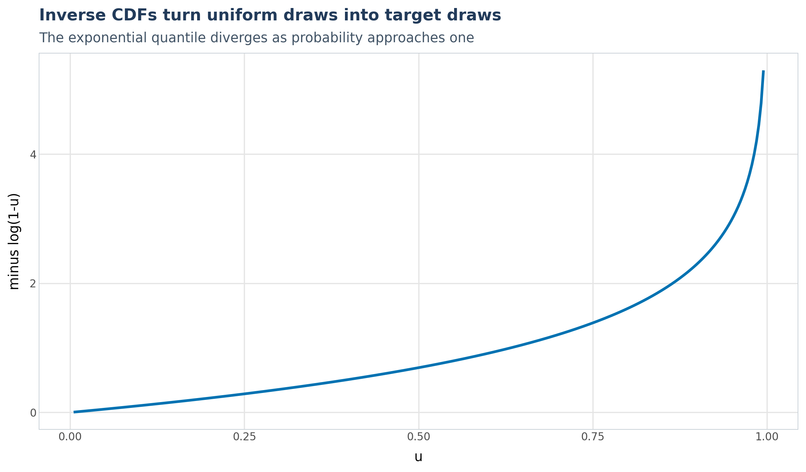

# Distributions and Transformations {#sec-pp-distributions}

Distribution families encode support, shape, and sampling mechanisms.
Transformations connect constrained quantities to unconstrained computation and
require Jacobian corrections in densities.

## Discrete and continuous families

Bernoulli and categorical distributions model alternatives; binomial and
multinomial distributions count repeated alternatives; Poisson models event
counts under a rate mechanism. Normal distributions model additive variation,
gamma and lognormal distributions positive scales, and beta distributions
probabilities.

A density integrates to probability:

$$
P(a<X<b)=\int_a^b p_X(x)\,dx.
$$

Its numerical value depends on units. A density can exceed one; only integrated
probability must lie in $[0,1]$.

Mixtures average distributions,
$p(x)=\sum_k w_kp_k(x)$, while hierarchical models draw parameters that induce
dependence among observations. A heavy-tailed marginal can arise from a scale
mixture of normals.

## Change of variables

For a one-to-one differentiable transform $Y=g(X)$,

$$
p_Y(y)=p_X(g^{-1}(y))
\left|\frac{d}{dy}g^{-1}(y)\right|.
$$

In several dimensions, use the absolute determinant of the inverse Jacobian.
The correction accounts for local volume change.

For positive $\sigma=e^\eta$,

$$
\log p_\eta(\eta)=\log p_\sigma(e^\eta)+\eta.
$$

The final term is the log-Jacobian. Omitting it changes the distribution, even
if forward values are transformed correctly.

For any positive-scale log density, the transformed log density is a function
composition plus the single Jacobian term `log_scale`.  The callback keeps the
original density visible and reusable.

```python
from collections.abc import Callable
from math import exp, isfinite

def transformed_log_density(
    log_scale: float,
    positive_scale_log_density: Callable[[float], float],
) -> float:
    """Evaluate log p_eta(eta) for sigma=exp(eta)."""
    if not isfinite(log_scale) or not -700.0 <= log_scale <= 700.0:
        raise ValueError("log_scale must lie in the finite exponential range")
    positive_scale = exp(log_scale)
    base_log_density = positive_scale_log_density(positive_scale)
    if not isfinite(base_log_density):
        raise ValueError("the original log density must be finite at exp(eta)")
    return base_log_density + log_scale

# Unit-rate exponential prior: log p_sigma(sigma) = -sigma for sigma > 0.
for log_scale in (-1.0, 0.0, 1.0):
    print(log_scale, transformed_log_density(log_scale, lambda scale: -scale))
```

The three values implement $-e^\eta+\eta$ exactly up to floating-point
rounding.  They do not check normalization over the full real line; that
follows from the change-of-variables theorem.

<figure id="fig-pp-transform">


<figcaption>

Figure 3.1: The inverse exponential CDF maps evenly spaced uniform probabilities into increasingly separated positive values.

</figcaption>
</figure>

Inverse-CDF simulation draws $U\sim\operatorname{Uniform}(0,1)$ and returns
$F^{-1}(U)$. Multivariate and discrete distributions may require other
samplers.

## Moments and existence

Expectation and variance need not exist. A Cauchy variable has no finite mean,
so reporting Monte Carlo averages with more digits does not estimate a
well-defined target. Quantiles remain meaningful.

Moment-generating functions can fail even when moments exist. Characteristic
functions $E[e^{itX}]$ always exist and determine distributions.

## Case clinic: a prior on time scale

If decay time $\tau$ must be positive, modeling $\eta=\log\tau$ with a normal
prior makes multiplicative changes symmetric. A one-unit increase in $\eta$
multiplies time by $e$. The induced median is $e^{E\eta}$, while its mean is
larger because of right skew. Simulate $\tau$ in seconds before calling the
prior weak or strong.

Changing from seconds to minutes shifts $\eta$ by $-\log 60$. A correctly
transformed model preserves physical predictions; reusing the same numeric
normal prior does not.

**Nonexample.** Applying a normal distribution directly to a scale allows
negative values. Truncating negative samples afterward does not produce the
same model as a lognormal or truncated-normal density.

<!-- inline-formula-code:start -->
## Formula and finite computation

The exponential inverse CDF with rate $\lambda$ is

$$
X=-\frac{\log(1-U)}{\lambda}.
$$

```python
from math import isfinite, log1p

def exponential_quantiles(uniforms: list[float], rate: float) -> list[float]:
    if not isfinite(rate) or rate <= 0.0:
        raise ValueError("rate must be finite and positive")
    if not uniforms or any(
        not isfinite(value) or not 0.0 < value < 1.0 for value in uniforms
    ):
        raise ValueError("uniforms must be nonempty, finite, and strictly inside (0,1)")
    return [-log1p(-value) / rate for value in uniforms]

print(exponential_quantiles([0.1, 0.5, 0.9, 0.99], 2.0))
```

**What the computation establishes.** Four exact formula evaluations generate
declared exponential quantiles up to floating-point rounding. They do not prove
the change-of-variables theorem or certify a random-number generator.
<!-- inline-formula-code:end -->

## Summary

Distribution choice includes support and mechanism, not only mean and variance.
Densities integrate to probabilities, mixtures and hierarchies differ, and
transforms require Jacobians. Moment existence must be checked before an
estimator is interpreted.

## Exercises

<div class="exercise" id="probabilistic_programming-03-distributions-transformations-ex-1">
<p class="exercise-title"><strong>Exercise 1</strong></p>

Normalize a geometric mass function.

</div>

<div class="exercise" id="probabilistic_programming-03-distributions-transformations-ex-2">
<p class="exercise-title"><strong>Exercise 2</strong></p>

Derive mean and variance of a Poisson variable.

</div>

<div class="exercise" id="probabilistic_programming-03-distributions-transformations-ex-3">
<p class="exercise-title"><strong>Exercise 3</strong></p>

Transform a uniform variable to an exponential variable.

</div>

<div class="exercise" id="probabilistic_programming-03-distributions-transformations-ex-4">
<p class="exercise-title"><strong>Exercise 4</strong></p>

Derive the log-Jacobian for a logistic transform to $(0,1)$.

<details class="solution"><summary>Solution</summary>

For Exercise 4, $p=(1+e^{-\eta})^{-1}$ has derivative
$p(1-p)$. Thus an unconstrained log density adds
$\log p+\log(1-p)$ to the constrained density evaluated at $p$.

</details>

</div>

<div class="exercise" id="probabilistic_programming-03-distributions-transformations-ex-5">
<p class="exercise-title"><strong>Exercise 5</strong></p>

Compare a mixture with a single matched normal.

</div>

<div class="exercise" id="probabilistic_programming-03-distributions-transformations-ex-6">
<p class="exercise-title"><strong>Exercise 6</strong></p>

Explain why Cauchy sample means are unstable.

</div>

### Selected solution

For Exercise 4, $p=(1+e^{-\eta})^{-1}$ has derivative
$p(1-p)$. Thus an unconstrained log density adds
$\log p+\log(1-p)$ to the constrained density evaluated at $p$.
