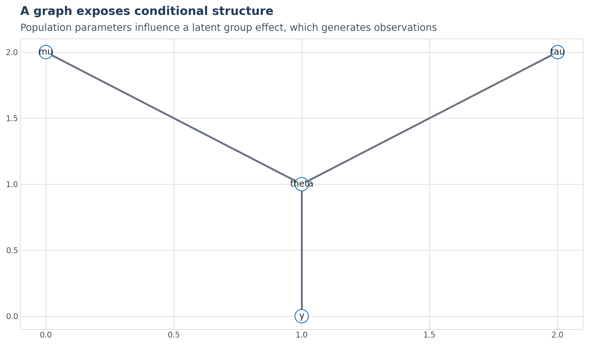

# Graphical Models and Conditional Independence {#sec-pp-graphs}

Graphs display which variables directly depend on which others. They compress a
joint factorization and make conditional-independence claims auditable before
computation.

## Directed acyclic graphs

For a directed acyclic graph with parents $\operatorname{pa}(v)$,

$$
p(x_1,\ldots,x_n)
=\prod_{v=1}^n p(x_v\mid x_{\operatorname{pa}(v)}).
$$

The local Markov property says a node is conditionally independent of its
nondescendants given its parents. Plates repeat nodes and edges; they are
notation for indexed factorization, not a new probability operation.

<figure id="fig-pp-dag">


<figcaption>

Figure 4.1: A hierarchical DAG makes population parameters, a latent group effect, and observations distinct nodes.

</figcaption>
</figure>

The arrows encode conditional distribution arguments, not necessarily causal
effects. A causal interpretation requires intervention assumptions and correct
graph structure.

## Chains, forks, and colliders

In a chain $X\to Z\to Y$ or fork $X\leftarrow Z\to Y$, conditioning on $Z$
blocks association along the path. In a collider
$X\to Z\leftarrow Y$, the path is blocked marginally but conditioning on $Z$ or
its descendant opens it. This collider reversal explains selection bias.

d-Separation applies these rules to every path. Under the graph factorization,
d-separation implies conditional independence. Extra parameter coincidences may
create independences not visible in the graph; faithfulness rules those out.

## Identifiability

A latent model is identifiable when distinct parameter values imply distinct
observable distributions, up to declared symmetries. Mixture component labels
can permute without changing likelihood. A graph can expose missing paths but
does not automatically prove numerical identifiability.

Factor graphs and undirected Markov random fields represent other
factorizations. Their normalizing constants can be intractable even when each
local factor is easy to evaluate.

## Case clinic: the sign of collider selection {#sec-pp-collider-sign}

Independent skill and personal connections can each increase admission, yet
their association among admitted people can be negative, zero, or positive.
The collider $X\to S\leftarrow Y$ permits selected association; its graph and
monotonicity alone do not determine the sign. Negative *explaining away*
requires a condition on the selection mechanism
([Mansournia et al. 2022](bibliography.md#ref-mansournia2022collider), discussion following Figure 2).

Let $X\sim\operatorname{Bernoulli}(p)$ and
$Y\sim\operatorname{Bernoulli}(q)$ be independent, with $0<p,q<1$. Write
$s_{xy}=P(S=1\mid X=x,Y=y)$ and assume $Z=P(S=1)>0$. Use cell order
**00, 01, 10, 11**, with $X$ first. Bayes' rule gives the selected table

$$
(a,b,c,d)=\frac1Z\bigl((1-p)(1-q)s_{00},\,
(1-p)qs_{01},\,p(1-q)s_{10},\,pqs_{11}\bigr).
$$

For any normalized binary table in this order, $E[X]=c+d$, $E[Y]=b+d$,
and $E[XY]=d$. Consequently,

$$
\operatorname{Cov}(X,Y\mid S=1)
=d-(c+d)(b+d)=ad-bc
=\frac{p(1-p)q(1-q)}{Z^2}
  (s_{00}s_{11}-s_{01}s_{10}).
$$

The middle equality uses $a+b+c+d=1$. The prefactor is positive, so the
selection cross-product contrast determines the sign. If all four selected
cells are positive, their odds ratio is

$$
\mathrm{OR}_{S=1}=\frac{ad}{bc}
=\frac{s_{00}s_{11}}{s_{01}s_{10}}.
$$

Thus negative association corresponds to $s_{00}s_{11}<s_{01}s_{10}$;
equality gives independence in this selected binary stratum. Monotonicity
does not impose that inequality. When cells vanish, the covariance identity
still holds; do not divide by a zero denominator to compute an odds ratio.

**Worked counterexample.** Set $p=q=1/2$ and
$(s_{00},s_{01},s_{10},s_{11})=(1/10,1/5,1/5,9/10)$. Each cause strictly
increases admission at either value of the other cause. But

$$
Z=7/20,\qquad (a,b,c,d)=(1,2,2,9)/14,\qquad
\operatorname{Cov}=5/196>0,\qquad \mathrm{OR}=9/4.
$$

Indeed, $P(X=1\mid Y=0,S=1)=2/3$ while
$P(X=1\mid Y=1,S=1)=9/11$. Here stronger connections predict higher skill
among admitted people, reversing the familiar negative explaining-away
story. The probabilities, rather than the collider drawing alone, decide
which story is correct. The [changed task](#sec-pp-collider-task) produces
all three signs with the same graph and strict monotonicity.

Selection on hospitalization, response, or a threshold can similarly create
association. Adding selection as an ordinary covariate can create rather
than remove bias; graph the sampling process as well as the outcome process.

**Nonexample.** “No arrow” does not always mean marginal independence. Two
nodes can be connected through ancestors or descendants. Read graph separation,
not isolated edge absence.

<!-- inline-formula-code:start -->
## Formula and finite computation

For $M\to T\to Y$, the binary joint factorizes as

$$
p(m,t,y)=p(m)p(t\mid m)p(y\mid t).
$$

```python
def binary_chain_joint_mass(
    upstream_state: int, mediator_state: int, outcome_state: int
) -> float:
    states = (upstream_state, mediator_state, outcome_state)
    if any(value not in (0, 1) for value in states):
        raise ValueError("states must be binary")
    upstream_mass = 0.4 if upstream_state else 0.6
    mediator_one_probability = 0.8 if upstream_state else 0.2
    outcome_one_probability = 0.9 if mediator_state else 0.1
    mediator_mass = (
        mediator_one_probability
        if mediator_state
        else 1.0 - mediator_one_probability
    )
    outcome_mass = (
        outcome_one_probability
        if outcome_state
        else 1.0 - outcome_one_probability
    )
    return upstream_mass * mediator_mass * outcome_mass

total = sum(
    binary_chain_joint_mass(upstream, mediator, outcome)
    for upstream in (0, 1)
    for mediator in (0, 1)
    for outcome in (0, 1)
)
print(total)
```

**What the computation establishes.** The eight-state finite joint normalizes
under the declared factors. It does not prove a graph is scientifically correct
or that an unobserved-variable model is identifiable.
<!-- inline-formula-code:end -->

## Exact finite collider certificate {#sec-pp-collider-certificate}

This certificate evaluates a **complete stipulated binary model**, including
the independent priors and all four selection probabilities. It computes
moments directly; the determinant identity above supplies an independent
check. Choose $S=0$ by complementing each selection probability. No drawn
graph alone supplies these numerical inputs.

```python
from fractions import Fraction

def binary_collider_reference(
    first_probability: int | Fraction,
    second_probability: int | Fraction,
    selection_probabilities: tuple[int | Fraction, ...],
    selected_state: int = 1,
) -> tuple[Fraction, tuple[Fraction, ...], Fraction,
           tuple[Fraction, Fraction], Fraction | None]:
    """Return stratum mass, cells, covariance, cross-products, and positive-cell OR."""
    if len(selection_probabilities) != 4:
        raise ValueError("use four selection cells in order 00, 01, 10, 11")
    values = (first_probability, second_probability, *selection_probabilities)
    if any(isinstance(value, bool) or not isinstance(value, (int, Fraction))
           for value in values):
        raise TypeError("use integers or Fraction values")
    if isinstance(selected_state, bool) or not isinstance(selected_state, int) \
            or selected_state not in (0, 1):
        raise ValueError("selected_state must be integer zero or one")
    first_probability, second_probability = map(Fraction, values[:2])
    selection_probabilities = tuple(map(Fraction, values[2:]))
    if not 0 < first_probability < 1 or not 0 < second_probability < 1:
        raise ValueError("independent prior probabilities must lie strictly in (0, 1)")
    if any(not 0 <= value <= 1 for value in selection_probabilities):
        raise ValueError("selection probabilities must lie in [0, 1]")
    states = ((0, 0), (0, 1), (1, 0), (1, 1))
    weights = []
    for (first, second), selection in zip(states, selection_probabilities, strict=True):
        prior_mass = first_probability if first else 1 - first_probability
        prior_mass *= second_probability if second else 1 - second_probability
        selected_mass = selection if selected_state else 1 - selection
        weights.append(prior_mass * selected_mass)
    stratum_mass = sum(weights)
    if stratum_mass == 0:
        raise ValueError("the selected stratum must have positive probability")
    cells = tuple(weight / stratum_mass for weight in weights)
    first_mean = sum(first * cell for (first, second), cell in zip(states, cells))
    second_mean = sum(second * cell for (first, second), cell in zip(states, cells))
    cross_mean = sum(first * second * cell
                     for (first, second), cell in zip(states, cells))
    covariance = cross_mean - first_mean * second_mean
    cross_products = (cells[0] * cells[3], cells[1] * cells[2])
    odds_ratio = cross_products[0] / cross_products[1] if all(cells) else None
    return stratum_mass, cells, covariance, cross_products, odds_ratio

print(binary_collider_reference(
    Fraction(1, 2), Fraction(1, 2),
    (Fraction(1, 10), Fraction(1, 5), Fraction(1, 5), Fraction(9, 10)),
))
```

The output gives the worked stratum mass, table, covariance, cross-products
$(9/196,4/196)$, and odds ratio $9/4$. The conservative API reports an
odds ratio only when every selected cell is positive; `None` outside that
contract is **not** a claim of zero association. A mathematical ratio can
still be zero when its numerator is zero and its denominator is positive.
The exact cross-products and covariance remain available at every admitted
boundary. This finite computation does not infer a mechanism from data or
establish a graph's causal interpretation.

Use the [determinant proof](#sec-pp-collider-sign) to interpret the computed
sign.

## Summary

DAGs encode joint factorization and conditional independence. Chains and forks
are blocked by conditioning; colliders are opened. Plates express repetition,
while identifiability and causal meaning require additional arguments beyond
the drawn graph.

## Exercises {#sec-pp-collider-task}

<div class="exercise" id="probabilistic_programming-04-graphical-models-independence-ex-1">
<p class="exercise-title"><strong>Exercise 1</strong></p>

Factor a four-node DAG.

</div>

<div class="exercise" id="probabilistic_programming-04-graphical-models-independence-ex-2">
<p class="exercise-title"><strong>Exercise 2</strong></p>

List independences implied by a chain.

<details class="solution"><summary>Solution</summary>

For Exercise 2, in $X\to Z\to Y$, the graph implies
$X\perp Y\mid Z$. Marginal independence is not implied because variation in
$X$ changes $Z$, which changes $Y$.

</details>

</div>

<div class="exercise" id="probabilistic_programming-04-graphical-models-independence-ex-3">
<p class="exercise-title"><strong>Exercise 3</strong></p>

Explain what a collider graph permits. Under independent binary priors,
derive the determinant sign criterion and show why monotone selection
alone does not imply negative association.

<details class="solution"><summary>Solution</summary>

For Exercise 3, the selected binary covariance is $ad-bc$, obtained by
expanding $d-(c+d)(b+d)$ and using normalization. Independent prior factors
give the positive prefactor times $s_{00}s_{11}-s_{01}s_{10}$. The worked
strictly monotone mechanism has a positive contrast and covariance $5/196$,
so a graph and monotonicity alone do not determine a negative sign.

</details>

</div>

<div class="exercise" id="probabilistic_programming-04-graphical-models-independence-ex-4">
<p class="exercise-title"><strong>Exercise 4</strong></p>

Normalize the finite joint in the code by hand.

</div>

<div class="exercise" id="probabilistic_programming-04-graphical-models-independence-ex-5">
<p class="exercise-title"><strong>Exercise 5</strong></p>

Draw a plate for repeated group observations.

</div>

<div class="exercise" id="probabilistic_programming-04-graphical-models-independence-ex-6">
<p class="exercise-title"><strong>Exercise 6</strong></p>

Give a label-switching nonidentifiability example.

</div>

<div class="exercise" id="probabilistic_programming-04-graphical-models-independence-ex-7">
<p class="exercise-title"><strong>Exercise 7</strong></p>

**Changed task.** Let $X\sim\operatorname{Bernoulli}(1/3)$ and
$Y\sim\operatorname{Bernoulli}(2/3)$ independently, and for $1/2<t<1$
set $(s_{00},s_{01},s_{10},s_{11})=(1/4,1/3,1/2,t)$. Verify strict
monotonicity in each cause. Derive the admitted stratum's mass, four-cell
distribution, covariance, and odds ratio as functions of $t$, and find
the sign threshold. Evaluate the mass, covariance, and odds ratio at
$t=3/5,2/3,3/4$. Finally, at $t=2/3$, compute the nonadmitted table,
covariance, and odds ratio. Does independence among admitted people imply
$X\perp Y\mid S$?

Try the changed task before its [hint](#sec-pp-collider-hint) and
[explanation](#sec-pp-collider-solution).

<details class="solution"><summary>Solution</summary>

For Exercise 7, strict monotonicity follows from $1/4<1/3$, $1/4<1/2$,
and $t>1/2>1/3$. The unnormalized admitted cells are $(3,8,3,12t)/54$,
so

$$
Z=\frac{7+6t}{27},\qquad
(a,b,c,d)=\frac{(3,8,3,12t)}{14+12t},\qquad
\operatorname{Cov}=\frac{3(3t-2)}{(7+6t)^2},\qquad
\mathrm{OR}=\frac{3t}{2}.
$$

The sign changes at $t=2/3$.

| $t$ | Stratum mass $Z$ | Covariance given $S=1$ | Odds ratio given $S=1$ |
|:--|:--|:--|:--|
| $3/5$ | $53/135$ | $-15/2809$ | $9/10$ |
| $2/3$ | $11/27$ | $0$ | $1$ |
| $3/4$ | $23/54$ | $3/529$ | $9/8$ |

At $t=2/3$, nonadmission has probability $16/27$ and conditional table
$(9,16,3,4)/32$, giving covariance $-3/256$ and odds ratio $3/4$.
The admitted stratum is independent but the nonadmitted stratum is not;
therefore $X\not\perp Y\mid S$. Cancellation in one stratum does not
establish the random-variable conditional independence excluded by the
earlier faithfulness discussion. Use the [exact certificate](#sec-pp-collider-certificate)
to check each stipulated table, and the [determinant proof](#sec-pp-collider-sign)
to explain why the sign can change.

</details>

</div>

### Hint for the changed task {#sec-pp-collider-hint}

Multiply prior cells by selection probabilities before normalizing. For a
normalized binary table use covariance $ad-bc$ and positive-cell odds ratio
$ad/(bc)$. For nonadmission replace each $s_{xy}$ by $1-s_{xy}$.
Independence conditional on the random variable $S$ requires factorization
at both values of $S$ having positive probability. Compare with the
[selected solution](#sec-pp-collider-solution).

### Selected solution {#sec-pp-collider-solution}

For Exercise 2, in $X\to Z\to Y$, the graph implies
$X\perp Y\mid Z$. Marginal independence is not implied because variation in
$X$ changes $Z$, which changes $Y$.

For Exercise 3, the selected binary covariance is $ad-bc$, obtained by
expanding $d-(c+d)(b+d)$ and using normalization. Independent prior factors
give the positive prefactor times $s_{00}s_{11}-s_{01}s_{10}$. The worked
strictly monotone mechanism has a positive contrast and covariance $5/196$,
so a graph and monotonicity alone do not determine a negative sign.

For Exercise 7, strict monotonicity follows from $1/4<1/3$, $1/4<1/2$,
and $t>1/2>1/3$. The unnormalized admitted cells are $(3,8,3,12t)/54$,
so

$$
Z=\frac{7+6t}{27},\qquad
(a,b,c,d)=\frac{(3,8,3,12t)}{14+12t},\qquad
\operatorname{Cov}=\frac{3(3t-2)}{(7+6t)^2},\qquad
\mathrm{OR}=\frac{3t}{2}.
$$

The sign changes at $t=2/3$.

| $t$ | Stratum mass $Z$ | Covariance given $S=1$ | Odds ratio given $S=1$ |
|:--|:--|:--|:--|
| $3/5$ | $53/135$ | $-15/2809$ | $9/10$ |
| $2/3$ | $11/27$ | $0$ | $1$ |
| $3/4$ | $23/54$ | $3/529$ | $9/8$ |

At $t=2/3$, nonadmission has probability $16/27$ and conditional table
$(9,16,3,4)/32$, giving covariance $-3/256$ and odds ratio $3/4$.
The admitted stratum is independent but the nonadmitted stratum is not;
therefore $X\not\perp Y\mid S$. Cancellation in one stratum does not
establish the random-variable conditional independence excluded by the
earlier faithfulness discussion. Use the [exact certificate](#sec-pp-collider-certificate)
to check each stipulated table, and the [determinant proof](#sec-pp-collider-sign)
to explain why the sign can change.
