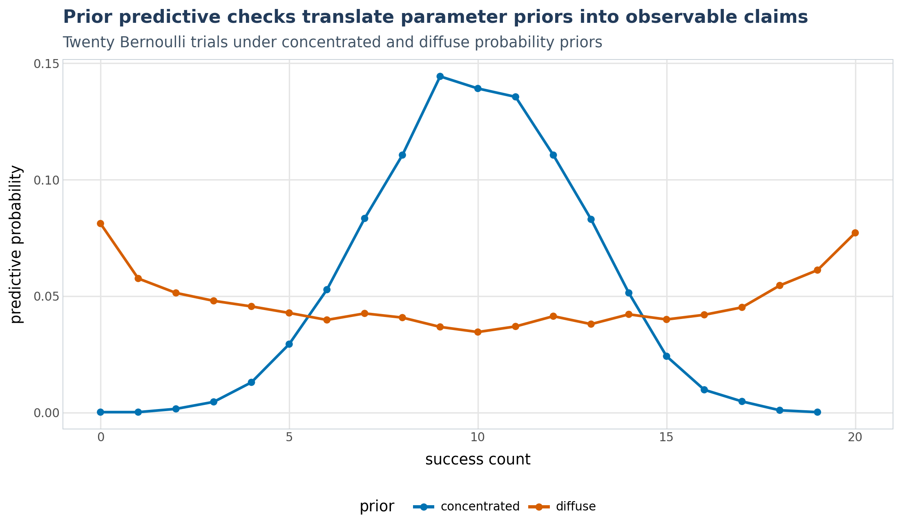

# Bayesian Workflow {#sec-pp-workflow}

Inference is one stage of model building. A reliable workflow begins with
observable implications, tests computation on simulated truth, checks the
fitted model against data, and revises assumptions without hiding the search.

## Prior predictive checks

Before observing $y$, the prior predictive distribution is

$$
p(y)=\int p(y\mid\theta)p(\theta)\,d\theta.
$$

It translates a parameter prior into claims about measurements. Check units,
ranges, dependence, and rare events in the data scale. A seemingly vague prior
on a regression coefficient can imply near-deterministic probabilities after a
nonlinear link.

<figure id="fig-pp-prior-predictive">


<figcaption>

Figure 5.1: Two priors centered at the same probability produce radically different prior-predictive success counts.

</figcaption>
</figure>

Prior predictive simulation should be performed before tuning to the observed
outcome. It is a design and model-understanding tool, not a pass/fail ritual.

## Simulation-based recovery

Choose parameters from the prior or a scientifically relevant grid, simulate
data, fit the model, and ask whether the procedure recovers calibrated
uncertainty. This detects coding mistakes, weak identification, and algorithmic
failure under known truth.

Recovery of every individual parameter is not always expected. Prediction or a
lower-dimensional estimand can be identifiable when latent components are not.

## Posterior predictive checks

Posterior predictive replication draws

$$
\theta^{(s)}\sim p(\theta\mid y),\qquad
y_{\mathrm{rep}}^{(s)}\sim p(y_{\mathrm{rep}}\mid\theta^{(s)}).
$$

Compare summaries that probe assumptions: tails, zero frequency, group spread,
time autocorrelation, or residual pattern. Using the same data for fitting and
checking makes posterior predictive checks conservative for some discrepancies;
they still expose large mismatches.

## Sensitivity and revision

Vary reasonable priors, likelihood families, missing-data assumptions, and
outlier mechanisms. Report which conclusions move. If the model is revised
after seeing checks, document the revision and reserve new or held-out evidence
when confirmatory claims matter.

## A workflow ledger

For each revision, retain the original model, failed check, scientific
explanation, exact change, and a new check not used to motivate the change.
This prevents reasonable local edits from becoming invisible overfitting. It
also distinguishes computational repair, such as noncentering an unchanged
hierarchy, from a changed joint distribution.

Fake-data tests belong in continuous integration. Include interior, boundary,
weak-information, missing-data, and outlier cases, with exact or conjugate
references whenever available.

**Nonexample.** A posterior predictive mean matching the observed mean does not
validate a model whose mean parameter was fitted to that data. Check features
not mechanically forced by estimation.

<!-- inline-formula-code:start -->
## Formula and finite computation

Prior predictive simulation follows

$$
p(y)=\int p(y\mid p)p(p)\,dp.
$$

```python
import numpy as np

def prior_predictive_counts(
    alpha: float, beta: float, trials: int, replications: int, seed: int
) -> list[int]:
    if min(alpha, beta) <= 0.0 or min(trials, replications) <= 0:
        raise ValueError("shapes, trials, and replications must be positive")
    rng = np.random.default_rng(seed)
    probabilities = rng.beta(alpha, beta, size=replications)
    return rng.binomial(trials, probabilities).tolist()

counts = prior_predictive_counts(2.0, 2.0, 20, 5_000, 14)
print(min(counts), sum(counts) / len(counts), max(counts))
```

**What the computation establishes.** Finite simulations summarize one
Beta–binomial prior predictive distribution. They do not decide whether its
range is scientifically plausible or prove Monte Carlo convergence.
<!-- inline-formula-code:end -->

## Summary

Workflow surrounds posterior computation with prior predictive checks,
simulation recovery, posterior predictive criticism, and sensitivity analysis.
Checks target assumptions in observable units. Revision is expected, but its
data dependence must be documented.

## Exercises

<div class="exercise" id="probabilistic_programming-05-bayesian-workflow-ex-1">
<p class="exercise-title"><strong>Exercise 1</strong></p>

Design checks for a Poisson count model.

<details class="solution"><summary>Solution</summary>

For Exercise 1, inspect zero frequency, mean–variance relation, upper-tail
counts, and repeated-measure dependence. Matching only the mean cannot detect
overdispersion or excess zeros.

</details>

</div>

<div class="exercise" id="probabilistic_programming-05-bayesian-workflow-ex-2">
<p class="exercise-title"><strong>Exercise 2</strong></p>

Simulate parameter recovery for a Bernoulli model.

</div>

<div class="exercise" id="probabilistic_programming-05-bayesian-workflow-ex-3">
<p class="exercise-title"><strong>Exercise 3</strong></p>

Choose a tail-sensitive predictive statistic.

</div>

<div class="exercise" id="probabilistic_programming-05-bayesian-workflow-ex-4">
<p class="exercise-title"><strong>Exercise 4</strong></p>

Contrast prior and posterior predictive checks.

</div>

<div class="exercise" id="probabilistic_programming-05-bayesian-workflow-ex-5">
<p class="exercise-title"><strong>Exercise 5</strong></p>

Give an identifiable prediction with nonidentifiable parameters.

</div>

<div class="exercise" id="probabilistic_programming-05-bayesian-workflow-ex-6">
<p class="exercise-title"><strong>Exercise 6</strong></p>

Write a revision log for an overdispersed count model.

</div>

### Selected solution

For Exercise 1, inspect zero frequency, mean–variance relation, upper-tail
counts, and repeated-measure dependence. Matching only the mean cannot detect
overdispersion or excess zeros.
