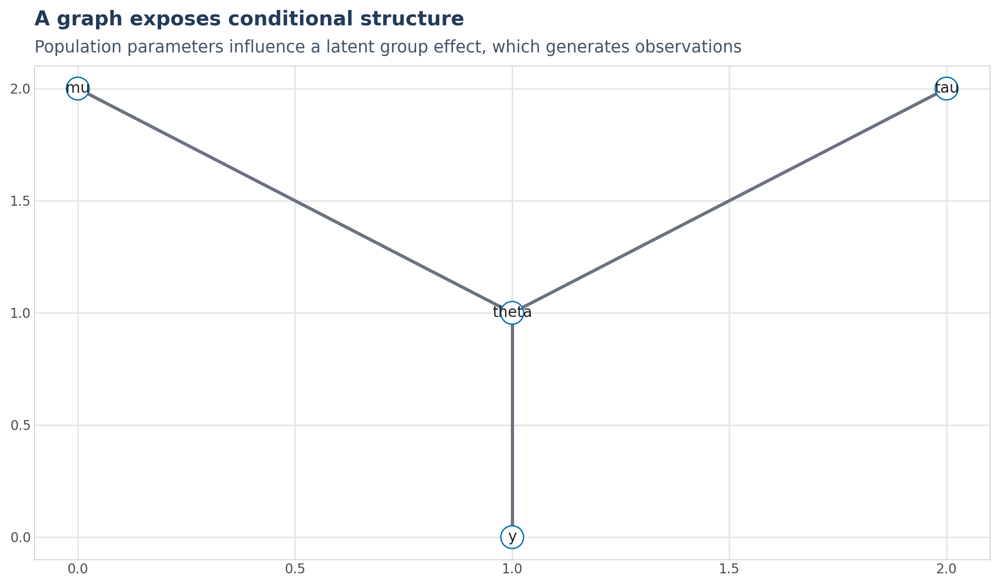

# Traces and Density Semantics {#sec-pp-semantics}

A probabilistic program may take different random branches and create different
sets of latent choices. A **trace** records the address, value, and distribution
of each random choice so that execution can be assigned a joint weight.

## Sample and observe

A sample statement adds a random variable to the trace. An observe statement
fixes a value and contributes its log density. Deterministic statements
transform existing values but add no probability unless a change of random
coordinates requires a Jacobian.

For a fixed trace $z=(z_1,\ldots,z_m)$ and observations $y$,

$$
\log p(z,y)
=\sum_{j=1}^m\log p(z_j\mid z_{<j})
+\sum_i\log p(y_i\mid z).
$$

Addresses distinguish repeated or branch-specific choices. They must remain
stable enough for an inference engine to compare related executions.

## Conditioning and support

Inference targets $p(z\mid y)$, which is proportional to the joint. A trace
outside support has log density $-\infty$. Support can depend on earlier random
choices; trans-dimensional programs then require proposals that account for
created and removed variables.

Two programs can induce the same observable distribution while using different
latent parameterizations. Their inference geometry can differ dramatically.
Centered and noncentered hierarchical forms are a central example.

<figure id="fig-pp-trace-dag">


<figcaption>

Figure 6.1: The DAG is one static trace template; stochastic control flow can create a family of such dependency structures.

</figcaption>
</figure>

## Density versus simulator semantics

Some programs can simulate but cannot evaluate a tractable likelihood. Approximate
Bayesian computation, neural likelihoods, or other likelihood-free methods use
additional approximation. Conversely, an unnormalized density may be evaluable
without a direct sampler.

Measure-theoretic semantics matter when continuous and discrete choices mix.
A “density” is always relative to a reference measure. Rewriting a program on
new coordinates changes that density by a Radon–Nikodym or Jacobian factor.

## Program transformations

Marginalizing a discrete variable replaces branches by a log-sum-exp factor.
Reparameterizing a continuous variable replaces its trace coordinate and adds
a Jacobian. Rao–Blackwellization replaces a sampled quantity by a conditional
expectation. Each transformation may preserve the intended marginal target
while changing variance and geometry.

State equivalence precisely: equality of joint laws, equality after removing an
auxiliary variable, or equality of one predictive distribution. Identical
observable simulators need not give corresponding meanings to internal states.

**Nonexample.** Multiplying branch probabilities after observing which branch
ran, while omitting the probability of choosing that branch, gives the wrong
trace weight.

<!-- inline-formula-code:start -->
## Formula and finite computation

A finite trace log joint is

$$
\log p(z,y)=\sum_r\log p_r.
$$

```python
from math import log

def trace_log_joint(probability_factors: list[float]) -> float:
    if not probability_factors or any(not 0.0 < value <= 1.0 for value in probability_factors):
        raise ValueError("factors must be a nonempty list in (0,1]")
    return sum(log(value) for value in probability_factors)

# branch choice, latent choice given branch, observed likelihood
print(trace_log_joint([0.3, 0.8, 0.65]))
```

**What the computation establishes.** Three declared finite mass factors are
combined stably on the log scale. The code does not infer trace addresses,
choose a reference measure, or validate a stochastic-control-flow semantics.
<!-- inline-formula-code:end -->

## Summary

Traces make random choices and their addresses explicit. Sample and observe
factors form a joint log density, while deterministic transforms need
coordinate corrections when they reparameterize randomness. Simulator-only,
density-only, and trans-dimensional programs require different inference
machinery.

## Exercises

<div class="exercise" id="probabilistic_programming-06-traces-density-semantics-ex-1">
<p class="exercise-title"><strong>Exercise 1</strong></p>

Write a trace for a two-component mixture observation.

<details class="solution"><summary>Solution</summary>

For Exercise 1, record component label $z$, component parameter choices if
random, and observed $y$. The joint factor is
$p(z)p(y\mid z,\theta)$ times any prior factors for $\theta$.

</details>

</div>

<div class="exercise" id="probabilistic_programming-06-traces-density-semantics-ex-2">
<p class="exercise-title"><strong>Exercise 2</strong></p>

Include branch-choice probability in its joint mass.

</div>

<div class="exercise" id="probabilistic_programming-06-traces-density-semantics-ex-3">
<p class="exercise-title"><strong>Exercise 3</strong></p>

Compare centered and noncentered trace variables.

</div>

<div class="exercise" id="probabilistic_programming-06-traces-density-semantics-ex-4">
<p class="exercise-title"><strong>Exercise 4</strong></p>

Explain why continuous density depends on reference measure.

</div>

<div class="exercise" id="probabilistic_programming-06-traces-density-semantics-ex-5">
<p class="exercise-title"><strong>Exercise 5</strong></p>

Give a simulator with an intractable likelihood.

</div>

<div class="exercise" id="probabilistic_programming-06-traces-density-semantics-ex-6">
<p class="exercise-title"><strong>Exercise 6</strong></p>

Identify address collisions in a loop with stochastic length.

</div>

### Selected solution

For Exercise 1, record component label $z$, component parameter choices if
random, and observed $y$. The joint factor is
$p(z)p(y\mid z,\theta)$ times any prior factors for $\theta$.
