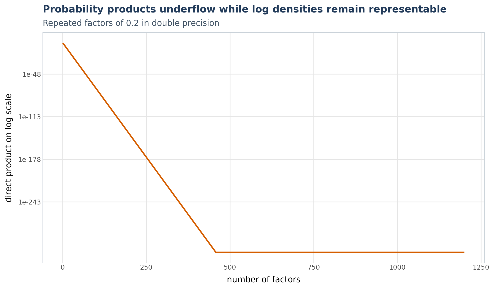

# Constraints, Stable Densities, and Automatic Differentiation {#sec-pp-numerics}

Inference algorithms repeatedly evaluate log densities and gradients in regions
of widely varying probability. Numerical representation is part of the
mathematics: underflow, support violations, and missing Jacobians change the
target.

## Log-sum-exp

For log values $a_i$,

$$
\log\sum_i e^{a_i}
=m+\log\sum_i e^{a_i-m},
\qquad m=\max_i a_i.
$$

Subtracting $m$ makes every exponential at most one. The identity is exact;
only floating-point evaluation is approximate.

<figure id="fig-pp-underflow">


<figcaption>

Figure 7.1: A product of repeated probability factors underflows even though its accumulated log value remains finite and informative.

</figcaption>
</figure>

Normalize log weights with log-sum-exp, compute
$\log(1-p)$ using a stable log-one-minus function near one, and avoid
subtracting nearly equal CDF values when tail-specific functions exist.

## Unconstraining transforms

Gradient algorithms work naturally in $\mathbb R^d$. Positive variables use
exponentials; probabilities use logistic transforms; simplexes use
stick-breaking or softmax coordinates; ordered vectors use cumulative positive
increments. The unconstrained target includes the log absolute Jacobian.

Boundary behavior matters. A posterior concentrated near probability zero can
be far into the negative logistic coordinate, producing strong curvature.

## Automatic differentiation

Forward AD propagates values and directional derivatives; reverse AD propagates
output sensitivities backward through a computational graph. For scalar log
density with many parameters, reverse mode usually has the favorable
input/output shape.

AD gives derivatives of the executed program. It does not make discontinuous
branches differentiable, repair an unstable formula, or choose a meaningful
parameterization. Compare a few directional derivatives to finite differences
across a range of step sizes.

## Precision and support

Return negative infinity for genuinely impossible support, not for ordinary
recoverable numerical errors. A sampler that frequently hits support boundaries
may need a transformation or a different proposal. NaN values should fail with
context rather than be silently treated as rejection.

## Gradient audit

At a point away from support boundaries, compare the AD directional derivative
$\nabla\ell(\theta)^Tv$ with centered differences for geometrically decreasing
steps. Large steps show truncation and tiny steps cancellation; an intermediate
agreement region is expected. Repeat in important high-curvature regions.

This tests the derivative of the implemented density. It cannot expose a
missing likelihood term or Jacobian if both the implementation and comparison
omit it. Pair numerical checks with hand-derived small cases.

**Nonexample.** Clipping a probability to $10^{-6}$ and $1-10^{-6}$ changes
the model. A logit parameterization preserves the open interval without an
arbitrary hard plateau.

<!-- inline-formula-code:start -->
## Formula and finite computation

Stable log-sum-exp is

$$
\operatorname{LSE}(a)=m+\log\sum_i e^{a_i-m}.
$$

```python
from math import exp, isfinite, log

def log_sum_exp(values: list[float]) -> float:
    if not values or any(not isfinite(value) for value in values):
        raise ValueError("values must be nonempty and finite")
    maximum = max(values)
    return maximum + log(sum(exp(value - maximum) for value in values))

logs = [-1_000.0, -1_001.0, -1_004.0]
print(log_sum_exp(logs))
```

**What the computation establishes.** A finite log sum is evaluated without
underflow for three extreme inputs. The identity does not validate the density
factors or guarantee stable gradients throughout an inference program.
<!-- inline-formula-code:end -->

## Summary

Log-scale identities prevent underflow, unconstraining maps expose Euclidean
coordinates and require Jacobians, and automatic differentiation computes exact
program derivatives up to floating-point arithmetic. Stable evaluation,
mathematical support, and model parameterization remain separate concerns.

## Exercises

<div class="exercise" id="probabilistic_programming-07-constraints-numerics-autodiff-ex-1">
<p class="exercise-title"><strong>Exercise 1</strong></p>

Derive log-sum-exp by factoring out the maximum.

</div>

<div class="exercise" id="probabilistic_programming-07-constraints-numerics-autodiff-ex-2">
<p class="exercise-title"><strong>Exercise 2</strong></p>

Normalize three log weights stably.

<details class="solution"><summary>Solution</summary>

For Exercise 2, compute $L=\operatorname{LSE}(a)$ and weights
$w_i=e^{a_i-L}$. Their sum is one algebraically; subtracting the maximum keeps
the exponentials representable.

</details>

</div>

<div class="exercise" id="probabilistic_programming-07-constraints-numerics-autodiff-ex-3">
<p class="exercise-title"><strong>Exercise 3</strong></p>

Derive logistic-transform Jacobian.

</div>

<div class="exercise" id="probabilistic_programming-07-constraints-numerics-autodiff-ex-4">
<p class="exercise-title"><strong>Exercise 4</strong></p>

Compare forward and reverse AD costs.

</div>

<div class="exercise" id="probabilistic_programming-07-constraints-numerics-autodiff-ex-5">
<p class="exercise-title"><strong>Exercise 5</strong></p>

Design a finite-difference directional check.

</div>

<div class="exercise" id="probabilistic_programming-07-constraints-numerics-autodiff-ex-6">
<p class="exercise-title"><strong>Exercise 6</strong></p>

Explain why clipping changes a posterior target.

</div>

### Selected solution

For Exercise 2, compute $L=\operatorname{LSE}(a)$ and weights
$w_i=e^{a_i-L}$. Their sum is one algebraically; subtracting the maximum keeps
the exponentials representable.
