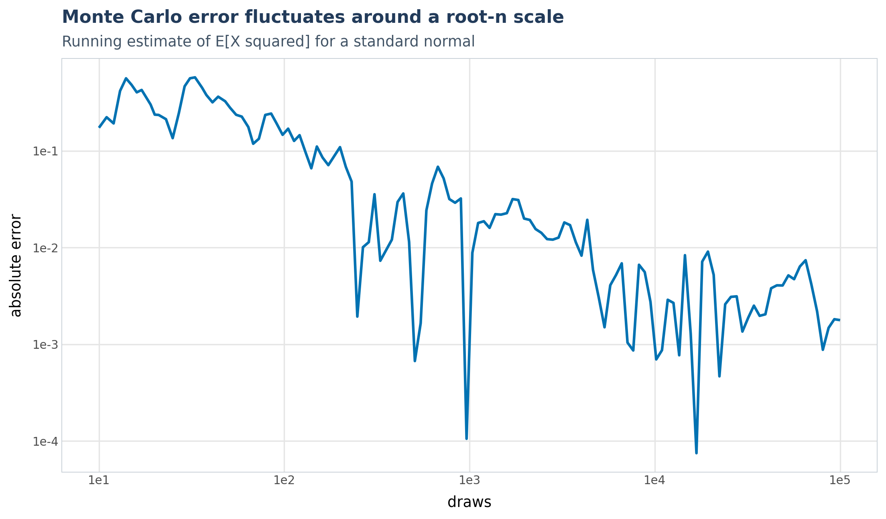

# Direct Monte Carlo {#sec-pp-monte-carlo}

When independent draws from a target distribution are available, expectations
become averages. This simplest Monte Carlo setting supplies the error language
needed for every later sampler.

## Estimation and uncertainty

For $X_i$ independently distributed as $p$,

$$
\widehat\mu_N=\frac1N\sum_{i=1}^Nh(X_i),
\qquad
\operatorname{Var}(\widehat\mu_N)=\frac{\operatorname{Var}(h(X))}{N}.
$$

The standard error decays as $N^{-1/2}$. Gaining one extra decimal digit
typically requires one hundred times the draws. The Central Limit Theorem gives
an approximate normal error distribution when variance is finite.

<figure id="fig-pp-mc-convergence">


<figcaption>

Figure 8.1: A running second-moment estimate fluctuates while its overall error scale decreases roughly with the square root of draw count.

</figcaption>
</figure>

Running averages are correlated across the horizontal axis because each reuses
earlier draws. The curve is one realization, not a deterministic convergence
rate.

## Variance reduction

Antithetic sampling pairs negatively correlated evaluations while preserving
the target marginal. Control variates use a correlated quantity $C$ with known
mean:

$$
\widehat\mu_{\mathrm{cv}}
=\overline h-\beta(\overline C-\mathbb EC).
$$

The variance-minimizing coefficient is
$\beta=\operatorname{Cov}(h,C)/\operatorname{Var}(C)$. Estimating it from the
same simulation needs an uncertainty audit.

Stratified sampling allocates draws across regions; Rao–Blackwellization
replaces a noisy quantity by a conditional expectation. Quasi-Monte Carlo uses
low-discrepancy deterministic points and has different error theory.

## Reproducible simulation

Use independent generator streams for replications, record seeds and draw
counts, and avoid resetting a seed inside a function called repeatedly.
Vectorization changes performance, not the probability law, if draws remain
correct.

## Error budgets and stopping

Choose a tolerance on the estimand's scale before simulation. Continue until
estimated MCSE is small enough only when the variance estimate has stabilized
and the target has finite variance. Rare probabilities often need relative
error. A zero-event estimate has a misleading plug-in error of zero; use
binomial bounds or a targeted importance method.

Increasing draws reduces Monte Carlo error, not posterior uncertainty about an
unknown quantity. Report those two scales separately.

**Nonexample.** Reporting the sample standard deviation of $h(X_i)$ as the
uncertainty of the mean omits division by $\sqrt N$; reporting only the
standard error hides the spread of individual outcomes.

<!-- inline-formula-code:start -->
## Formula and finite computation

The Monte Carlo standard error estimate is

$$
\widehat{\operatorname{SE}}(\widehat\mu)
=\frac{s_h}{\sqrt N}.
$$

```python
from math import sqrt
import numpy as np

def normal_second_moment(draws: int, seed: int) -> tuple[float, float]:
    if draws < 2 or draws > 10_000_000:
        raise ValueError("draws must be between 2 and 10000000")
    rng = np.random.default_rng(seed)
    values = rng.normal(size=draws) ** 2
    estimate = float(values.mean())
    standard_error = float(values.std(ddof=1) / sqrt(draws))
    return estimate, standard_error

print(normal_second_moment(20_000, 301))
```

**What the computation establishes.** One finite estimate of the exact target
$E[X^2]=1$ and its iid standard-error estimate are returned. The CLT
approximation and variance formula require their probabilistic proofs.
<!-- inline-formula-code:end -->

## Summary

Direct Monte Carlo estimates expectations with iid averages and root-draw-count
uncertainty. Control variates, stratification, antithetics, and conditional
expectations can reduce variance without changing the target. Seeds reproduce
finite output but do not certify accuracy.

## Exercises

<div class="exercise" id="probabilistic_programming-08-direct-monte-carlo-ex-1">
<p class="exercise-title"><strong>Exercise 1</strong></p>

Derive variance of an iid average.

<details class="solution"><summary>Solution</summary>

For Exercise 1, independence makes covariances vanish, so the variance of the
sum is $N\sigma^2$. Dividing the sum by $N$ divides variance by $N^2$, leaving
$\sigma^2/N$.

</details>

</div>

<div class="exercise" id="probabilistic_programming-08-direct-monte-carlo-ex-2">
<p class="exercise-title"><strong>Exercise 2</strong></p>

Estimate a normal tail probability and its standard error.

</div>

<div class="exercise" id="probabilistic_programming-08-direct-monte-carlo-ex-3">
<p class="exercise-title"><strong>Exercise 3</strong></p>

Build an antithetic estimator for a monotone function of a uniform draw.

</div>

<div class="exercise" id="probabilistic_programming-08-direct-monte-carlo-ex-4">
<p class="exercise-title"><strong>Exercise 4</strong></p>

Derive the optimal control-variate coefficient.

</div>

<div class="exercise" id="probabilistic_programming-08-direct-monte-carlo-ex-5">
<p class="exercise-title"><strong>Exercise 5</strong></p>

Compare sample spread and Monte Carlo standard error.

</div>

<div class="exercise" id="probabilistic_programming-08-direct-monte-carlo-ex-6">
<p class="exercise-title"><strong>Exercise 6</strong></p>

Explain what fails for infinite-variance integrands.

</div>

### Selected solution

For Exercise 1, independence makes covariances vanish, so the variance of the
sum is $N\sigma^2$. Dividing the sum by $N$ divides variance by $N^2$, leaving
$\sigma^2/N$.
