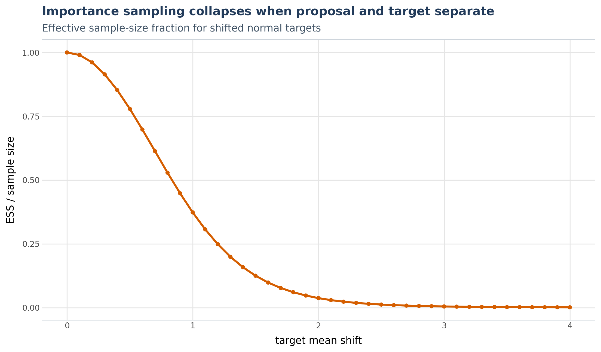

# Rejection and Importance Sampling {#sec-pp-importance}

When direct target draws are unavailable, a proposal distribution can generate
candidates. Rejection sampling turns some candidates into exact independent
target draws; importance sampling keeps them all but reweights their
contributions.

## Rejection sampling

Suppose target density $p$ and proposal $q$ satisfy

$$
p(x)\le Mq(x)\quad\text{for every }x.
$$

Draw $X\sim q$ and $U\sim\operatorname{Uniform}(0,1)$; accept when
$U\le p(X)/(Mq(X))$. Accepted values have density $p$, and acceptance
probability is $1/M$ for normalized $p$.

The envelope must hold globally. Checking it on a grid is insufficient when
tails or sharp modes are unresolved.

## Importance sampling

For support covering the target,

$$
E_p[h(X)]
=E_q\left[h(X)\frac{p(X)}{q(X)}\right].
$$

With unnormalized target $\widetilde p$, self-normalized importance sampling
uses

$$
\widehat\mu
=\frac{\sum_iw_ih(X_i)}{\sum_iw_i},
\qquad w_i=\frac{\widetilde p(X_i)}{q(X_i)}.
$$

This estimator is biased at finite $N$ but consistent under conditions.
Compute weights on the log scale.

An empirical effective sample size diagnostic is

$$
\operatorname{ESS}
=\frac{(\sum_iw_i)^2}{\sum_iw_i^2}.
$$

The estimator and ESS should be computed from the same normalized weights.  A
max-shift makes exponentiation stable without changing any normalized ratio.

```python
from math import exp, isfinite

def self_normalized_importance(
    values: list[float], log_weights: list[float]
) -> tuple[float, float]:
    """Return the self-normalized estimate and empirical effective sample size."""
    if not values or len(values) != len(log_weights):
        raise ValueError("values and log_weights must be nonempty and equally long")
    if any(not isfinite(value) for value in values + log_weights):
        raise ValueError("values and log_weights must be finite")
    maximum_log_weight = max(log_weights)
    raw_weights = [exp(weight - maximum_log_weight) for weight in log_weights]
    total_weight = sum(raw_weights)
    normalized = [weight / total_weight for weight in raw_weights]
    estimate = sum(
        weight * value
        for weight, value in zip(normalized, values, strict=True)
    )
    effective_size = 1.0 / sum(weight * weight for weight in normalized)
    return estimate, effective_size

estimate, effective_size = self_normalized_importance(
    [0.0, 1.0, 4.0, 9.0],
    [-2.0, -1.0, 0.0, -3.0],
)
print(estimate, effective_size)
```

The output evaluates both finite formulas from one declared weighted sample.
ESS is a concentration diagnostic, not an error bar, and neither number can
reveal a target region that the proposal never visited.

<figure id="fig-pp-importance-ess">


<figcaption>

Figure 9.1: Effective sample size collapses as a normal proposal and shifted target lose overlap.

</figcaption>
</figure>

ESS summarizes weight concentration, not tail reliability. One unseen extreme
weight can change the estimate after the diagnostic was reported.

## Proposal design

A proposal should cover every target region and usually have at least as heavy
tails. Adaptive importance sampling can learn proposals using separate stages.
Multiple importance sampling combines proposals and must state its weighting
scheme. Pareto-smoothed diagnostics estimate whether the upper weight tail makes
importance estimates unreliable.

## Rare-event clinic

Ordinary draws waste nearly every sample when estimating a far normal tail. A
proposal shifted into the tail makes the event common, but each draw needs the
target-to-proposal weight. Shifting too far creates another instability: a few
draws near the important boundary dominate.

Design the proposal for both target and integrand. Use independent batches,
inspect weight tails, and compare with an analytic or high-precision reference
while developing the estimator.

**Nonexample.** A narrow proposal centered on one posterior mode gives a stable
looking answer while assigning zero practical coverage to another mode.

<!-- inline-formula-code:start -->
## Formula and finite computation

Normalized weights and ESS are

$$
\bar w_i=\frac{w_i}{\sum_jw_j},
\qquad
\operatorname{ESS}=\frac1{\sum_i\bar w_i^2}.
$$

```python
from math import exp, isfinite

def normalized_weights(log_weights: list[float]) -> tuple[list[float], float]:
    if not log_weights or any(not isfinite(value) for value in log_weights):
        raise ValueError("log_weights must be nonempty and finite")
    maximum = max(log_weights)
    raw = [exp(value - maximum) for value in log_weights]
    total = sum(raw)
    weights = [value / total for value in raw]
    ess = 1.0 / sum(value * value for value in weights)
    return weights, ess

print(normalized_weights([0.0, -0.2, -1.5, -6.0]))
```

**What the computation establishes.** Four finite log weights are normalized
and their algebraic ESS computed. This does not assess proposal support or
guarantee finite variance of an importance estimator.
<!-- inline-formula-code:end -->

## Summary

Rejection sampling needs a global envelope and yields iid target draws.
Importance sampling uses density ratios and can work with unnormalized targets,
but overlap and weight-tail behavior control reliability. ESS detects visible
concentration while remaining a finite diagnostic.

## Exercises

<div class="exercise" id="probabilistic_programming-09-rejection-importance-ex-1">
<p class="exercise-title"><strong>Exercise 1</strong></p>

Prove the accepted rejection density is proportional to $p$.

</div>

<div class="exercise" id="probabilistic_programming-09-rejection-importance-ex-2">
<p class="exercise-title"><strong>Exercise 2</strong></p>

Compute acceptance rate for a simple uniform envelope.

</div>

<div class="exercise" id="probabilistic_programming-09-rejection-importance-ex-3">
<p class="exercise-title"><strong>Exercise 3</strong></p>

Derive the importance identity.

<details class="solution"><summary>Solution</summary>

For Exercise 3,
$E_q[h(X)p(X)/q(X)]=\int h(x)p(x)q(x)/q(x)\,dx=\int h(x)p(x)\,dx$,
provided $q>0$ wherever the integrand under $p$ matters.

</details>

</div>

<div class="exercise" id="probabilistic_programming-09-rejection-importance-ex-4">
<p class="exercise-title"><strong>Exercise 4</strong></p>

Normalize extreme log weights.

</div>

<div class="exercise" id="probabilistic_programming-09-rejection-importance-ex-5">
<p class="exercise-title"><strong>Exercise 5</strong></p>

Construct a proposal with missing target support.

</div>

<div class="exercise" id="probabilistic_programming-09-rejection-importance-ex-6">
<p class="exercise-title"><strong>Exercise 6</strong></p>

Compare ordinary and self-normalized importance estimators.

</div>

### Selected solution

For Exercise 3,
$E_q[h(X)p(X)/q(X)]=\int h(x)p(x)q(x)/q(x)\,dx=\int h(x)p(x)\,dx$,
provided $q>0$ wherever the integrand under $p$ matters.
