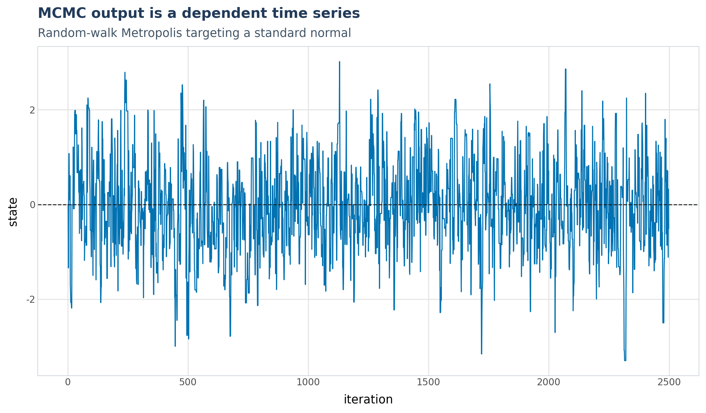

# Metropolis–Hastings {#sec-pp-metropolis}

Metropolis–Hastings constructs a dependent Markov chain whose stationary
distribution is the target. It requires only target density ratios, but finite
output must be diagnosed as a time series.

## Transition and acceptance

From current $x$, propose $y\sim q(y\mid x)$ and accept with

$$
\alpha(x,y)=
\min\left(
1,\frac{\widetilde p(y)q(x\mid y)}
{\widetilde p(x)q(y\mid x)}
\right).
$$

Otherwise retain $x$. The unknown target normalizing constant cancels.
For a symmetric random walk, proposal terms cancel too.

The acceptance rule gives detailed balance:

$$
p(x)K(x,dy)=p(y)K(y,dx),
$$

which implies stationarity. Convergence additionally needs irreducibility and
aperiodicity or related conditions.

<figure id="fig-pp-mh-trace">


<figcaption>

Figure 10.1: A random-walk Metropolis trace explores a normal target but retains visible serial dependence.

</figcaption>
</figure>

Repeated values are valid rejections, not missing data. Deleting them changes
the chain's stationary weighting.

## Tuning and geometry

Tiny proposals accept often but move slowly. Huge proposals reject often.
Acceptance rate alone is not the objective; effective exploration per unit work
matters. Scale each parameter or use covariance-aware proposals.

Burn-in removes initialization-sensitive output but cannot repair a
nonconvergent chain. Thinning usually discards information and is justified
mainly by storage or expensive downstream computation.

Adaptive proposals must diminish or otherwise satisfy conditions preserving
the target. Tuning forever from the same chain without theory can invalidate
stationarity.

## Multimodality and boundaries

Local random walks can remain trapped in one mode. Multiple dispersed chains,
tempering, informed proposals, or reparameterization can expose the problem.
Constrained targets benefit from unconstrained coordinates rather than repeated
out-of-support proposals.

## Global and delayed proposals

An independence proposal ignores the current state. It performs well only when
it covers all target regions with adequate tails. A variational approximation
can supply such proposals, but missing modes remain missing unless another
kernel restores reachability.

Delayed acceptance screens with a cheap approximation and then corrects using
the exact target. Omitting the correction samples the approximation. Combining
local and global kernels is valid when each preserves the same target.

**Nonexample.** A smooth trace segment is not evidence of convergence; it may
be smooth because the chain is stuck. Compare chains, ranks, autocorrelation,
and model-specific quantities.

<!-- inline-formula-code:start -->
## Formula and finite computation

For a symmetric proposal,

$$
\log\alpha(x,y)=
\min(0,\log\widetilde p(y)-\log\widetilde p(x)).
$$

```python
from math import isfinite

import numpy as np

def random_walk_metropolis(
    draws: int, proposal_scale: float, seed: int
) -> tuple[list[float], float]:
    if draws <= 0 or draws > 10_000_000:
        raise ValueError("draws must be between 1 and 10000000")
    if not isfinite(proposal_scale) or proposal_scale <= 0.0:
        raise ValueError("proposal_scale must be finite and positive")
    rng = np.random.default_rng(seed)
    state = 0.0
    chain: list[float] = []
    accepted = 0
    for _ in range(draws):
        proposal = state + rng.normal(scale=proposal_scale)
        log_ratio = -0.5 * proposal**2 + 0.5 * state**2
        if np.log(rng.random()) < min(0.0, log_ratio):
            state = proposal
            accepted += 1
        chain.append(state)
    return chain, accepted / draws

chain, acceptance = random_walk_metropolis(5_000, 1.2, 73)
print(sum(chain) / len(chain), acceptance)
```

**What the computation establishes.** One finite chain and acceptance fraction
are produced for a standard-normal target. The output does not prove
stationarity, mixing, or an adequate effective sample size.
<!-- inline-formula-code:end -->

## Summary

Metropolis–Hastings corrects a proposal through a density-ratio acceptance
step and preserves the target under detailed balance. Proposal geometry controls
mixing, rejections remain part of the chain, and burn-in or thinning cannot
replace convergence diagnostics.

## Exercises

<div class="exercise" id="probabilistic_programming-10-metropolis-hastings-ex-1">
<p class="exercise-title"><strong>Exercise 1</strong></p>

Derive acceptance for a symmetric proposal.

</div>

<div class="exercise" id="probabilistic_programming-10-metropolis-hastings-ex-2">
<p class="exercise-title"><strong>Exercise 2</strong></p>

Prove detailed balance for accepted moves.

</div>

<div class="exercise" id="probabilistic_programming-10-metropolis-hastings-ex-3">
<p class="exercise-title"><strong>Exercise 3</strong></p>

Compare two proposal scales by ESS rather than acceptance alone.

</div>

<div class="exercise" id="probabilistic_programming-10-metropolis-hastings-ex-4">
<p class="exercise-title"><strong>Exercise 4</strong></p>

Explain why rejected states must remain.

<details class="solution"><summary>Solution</summary>

For Exercise 4, rejection gives transition mass at the current state. Removing
duplicates conditions on moving and changes relative residence time, so the
empirical distribution no longer represents the Markov kernel's target.

</details>

</div>

<div class="exercise" id="probabilistic_programming-10-metropolis-hastings-ex-5">
<p class="exercise-title"><strong>Exercise 5</strong></p>

Design a proposal for a positive parameter.

</div>

<div class="exercise" id="probabilistic_programming-10-metropolis-hastings-ex-6">
<p class="exercise-title"><strong>Exercise 6</strong></p>

Diagnose a two-mode target with multiple chains.

</div>

### Selected solution

For Exercise 4, rejection gives transition mass at the current state. Removing
duplicates conditions on moving and changes relative residence time, so the
empirical distribution no longer represents the Markov kernel's target.
