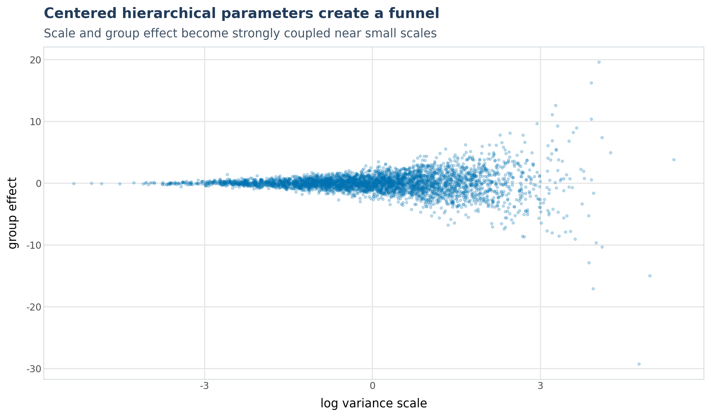

# Gibbs Sampling and Data Augmentation {#sec-pp-gibbs}

Gibbs sampling updates each variable from its full conditional distribution.
Data augmentation introduces latent variables that make those conditionals
easier, trading dimension for simpler steps.

## Full conditional updates

For joint target $p(x_1,\ldots,x_d)$, a systematic Gibbs sweep draws

$$
x_j^{\mathrm{new}}\sim
p(x_j\mid x_1^{\mathrm{new}},\ldots,x_{j-1}^{\mathrm{new}},
x_{j+1}^{\mathrm{old}},\ldots,x_d^{\mathrm{old}}).
$$

Each update is a Metropolis–Hastings step with acceptance one. The composition
preserves the joint target, though a systematic sweep is not generally
reversible as a whole.

For a correlated bivariate normal, each conditional is normal. Strong
correlation makes coordinate Gibbs move slowly along a narrow diagonal.
Blocking correlated variables can improve exploration.

## Conjugate models

In a normal model with unknown mean and variance, conjugate priors produce
normal and inverse-gamma full conditionals. In mixture models, component labels
condition on parameters and parameters condition on labels. These simple
updates can still suffer label switching or empty components.

## Data augmentation

Latent variables can turn a difficult likelihood into conditionally conjugate
pieces. Probit regression introduces latent normal scores; Student models
introduce latent scales; missing values can be sampled from their conditional
distribution under an explicit missingness model.

Augmentation affects geometry. Highly coupled latent variables can slow mixing,
and parameter expansion or marginalization can help. More variables do not
automatically mean worse computation; dependence structure matters.

<figure id="fig-pp-gibbs-funnel">


<figcaption>

Figure 11.1: The centered hierarchical funnel previews why alternating scale and effect updates can mix poorly near a narrow neck.

</figcaption>
</figure>

## Reducibility

Full conditionals must permit movement across target support. Deterministic
constraints can split state space so coordinate updates never cross between
components. An apparently valid conditional sampler may then be reducible.

## Collapsing and scan order

Integrating a conjugate parameter out before updating labels gives a collapsed
sampler. It may reduce dependence but makes each allocation update depend on
more of the current state. Partially collapsed schemes must order operations
carefully; plausible conditionals composed incorrectly can lose stationarity.

Random scan chooses coordinates randomly; systematic scan uses fixed sweeps.
Report whether an iteration means one coordinate or a full sweep before
comparing ESS per unit work.

**Nonexample.** Drawing every coordinate from its marginal distribution does
not produce the correct joint when coordinates are dependent.

<!-- inline-formula-code:start -->
## Formula and finite computation

For standard bivariate normal variables with correlation $\rho$,

$$
X\mid Y=y\sim N(\rho y,1-\rho^2),
\qquad
Y\mid X=x\sim N(\rho x,1-\rho^2).
$$

```python
from math import isfinite, sqrt
import numpy as np

def gaussian_gibbs(correlation: float, sweeps: int, seed: int) -> list[tuple[float, float]]:
    if not isfinite(correlation) or not -1.0 < correlation < 1.0:
        raise ValueError("correlation must be finite and in (-1,1)")
    if sweeps <= 0 or sweeps > 10_000_000:
        raise ValueError("sweeps must be between 1 and 10000000")
    rng = np.random.default_rng(seed)
    x, y = 0.0, 0.0
    conditional_sd = sqrt(1.0 - correlation**2)
    draws: list[tuple[float, float]] = []
    for _ in range(sweeps):
        x = rng.normal(correlation * y, conditional_sd)
        y = rng.normal(correlation * x, conditional_sd)
        draws.append((float(x), float(y)))
    return draws

draws = gaussian_gibbs(0.9, 5_000, 11)
print(np.mean(draws, axis=0), np.corrcoef(np.array(draws).T)[0, 1])
```

**What the computation establishes.** One finite Gibbs chain reproduces
approximate first moments and correlation for a known target. It does not prove
ergodicity or adequate mixing at stronger correlation.
<!-- inline-formula-code:end -->

## Summary

Gibbs sampling uses exact full conditionals and accepts every update. Blocking,
marginalization, and augmentation change dependence and computational
efficiency without changing the intended joint when derived correctly.
Reducibility and strong coupling remain serious failure modes.

## Exercises

<div class="exercise" id="probabilistic_programming-11-gibbs-augmentation-ex-1">
<p class="exercise-title"><strong>Exercise 1</strong></p>

Derive beta–Bernoulli Gibbs conditionals.

</div>

<div class="exercise" id="probabilistic_programming-11-gibbs-augmentation-ex-2">
<p class="exercise-title"><strong>Exercise 2</strong></p>

Derive bivariate-normal conditionals.

</div>

<div class="exercise" id="probabilistic_programming-11-gibbs-augmentation-ex-3">
<p class="exercise-title"><strong>Exercise 3</strong></p>

Compare Gibbs mixing at correlations $0.2$ and $0.99$.

<details class="solution"><summary>Solution</summary>

For Exercise 3, conditional variance is $1-\rho^2$. Near correlation one,
updates have tiny conditional spread and progress slowly along the joint
diagonal, increasing autocorrelation despite acceptance one.

</details>

</div>

<div class="exercise" id="probabilistic_programming-11-gibbs-augmentation-ex-4">
<p class="exercise-title"><strong>Exercise 4</strong></p>

Explain why blocking helps a narrow diagonal target.

</div>

<div class="exercise" id="probabilistic_programming-11-gibbs-augmentation-ex-5">
<p class="exercise-title"><strong>Exercise 5</strong></p>

Design latent labels for a Gaussian mixture.

</div>

<div class="exercise" id="probabilistic_programming-11-gibbs-augmentation-ex-6">
<p class="exercise-title"><strong>Exercise 6</strong></p>

Give a deterministic constraint causing reducibility.

</div>

### Selected solution

For Exercise 3, conditional variance is $1-\rho^2$. Near correlation one,
updates have tiny conditional spread and progress slowly along the joint
diagonal, increasing autocorrelation despite acceptance one.
