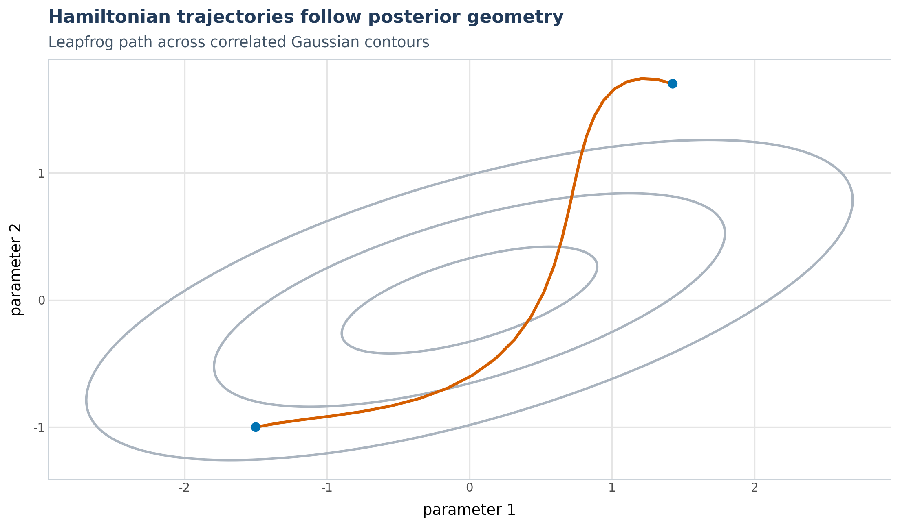

# Hamiltonian Monte Carlo and NUTS {#sec-pp-hmc}

Hamiltonian Monte Carlo uses gradients and auxiliary momentum to propose distant
states while approximately conserving an energy. It replaces random-walk
diffusion with directed trajectories.

## Hamiltonian construction

For unconstrained position $q$ with target density $p(q)$, define potential
$U(q)=-\log p(q)$ and draw momentum
$r\sim N(0,M)$. The Hamiltonian is

$$
H(q,r)=U(q)+\frac12r^TM^{-1}r.
$$

Hamilton's equations preserve $H$ and phase volume. Exact flow would always be
accepted, but numerical integration introduces an energy error corrected by a
Metropolis step.

## Leapfrog integration

One leapfrog step is

$$
\begin{aligned}
r_{1/2}&=r_0-\frac\epsilon2\nabla U(q_0),\\
q_1&=q_0+\epsilon M^{-1}r_{1/2},\\
r_1&=r_{1/2}-\frac\epsilon2\nabla U(q_1).
\end{aligned}
$$

It is reversible and volume preserving. Acceptance is
$\min(1,e^{-H_1+H_0})$.

Computing this probability from the energy difference avoids exponentiating a
positive number when the proposal should be accepted with probability one.

```python
from math import exp, isfinite

def hmc_acceptance_probability(
    initial_energy: float, proposed_energy: float
) -> float:
    """Return min(1, exp(initial_energy - proposed_energy)) stably."""
    if not isfinite(initial_energy) or not isfinite(proposed_energy):
        raise ValueError("Hamiltonian energies must be finite")
    log_ratio = initial_energy - proposed_energy
    return 1.0 if log_ratio >= 0.0 else exp(log_ratio)

for proposed_energy in (4.8, 5.0, 5.2, 12.0):
    print(proposed_energy, hmc_acceptance_probability(5.0, proposed_energy))
```

The outputs translate lower, equal, and higher proposed energies into valid
probabilities.  Acceptance corrects a proposal kernel only when the leapfrog
map, momentum convention, and Metropolis construction satisfy their stated
reversibility and volume conditions.

<figure id="fig-pp-hmc-geometry">


<figcaption>

Figure 12.1: A leapfrog trajectory follows correlated posterior contours instead of diffusing through them one local random step at a time.

</figcaption>
</figure>

Step size controls integration error; trajectory length controls travel.
A mass matrix rescales geometry. Adapt these during warmup, then freeze them
for sampling.

## Gaussian conditioning under this momentum convention {#sec-pp-hmc-mass-convention}

The word *mass* does not by itself specify whether a matrix or its inverse
appears in an implementation. Here $M$ is the **momentum covariance**, exactly
as in $r\sim N(0,M)$ and $K(r)=r^TM^{-1}r/2$. Keep that convention fixed when
choosing a scale ([Neal 2011](bibliography.md#ref-neal2011hmc), Section 5.4.1).

For a centered Gaussian target with positive definite covariance $\Sigma$,

$$
U(q)=\frac12q^T\Sigma^{-1}q+\text{constant},\qquad
\dot q=M^{-1}r,\qquad \dot r=-\Sigma^{-1}q,
\qquad \ddot q=-M^{-1}\Sigma^{-1}q.
$$

Thus **$M=\Sigma^{-1}$ equalizes the Gaussian frequencies** under this
convention: $\ddot q=-q$. This is a conditioning choice, not a requirement for
the target distribution to be correct. Any positive definite mass can give the
correct target with a valid momentum refresh, reversible volume-preserving
proposal, and Metropolis correction. Poor conditioning can instead make that
sampler inefficient.

For diagonal $\Sigma=\operatorname{diag}(v_i)$ and
$M=\operatorname{diag}(m_i)$, coordinate $i$ has angular frequency
$\omega_i=1/\sqrt{m_iv_i}$. In particular, setting $M=\Sigma$ gives
$\omega_i=1/v_i$, which can **increase** the frequency ratio. For general
positive definite matrices, $M^{-1}\Sigma^{-1}$ is similar to the positive
definite symmetric matrix $M^{-1/2}\Sigma^{-1}M^{-1/2}$, so its eigenvalues
are positive squared frequencies.

**Worked example.** Let $\Sigma=\operatorname{diag}(1/4,4)$. The scalar
leapfrog argument below gives the strict bound
$\epsilon<2/\max_i\omega_i$ for bounded powers of the full update matrix.

| Momentum covariance $M$ | Frequencies $(\omega_1,\omega_2)$ | Largest/smallest | Strict step-size bound |
|:--|:--|:--|:--|
| $I$ | $(2,1/2)$ | $4$ | $\epsilon<1$ |
| $\Sigma$ | $(4,1/4)$ | $16$ | $\epsilon<1/2$ |
| $\Sigma^{-1}$ | $(1,1)$ | $1$ | $\epsilon<2$ |

These are linear-stability bounds, not guarantees of high acceptance or good
mixing. A position-dependent curvature or a non-Gaussian funnel needs more
than one fixed Gaussian scaling.

Transfer this comparison to different scales in [Exercise 7](#sec-pp-hmc-task).

## NUTS and divergences

The No-U-Turn Sampler builds a trajectory recursively and stops before it
doubles back, avoiding a manually fixed path length. It still requires a target
gradient, step-size adaptation, and diagnostics.

A divergence reports numerical failure to follow the Hamiltonian trajectory
within tolerance. Divergences often localize high curvature, funnels, or hard
boundaries. Raising the acceptance target can reduce step size, but persistent
divergences call for reparameterization or model revision.

Energy diagnostics, maximum tree depth, and effective sample size complement
rank-normalized chain comparisons. High acceptance alone does not guarantee
exploration.

## Parameterization

Transform constraints to Euclidean coordinates and add Jacobians. Noncentered
hierarchical parameterizations replace
$\theta\sim N(\mu,\tau)$ by
$z\sim N(0,1)$ and $\theta=\mu+\tau z$. They often reduce funnel coupling when
data are weak; centered forms can be better when data strongly identify group
effects.

## Geometry clinic: weak scale information

As a group scale approaches zero, centered effects crowd into a narrow funnel
neck. Leapfrog needs a tiny step there but then travels slowly in the broad
region. A single Euclidean mass matrix cannot remove changing curvature.
Noncentering often separates standardized effects from scale when data are weak.

With strongly identifying data, noncentering can instead introduce dependence.
Simulate both regimes and compare divergences and ESS per gradient evaluation
rather than treating either parameterization as universally superior.

**Nonexample.** HMC cannot cross a discontinuity merely because gradients are
available elsewhere. Discrete variables require marginalization, specialized
updates, or hybrid algorithms.

<!-- inline-formula-code:start -->
## Formula and finite computation

For $U(q)=q^2/2$ and unit mass, leapfrog uses the displayed three updates.

$$
r_{n+1/2}=r_n-\frac\epsilon2q_n,\qquad
q_{n+1}=q_n+\epsilon r_{n+1/2},\qquad
r_{n+1}=r_{n+1/2}-\frac\epsilon2q_{n+1}.
$$

```python
from math import isfinite

def leapfrog(
    position: float, momentum: float, step_size: float, steps: int
) -> tuple[float, float, float]:
    if not all(isfinite(value) for value in (position, momentum, step_size)):
        raise ValueError("position, momentum, and step_size must be finite")
    if step_size <= 0.0 or steps <= 0 or steps > 10_000_000:
        raise ValueError("step_size must be positive and steps bounded")
    initial_energy = 0.5 * (position**2 + momentum**2)
    for _ in range(steps):
        momentum -= 0.5 * step_size * position
        position += step_size * momentum
        momentum -= 0.5 * step_size * position
    final_energy = 0.5 * (position**2 + momentum**2)
    return position, momentum, final_energy - initial_energy

print(leapfrog(1.0, 0.3, 0.1, 20))
```

**What the computation establishes.** One finite oscillator trajectory has a
reported numerical energy error. It does not prove target invariance or choose
an adequate step size for a different posterior geometry.
<!-- inline-formula-code:end -->

## Exact leapfrog stability certificate {#sec-pp-hmc-stability}

For a scalar target of variance $v>0$ and momentum variance $m>0$, substitute
$\nabla U(q)=q/v$ into the three leapfrog updates. With
$\omega^2=1/(mv)$, one step is

$$
\begin{pmatrix}q_1\\r_1\end{pmatrix}
=L_\epsilon\begin{pmatrix}q_0\\r_0\end{pmatrix},\qquad
L_\epsilon=
\begin{pmatrix}
1-\epsilon^2/(2mv)&\epsilon/m\\
-\dfrac\epsilon v\left(1-\dfrac{\epsilon^2}{4mv}\right)
&1-\epsilon^2/(2mv)
\end{pmatrix}.
$$

Multiplying out gives $\det L_\epsilon=1$ and
$\operatorname{tr}L_\epsilon=2-\epsilon^2/(mv)$.
For $0<\epsilon\omega<2$, its two distinct eigenvalues lie on the unit circle,
so all powers of this fixed matrix are bounded. Equivalently, direct
substitution shows that each step preserves the positive definite quadratic
form

$$
\widetilde H(q,r)=
\left(1-\frac{\epsilon^2}{4mv}\right)\frac{q^2}{2v}
+\frac{r^2}{2m}.
$$

At $\epsilon\omega=2$, however,
$L_\epsilon=\left(\begin{smallmatrix}-1&\epsilon/m\\0&-1\end{smallmatrix}\right)$
has a nonzero off-diagonal entry. Its powers grow linearly on generic initial
states even though both eigenvalues equal $-1$; the eigenline $r=0$ stays
bounded. Beyond this boundary the real reciprocal eigenvalues include one
with modulus greater than one, so the powers are unbounded (a contracting
eigendirection still exists). Determinant one and reversibility alone do not
imply stability ([Neal 2011](bibliography.md#ref-neal2011hmc), Section 5.4.2.2).

The following certificate uses only integers and exact fractions. Its input
contract excludes floating-point approximations, nonpositive variances, and
nonpositive step sizes. It checks one Gaussian mode, not a general posterior
or a complete HMC sampler.

```python
from fractions import Fraction

RationalMatrix = tuple[tuple[Fraction, Fraction], tuple[Fraction, Fraction]]

def gaussian_leapfrog_certificate(
    variance: int | Fraction,
    mass: int | Fraction,
    step_size: int | Fraction,
) -> tuple[RationalMatrix, str]:
    """Return an exact scalar leapfrog matrix and its power-boundedness regime."""
    values = (variance, mass, step_size)
    if any(isinstance(value, bool) or not isinstance(value, (int, Fraction))
           for value in values):
        raise TypeError("use integers or Fraction values")
    if any(value <= 0 for value in values):
        raise ValueError("variance, mass, and step_size must be positive")
    variance, mass, step_size = map(Fraction, values)
    ratio = step_size**2 / (mass * variance)
    diagonal = 1 - ratio / 2
    matrix = (
        (diagonal, step_size / mass),
        (-step_size / variance * (1 - ratio / 4), diagonal),
    )
    regime = "bounded" if ratio < 4 else "boundary" if ratio == 4 else "unbounded"
    return matrix, regime

matrix, regime = gaussian_leapfrog_certificate(1, 1, Fraction(1, 2))
determinant = matrix[0][0] * matrix[1][1] - matrix[0][1] * matrix[1][0]
trace = matrix[0][0] + matrix[1][1]
print(matrix, determinant, trace, regime)
```

The output has diagonal entries $7/8$, off-diagonal entries $1/2$ and
$-15/32$, determinant $1$, trace $7/4$, and regime `bounded`. Exact
coefficients let us check the three original updates independently rather
than infer stability from a plotted finite trajectory. Metropolis rejection
can still preserve the target when an integrator is inefficient; this
certificate does not claim that an unstable proposal is useful.

## Summary

HMC augments parameters with momentum, integrates Hamiltonian dynamics, and
corrects numerical error by acceptance. Leapfrog structure, mass scaling, and
parameterization control efficiency. NUTS adapts trajectory length, while
divergences expose geometry that must not be ignored.

## Exercises {#sec-pp-hmc-task}

<div class="exercise" id="probabilistic_programming-12-hamiltonian-monte-carlo-ex-1">
<p class="exercise-title"><strong>Exercise 1</strong></p>

Derive Hamilton's equations for a normal target.

</div>

<div class="exercise" id="probabilistic_programming-12-hamiltonian-monte-carlo-ex-2">
<p class="exercise-title"><strong>Exercise 2</strong></p>

Verify leapfrog reversibility.

</div>

<div class="exercise" id="probabilistic_programming-12-hamiltonian-monte-carlo-ex-3">
<p class="exercise-title"><strong>Exercise 3</strong></p>

Compute one-step energy error.

</div>

<div class="exercise" id="probabilistic_programming-12-hamiltonian-monte-carlo-ex-4">
<p class="exercise-title"><strong>Exercise 4</strong></p>

Under the stated convention $r\sim N(0,M)$, derive the Gaussian position
equation and explain whether covariance or precision equalizes its
frequencies. Separate this efficiency claim from target correctness.

<details class="solution"><summary>Solution</summary>

For Exercise 4, differentiating $\dot q=M^{-1}r$ gives
$\ddot q=-M^{-1}\Sigma^{-1}q$. Because $M$ denotes momentum covariance in
this chapter, $M=\Sigma^{-1}$ gives unit frequency in every Gaussian
direction. Setting $M=\Sigma$ generally does not. Other positive definite
masses remain valid choices for a correctly constructed Metropolis-corrected
HMC kernel; they can impose a smaller usable step size and poorer exploration.

</details>

</div>

<div class="exercise" id="probabilistic_programming-12-hamiltonian-monte-carlo-ex-5">
<p class="exercise-title"><strong>Exercise 5</strong></p>

Contrast centered and noncentered hierarchy coordinates.

</div>

<div class="exercise" id="probabilistic_programming-12-hamiltonian-monte-carlo-ex-6">
<p class="exercise-title"><strong>Exercise 6</strong></p>

State three responses to persistent divergences.

</div>

<div class="exercise" id="probabilistic_programming-12-hamiltonian-monte-carlo-ex-7">
<p class="exercise-title"><strong>Exercise 7</strong></p>

**Changed task.** For $\Sigma=\operatorname{diag}(1/9,16)$, find the
frequencies, frequency ratio, and strict global leapfrog step-size bound
for $M=I$, $M=\Sigma$, and $M=\Sigma^{-1}$. Separately take the scalar
values $v=m=1/9$ and $\epsilon=2/9$. Find the exact update matrix and its
fourth iterate from $(q_0,r_0)=(0,1)$. Does determinant one prove bounded
powers at this boundary?

Try the changed task before opening its [hint](#sec-pp-hmc-hint) or
[explanation](#sec-pp-hmc-solution).

<details class="solution"><summary>Solution</summary>

For Exercise 7, the three frequency pairs are $(3,1/4)$, $(9,1/16)$, and
$(1,1)$. Their ratios are $12$, $144$, and $1$, with strict bounds
$\epsilon<2/3$, $\epsilon<2/9$, and $\epsilon<2$, respectively. For the
separate scalar mode, the exact matrix is

$$
L=\begin{pmatrix}-1&2\\0&-1\end{pmatrix},\qquad
L^n=(-1)^n\begin{pmatrix}1&-2n\\0&1\end{pmatrix}.
$$

Thus $L^4(0,1)^T=(-8,1)^T$. Its determinant is one but its powers are
unbounded. This mode lies exactly at the strict stability boundary; it does
not contradict correctness of a separate valid Metropolis correction.

The [exact certificate](#sec-pp-hmc-stability) checks this boundary without
rounding the mass or the step size.

</details>

</div>

### Hint for the changed task {#sec-pp-hmc-hint}

Use $\omega_i^2=1/(m_iv_i)$ and require $\epsilon\max_i\omega_i<2$.
For the scalar boundary, write $L=-I+N$ with $N^2=0$ and compute its powers.

Compare your result with the [selected solution](#sec-pp-hmc-solution).

### Selected solution {#sec-pp-hmc-solution}

For Exercise 4, differentiating $\dot q=M^{-1}r$ gives
$\ddot q=-M^{-1}\Sigma^{-1}q$. Because $M$ denotes momentum covariance in
this chapter, $M=\Sigma^{-1}$ gives unit frequency in every Gaussian
direction. Setting $M=\Sigma$ generally does not. Other positive definite
masses remain valid choices for a correctly constructed Metropolis-corrected
HMC kernel; they can impose a smaller usable step size and poorer exploration.

For Exercise 7, the three frequency pairs are $(3,1/4)$, $(9,1/16)$, and
$(1,1)$. Their ratios are $12$, $144$, and $1$, with strict bounds
$\epsilon<2/3$, $\epsilon<2/9$, and $\epsilon<2$, respectively. For the
separate scalar mode, the exact matrix is

$$
L=\begin{pmatrix}-1&2\\0&-1\end{pmatrix},\qquad
L^n=(-1)^n\begin{pmatrix}1&-2n\\0&1\end{pmatrix}.
$$

Thus $L^4(0,1)^T=(-8,1)^T$. Its determinant is one but its powers are
unbounded. This mode lies exactly at the strict stability boundary; it does
not contradict correctness of a separate valid Metropolis correction.

The [exact certificate](#sec-pp-hmc-stability) checks this boundary without
rounding the mass or the step size.
