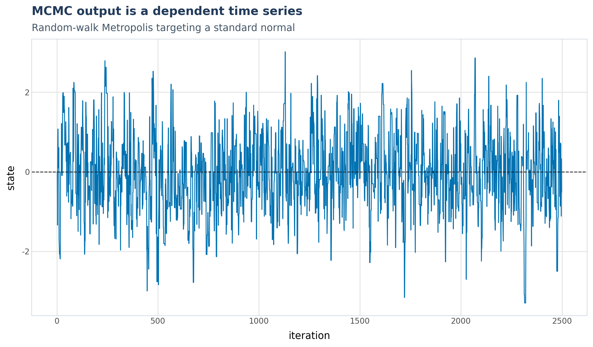
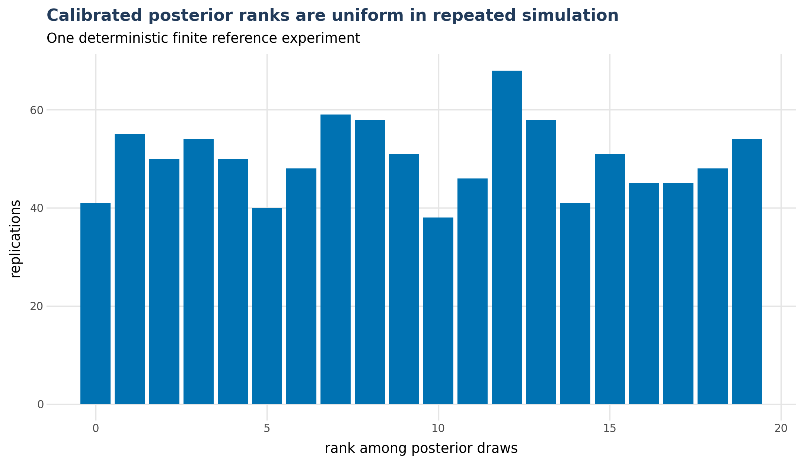

# Diagnostics and Simulation Calibration {#sec-pp-diagnostics}

An inference algorithm returns finite, dependent output. Diagnostics ask whether
that output resolves the posterior quantities of interest and whether the
implementation is calibrated under simulated truth.

## Chains, ranks, and scale

Run multiple chains from dispersed initial states. Split rank-normalized
$\widehat R$ compares within- and between-chain variation; values materially
above one signal nonstationarity or poor mixing. Rank plots reveal chains
occupying different regions even when means agree.

Autocorrelation reduces independent information. A generic effective sample
size is based on

$$
N_{\mathrm{eff}}
\approx\frac{N}{1+2\sum_{k\ge1}\rho_k},
$$

with a carefully truncated, stabilized autocorrelation sum. Monte Carlo
standard error is posterior standard deviation divided by
$\sqrt{N_{\mathrm{eff}}}$ for a mean-like estimand.

<figure id="fig-pp-diagnostic-trace">


<figcaption>

Figure 13.1: A trace can look mobile while retaining substantial local dependence, so time-series diagnostics are required.

</figcaption>
</figure>

Tail ESS, quantile MCSE, HMC divergences, energy behavior, and tree depth target
failures not summarized by one bulk ESS.

## Simulation-based calibration

Repeat:

1. draw $\theta^\star$ from the prior;
2. simulate $y$ from the likelihood;
3. fit the model;
4. rank $\theta^\star$ among posterior draws.

Under calibrated computation and exchangeability, ranks are uniform.

<figure id="fig-pp-sbc">


<figcaption>

Figure 13.2: A reference simulation-based-calibration histogram fluctuates around a uniform count across ranks.

</figcaption>
</figure>

SBC tests implementation averaged over the prior predictive distribution.
It can miss failures in a scientifically important region assigned little prior
mass. Conditional SBC or targeted fake-data grids complement it.

## Diagnosing the model versus the algorithm

Good chain diagnostics do not validate a likelihood. Posterior predictive checks
probe model fit. Bad chain diagnostics make predictive checks unreliable.
Resolve computation first, then criticize the model, while recognizing that
extreme geometry may itself reveal weak identification.

## Precision-based termination

A run is adequate only relative to named summaries. Require MCSE small compared
with posterior uncertainty or a decision tolerance for reported means,
quantiles, tails, and contrasts. Bulk mean ESS can be adequate while tail ESS
is not.

After changing model or parameterization in response to diagnostics, start
fresh chains under the final configuration. Record the search so a finite
sequence of repairs is not mistaken for a preregistered analysis.

**Nonexample.** Passing a threshold such as $\widehat R<1.01$ is not a
certificate. A chain can miss an undiscovered mode identically across all
initializations.

<!-- inline-formula-code:start -->
## Formula and finite computation

A simple positive-sequence ESS approximation uses

$$
N_{\mathrm{eff}}=\frac{N}{1+2\sum_{k=1}^K\rho_k}.
$$

```python
import numpy as np

def autocorrelation_ess(values: list[float], max_lag: int) -> float:
    if len(values) < 3 or not 1 <= max_lag < len(values):
        raise ValueError("require at least three values and a valid max_lag")
    array = np.asarray(values, dtype=float)
    if not np.all(np.isfinite(array)):
        raise ValueError("chain values must be finite")
    centered = array - array.mean()
    variance = float(np.dot(centered, centered))
    if variance == 0.0:
        raise ValueError("constant chain has undefined autocorrelation ESS")
    correlations = [
        float(np.dot(centered[:-lag], centered[lag:]) / variance)
        for lag in range(1, max_lag + 1)
    ]
    positive = []
    for correlation in correlations:
        if correlation <= 0.0:
            break
        positive.append(correlation)
    return len(array) / (1.0 + 2.0 * sum(positive))

rng = np.random.default_rng(5)
chain = np.cumsum(rng.normal(size=2_000)).tolist()
print(autocorrelation_ess(chain, 100))
```

**What the computation establishes.** A crude finite ESS diagnostic is
calculated for one deliberately dependent series. Production rank-normalized
ESS uses more robust truncation, and no finite ESS proves all modes were found.
<!-- inline-formula-code:end -->

## Summary

Multiple-chain ranks, $\widehat R$, ESS, MCSE, divergences, and energy
diagnostics assess finite computation from different angles. SBC tests
calibration under simulated truth. Algorithm diagnostics and model checks are
complementary and cannot substitute for each other.

Chapter 25 develops the production form of this toolkit: rank normalization,
folding, multi-chain bulk and tail ESS, estimand-specific precision budgets, and
sampler-specific escalation rules.

## Exercises

<div class="exercise" id="probabilistic_programming-13-diagnostics-calibration-ex-1">
<p class="exercise-title"><strong>Exercise 1</strong></p>

Compute autocorrelations for an alternating chain.

</div>

<div class="exercise" id="probabilistic_programming-13-diagnostics-calibration-ex-2">
<p class="exercise-title"><strong>Exercise 2</strong></p>

Explain why thinning does not create information.

<details class="solution"><summary>Solution</summary>

For Exercise 2, retaining every tenth draw reduces autocorrelation among stored
values but discards the intermediate information. Unless storage or downstream
cost dominates, estimators using all draws are at least as informative.

</details>

</div>

<div class="exercise" id="probabilistic_programming-13-diagnostics-calibration-ex-3">
<p class="exercise-title"><strong>Exercise 3</strong></p>

Design SBC for a beta–binomial model.

</div>

<div class="exercise" id="probabilistic_programming-13-diagnostics-calibration-ex-4">
<p class="exercise-title"><strong>Exercise 4</strong></p>

Interpret U- and hump-shaped SBC histograms.

</div>

<div class="exercise" id="probabilistic_programming-13-diagnostics-calibration-ex-5">
<p class="exercise-title"><strong>Exercise 5</strong></p>

Contrast posterior ESS and importance ESS.

</div>

<div class="exercise" id="probabilistic_programming-13-diagnostics-calibration-ex-6">
<p class="exercise-title"><strong>Exercise 6</strong></p>

List model checks after computation passes.

</div>

### Selected solution

For Exercise 2, retaining every tenth draw reduces autocorrelation among stored
values but discards the intermediate information. Unless storage or downstream
cost dominates, estimators using all draws are at least as informative.
