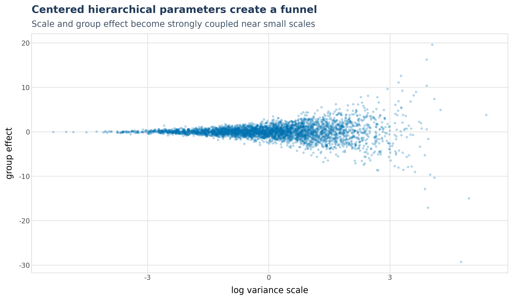

# Hierarchical Models and Partial Pooling {#sec-pp-hierarchical}

Repeated groups are neither identical nor unrelated. Hierarchical models share
information through a population distribution while retaining group-specific
effects.

## Exchangeable groups

For group effects,

$$
\theta_j\sim N(\mu,\tau^2),
\qquad
y_{ij}\sim N(\theta_j,\sigma^2).
$$

Conditional on $(\mu,\tau,\sigma)$, groups are independent; marginally they are
dependent because they share hyperparameters. Exchangeability says group labels
can be permuted without changing the joint model, not that groups have equal
effects.

With known variances, a group-mean posterior is a precision-weighted average:

$$
E[\theta_j\mid\bar y_j,\mu]
= \frac{n_j/\sigma^2}{n_j/\sigma^2+1/\tau^2}\bar y_j
+\frac{1/\tau^2}{n_j/\sigma^2+1/\tau^2}\mu.
$$

Small or noisy groups shrink more toward the population mean. This is partial
pooling. Complete pooling sets every effect equal; no pooling estimates each
group separately.

## Hyperpriors and geometry

Priors on $\mu,\tau,\sigma$ must be predictive on the outcome scale. A prior
that places substantial mass near $\tau=0$ creates a narrow centered geometry:

<figure id="fig-pp-hierarchical-funnel">


<figcaption>

Figure 14.1: Centered group effects and their scale form a funnel that narrows sharply near small population variance.

</figcaption>
</figure>

The noncentered form
$z_j\sim N(0,1)$, $\theta_j=\mu+\tau z_j$ separates prior scale from
standardized effect. It often helps with weak group data; strong data can favor
the centered form. Mixed parameterizations can be group-specific.

## Varying intercepts and slopes

Multilevel regression lets intercepts and slopes vary by group with a joint
population covariance. Correlated varying effects can express, for example,
that high-baseline groups respond differently. Covariance priors should be
separated into standard deviations and a correlation matrix.

Predictions for an existing group condition on its effect; predictions for a
new group draw a new effect from the population distribution. Confusing these
targets understates uncertainty.

## Number of groups and identifiability

Few groups provide weak information about $\tau$ even with many observations
per group. The likelihood can identify each $\theta_j$ while leaving the
population spread uncertain. Prior sensitivity and simulation recovery are
essential.

## Predictive targets and cross-level bias

Population and group predictors can have different meanings. A group-mean
predictor and an individual deviation should enter separately when within-group
and between-group associations differ. Otherwise one coefficient blends two
questions and can reverse sign.

For out-of-sample assessment, hold out whole groups when deployment concerns
new groups; holding out rows from known groups measures a less demanding target.
Report both when both uses matter, including hyperparameter uncertainty in new
group predictions.

**Nonexample.** Treating thousands of measurements within one group as
thousands of independent groups gives false information about between-group
variation.

<!-- inline-formula-code:start -->
## Formula and finite computation

The known-variance posterior mean is

$$
m_j=\frac{(n_j/\sigma^2)\bar y_j+(1/\tau^2)\mu}
{n_j/\sigma^2+1/\tau^2}.
$$

```python
from math import isfinite

def normal_shrinkage_mean(
    sample_mean: float,
    sample_size: int,
    observation_sd: float,
    population_mean: float,
    population_sd: float,
) -> float:
    continuous_values = (sample_mean, observation_sd, population_mean, population_sd)
    if any(not isfinite(value) for value in continuous_values):
        raise ValueError("means and scales must be finite")
    if sample_size <= 0 or observation_sd <= 0.0 or population_sd <= 0.0:
        raise ValueError("sample size and scales must be positive")
    data_precision = sample_size / observation_sd**2
    prior_precision = 1.0 / population_sd**2
    return (
        data_precision * sample_mean + prior_precision * population_mean
    ) / (data_precision + prior_precision)

for size in (2, 10, 100):
    print(size, normal_shrinkage_mean(4.0, size, 3.0, 1.0, 1.5))
```

**What the computation establishes.** The analytic mean shows less shrinkage as
group sample size grows under known variances. It does not estimate
hyperparameters or validate exchangeability.
<!-- inline-formula-code:end -->

## Summary

Hierarchical models induce partial pooling through shared population
parameters. Shrinkage depends on relative precision, new-group prediction
differs from existing-group prediction, and centered versus noncentered forms
change geometry rather than the intended distribution. Few groups make
hyperparameter uncertainty especially important.

## Exercises

<div class="exercise" id="probabilistic_programming-14-hierarchical-models-ex-1">
<p class="exercise-title"><strong>Exercise 1</strong></p>

Derive the normal shrinkage mean.

</div>

<div class="exercise" id="probabilistic_programming-14-hierarchical-models-ex-2">
<p class="exercise-title"><strong>Exercise 2</strong></p>

Compare complete, no, and partial pooling.

<details class="solution"><summary>Solution</summary>

For Exercise 2, complete pooling ignores between-group variation; no pooling
ignores shared information. Partial pooling interpolates according to group
precision and estimated population spread, improving noisy groups when the
exchangeability model is credible.

</details>

</div>

<div class="exercise" id="probabilistic_programming-14-hierarchical-models-ex-3">
<p class="exercise-title"><strong>Exercise 3</strong></p>

Simulate new-group predictions.

</div>

<div class="exercise" id="probabilistic_programming-14-hierarchical-models-ex-4">
<p class="exercise-title"><strong>Exercise 4</strong></p>

Write a varying-slope model.

</div>

<div class="exercise" id="probabilistic_programming-14-hierarchical-models-ex-5">
<p class="exercise-title"><strong>Exercise 5</strong></p>

Explain the centered funnel.

</div>

<div class="exercise" id="probabilistic_programming-14-hierarchical-models-ex-6">
<p class="exercise-title"><strong>Exercise 6</strong></p>

Design a sensitivity check for a scale hyperprior.

</div>

### Selected solution

For Exercise 2, complete pooling ignores between-group variation; no pooling
ignores shared information. Partial pooling interpolates according to group
precision and estimated population spread, improving noisy groups when the
exchangeability model is credible.
