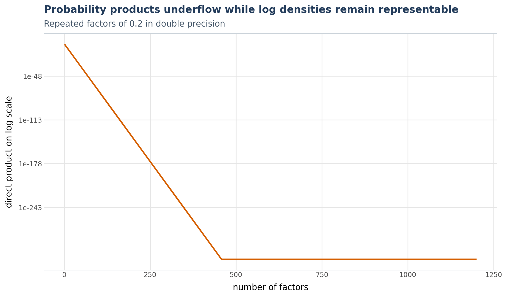

# Generalized Linear Models {#sec-pp-glm}

Generalized linear models connect predictors to non-normal outcomes through a
linear predictor and link function, while preserving an explicit observation
distribution.

## Three components

A GLM specifies:

1. an exponential-family outcome distribution;
2. linear predictor $\eta_i=x_i^T\beta$; and
3. link $g(\mu_i)=\eta_i$ for mean $\mu_i$.

Logistic regression uses

$$
p_i=\frac{1}{1+e^{-\eta_i}},
\qquad
y_i\sim\operatorname{Bernoulli}(p_i).
$$

Poisson log-linear regression uses
$\lambda_i=e^{\eta_i}$ and
$y_i\sim\operatorname{Poisson}(\lambda_i e_i)$ with exposure $e_i$.
Offsets encode known multiplicative exposure.

## Interpretation and priors

A logistic coefficient is a change in log odds per predictor unit, conditional
on other columns. Exponentiating gives an odds ratio, not a risk ratio.
Standardize or otherwise scale predictors so priors express plausible changes
on the outcome scale.

Interactions mean one coefficient's effect depends on another predictor.
Polynomial terms change curvature but can be ill-conditioned in raw powers;
centered or orthogonal bases help.

## Separation and overdispersion

Complete separation occurs when a coefficient direction classifies all binary
outcomes perfectly. The maximum likelihood estimate diverges. A proper prior
can yield a proper posterior, but results may be highly prior-sensitive.

Poisson variance equals its mean. Extra-Poisson variation may call for negative
binomial, random effects, zero inflation, or a revised dependence model.

<figure id="fig-pp-glm-logscale">


<figcaption>

Figure 15.1: Stable log-density work is essential because GLM likelihoods multiply many small Bernoulli or Poisson contributions.

</figcaption>
</figure>

## Prediction and checking

Distinguish the conditional mean from a new outcome. Posterior predictive draws
include coefficient uncertainty and outcome variation. Check calibration,
residual pattern, grouped frequencies, tails, and dependence.

## Case clinic: rates with unequal exposure

If regions are observed for different person-times $e_i$, count means should be
$e_i\lambda_i$. In a log link, $\log e_i$ is an offset with coefficient fixed
at one. Treating exposure as an ordinary predictor estimates an unnecessary
coefficient and can distort rate comparison.

Check counts per exposure only for visualization; fit the integer count
likelihood with its exposure. Very small exposures and zero counts can reveal
whether the assumed constant within-period rate is plausible.

**Nonexample.** A sigmoid curve does not make an association causal.
Confounding, selection, measurement error, and interventions require separate
assumptions.

<!-- inline-formula-code:start -->
## Formula and finite computation

The stable Bernoulli log likelihood can use

$$
\log p(y\mid\eta)
=y\eta-\log(1+e^\eta).
$$

```python
from math import exp, isfinite, log1p

def softplus(value: float) -> float:
    if not isfinite(value):
        raise ValueError("softplus input must be finite")
    if value > 0.0:
        return value + log1p(exp(-value))
    return log1p(exp(value))

def bernoulli_logit_log_likelihood(
    outcomes: list[int], linear_predictors: list[float]
) -> float:
    if len(outcomes) != len(linear_predictors) or not outcomes:
        raise ValueError("nonempty outcomes and linear predictors must have equal length")
    if any(outcome not in (0, 1) for outcome in outcomes):
        raise ValueError("outcomes must be binary")
    if any(not isfinite(value) for value in linear_predictors):
        raise ValueError("linear predictors must be finite")
    return sum(
        outcome * linear_predictor - softplus(linear_predictor)
        for outcome, linear_predictor in zip(
            outcomes, linear_predictors, strict=True
        )
    )

print(bernoulli_logit_log_likelihood([1, 0, 1], [50.0, -40.0, 1.2]))
```

**What the computation establishes.** Three extreme finite log-likelihood
contributions are evaluated without sigmoid overflow. The code does not fit
coefficients or validate a logistic outcome model.
<!-- inline-formula-code:end -->

## Summary

GLMs combine an outcome family, linear predictor, and link. Coefficients live on
the link scale; priors require predictor-aware calibration. Separation,
overdispersion, dependence, and causal scope remain visible failure modes.

## Exercises

<div class="exercise" id="probabilistic_programming-15-generalized-linear-models-ex-1">
<p class="exercise-title"><strong>Exercise 1</strong></p>

Convert a logistic coefficient to an odds ratio.

<details class="solution"><summary>Solution</summary>

For Exercise 1, increasing a predictor by one adds $\beta$ to log odds, so it
multiplies odds by $e^\beta$, conditional on the other modeled predictors.

</details>

</div>

<div class="exercise" id="probabilistic_programming-15-generalized-linear-models-ex-2">
<p class="exercise-title"><strong>Exercise 2</strong></p>

Derive the stable Bernoulli log-likelihood identity.

</div>

<div class="exercise" id="probabilistic_programming-15-generalized-linear-models-ex-3">
<p class="exercise-title"><strong>Exercise 3</strong></p>

Include exposure in a Poisson model.

</div>

<div class="exercise" id="probabilistic_programming-15-generalized-linear-models-ex-4">
<p class="exercise-title"><strong>Exercise 4</strong></p>

Simulate complete separation.

</div>

<div class="exercise" id="probabilistic_programming-15-generalized-linear-models-ex-5">
<p class="exercise-title"><strong>Exercise 5</strong></p>

Compare Poisson and negative-binomial predictive variance.

</div>

<div class="exercise" id="probabilistic_programming-15-generalized-linear-models-ex-6">
<p class="exercise-title"><strong>Exercise 6</strong></p>

Design a calibration plot.

</div>

### Selected solution

For Exercise 1, increasing a predictor by one adds $\beta$ to log odds, so it
multiplies odds by $e^\beta$, conditional on the other modeled predictors.
