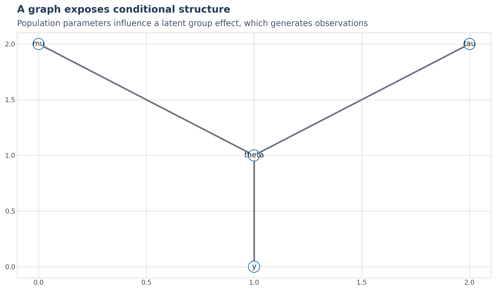

# Mixtures and Latent Variables {#sec-pp-mixtures}

Mixture models represent heterogeneous distributions through an unobserved
component label. They are flexible, but symmetry and overlapping components
create distinctive inferential hazards.

## Finite mixtures

For weights $\pi_k$ and component densities $p_k$,

$$
p(y)=\sum_{k=1}^K\pi_kp_k(y),
\qquad \pi_k\ge0,\quad\sum_k\pi_k=1.
$$

Introduce $Z\sim\operatorname{Categorical}(\pi)$ and
$Y\mid Z=k\sim p_k$. The posterior responsibility is

$$
P(Z=k\mid y)
=\frac{\pi_kp_k(y)}{\sum_j\pi_jp_j(y)}.
$$

This is a conditional probability, not a guarantee that component $k$
corresponds to a real scientific class.

<figure id="fig-pp-mixture-graph">


<figcaption>

Figure 16.1: Latent variables sit between population parameters and observations in a graph, making mixture allocation an inferred rather than observed quantity.

</figcaption>
</figure>

## Label switching

Permuting labels and their parameters leaves the mixture density unchanged.
On a permutation-invariant parameter space, a joint prior on weights and component parameters that is exchangeable under label permutations gives a label-invariant posterior when the evidence is finite and positive. The orbit of any existing mode under label permutations has at most $K!$ distinct points,
with fewer when a nonidentity permutation fixes the mode; other inequivalent mode orbits may exist. Component-specific posterior means across switched draws can be
nonsense. Use permutation-invariant summaries or a justified relabelling rule.

Ordering means can identify labels computationally but changes the prior and can
behave badly when components overlap.

## Mixtures, clustering, and robust models

A mixture density need not imply clusters: a two-component representation can
approximate skewness. Conversely, density clusters can merge under overlap.
Posterior classification uncertainty should be reported.

Scale mixtures produce robust heavy tails. A Student distribution can be
represented as a normal with random precision, enabling Gibbs updates and
observation-specific outlier accommodation.

Hidden Markov models add dependence between labels over time. Topic models and
factor models use other latent structures. Integrating discrete labels out can
improve gradient sampling when the sum over states is tractable.

## Posterior summaries under symmetry

The overall mixture density, predictive distribution, number of occupied
components, and pairwise probability that two observations share a component
are invariant to label permutation. These summaries remain meaningful when a
component-wise posterior mean does not.

If scientific labels exist, encode them with identified measurements or
ordered scientific constraints rather than sorting every posterior draw after
fitting. Relabelling for display cannot manufacture identifiability that the
likelihood lacks.

**Nonexample.** Selecting $K$ solely because one fitted mixture has the highest
ordinary likelihood rewards singular components whose variance collapses onto
a data point.

<!-- inline-formula-code:start -->
## Formula and finite computation

For finitely many components, responsibilities normalize log scores:

$$
r_k=\frac{e^{a_k}}{\sum_je^{a_j}},
\qquad a_k=\log\pi_k+\log p_k(y).
$$

```python
from math import exp, isfinite

def responsibilities(log_scores: list[float]) -> list[float]:
    if not log_scores or any(not isfinite(value) for value in log_scores):
        raise ValueError("log_scores must be nonempty and finite")
    maximum = max(log_scores)
    raw = [exp(score - maximum) for score in log_scores]
    total = sum(raw)
    return [value / total for value in raw]

print(responsibilities([-2.3, -0.7, -4.0]))
```

**What the computation establishes.** Three finite component log scores are
normalized stably. The result does not identify a component interpretation,
choose $K$, or solve label switching across posterior draws.
<!-- inline-formula-code:end -->

## Summary

Mixtures marginalize latent labels and use responsibilities for conditional
allocation. Label symmetry can create multimodal posteriors, component
interpretations require domain justification, and likelihood singularities
complicate component-count selection. Marginalization can make inference more
stable.

## Exercises

<div class="exercise" id="probabilistic_programming-16-mixtures-latent-variables-ex-1">
<p class="exercise-title"><strong>Exercise 1</strong></p>

Derive mixture responsibilities.

</div>

<div class="exercise" id="probabilistic_programming-16-mixtures-latent-variables-ex-2">
<p class="exercise-title"><strong>Exercise 2</strong></p>

Show likelihood invariance under label permutation.

<details class="solution"><summary>Solution</summary>

For Exercise 2, a permutation merely reorders the terms
$\sum_k\pi_kp(y\mid\theta_k)$, leaving their sum unchanged. The latent labels
have no inherent names unless the model adds identifying information.

</details>

</div>

<div class="exercise" id="probabilistic_programming-16-mixtures-latent-variables-ex-3">
<p class="exercise-title"><strong>Exercise 3</strong></p>

Simulate overlapping components and classification uncertainty.

</div>

<div class="exercise" id="probabilistic_programming-16-mixtures-latent-variables-ex-4">
<p class="exercise-title"><strong>Exercise 4</strong></p>

Explain why clustering and mixture density differ.

</div>

<div class="exercise" id="probabilistic_programming-16-mixtures-latent-variables-ex-5">
<p class="exercise-title"><strong>Exercise 5</strong></p>

Marginalize one binary label.

</div>

<div class="exercise" id="probabilistic_programming-16-mixtures-latent-variables-ex-6">
<p class="exercise-title"><strong>Exercise 6</strong></p>

Describe a scale-mixture robust model.

</div>

### Selected solution

For Exercise 2, a permutation merely reorders the terms
$\sum_k\pi_kp(y\mid\theta_k)$, leaving their sum unchanged. The latent labels
have no inherent names unless the model adds identifying information.
