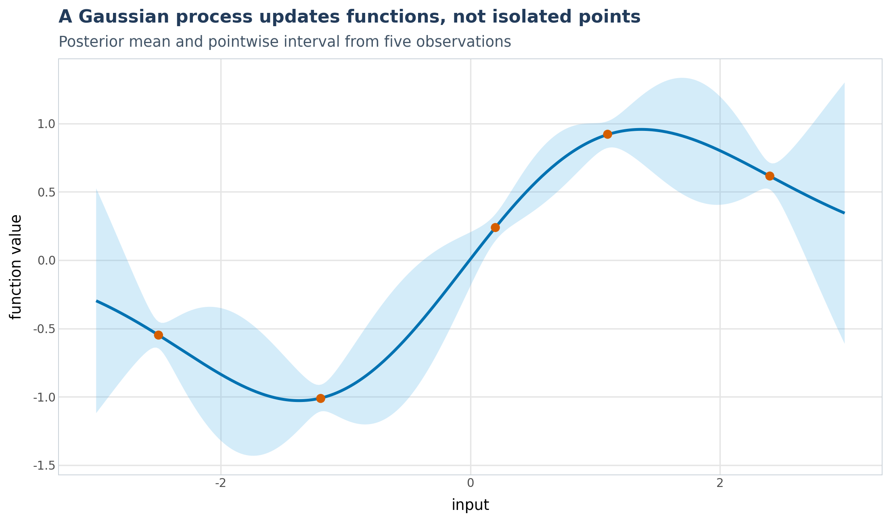

# Gaussian Processes {#sec-pp-gp}

A Gaussian process places a distribution on functions by declaring every
finite vector of function values jointly normal. Kernels express smoothness,
scale, periodicity, and other prior structure.

## Definition and kernels

Write

$$
f\sim\operatorname{GP}(m,k)
$$

when for any inputs $x_1,\ldots,x_n$,

$$
(f(x_1),\ldots,f(x_n))^T
\sim N(m_X,K_{XX}),
\qquad (K_{XX})_{ij}=k(x_i,x_j).
$$

A valid kernel yields positive-semidefinite Gram matrices. The squared
exponential kernel

$$
k(x,x')=\sigma_f^2
\exp\left(-\frac{(x-x')^2}{2\ell^2}\right)
$$

produces very smooth functions. Matérn kernels control differentiability more
flexibly. Sums and products build additive, interaction, periodic, or
locally varying structure.

## Gaussian regression

With zero prior mean and noise variance $\sigma_n^2$, posterior latent-function
mean and covariance at test inputs are

$$
m_* = K_{*X}(K_{XX}+\sigma_n^2I)^{-1}y,
$$

$$
K_{**\mid y}
=K_{**}-K_{*X}(K_{XX}+\sigma_n^2I)^{-1}K_{X*}.
$$

Use Cholesky solves rather than a matrix inverse.

The following implementation follows that instruction literally: it builds
the three Gram blocks, factors the noisy training block once, and reuses
triangular solves for both posterior formulas.

```python
import numpy as np
from numpy.typing import NDArray

def gaussian_process_posterior(
    training_inputs: list[float],
    observations: list[float],
    test_inputs: list[float],
    amplitude: float,
    length_scale: float,
    noise_standard_deviation: float,
) -> tuple[NDArray[np.float64], NDArray[np.float64]]:
    """Return zero-mean RBF GP posterior mean and latent covariance."""
    if not training_inputs or len(training_inputs) != len(observations):
        raise ValueError("training inputs and observations must be nonempty and aligned")
    if not test_inputs:
        raise ValueError("provide at least one test input")
    scales = (amplitude, length_scale, noise_standard_deviation)
    if any(not np.isfinite(scale) or scale <= 0.0 for scale in scales):
        raise ValueError("kernel and noise scales must be finite and positive")
    train = np.asarray(training_inputs, dtype=float)
    observed = np.asarray(observations, dtype=float)
    test = np.asarray(test_inputs, dtype=float)
    if not all(np.all(np.isfinite(array)) for array in (train, observed, test)):
        raise ValueError("all inputs and observations must be finite")

    def kernel(
        left: NDArray[np.float64], right: NDArray[np.float64]
    ) -> NDArray[np.float64]:
        squared_distance = (left[:, None] - right[None, :]) ** 2
        return amplitude**2 * np.exp(-0.5 * squared_distance / length_scale**2)

    training_covariance = kernel(train, train)
    training_covariance += noise_standard_deviation**2 * np.eye(train.size)
    cross_covariance = kernel(test, train)
    test_covariance = kernel(test, test)
    cholesky = np.linalg.cholesky(training_covariance)
    alpha = np.linalg.solve(cholesky.T, np.linalg.solve(cholesky, observed))
    posterior_mean = cross_covariance @ alpha
    projected = np.linalg.solve(cholesky, cross_covariance.T)
    posterior_covariance = test_covariance - projected.T @ projected
    return posterior_mean, posterior_covariance

mean, covariance = gaussian_process_posterior(
    training_inputs=[-1.0, 0.0, 1.0],
    observations=[-0.8, 0.1, 0.9],
    test_inputs=[-0.5, 0.5],
    amplitude=1.0,
    length_scale=0.8,
    noise_standard_deviation=0.1,
)
print(mean)
print(np.diag(covariance))
```

The output is the finite Gaussian conditional for the declared kernel and
fixed hyperparameters.  It does not integrate hyperparameter uncertainty,
validate the kernel choice, or turn pointwise marginal variances into a
simultaneous credible band.

<figure id="fig-pp-gp-posterior">


<figcaption>

Figure 17.1: Five observations update a Gaussian-process function, narrowing pointwise uncertainty near measured inputs.

</figcaption>
</figure>

The ribbon is pointwise, not a simultaneous band. Hyperparameter uncertainty is
absent if kernel parameters were fixed.

## Hyperparameters and computation

Length scale, amplitude, noise, and mean parameters can be inferred by posterior
sampling or marginal likelihood. Weak identification and multiple scales can
create difficult geometry. Standard exact regression costs cubic time and
quadratic memory in observation count; inducing points, structured kernels, and
state-space forms trade accuracy for scalability.

For likelihoods with a nonquadratic log kernel in the latent function, the
ordinary Gaussian update generally does not apply. Laplace, variational,
expectation-propagation, or Monte Carlo approximations are often used;
non-Gaussian observations alone neither exclude a Gaussian latent posterior
nor force approximation.

## Observation transforms {#sec-pp-gp-transforms}

The likelihood must be examined as a function of the latent process. A
non-normal distribution for an observed quantity can still produce an exact
Gaussian posterior for that process. Conversely, an exact posterior need
not itself be Gaussian.

### A fixed invertible map {#sec-pp-gp-invertible}

Let the kernel parameters and noise standard deviation $\sigma>0$ be fixed.
At one input $x_0$, generate a noisy latent observation and then transform it:

$$
Z=f(x_0)+\epsilon,\qquad
\epsilon\sim N(0,\sigma^2),\qquad
Y=g(Z).
$$

The noise is independent of the process. The map $g$ is a fixed differentiable
bijection from the real line onto the observation interval, with a
differentiable inverse whose derivative is nonzero. Write $\phi_\sigma$ for
the centered normal density with standard deviation $\sigma$. At an observed
value $y$ in that interval, put $z=g^{-1}(y)$. The change-of-variables formula
gives the likelihood

$$
p_Y(y\mid f)
=\phi_\sigma\bigl(z-f(x_0)\bigr)
 \left|\bigl(g^{-1}\bigr)'(y)\right|.
$$

The inverse derivative is independent of the latent function. In Bayes'
density formula it cancels from the normalized conditional law of $f$.
Thus conditioning on $Y=y$ gives the same latent posterior as conditioning
on the noisy Gaussian observation $Z=z$. Every finite vector of function
values has the ordinary joint Gaussian conditional, so the latent posterior
is still a GP. Predictions of the transformed observation need not be
Gaussian.

The same cancellation does not remove the derivative from the predictive
density of $Y$. It also does not justify dropping a derivative that depends
on an unknown transformation parameter when learning that parameter.
Integrating uncertain kernel or transformation parameters can produce a
non-Gaussian mixture even when each fixed-parameter conditional is Gaussian.

This is a statement about conditional densities. The probability of an exact
continuous observation is zero, so no ratio of probabilities of single real
values is being taken. The transformation is part of the stipulated model,
not a data preprocessing step that repairs any chosen likelihood.
The fixed monotone-transform framework is developed by Snelson, Rasmussen,
and Ghahramani ([Snelson et al. 2004](bibliography.md#ref-snelson2004warped), Section 3, equations 5–8).

### Worked example {#sec-pp-gp-worked}

Let the finite latent vector and independent noise satisfy

$$
F=\begin{pmatrix}F_1\\F_2\end{pmatrix}\sim N(0,K),
\qquad
K=\begin{pmatrix}1&1/2\\1/2&1\end{pmatrix},
\qquad \epsilon\sim N(0,1).
$$

All quantities are dimensionless. Observe noise followed by exponentiation:

$$
Z=F_1+\epsilon,\qquad Y=e^Z,\qquad Y=e^2.
$$

For $y>0$ the likelihood is lognormal in the observation $y$ but a Gaussian
kernel in the unknown latent coordinate:

$$
p_Y(y\mid F_1=f_1)
=\frac{\phi_1(\log y-f_1)}{y}.
$$

Set $k=\operatorname{Cov}(F,Z)=(1,1/2)^T$. Since
$\operatorname{Var}(Z)=2$ and the transformed observation is $Z=2$,

$$
F\mid Y=e^2\sim N(m,C),
$$

$$
m=\frac{2k}{2}=\begin{pmatrix}1\\1/2\end{pmatrix},
\qquad
C=K-\frac{kk^T}{2}
=\begin{pmatrix}1/2&1/4\\1/4&7/8\end{pmatrix}.
$$

The density of $Z$ is that of $N(0,2)$. Denote it by $\phi_{0,2}$, where the
second subscript is the variance. The observation-space evidence retains
the Jacobian:

$$
p_Y(e^2)
=e^{-2}\phi_{0,2}(2)
=\frac{e^{-3}}{2\sqrt{\pi}}.
$$

The unchanged regression helper above realizes this conditional with one
training input at zero, transformed response $2$, and test inputs $0$ and
$1$. Set amplitude and noise standard deviation both to $1$, and choose

$$
\ell=\frac{1}{\sqrt{2\log 2}}.
$$

The RBF covariance between those inputs is then $1/2$. Ordinary floating
arithmetic approximates the displayed exact mean and covariance. The helper
neither detects the observation transform nor supplies the observation-space
Jacobian: those remain parts of the mathematical model.

The noise was added **before** exponentiation. The different model
$Y=e^{F_1}+\epsilon$ has a different likelihood and does not receive this
Gaussian update.

## Kernel criticism

Plot prior functions before fitting and ask whether their zero crossings,
roughness, amplitude, and long-range behavior resemble plausible processes.
After fitting, examine standardized residuals and predictions across gaps.
Marginal-likelihood optimization can drive length scale to a boundary when
noise and short-scale variation are confounded.

Inputs with physical units require length scales in the same units. Automatic
feature scaling silently changes the kernel and must be part of the recorded
model, especially for anisotropic multidimensional inputs.

**Nonexample.** A squared-exponential prior is not nonparametric ignorance. It
strongly favors infinitely differentiable functions and can extrapolate poorly
across regime changes.

<!-- inline-formula-code:start -->
## Formula and finite computation

The radial basis kernel is

$$
k(x,x')=\sigma^2\exp\left(-\frac{(x-x')^2}{2\ell^2}\right).
$$

```python
from math import exp, isfinite

def rbf_kernel(left: float, right: float, amplitude: float, length_scale: float) -> float:
    values = (left, right, amplitude, length_scale)
    if any(not isfinite(value) for value in values):
        raise ValueError("kernel inputs must be finite")
    if amplitude <= 0.0 or length_scale <= 0.0:
        raise ValueError("kernel scales must be positive")
    return amplitude**2 * exp(-0.5 * ((left - right) / length_scale) ** 2)

points = [-1.0, 0.0, 1.0]
gram = [[rbf_kernel(x, y, 1.5, 0.8) for y in points] for x in points]
print(gram)
```

**What the computation establishes.** A symmetric three-by-three Gram matrix
is evaluated. It does not prove positive semidefiniteness for every input set or
validate this smoothness prior for data.
<!-- inline-formula-code:end -->

## Summary

Gaussian processes specify consistent finite normal distributions through a
mean and kernel. Gaussian likelihoods yield analytic conditioning, while kernel
choice and hyperparameters encode strong function assumptions. Stable solves,
scalability approximations, and predictive interpretation all require explicit
audits.

Check the likelihood as a function of the latent unknown: a fixed invertible
observation transform can retain Gaussian conditioning, while finitely many
inverse branches can yield an exact non-Gaussian mixture.

## Exercises

<div class="exercise" id="probabilistic_programming-17-gaussian-processes-ex-1">
<p class="exercise-title"><strong>Exercise 1</strong></p>

Build Gram matrices for three kernels.

</div>

<div class="exercise" id="probabilistic_programming-17-gaussian-processes-ex-2">
<p class="exercise-title"><strong>Exercise 2</strong></p>

Verify kernel symmetry.

</div>

<div class="exercise" id="probabilistic_programming-17-gaussian-processes-ex-3">
<p class="exercise-title"><strong>Exercise 3</strong></p>

Derive Gaussian conditioning formulas.

</div>

<div class="exercise" id="probabilistic_programming-17-gaussian-processes-ex-4">
<p class="exercise-title"><strong>Exercise 4</strong></p>

Compare short and long length scales.

</div>

<div class="exercise" id="probabilistic_programming-17-gaussian-processes-ex-5">
<p class="exercise-title"><strong>Exercise 5</strong></p>

Distinguish pointwise and simultaneous intervals.

</div>

<div class="exercise" id="probabilistic_programming-17-gaussian-processes-ex-6">
<p class="exercise-title"><strong>Exercise 6</strong></p>

Design a periodic-plus-trend kernel.

<details class="solution"><summary>Solution</summary>

For Exercise 6, use
$k=k_{\mathrm{trend}}+k_{\mathrm{periodic}}$. Kernel addition corresponds to
independent latent functions whose sum has covariance equal to the sum.

</details>

</div>

<div class="exercise" id="probabilistic_programming-17-gaussian-processes-ex-7">
<p class="exercise-title"><strong>Exercise 7</strong></p>

Compare invertible and two-branch observation transforms in the
[changed task](#sec-pp-gp-task), including their posterior moments.

</div>

### Selected solution

For Exercise 6, use
$k=k_{\mathrm{trend}}+k_{\mathrm{periodic}}$. Kernel addition corresponds to
independent latent functions whose sum has covariance equal to the sum.

### Changed task: two inverse branches {#sec-pp-gp-task}

Keep the worked example's $F$, $K$ and independent $\epsilon$, but observe

$$
Z=F_1+\epsilon,\qquad Y=Z^2,\qquad Y=4.
$$

The square is applied after adding noise. This is a different model from
$Y=F_1^2+\epsilon$.

1. Derive the likelihood density at $Y=4$, including every inverse branch.
2. Find both conditional Gaussian components, their weights, and the
   observation-space evidence.
3. Compute the full posterior vector mean and covariance.
4. Use the fourth moment of $F_1$ to prove that the posterior is not Gaussian.
   Does this conclusion force approximation?
5. Explain what would go wrong if only the positive square root were passed
   to the original regression helper.

Try the calculation before opening the [hint](#sec-pp-gp-hint) or
[full answer](#sec-pp-gp-solution).

### Hint {#sec-pp-gp-hint}

For a squared observation $y>0$, the inverse branches are
$z=\sqrt{y}$ and $z=-\sqrt{y}$. Each has inverse derivative of absolute value

$$
\frac{1}{2\sqrt{y}}.
$$

Weight a branch by its predictive density times that absolute derivative.
Then use Gaussian conditioning on each value of $Z$. Total covariance
includes both variation inside each component and variation between their
means. For a centered Gaussian variable $U$ of variance $s^2$, expanding
$(a+U)^4$ gives $a^4+6a^2s^2+3s^4$.

Return to the [task](#sec-pp-gp-task) or continue to the
[full answer](#sec-pp-gp-solution).

### Full answer {#sec-pp-gp-solution}

At $y=4$ there are two inverse values, $2$ and $-2$, each contributing a
Jacobian of $1/4$. Consequently,

$$
p_Y(4\mid F_1=f_1)
=\frac{\phi_1(2-f_1)+\phi_1(-2-f_1)}{4}.
$$

The predictive density of $Z\sim N(0,2)$ is symmetric, and the two inverse
Jacobians are equal. Each posterior branch weight is therefore $1/2$.
Using the same $m$ and $C$ as in the worked example, the exact vector
posterior is

$$
\frac12N(m,C)+\frac12N(-m,C).
$$

The equal weights use the symmetric predictive law of $Z$; they are not a
general rule for two inverse branches.

Both components are required, even though each component has positive
density on the whole latent plane. This error would be a missing inverse
branch in the likelihood; it is not a lack of support of either Gaussian
component.

The evidence is a sum of density contributions:

$$
p_Y(4)
=\frac{\phi_{0,2}(2)+\phi_{0,2}(-2)}{4}
=\frac{e^{-1}}{4\sqrt{\pi}}.
$$

The posterior mean is zero. By total covariance,

$$
\operatorname{Cov}(F\mid Y=4)
=C+mm^T
=\begin{pmatrix}3/2&3/4\\3/4&9/8\end{pmatrix}.
$$

In particular, the first coordinate has component means $1$ and $-1$ and
component variance $1/2$. The fourth-moment identity from the hint gives

$$
E[F_1^4\mid Y=4]
=1+6\left(\frac12\right)
 +3\left(\frac12\right)^2
=\frac{19}{4}.
$$

A Gaussian with the same zero mean and variance $3/2$ would instead have

$$
E[F_1^4]
=3\left(\frac32\right)^2
=\frac{27}{4}.
$$

The unequal fourth moments certify that even this one-dimensional marginal
is not Gaussian, so the latent posterior is not a GP. Nevertheless, the
two-component formula is exact. Non-Gaussianity does not by itself force
approximation.

Passing only the positive root to the original helper gives the single
component $N(m,C)$. Its first-coordinate mean and variance are $1$ and $1/2$,
whereas the correct values are $0$ and $3/2$. A solver can perform the
Gaussian calculation correctly while receiving the wrong conditioning model.

For a further check, let the independent noise variance be $r>0$, keep $K$,
and observe a squared value $y>0$. Put $v=1+r$ and $k=(1,1/2)^T$. The two
equally weighted component means and their common covariance are

$$
m_\pm=\pm\frac{\sqrt{y}}{v}k,
\qquad C_r=K-\frac{kk^T}{v}.
$$

Their total covariance is

$$
\operatorname{Cov}(F\mid Y=y)
=K+\frac{y-v}{v^2}kk^T.
$$

When $y>v$, conditional variances can exceed their prior values. This does
not contradict total variance: the posterior mean is zero for every $y>0$,
and $E[Y]=E[Z^2]=v$, so averaging the displayed covariance recovers $K$.
This calculation is for the stipulated symmetric, one-observation model,
not a classification of general non-Gaussian likelihoods.

The inverse-derivative calculation excludes $y=0$, where the squaring map
has a critical point. Many observations can require many branch
combinations, and infinitely many inverse branches need additional arguments.
These finite examples do not guarantee efficient exact inference in general.
