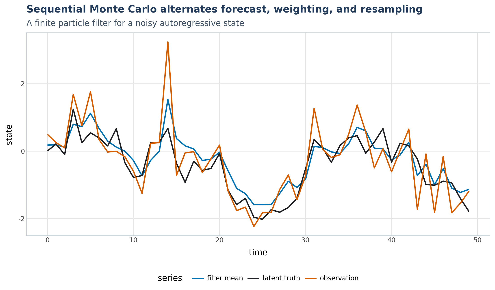

# State-Space Models and Sequential Monte Carlo {#sec-pp-smc}

Time series often contain an evolving latent state observed through noise.
Filtering updates current uncertainty online; smoothing revises past states
using later observations.

## State-space factorization

A Markov state model factors as

$$
p(x_{0:T},y_{1:T})
=p(x_0)\prod_{t=1}^T
p(x_t\mid x_{t-1})p(y_t\mid x_t).
$$

Prediction propagates

$$
p(x_t\mid y_{1:t-1})
=\int p(x_t\mid x_{t-1})
p(x_{t-1}\mid y_{1:t-1})\,dx_{t-1},
$$

and correction multiplies by $p(y_t\mid x_t)$ and normalizes.

Linear Gaussian models admit Kalman filters. Finite-state hidden Markov models
admit forward recursion. Nonlinear or non-Gaussian models often require
particles.

## Particle filtering

A bootstrap particle filter:

1. propagates particles through the transition;
2. weights them by observation likelihood;
3. normalizes and estimates expectations;
4. resamples when weight ESS is low.

<figure id="fig-pp-particle-filter">


<figcaption>

Figure 18.1: A particle filter tracks a latent autoregressive state through noisy observations by alternating forecast and correction.

</figcaption>
</figure>

Resampling combats weight collapse but duplicates particles and removes
diversity. With a fixed weighted cloud and output sample size, stratified
resampling and residual resampling with a multinomial remainder have
conditional estimator variance no larger than multinomial resampling.
Systematic resampling is also unbiased, but it has no such universal
variance guarantee; the particle order can change its variance sharply.

## Resampling: unbiasedness, variance, and order {#sec-resampling-variance}

Fix an ordered cloud of $N$ particles with weights $w_i\ge0$ summing to
one, and real values $f_i=f(x_i)$. All expectations and variances in this
section are **conditional on this fixed cloud**, over the resampling
randomness only. The target is the weighted-cloud mean
$\mu=\sum_iw_i f_i$, not an assertion that the finite cloud exactly equals
the filtering distribution. After choosing $N$ indices, the equal-weight
estimator is $\widehat\mu=N^{-1}\sum_i N_i f_i$, where $N_i$ counts the
offspring of particle $i$.

Write $C_0=0$, $C_i=\sum_{k=1}^i w_k$, and define the inverse-CDF map
$q(u)=\min\{i:u<C_i\}$ for $0\le u<1$. Particle $i$ owns the half-open
interval $[C_{i-1},C_i)$. A zero weight gives an empty interval and must
never be selected. These are one-based mathematical indices; the Python
laboratory uses zero-based indices.

### What systematic resampling preserves

Systematic resampling draws **one** $U\sim\operatorname{Uniform}[0,1/N)$
and selects $q(U+j/N)$ for $j=0,\ldots,N-1$. Each point is uniform in its
own stratum $S_j=[j/N,(j+1)/N)$, so interval lengths give

$$
\mathbb E[N_i]
=\sum_{j=0}^{N-1}N\,\operatorname{length}
  \bigl(S_j\cap[C_{i-1},C_i)\bigr)
=Nw_i.
$$

Consequently $\mathbb E[\widehat\mu]=\mu$. This is unbiasedness of the
offspring counts and mean. A particular output position is confined to its
stratum; it need not individually have categorical distribution $w$.
Moreover, the shared $U$ can make the positions dependent. Unbiasedness
alone supplies no variance comparison. The definitions and comparisons
follow ([Douc et al. 2005](bibliography.md#ref-douc2005resampling), Sections 2 and 3).

### An exact four-particle counterexample

Take

$$
w=\left(\frac18,\frac38,\frac18,\frac38\right),\qquad
f=(1,0,1,0),\qquad \mu=\frac14.
$$

The first-stratum offset determines the entire output. Index labels below
are zero-based to match the laboratory.

| Offset interval | Selected indices | $\widehat\mu$ | Probability |
|---|---|---:|---:|
| $0\le U<1/8$ | $0,1,2,3$ | $1/2$ | $1/2$ |
| $1/8\le U<1/4$ | $1,1,3,3$ | $0$ | $1/2$ |

Thus the systematic mean is unbiased, but

$$
\operatorname{Var}_{\mathrm{sys}}(\widehat\mu)=\frac1{16}.
$$

Multinomial resampling draws four independent indices with probabilities
$w$. Here each selected $f$ is Bernoulli with success probability $1/4$,
so the variance of their average is

$$
\operatorname{Var}_{\mathrm{mult}}(\widehat\mu)
=\frac{(1/4)(3/4)}4=\frac3{64}<\frac1{16}.
$$

Now permute the same weighted particles to
$w'=(1/8,1/8,3/8,3/8)$ and $f'=(1,1,0,0)$. This is the same empirical
measure and target mean. The two particles with value one occupy the
contiguous interval $[0,1/4)$, containing exactly one systematic grid point
for every admitted offset. Therefore $\widehat\mu=1/4$ always and the
systematic variance is zero. Multinomial variance is unchanged. Both
systematic and stratified laws can depend on particle order; the
stratified variance bound below still holds for each fixed order.

### Why independent stratification has a variance bound

Set $g(u)=f_{q(u)}$. For $V\sim\operatorname{Uniform}[0,1)$, let
$J=\lfloor NV\rfloor$, and define

$$
m_j=\mathbb E[g(V)\mid J=j],\qquad
v_j=\operatorname{Var}(g(V)\mid J=j).
$$

The stratum index $J$ is uniform over $0,\ldots,N-1$. Multinomial
resampling uses $N$ independent copies of $g(V)$, so total variance gives

$$
V_{\mathrm{mult}}
=\frac1N\left(\frac1N\sum_j v_j+
  \operatorname{Var}(m_J)\right).
$$

Stratified resampling instead draws an **independent** uniform point in
each $S_j$. Its estimator remains unbiased and has variance

$$
V_{\mathrm{strat}}=\frac1{N^2}\sum_j v_j,\qquad
V_{\mathrm{mult}}-V_{\mathrm{strat}}=\frac{\operatorname{Var}(m_J)}N\ge0.
$$

Equality is possible. In the four-particle counterexample, two strata have
a Bernoulli$(1/2)$ value and two have value zero, independently across
strata; hence $V_{\mathrm{strat}}=2(1/4)/4^2=1/32$. Reusing one common offset
changes the covariance terms: that is systematic resampling, for which
this independence proof does not apply.

### Exact branch computation, not a simulation

For rational weights, the systematic index tuple changes only when a grid
point crosses a cumulative boundary. The following standalone program
splits $[0,1/N)$ at every such boundary, evaluates one interior point in
each constant branch, and weights it by its exact interval probability.
Endpoints have probability zero under the continuous offset law; the
[laboratory implementation](app-d-python-lab.md#sec-systematic-lab) also
checks the specified half-open decisions at those exact endpoints.

```python
from bisect import bisect_right
from fractions import Fraction
from itertools import accumulate, pairwise

def systematic_mean_law(
    weights: tuple[int | Fraction, ...],
    values: tuple[int | Fraction, ...],
) -> dict[Fraction, Fraction]:
    """Integrate the exact mean law over the common first-stratum offset."""
    if not weights or len(weights) != len(values):
        raise ValueError("provide equal nonempty weight and value tuples")
    if any(type(value) not in (int, Fraction) for value in (*weights, *values)):
        raise TypeError("use exact int or Fraction data, excluding bool")
    exact_weights = tuple(Fraction(weight) for weight in weights)
    if any(weight < 0 for weight in exact_weights) or sum(exact_weights) != 1:
        raise ValueError("weights must be nonnegative and sum exactly to one")
    count = len(weights)
    step = Fraction(1, count)
    cumulative = tuple(accumulate(exact_weights))
    cuts = sorted({Fraction(0), step, *(boundary % step for boundary in cumulative)})
    law: dict[Fraction, Fraction] = {}
    for left, right in pairwise(cuts):
        offset = (left + right) / 2
        selected_values = (
            values[bisect_right(cumulative, offset + position * step)]
            for position in range(count)
        )
        estimate = sum(selected_values, Fraction(0)) / count
        law[estimate] = law.get(estimate, Fraction(0)) + (right - left) / step
    return dict(sorted(law.items()))

weights = (Fraction(1, 8), Fraction(3, 8)) * 2
values = (1, 0) * 2
law = systematic_mean_law(weights, values)
mean = sum(estimate * probability for estimate, probability in law.items())
variance = sum((estimate - mean) ** 2 * probability for estimate, probability in law.items())
print(law)
print(mean, variance)
```

The output law is $\{0:1/2,\ 1/2:1/2\}$, with mean $1/4$ and variance
$1/16$. Reduction modulo `step` moves each cumulative boundary into the
first stratum, collecting every possible crossing. This exact finite
integration establishes the law for the supplied cloud. The interval-length
proof establishes unbiasedness for every finite cloud, including irrational
weights; the finite program does not replace that proof.

### Changed task: six particles and the even-size family {#sec-resampling-task}

Use $w=(1/12,1/4,1/12,1/4,1/12,1/4)$ and $f=(1,0,1,0,1,0)$.
Derive the two systematic branches, their mean and variance, and compare
multinomial and independently stratified variances. Then group the three
value-one particles first, permuting their weights together with their
values; determine the new systematic law. Check the laws with the program,
and check offset zero and the branch boundary with the laboratory code.

Finally take any even $N=2m$ with alternating weights
$(1/(2N),3/(2N))$ and values $(1,0)$ repeated $m$ times. Prove the
systematic variance formula and identify which even sizes have strictly
larger variance than multinomial. The [separate explanation](#sec-resampling-solution)
also explains why grouping need not give zero variance for every even $N$.

## Smoothing and parameter learning

Filtering targets $p(x_t\mid y_{1:t})$; smoothing targets
$p(x_t\mid y_{1:T})$. Ancestor tracing can suffer path degeneracy far back in
time. Backward simulation and particle MCMC improve full trajectories.

Unknown static parameters do not rejuvenate through ordinary state propagation.
Particle marginal Metropolis–Hastings, SMC$^2$, or sufficient-statistic
methods address parameter learning at greater cost.

## Degeneracy and proposal choice

If observations are much sharper than transitions, prior propagation places
few particles near the data. Guided proposals condition partly on the new
observation. Increasing particle count helps but cannot repair a transition or
observation model with wrong support.

## Forecast evaluation and missing observations

At each time, the one-step predictive density
$p(y_t\mid y_{1:t-1})$ supplies a calibrated forecast score and a model check.
Systematic residuals reveal transition drift, observation outliers, or missing
seasonality before smoothing hides the timing.

When an observation is missing under an ignorable mechanism, propagate without
the correction step. Informative missingness needs its own observation
indicator model. Substituting a predicted value as if observed double-counts
model information and understates uncertainty.

**Nonexample.** Treating resampled particles as independent posterior draws
understates uncertainty; their ancestry creates dependence and duplicates.

<!-- inline-formula-code:start -->
## Formula and finite computation

Normalized particle weights are

$$
\bar w_t^{(i)}
=\frac{p(y_t\mid x_t^{(i)})}
{\sum_jp(y_t\mid x_t^{(j)})}.
$$

```python
from math import exp, isfinite

def particle_weights(states: list[float], observation: float, noise_sd: float) -> list[float]:
    if not states or any(not isfinite(state) for state in states):
        raise ValueError("states must be nonempty and finite")
    if not isfinite(observation) or not isfinite(noise_sd) or noise_sd <= 0.0:
        raise ValueError("observation must be finite and noise_sd finite and positive")
    log_weights = [-0.5 * ((observation - state) / noise_sd) ** 2 for state in states]
    maximum = max(log_weights)
    raw = [exp(value - maximum) for value in log_weights]
    total = sum(raw)
    return [value / total for value in raw]

print(particle_weights([-1.0, 0.0, 0.5, 2.0], 0.4, 0.6))
```

**What the computation establishes.** Four forecast particles receive stable
finite observation weights. It does not propagate, resample, or prove that the
finite cloud approximates a filtering distribution.
<!-- inline-formula-code:end -->

## Summary

State-space models factor dynamics and observations. Filtering alternates
prediction and correction; particle filters approximate these steps with
weighted samples and resampling. Smoothing, static parameters, sharp
observations, and ancestry degeneracy require additional algorithms and
diagnostics.

## Exercises

<div class="exercise" id="probabilistic_programming-18-state-space-smc-ex-1">
<p class="exercise-title"><strong>Exercise 1</strong></p>

Factor a three-time-step state-space joint density.

</div>

<div class="exercise" id="probabilistic_programming-18-state-space-smc-ex-2">
<p class="exercise-title"><strong>Exercise 2</strong></p>

Derive the discrete HMM forward recursion.

</div>

<div class="exercise" id="probabilistic_programming-18-state-space-smc-ex-3">
<p class="exercise-title"><strong>Exercise 3</strong></p>

Normalize particle log weights.

</div>

<div class="exercise" id="probabilistic_programming-18-state-space-smc-ex-4">
<p class="exercise-title"><strong>Exercise 4</strong></p>

Solve the [six-particle resampling task](#sec-resampling-task), including
its changed particle order and general even-size extension.

</div>

<div class="exercise" id="probabilistic_programming-18-state-space-smc-ex-5">
<p class="exercise-title"><strong>Exercise 5</strong></p>

Distinguish filtering from smoothing.

<details class="solution"><summary>Solution</summary>

For Exercise 5, filtering at time $t$ conditions only on observations through
$t$ and supports online decisions. Smoothing also uses future observations
through $T$, so it can revise earlier states but is not available online.

</details>

</div>

<div class="exercise" id="probabilistic_programming-18-state-space-smc-ex-6">
<p class="exercise-title"><strong>Exercise 6</strong></p>

Explain path degeneracy.

</div>

### Selected solution

For Exercise 5, filtering at time $t$ conditions only on observations through
$t$ and supports online decisions. Smoothing also uses future observations
through $T$, so it can revise earlier states but is not available online.

### Resampling-task explanation {#sec-resampling-solution}

In the alternating six-particle cloud, the systematic selected indices are
$(0,1,2,3,4,5)$ for $0\le U<1/12$ and $(1,1,3,3,5,5)$ for
$1/12\le U<1/6$. The estimator is respectively $1/2$ or zero, with equal
probabilities. Its mean is $1/4$ and variance $1/16$. The laboratory returns
the first tuple at offset zero and the second tuple at offset exactly
`Fraction(1, 12)`; use exact fractions for the supplied weights as well.

Multinomial variance is $(1/4)(3/4)/6=1/32$. Independent stratification has
three independent Bernoulli$(1/2)$ values, one in each first stratum of a
pair, and three deterministic zeros. Therefore its variance is
$3(1/4)/6^2=1/48$. The three schemes have the same expectation and
different dependence structures.

Grouping the value-one particles first gives
$w'=(1/12,1/12,1/12,1/4,1/4,1/4)$ and $f'=(1,1,1,0,0,0)$.
Their combined CDF interval is $[0,1/4)$. There are two grid points in it
when $U<1/12$ and one otherwise, so the systematic law is

$$
\mathbb P(\widehat\mu=1/3)=\frac12,\qquad
\mathbb P(\widehat\mu=1/6)=\frac12.
$$

The mean remains $1/4$ and the variance is $1/144$. Grouping improved
this example but did not make it deterministic, as it did for four
particles. Calling `systematic_mean_law` with these exact tuples yields
the displayed law without sampling random offsets.

For general even $N=2m$, split the CDF into $m$ adjacent pairs of total
mass $2/N$. In each pair, the value-one particle has mass $1/(2N)$.
The first systematic point in that pair hits it if and only if
$U<1/(2N)$; the second point always hits the value-zero particle. Thus
all $m$ potential successes move together, and $\widehat\mu$ equals
$m/N=1/2$ or zero with equal probabilities. Hence

$$
V_{\mathrm{sys}}=\frac1{16},\qquad
V_{\mathrm{mult}}=\frac3{16N},\qquad
V_{\mathrm{strat}}=\frac1{8N}.
$$

Systematic variance is strictly larger than multinomial for every even
$N\ge4$; at $N=2$ it is smaller. The persistence of $1/16$ in this
size-dependent family is an explicit reason not to infer convergence from
unbiasedness alone.

When all value-one particles are grouped together, the success interval is
still $[0,1/4)$. Its grid-point count is
$\lfloor N/4\rfloor+\operatorname{Bernoulli}(\theta)$ with
$\theta=N/4-\lfloor N/4\rfloor$. The variance of the average is
$\theta(1-\theta)/N^2$: zero if $N$ is divisible by four, and
$1/(4N^2)$ for even $N$ congruent to two modulo four. This proves the
four-versus-six distinction directly.
