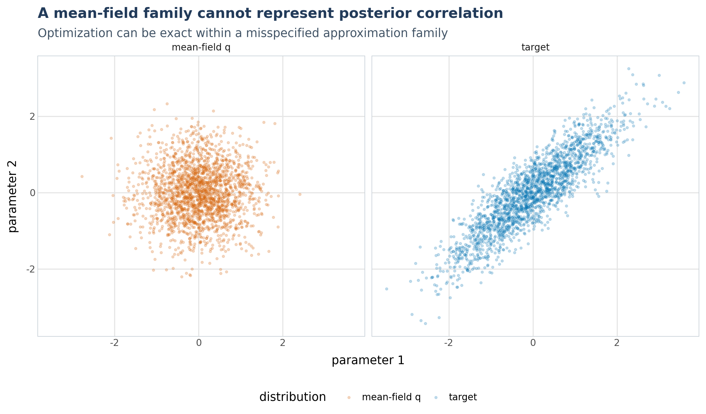

# Variational Inference {#sec-pp-variational}

Variational inference replaces posterior sampling by optimization over a chosen
family of approximating distributions. It can scale well and support fast
prediction, but optimization success is only relative to that family and
objective.

## KL divergence and the ELBO

Choose $q_\lambda(z)$ and minimize

$$
\operatorname{KL}(q_\lambda\|p(\,\cdot\mid y))
=E_q\left[\log\frac{q_\lambda(z)}{p(z\mid y)}\right].
$$

Since $\log p(y)$ is constant in $\lambda$, this is equivalent to maximizing
the evidence lower bound

$$
\mathcal L(\lambda)
=E_q[\log p(y,z)-\log q_\lambda(z)]
\le\log p(y).
$$

The gap is the KL divergence. An increasing ELBO shows optimization progress
within the implemented objective, not posterior accuracy.

## Mean field and its geometry

Mean-field families factor
$q(z)=\prod_jq_j(z_j)$. Coordinate ascent sets each factor proportional to the
exponential of the expected joint log density over other factors when
conjugacy permits.

<figure id="fig-pp-variational-gap">


<figcaption>

Figure 19.1: A mean-field normal approximation cannot reproduce strong posterior correlation and contracts into an axis-aligned cloud.

</figcaption>
</figure>

The $\operatorname{KL}(q\|p)$ used here heavily penalizes placing mass where the posterior has
little, often favoring one mode and giving too little spread between modes.
The direction $\operatorname{KL}(p\|q)$ and other divergences behave differently.

## An exact Gaussian family audit {#sec-pp-vi-gaussian}

A known Gaussian target makes the family restriction and the uncertainty
error explicit. The figure is qualitative; the calculation below
supplies a separate numerical certificate. The mean-field discussion and
factor updates in Blei, Kucukelbir, and McAuliffe
([Blei et al. 2017](bibliography.md#ref-blei2017variational), Sections 2.3–2.4) motivate this audit. We derive
the global certificate and contrast comparisons here.

Fix an integer $d\ge1$ and a **normalized** target
$p=N_d(\mu,\Sigma)$, with real symmetric positive definite covariance
$\Sigma$. Write $\Lambda=\Sigma^{-1}$ for its precision matrix. Use the family

$$
\begin{aligned}
\mathcal G_{\mathrm{diag}}
&=\{N_d(m,D):m\in\mathbb R^d,\\
&\qquad D=\operatorname{diag}(v_1,\ldots,v_d),\ v_j>0\}.
\end{aligned}
$$

We minimize $K(q)=\operatorname{KL}(q\|p)$ only within this Gaussian
family. General mean-field factors need not be Gaussian. This proof
does not establish global convergence of a general variational algorithm.
The known normalized $p$ here also differs from the joint masses
$p(y,z)$ in the finite ELBO listing later in the chapter.

### Deriving a global optimum {#sec-pp-vi-proof}

For $q=N_d(m,D)$, expand
$Z-\mu=(Z-m)+(m-\mu)$. The centered vector has expectation zero and
covariance $D$, so the cross term vanishes and

$$
\begin{aligned}
&E_q[(Z-\mu)^T\Lambda(Z-\mu)]\\
&\quad=\operatorname{tr}(\Lambda D)
       +(m-\mu)^T\Lambda(m-\mu).
\end{aligned}
$$

Here $\operatorname{tr}$ is the sum of diagonal entries: expanding the
centered quadratic form gives
$\sum_{i,j}\Lambda_{ij}E_q[(Z_i-m_i)(Z_j-m_j)]$.
The normalized Gaussian log densities therefore give

$$
\begin{aligned}
E_q\log q={}&-\frac d2\log(2\pi)\\
            &-\frac12\log\det D-\frac d2.
\end{aligned}
$$

and

$$
\begin{aligned}
E_q\log p={}&-\frac d2\log(2\pi)-\frac12\log\det\Sigma\\
&-\frac12\{\operatorname{tr}(\Lambda D)
                    +(m-\mu)^T\Lambda(m-\mu)\}.
\end{aligned}
$$

All these expectations are finite under the stated hypotheses. Subtract:

$$
\begin{aligned}
2K(m,v)={}&(m-\mu)^T\Lambda(m-\mu)\\
 &+\sum_j\Lambda_{jj}v_j-d\\
 &+\log\det\Sigma-\sum_j\log v_j.
\end{aligned}
$$

Positive definiteness gives $\Lambda_{jj}>0$. Define

$$
\begin{aligned}
m_*&=\mu,\qquad v_{*j}=\frac1{\Lambda_{jj}},\\
D_*&=\operatorname{diag}(v_{*1},\ldots,v_{*d}).
\end{aligned}
$$

For any feasible $(m,v)$, put $t_j=\Lambda_{jj}v_j>0$.
Direct subtraction gives

$$
\begin{aligned}
&2\{K(m,v)-K(m_*,v_*)\}\\
&\quad=(m-\mu)^T\Lambda(m-\mu)\\
&\qquad+\sum_j(t_j-1-\log t_j)\ge0.
\end{aligned}
$$

Indeed $g(t)=t-1-\log t$ has derivative $1-1/t$, negative below 1
and positive above 1, and $g(1)=0$. Thus $g(t)\ge0$, with equality only
at $t=1$. The positive definite quadratic form likewise vanishes
only at $m=\mu$. This proves the **unique global minimizer within
$\mathcal G_{\mathrm{diag}}$**, not just a stationary point. Its value is

$$
K_*=\frac12\log\left(\det\Sigma\prod_j\Lambda_{jj}\right).
$$

### Marginals and contrasts ask different questions {#sec-pp-vi-contrasts}

The optimum's coordinate variances are at most the target's. To prove
this when $d>1$, move coordinate $j$ to the first position and partition

$$
\Sigma=\begin{pmatrix}a&b^T\\b&C\end{pmatrix}.
$$

Solve $\Sigma(u,w)^T=(1,0)^T$: the second block equation gives
$w=-C^{-1}bu$, and the first gives
$u=(a-b^TC^{-1}b)^{-1}=\Lambda_{jj}$. Hence

$$
v_{*j}=a-b^TC^{-1}b\le a=\Sigma_{jj}.
$$

The principal submatrix $C$ is positive definite, so
$b^TC^{-1}b\ge0$, with equality only if $b=0$. For $d=1$ the
coordinate variances agree directly.

For a fixed real column vector $h$, however, the signed variance error is

$$
\begin{aligned}
&\operatorname{Var}_{q_*}(h^TZ)\\
&\quad-\operatorname{Var}_p(h^TZ)
 =h^T(D_*-\Sigma)h.
\end{aligned}
$$

A positive error means the variance is too large; a negative error
means it is too small; zero means an exact variance match. Every
linear mean $h^T\mu$ is exact at this optimum. To see why the coordinate
inequalities do not order all contrast variances, take

$$
\begin{aligned}
\Sigma&=\begin{pmatrix}A&C\\C&B\end{pmatrix},\\
&A,B>0,\quad \Delta=AB-C^2>0.
\end{aligned}
$$

Then

$$
\begin{aligned}
D_*&=\operatorname{diag}(\Delta/B,\Delta/A),\\
D_*-\Sigma&=\begin{pmatrix}-C^2/B&-C\\-C&-C^2/A\end{pmatrix}.
\end{aligned}
$$

If $C\ne0$, the error matrix has determinant
$-C^2\Delta/(AB)<0$. Its two real eigenvalues have opposite signs,
so some contrasts are overstated and others understated. If $C=0$,
$D_*=\Sigma$ and every contrast variance agrees.

### Better KL, worse error for one variance {#sec-pp-vi-worked}

Write $Z=(X,Y)^T$. Let $\mu=0$ and

$$
\begin{aligned}
\Sigma&=\begin{pmatrix}1&3/5\\3/5&1\end{pmatrix},\\
\Lambda&=\frac1{16}\begin{pmatrix}25&-15\\-15&25\end{pmatrix}.
\end{aligned}
$$

The optimum is $q_*=N_2(0,(16/25)I)$, with $K_*=\log(5/4)$.
Compare the feasible $q_0=N_2(0,(2/5)I)$, for which
$K_0=\log2-3/8$. The improvement is strictly positive:

$$
K_0-K_*=\log(8/5)-3/8=g(5/8)>0.
$$

| Quantity | Target $p$ | Feasible $q_0$ | Optimal $q_*$ |
|---|---:|---:|---:|
| $\operatorname{Var}(X)$ and $\operatorname{Var}(Y)$ | $1$ each | $2/5$ each | $16/25$ each |
| $\operatorname{Var}(X+Y)$ | $16/5$ | $4/5$ | $32/25$ |
| $\operatorname{Var}(X-Y)$ | $4/5$ | $4/5$ | $32/25$ |

The KL improves, yet the absolute error in $\operatorname{Var}(X-Y)$
increases from zero to $12/25$. Both coordinate variances increase from
$q_0$ to $q_*$; their shrinkage above compares the optimum with the
target. This exact pair does not prescribe every optimizer trajectory
or every estimand's behavior. It shows why objective improvement and
accuracy for a specified uncertainty question need separate checks.

## Stochastic gradients

For reparameterizable $z=g_\lambda(\epsilon)$ with fixed
$\epsilon\sim r$, differentiate Monte Carlo estimates through $g$. This pathwise
gradient usually has lower variance than score-function gradients.

For discrete variables, score gradients use

$$
\nabla_\lambda E_q[f(Z)]
=E_q[f(Z)\nabla_\lambda\log q_\lambda(Z)],
$$

with baselines or control variates. Continuous relaxations trade bias for lower
variance.

Normalizing flows transform a simple base density through invertible maps with
tractable Jacobians. Richer families reduce approximation bias but complicate
optimization and validation.

## Diagnostics

Use importance reweighting, comparisons with trusted small-model MCMC,
simulation calibration, predictive checks, and multiple optimization starts.
Report family, objective, optimizer, convergence behavior, and sensitivity.

## Optimization audit

Run multiple initializations, plot held-out ELBO estimates, and separate
gradient noise from objective curvature. Increase Monte Carlo samples near an
apparent optimum to check whether improvement has only fallen below estimator
noise. Use constrained scales and covariance parameterizations that cannot
produce invalid distributions.

Importance-weighted bounds can tighten evidence estimates while worsening the
signal-to-noise of some inference-network gradients. A larger bound index is
not automatically a better training algorithm.

**Nonexample.** A tiny stochastic-gradient norm can result from noisy
cancellation or a flat poor optimum; it is not a posterior certificate.

<!-- inline-formula-code:start -->
## Formula and finite computation

For normalized discrete $q$ and joint masses $p(y,z)$,

$$
\mathcal L=\sum_zq(z)\bigl[\log p(y,z)-\log q(z)\bigr].
$$

```python
from math import isfinite, log

def discrete_evidence_lower_bound(
    approximation_masses: list[float], joint_masses: list[float]
) -> float:
    if len(approximation_masses) != len(joint_masses) or not approximation_masses:
        raise ValueError("approximation and joint masses must be nonempty and equally long")
    all_masses = approximation_masses + joint_masses
    if any(not isfinite(value) or value <= 0.0 for value in all_masses):
        raise ValueError("all approximation and joint masses must be finite and positive")
    if abs(sum(approximation_masses) - 1.0) > 1e-12:
        raise ValueError("approximation masses must sum to one")
    return sum(
        approximation_mass * (log(joint_mass) - log(approximation_mass))
        for approximation_mass, joint_mass in zip(
            approximation_masses, joint_masses, strict=True
        )
    )

print(discrete_evidence_lower_bound([0.4, 0.6], [0.08, 0.27]))
```

**What the computation establishes.** The exact finite ELBO is evaluated for
one two-state approximation. It does not optimize the family or show closeness
to a continuous, multimodal posterior.
<!-- inline-formula-code:end -->

## Summary

Variational inference maximizes an ELBO, equivalently minimizing a chosen KL
direction within an approximation family. Mean-field structure can erase
dependence, stochastic gradients introduce optimization noise, and richer flows
trade tractability for expressiveness. Diagnostics must evaluate posterior
approximation, not only objective convergence.

Chapter 24 compares this global optimization view with local Laplace expansion,
EP moment matching, and explicitly invertible normalizing-flow densities.

## Exercises

<div class="exercise" id="probabilistic_programming-19-variational-inference-ex-1">
<p class="exercise-title"><strong>Exercise 1</strong></p>

Derive the ELBO identity.

<details class="solution"><summary>Solution</summary>

For Exercise 1, substitute
$\log p(z\mid y)=\log p(y,z)-\log p(y)$ into KL and rearrange:
$\log p(y)=\mathcal L+\operatorname{KL}(q\|p)$.

</details>

</div>

<div class="exercise" id="probabilistic_programming-19-variational-inference-ex-2">
<p class="exercise-title"><strong>Exercise 2</strong></p>

Optimize a two-state variational distribution.

</div>

<div class="exercise" id="probabilistic_programming-19-variational-inference-ex-3">
<p class="exercise-title"><strong>Exercise 3</strong></p>

Write the exact KL direction used here. Explain the penalty for placing $q$ mass where $q/p$ is large, then use the clinic to explain why this intuition does not order every contrast variance.

<details class="solution"><summary>Solution</summary>

For Exercise 3, the expectation is under $q$ in
$\operatorname{KL}(q\|p)=E_q[\log q-\log p]$. Regions where $q/p$
is large contribute positively, with the $-\log p$ term penalizing
$q$ mass in low-target-density regions. A restricted family
can consequently favor one mode, but this is no universal one-mode theorem.
In the clinic, smaller coordinate variances coexist with both signs
of contrast-variance error; the KL intuition cannot order them all.

</details>

</div>

<div class="exercise" id="probabilistic_programming-19-variational-inference-ex-4">
<p class="exercise-title"><strong>Exercise 4</strong></p>

Derive a reparameterized normal gradient.

</div>

<div class="exercise" id="probabilistic_programming-19-variational-inference-ex-5">
<p class="exercise-title"><strong>Exercise 5</strong></p>

Add a score-function baseline.

</div>

<div class="exercise" id="probabilistic_programming-19-variational-inference-ex-6">
<p class="exercise-title"><strong>Exercise 6</strong></p>

Design a variational-versus-MCMC validation experiment.

</div>

<div class="exercise" id="probabilistic_programming-19-variational-inference-ex-7">
<p class="exercise-title"><strong>Exercise 7</strong></p>

Do the [changed Gaussian task](#sec-pp-vi-task); compare $X+2Y$ with $X-2Y$.

</div>

### Selected solution

For Exercise 1, substitute
$\log p(z\mid y)=\log p(y,z)-\log p(y)$ into KL and rearrange:
$\log p(y)=\mathcal L+\operatorname{KL}(q\|p)$.

For Exercise 3, the expectation is under $q$ in
$\operatorname{KL}(q\|p)=E_q[\log q-\log p]$. Regions where $q/p$
is large contribute positively, with the $-\log p$ term penalizing
$q$ mass in low-target-density regions. A restricted family
can consequently favor one mode, but this is no universal one-mode theorem.
In the clinic, smaller coordinate variances coexist with both signs
of contrast-variance error; the KL intuition cannot order them all.

### Changed task: unequal scales and two contrasts {#sec-pp-vi-task}

Write $Z=(X,Y)^T$. For the known target

$$
p=N_2\!\left(0,\begin{pmatrix}4&1\\1&1\end{pmatrix}\right),
$$

verify positive definiteness. Minimize $K(q)=\operatorname{KL}(q\|p)$
over $\mathcal G_{\mathrm{diag}}$, finding $m_*,D_*,K_*$ and explaining
global uniqueness. Find target and approximate variances of $X+2Y$ and
$X-2Y$, then give each signed error (approximate minus target).
Explain why comparing only the coordinate variances cannot answer both
contrast questions. Check the [hint](#sec-pp-vi-hint) before the
[full answer](#sec-pp-vi-solution).

### Hint {#sec-pp-vi-hint}

Invert the covariance. Use reciprocal **precision** diagonals, rather
than the target marginal variances. Apply the nonnegative gap identity
for global optimality and $h^T\Sigma h$ for each contrast.

### Full answer {#sec-pp-vi-solution}

The leading principal minors are $4$ and $3$, so the covariance is
positive definite. Its precision and restricted-family optimum are

$$
\begin{aligned}
\Lambda&=\frac13\begin{pmatrix}1&-1\\-1&4\end{pmatrix},\\
m_*&=0,\qquad D_*=\operatorname{diag}(3,3/4).
\end{aligned}
$$

The gap identity vanishes only at these parameters, proving global
uniqueness within $\mathcal G_{\mathrm{diag}}$. Since
$\det\Sigma=3$ and $\det D_*=9/4$,

$$
K_*=\frac12\log(4/3).
$$

| Contrast | Target variance | $q_*$ variance | Signed error |
|---|---:|---:|---:|
| $X+2Y$ | $4+4+4=12$ | $3+4(3/4)=6$ | $-6$ |
| $X-2Y$ | $4+4-4=4$ | $3+4(3/4)=6$ | $+2$ |

Both coordinate variances shrink, $3<4$ and $3/4<1$, while the second
contrast variance increases. Both linear means are exactly zero.
This is a conclusion about the specified objective and Gaussian family;
it supplies no general posterior-accuracy certificate.
