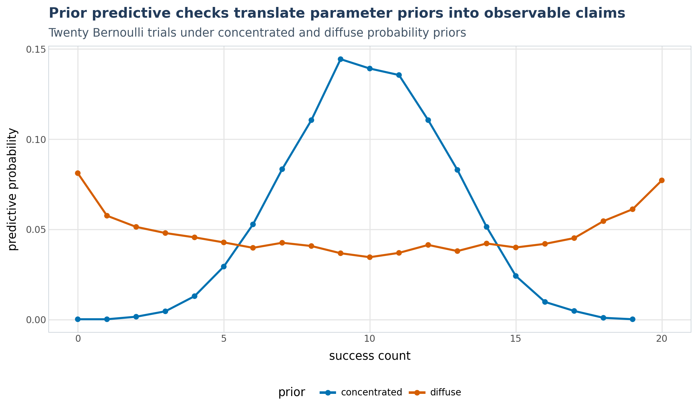

# Model Comparison and Criticism {#sec-pp-comparison}

Models should be compared for a declared purpose: prediction, explanation,
decision, or scientific mechanism. No single score both diagnoses every
failure and chooses a model automatically.

## Predictive scoring

For held-out observation $y_i$, the log predictive density is

$$
\log p(y_i\mid y_{-i})
=\log\int p(y_i\mid\theta)p(\theta\mid y_{-i})\,d\theta.
$$

Leave-one-out cross-validation sums these terms. For grouped or time-dependent
data, the held-out unit must match deployment: leaving one row out can leak
subject or future information.

Expected log predictive density is a relative score. Differences need standard
errors that respect dependence. Stacking combines model predictions by
optimizing predictive weights rather than pretending one candidate is true.

## Information criteria and evidence

WAIC approximates Bayesian leave-one-out behavior using pointwise log
likelihood and an effective-parameter correction. Pareto-smoothed importance
sampling can approximate LOO from full-posterior draws and diagnose influential
observations.

Marginal likelihood is

$$
p(y\mid M)=\int p(y\mid\theta,M)p(\theta\mid M)\,d\theta.
$$

Bayes factors compare these evidences. They are sensitive to prior mass across
the whole parameter space, including regions with little posterior mass. A
vague prior can impose a strong complexity penalty.

<figure id="fig-pp-comparison-priors">


<figcaption>

Figure 20.1: Prior-predictive distributions reveal model commitments that marginal likelihood and posterior fit both depend on.

</figcaption>
</figure>

## Criticism before ranking

Posterior predictive checks can reveal that every candidate misses the same
tail, dependence, or measurement mechanism. Ranking bad models does not create
a good one. Residual and predictive checks should target the scientific use.

Sensitivity to prior, likelihood, observations, and preprocessing is part of
comparison. Model expansion after criticism should be documented; repeated
selection against one test set overfits that set.

## Decision-aware comparison

Small average log-score differences may concentrate in cases with little
decision consequence, while a rare safety-relevant tail dominates utility.
Evaluate both proper predictive scores and downstream decision loss. The latter
requires utilities stated independently of the model comparison.

When candidate models extrapolate differently, ordinary interpolation-focused
cross-validation cannot choose among them. Use mechanistic constraints,
external evidence, or a design that observes the extrapolation region; do not
convert agreement on existing data into certainty about the future.

**Nonexample.** Choosing the model with highest in-sample likelihood rewards
flexibility and ignores uncertainty about fitted parameters.

<!-- inline-formula-code:start -->
## Formula and finite computation

Summed log predictive score is

$$
\operatorname{elpd}=\sum_{i=1}^n\log p(y_i\mid y_{-i}).
$$

```python
from math import log

def log_predictive_score(probabilities: list[float], outcomes: list[int]) -> float:
    if len(probabilities) != len(outcomes) or not outcomes:
        raise ValueError("probabilities and outcomes must be nonempty and equal length")
    if any(not 0.0 < probability < 1.0 for probability in probabilities):
        raise ValueError("probabilities must lie strictly inside (0,1)")
    if any(outcome not in (0, 1) for outcome in outcomes):
        raise ValueError("outcomes must be binary")
    return sum(
        log(probability if outcome else 1.0 - probability)
        for probability, outcome in zip(probabilities, outcomes, strict=True)
    )

print(log_predictive_score([0.8, 0.35, 0.6, 0.2], [1, 0, 1, 1]))
```

**What the computation establishes.** Four declared predictive probabilities
receive a proper log score. The code does not perform honest cross-validation
or estimate uncertainty in a model-score difference.
<!-- inline-formula-code:end -->

## Summary

Cross-validation targets predictive deployment, information criteria approximate
it under conditions, and marginal likelihood compares fully prior-averaged
models. Predictive checks diagnose shared failure before ranking. Data grouping,
prior sensitivity, repeated selection, and score uncertainty must be reported.

Chapter 26 derives the raw leave-one-out importance identity, explains Pareto
smoothing and its diagnostics, and develops pointwise score uncertainty and
stacking.

## Exercises

<div class="exercise" id="probabilistic_programming-20-model-comparison-criticism-ex-1">
<p class="exercise-title"><strong>Exercise 1</strong></p>

Design grouped cross-validation.

</div>

<div class="exercise" id="probabilistic_programming-20-model-comparison-criticism-ex-2">
<p class="exercise-title"><strong>Exercise 2</strong></p>

Compute two models' log scores.

</div>

<div class="exercise" id="probabilistic_programming-20-model-comparison-criticism-ex-3">
<p class="exercise-title"><strong>Exercise 3</strong></p>

Explain Bayes-factor prior sensitivity.

</div>

<div class="exercise" id="probabilistic_programming-20-model-comparison-criticism-ex-4">
<p class="exercise-title"><strong>Exercise 4</strong></p>

Give a predictive check both candidates can fail.

</div>

<div class="exercise" id="probabilistic_programming-20-model-comparison-criticism-ex-5">
<p class="exercise-title"><strong>Exercise 5</strong></p>

Contrast stacking with model selection.

</div>

<div class="exercise" id="probabilistic_programming-20-model-comparison-criticism-ex-6">
<p class="exercise-title"><strong>Exercise 6</strong></p>

Identify leakage in a time-series split.

<details class="solution"><summary>Solution</summary>

For Exercise 6, randomly holding out future and past rows lets training include
observations after a test time. A forward-chaining split trains only on the past
available at each deployment point.

</details>

</div>

### Selected solution

For Exercise 6, randomly holding out future and past rows lets training include
observations after a test time. A forward-chaining split trains only on the past
available at each deployment point.
