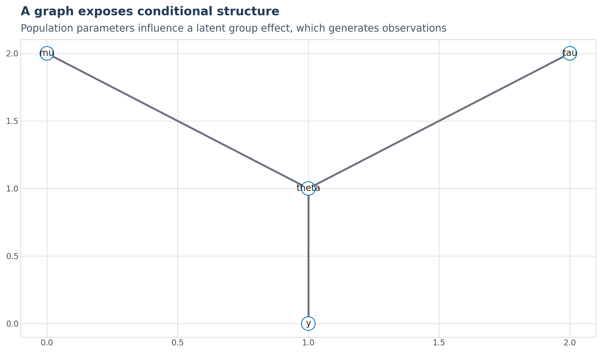

# Causal and Decision Analysis {#sec-pp-causal-decision}

A posterior describes uncertainty under a model. A causal claim additionally
asks what would happen under intervention, and a decision additionally attaches
utilities or losses to actions and outcomes.

## Intervention versus conditioning

In a causal DAG, conditioning on $X=x$ filters observed units; intervention
$\operatorname{do}(X=x)$ replaces the mechanism generating $X$. These
distributions coincide only under appropriate absence of confounding.

The backdoor adjustment is

$$
p(y\mid\operatorname{do}(x))
=\sum_z p(y\mid x,z)p(z)
$$

when $Z$ blocks every backdoor path, contains no descendant of $X$, and
identification assumptions hold. Positivity requires each relevant stratum to
support treatment alternatives.

<figure id="fig-pp-causal-dag">


<figcaption>

Figure 21.1: The graphical language that encodes conditional structure becomes causal only after arrows receive intervention semantics and assumptions.

</figcaption>
</figure>

Potential outcomes express unit-level outcomes $Y(1),Y(0)$. Randomization
identifies average effects through exchangeability; observational identification
requires measured-confounder assumptions or other designs. Posterior precision
cannot identify an effect hidden by unmeasured confounding.

## Bayesian decision theory

For action $a$, state $\theta$, and utility $u(a,\theta)$, choose

$$
a^\star=\underset{a}{\operatorname{argmax}}\,
E[u(a,\theta)\mid y].
$$

Under squared-error loss, the posterior mean is optimal; under absolute loss,
a posterior median is optimal; under zero-one loss for a discrete state, a
posterior mode is optimal. Different utilities create different rational
actions from the same posterior.

The expected value of perfect information compares the posterior-optimal action
now with the action possible after learning $\theta$. Sample information
accounts for an actual experiment's imperfect signal and cost.

## Robustness and policy

Sensitivity analyses vary unmeasured confounding, selection, interference,
utility, and transport to a target population. A policy can affect future data
and invalidate a stationary observation model. Fairness constraints and harms
are decisions, not latent parameters that likelihood automatically resolves.

## Bayesian uncertainty after identification

Once a causal functional is identified, a Bayesian model can propagate finite
sample uncertainty through outcome, treatment, and covariate distributions.
This does not turn the identifying assumptions into random variables. Sensitivity
parameters for unmeasured confounding express a range of departures whose
scientific plausibility must be argued.

Posterior decision analysis should include implementation constraints and
feedback: treatment capacity, adherence, spillovers, and learning can change
the population exposed to a policy.

**Nonexample.** Choosing treatment whenever posterior probability of benefit
exceeds one half assumes symmetric zero-one utility. Cost, side effects, benefit
magnitude, and alternatives can change the threshold.

<!-- inline-formula-code:start -->
## Formula and finite computation

Posterior expected utility is

$$
EU(a)=\sum_su(a,s)p(s\mid y).
$$

```python
from math import isfinite

def best_action(
    posterior: dict[str, float], utilities: dict[str, dict[str, float]]
) -> tuple[str, dict[str, float]]:
    if not posterior or any(not isfinite(value) for value in posterior.values()):
        raise ValueError("posterior must be nonempty and finite")
    if abs(sum(posterior.values()) - 1.0) > 1e-12 or any(
        value < 0.0 for value in posterior.values()
    ):
        raise ValueError("posterior must be a probability distribution")
    if not utilities or any(
        not isfinite(value)
        for by_state in utilities.values()
        for value in by_state.values()
    ):
        raise ValueError("utilities must be nonempty and finite")
    if any(set(by_state) != set(posterior) for by_state in utilities.values()):
        raise ValueError("every action needs utility for every state")
    expected = {
        action: sum(by_state[state] * probability for state, probability in posterior.items())
        for action, by_state in utilities.items()
    }
    return max(expected, key=expected.get), expected

posterior = {"benefit": 0.65, "no_benefit": 0.35}
utilities = {
    "treat": {"benefit": 8.0, "no_benefit": -5.0},
    "wait": {"benefit": 0.0, "no_benefit": 1.0},
}
print(best_action(posterior, utilities))
```

**What the computation establishes.** One finite action table is optimized
under declared posterior probabilities and utilities. It does not identify a
causal benefit distribution or justify the utility numbers.
<!-- inline-formula-code:end -->

## Summary

Causal inference distinguishes intervention from conditioning and needs
identification assumptions beyond posterior computation. Decision theory maps
posterior uncertainty and explicit utility to actions. Confounding, positivity,
transport, interference, and utility sensitivity belong in the analysis.

## Exercises

<div class="exercise" id="probabilistic_programming-21-causal-decision-analysis-ex-1">
<p class="exercise-title"><strong>Exercise 1</strong></p>

Contrast conditioning and intervention in a confounded graph.

</div>

<div class="exercise" id="probabilistic_programming-21-causal-decision-analysis-ex-2">
<p class="exercise-title"><strong>Exercise 2</strong></p>

Derive a backdoor adjustment.

</div>

<div class="exercise" id="probabilistic_programming-21-causal-decision-analysis-ex-3">
<p class="exercise-title"><strong>Exercise 3</strong></p>

Show posterior mean minimizes squared loss.

<details class="solution"><summary>Solution</summary>

For Exercise 3, write
$E[(a-\theta)^2\mid y]=(a-E[\theta\mid y])^2+\operatorname{Var}(\theta\mid y)$.
Only the first term depends on $a$, so it is minimized at the posterior mean.

</details>

</div>

<div class="exercise" id="probabilistic_programming-21-causal-decision-analysis-ex-4">
<p class="exercise-title"><strong>Exercise 4</strong></p>

Compute an action threshold under asymmetric utility.

</div>

<div class="exercise" id="probabilistic_programming-21-causal-decision-analysis-ex-5">
<p class="exercise-title"><strong>Exercise 5</strong></p>

Define value of perfect information.

</div>

<div class="exercise" id="probabilistic_programming-21-causal-decision-analysis-ex-6">
<p class="exercise-title"><strong>Exercise 6</strong></p>

Design an unmeasured-confounding sensitivity analysis.

</div>

### Selected solution

For Exercise 3, write
$E[(a-\theta)^2\mid y]=(a-E[\theta\mid y])^2+\operatorname{Var}(\theta\mid y)$.
Only the first term depends on $a$, so it is minimized at the posterior mean.
