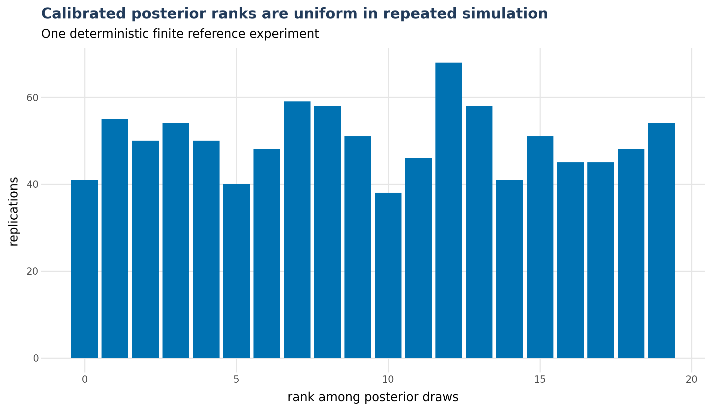

# Discrete, Amortized, and End-to-End Inference {#sec-pp-advanced-inference}

Not every latent variable is differentiable, and not every data set permits a
fresh expensive posterior fit. Exact enumeration, dynamic programming,
gradient estimators, and amortized inference fill these gaps. This final chapter
organizes them into auditable workflows.

## Exact marginalization and dynamic programming

For a small discrete latent state,

$$
p(\theta\mid y)
\propto p(\theta)\sum_zp(z\mid\theta)p(y\mid z,\theta).
$$

Summing $z$ exactly reduces sampler dimension and avoids discrete proposals.
Hidden Markov forward algorithms exploit conditional structure to replace an
exponential sum over state paths by repeated matrix-vector updates.

Variable elimination cost depends on graph treewidth, not only variable count.
Enumeration remains valuable as a reference test on small models.

## Discrete gradient strategies

Score-function gradients are unbiased but can have high variance. Baselines,
Rao–Blackwellization, and control variates help. Continuous relaxations such as
soft categorical samples produce pathwise gradients but optimize a relaxed or
biased objective at finite temperature.

Hybrid inference can marginalize some variables, Gibbs-update others, and use
HMC on continuous blocks. Every kernel must preserve the same joint target.

## Amortized inference

Instead of optimizing local variational parameters per data set, learn an
inference network $q_\phi(z\mid y)$ across simulated or observed cases.
Training cost is amortized over fast later predictions. The amortization gap is
the loss from sharing one learned mapping rather than optimizing each case.

Simulation-based inference learns likelihood ratios, posteriors, or summaries
from simulator output when likelihood evaluation is unavailable. Calibration
depends on simulation fidelity and coverage of the training proposal.

<figure id="fig-pp-end-to-end-sbc">


<figcaption>

Figure 22.1: Simulation-based rank checks provide an end-to-end audit of amortized or hybrid posterior output under generated truth.

</figcaption>
</figure>

## Three case-study blueprints

**A/B conversion hierarchy.** Begin with beta–binomial groups, add exchangeable
partial pooling, compare centered and marginal computations, check prior
predictive conversion counts, and choose deployment through expected utility.

**Robust sensor state.** Use a state-space transition with Student observation
noise represented by latent scales. Compare particle filtering and smoothing;
audit weight ESS, outlier interpretation, and transition misspecification.

**Likelihood-free population model.** Simulate summaries under parameters,
train a conditional approximation, validate by SBC and held-out simulations,
and test sensitivity to summaries and simulator discrepancy.

In every case, maintain a ledger with model, target, algorithm, finite
diagnostics, predictive criticism, sensitivity, and decision scope.

## Deployment and monitoring

Freeze preprocessing, simulator version, parameter support, and calibration
suite with the trained inference network. At deployment, detect inputs outside
the training proposal, monitor predictive calibration where outcomes arrive,
and abstain or fall back to a slower method when coverage fails.

Amortized speed can make repeated decisions cheap enough that multiplicity and
feedback matter. Logging only posterior summaries without inputs, versions, and
actions prevents later calibration or harm audits.

**Nonexample.** A neural posterior that is fast and visually plausible is not
validated by training loss alone. It can extrapolate outside simulation support
with unjustified confidence.

<!-- inline-formula-code:start -->
## Formula and finite computation

Exact discrete marginalization uses

$$
p(z\mid y)=\frac{p(z)p(y\mid z)}
{\sum_{z'}p(z')p(y\mid z')}.
$$

```python
from math import isfinite

def discrete_posterior(
    prior: dict[str, float], likelihood: dict[str, float]
) -> dict[str, float]:
    if set(prior) != set(likelihood) or not prior:
        raise ValueError("prior and likelihood states must match and be nonempty")
    invalid_prior_mass = any(
        not isfinite(value) or value < 0.0 for value in prior.values()
    )
    if invalid_prior_mass or abs(sum(prior.values()) - 1.0) > 1e-12:
        raise ValueError("prior must be normalized")
    if any(not isfinite(value) or not 0.0 <= value <= 1.0 for value in likelihood.values()):
        raise ValueError("likelihood values must lie in [0,1]")
    joint = {state: prior[state] * likelihood[state] for state in prior}
    evidence = sum(joint.values())
    if evidence == 0.0:
        raise ValueError("observation has zero evidence")
    return {state: value / evidence for state, value in joint.items()}

print(discrete_posterior({"low": 0.7, "high": 0.3}, {"low": 0.1, "high": 0.8}))
```

**What the computation establishes.** The posterior is normalized exactly for
one two-state latent model. It does not scale to a large graphical model or
validate amortized inference outside simulated training support.
<!-- inline-formula-code:end -->

## Summary

Exact summation and dynamic programming should replace sampling when structure
makes them tractable. Discrete gradients, hybrid kernels, and continuous
relaxations carry distinct bias and variance properties. Amortized inference
trades per-case optimization for a learned map and demands simulation-based
calibration, coverage checks, and discrepancy analysis.

The next sequence separates these themes for deeper study: Chapter 23 develops
exact elimination and messages, Chapter 27 develops trace and compiler
semantics, and Chapter 28 develops ABC and neural simulation-based inference.

## Exercises

<div class="exercise" id="probabilistic_programming-22-discrete-amortized-case-studies-ex-1">
<p class="exercise-title"><strong>Exercise 1</strong></p>

Enumerate a three-state posterior.

</div>

<div class="exercise" id="probabilistic_programming-22-discrete-amortized-case-studies-ex-2">
<p class="exercise-title"><strong>Exercise 2</strong></p>

Derive an HMM forward update.

</div>

<div class="exercise" id="probabilistic_programming-22-discrete-amortized-case-studies-ex-3">
<p class="exercise-title"><strong>Exercise 3</strong></p>

Add a baseline to a score gradient.

</div>

<div class="exercise" id="probabilistic_programming-22-discrete-amortized-case-studies-ex-4">
<p class="exercise-title"><strong>Exercise 4</strong></p>

Identify bias in a continuous categorical relaxation.

</div>

<div class="exercise" id="probabilistic_programming-22-discrete-amortized-case-studies-ex-5">
<p class="exercise-title"><strong>Exercise 5</strong></p>

Define optimization and amortization gaps.

<details class="solution"><summary>Solution</summary>

For Exercise 5, the approximation gap is the best family member's divergence
from the posterior. The optimization gap is failure to reach that best member.
The amortization gap is additional loss from predicting variational parameters
with a shared network rather than optimizing the case directly.

</details>

</div>

<div class="exercise" id="probabilistic_programming-22-discrete-amortized-case-studies-ex-6">
<p class="exercise-title"><strong>Exercise 6</strong></p>

Write a validation ledger for one case-study blueprint.

</div>

### Selected solution

For Exercise 5, the approximation gap is the best family member's divergence
from the posterior. The optimization gap is failure to reach that best member.
The amortization gap is additional loss from predicting variational parameters
with a shared network rather than optimizing the case directly.

## A finite A/B conversion workflow {#sec-pp-ab-exact-workflow}

The conversion blueprint above can be completed exactly on a deliberately small
hyperparameter space while retaining **continuous** arm probabilities. This is a
worked synthetic reference, not a report about a deployed experiment. Every
count and answer here is public; neither the example nor its changed-data
exercise is fresh, hidden assessment evidence.

### Specify the experiment and freeze the comparison {#sec-pp-ab-exact-contract}

Let $\theta_A,\theta_B\in(0,1)$ be two stable conversion probabilities. Conditional
on them, exposures are independent Bernoulli trials, within and between arms.
The training counts are $D=((n_A,y_A),(n_B,y_B))=((2,0),(6,4))$: no conversions in
two A exposures and four in six B exposures. Counts, rather than ordered binary
sequences, are the observations, so binomial coefficients belong in their
probabilities.

The workflow contract fixes these choices before using the held-out counts:

- Fit only these training counts. Use the six-state hierarchy $H$ below, with
  its uniform main prior and the stated central-mean sensitivity prior.
- Criticize the prior using a new, exchangeable arm with four exposures, before
  conditioning on training counts. The diagnostic event is an extreme count,
  $Y_4=0$ or $Y_4=4$; it is a descriptive check, with no pass threshold or fitted
  hyperprior.
- Compare $H$ with $N$, independent $\operatorname{Beta}(1,1)$ arm priors, and
  $P$, one shared $\operatorname{Beta}(1,1)$ probability for both arms. Freeze
  the **joint count-event** predictive probability for two future exposures in
  each already-seen arm as the comparison criterion.
- Make a risk-neutral one-exposure decision using a conversion reward of one
  utility unit and an incremental B cost of $c=1/5$. Keep A or deploy B; use
  training information only.
- Finally evaluate the reserved counts $(m_A,z_A)=(2,1)$ and $(m_B,z_B)=(2,2)$.
  Do not use these counts to fit weights, select the prior, change the cost or
  redesign the scoring event. Any later refit needs a different future test.

All these numbers are visible in this teaching fixture. “Frozen” specifies which
numbers may enter each calculation; it does not claim that a public exercise
was prospectively blinded or preregistered. Stable probabilities, exchangeable
arms and independent exposures are substantive assumptions. There is no
randomization or causal identification claim in this illustrative likelihood.

### Write the joint target and integrate the arms {#sec-pp-ab-exact-target}

A hyperstate is $h=(\mu,\kappa)$ with

$$
\mu\in\{1/4,1/2,3/4\},\qquad \kappa\in\{4,12\},\qquad
\pi_h=1/6.
$$

Given $h$, independently draw

$$
\theta_j\mid h\sim\operatorname{Beta}(a_h,b_h),\qquad
(a_h,b_h)=(\kappa\mu,\kappa(1-\mu)),\qquad
Y_j\mid\theta_j\sim\operatorname{Binomial}(n_j,\theta_j).
$$

Here every shape is a positive integer. The beta density is
$f_{a,b}(t)=t^{a-1}(1-t)^{b-1}/B(a,b)$ for $0<t<1$, with
$B(a,b)=(a-1)!(b-1)!/(a+b-1)!$. The prior arm mean is $\mu$ and its conditional
variance is $\mu(1-\mu)/(\kappa+1)$. Thus $\kappa$ controls concentration; it
is not a data-derived sample size.

The full, centered joint density with respect to counting measure in $h$ and
Lebesgue measure in the two probabilities is

$$
p(h,\theta_A,\theta_B,D)
=\pi_h\prod_{j\in\{A,B\}}
 f_{a_h,b_h}(\theta_j)\binom{n_j}{y_j}
 \theta_j^{y_j}(1-\theta_j)^{n_j-y_j}.
$$

For counts $y$ in $n$ trials, define the beta–binomial probability

$$
\operatorname{BB}(n,y;a,b)
=\binom ny\frac{B(a+y,b+n-y)}{B(a,b)}.
$$

Integrating both continuous probabilities gives

$$
L_h(D)=\prod_j\operatorname{BB}(n_j,y_j;a_h,b_h),\quad
Z(D)=\sum_h\pi_hL_h(D),\quad
w_h=p(h\mid D)=\frac{\pi_hL_h(D)}{Z(D)}.
$$

The conditional posterior and marginal arm posterior are

$$
\theta_j\mid h,D\sim\operatorname{Beta}(a_h+y_j,b_h+n_j-y_j),\qquad
p(\theta_j\mid D)=\sum_hw_h f_{a_h+y_j,b_h+n_j-y_j}(\theta_j).
$$

Equivalently, $p(h,\theta_A,\theta_B\mid D)$ is $w_h$ times the product of those
two conditional beta densities. This is the same target as the normalized
centered joint density, not an approximation to it. The listing checks that
factorization at $(\theta_A,\theta_B)=(1/2,1/2)$ as an exact arithmetic
identity. A density value at a point is not a probability mass. This comparison
establishes an analytic and finite-computation reference; it does not benchmark
centered versus noncentered MCMC mixing.

For the training fixture, $Z(D)=356807/9653280$. The table gives the six beta
shapes and posterior numerators; divide the last column by $356807$.

| $\mu$ | $\kappa$ | $(a_h,b_h)$ | $356807\,w_h$ |
|---|---:|---|---:|
| $1/4$ | 4 | $(1,3)$ | 68952 |
| $1/4$ | 12 | $(3,9)$ | 50625 |
| $1/2$ | 4 | $(2,2)$ | 86190 |
| $1/2$ | 12 | $(6,6)$ | 92610 |
| $3/4$ | 4 | $(3,1)$ | 28730 |
| $3/4$ | 12 | $(9,3)$ | 29700 |

### Check the prior, pooling and uncertainty {#sec-pp-ab-exact-uncertainty}

Before fitting, the declared extreme-count probability for one **new** arm is

$$
p(Y_4\in\{0,4\})
=\sum_h\pi_h\{\operatorname{BB}(4,0;a_h,b_h)
                 +\operatorname{BB}(4,4;a_h,b_h)\}
=\frac{97}{273}\approx0.355311355.
$$

The prior therefore puts substantial mass on four-exposure batches with no
conversions or all conversions. A domain in which such batches are implausible
would motivate a revised model before a new training/test comparison. This
single diagnostic neither validates the hierarchy nor supplies a significance
test; using fitted weights here would instead be a posterior predictive check.

For $n_j>0$, the conditional posterior mean exhibits partial pooling directly:

$$
m_{jh}=\frac{a_h+y_j}{\kappa+n_j}
=\frac{n_j}{\kappa+n_j}\frac{y_j}{n_j}
 +\frac{\kappa}{\kappa+n_j}\mu.
$$

The smaller A sample receives more shrinkage for each fixed $\kappa$. Mixing
these means with the training-only $w_h$ gives

$$
E(\theta_A\mid D)=\frac{1739053}{4995298}\approx0.348137989,\qquad
E(\theta_B\mid D)=\frac{397777}{713614}\approx0.557411990.
$$

For comparison, $N$ gives means $1/4,5/8$, and $P$ gives $1/2$ for both arms.
The hierarchical means lie between these independent-arm and fully pooled
means in this fixture. That ordering is an observed result here, not a theorem
for every mixture prior or data set.

Put $v_{jh}=(a_h+y_j)(b_h+n_j-y_j)/[(\kappa+n_j)^2(\kappa+n_j+1)]$.
Then

$$
\operatorname{Var}(\theta_j\mid D)
 =\sum_hw_h(v_{jh}+m_{jh}^2)-\left(\sum_hw_hm_{jh}\right)^2,
$$

$$
\operatorname{Cov}(\theta_A,\theta_B\mid D)
 =\sum_hw_hm_{Ah}m_{Bh}-E(\theta_A\mid D)E(\theta_B\mid D).
$$

Numerically the two variances are $0.041207869$ and $0.026229660$, and the
covariance is $0.010809466$. Conditional independence given $h$ does not imply
independence after mixing. For $\Delta=\theta_B-\theta_A$,

$$
E(\Delta\mid D)=\frac{522693}{2497649}\approx0.209274001,\qquad
\operatorname{Var}(\Delta\mid D)\approx0.045818596.
$$

The exact mixture also gives
$p(\Delta>0\mid D)=41528960673/49739966221\approx0.834921369$.
This probability concerns unknown conversion probabilities under this model,
not a probability that a deployed treatment has a causal effect. In particular,
neither the positive mean nor this probability establishes certainty or
assessed learner mastery.

For the sensitivity calculation keep both likelihood and hyperstate support
fixed, but give $\mu=1/2$ prior probability $1/2$, each other mean probability
$1/4$, and each $\kappa$ conditional probability $1/2$. In the table's order the
new posterior numerators are
$(68952,50625,172380,185220,28730,29700)/535607$.
The prior extreme-count probability becomes $148/455\approx0.325274725$;
posterior arm means become $0.359663095,0.563944273$, and the mean gain becomes
$765901/3749249\approx0.204281177$. These are sensitivity results, not weights
chosen by examining the reserved outcomes.

### Make a bounded decision and then score predictions {#sec-pp-ab-exact-prediction}

For one future exposure define $u(A,\theta)=\theta_A$ and
$u(B,\theta)=\theta_B-c$, where $c=1/5$. The two expected utilities under $H$
are approximately $0.348137989$ and $0.357411990$. Thus risk neutrality chooses
B with the small expected net advantage

$$
E[u(B,\theta)-u(A,\theta)\mid D]
=\frac{115816}{12488245}\approx0.009274001.
$$

Under the sensitivity prior that advantage is
$80256/18746245\approx0.004281177$, still positive but smaller. Cost,
population stability, outcome definition and the utility's linearity are
assumptions, not inferred facts. This calculation omits switching risks,
capacity, risk aversion, learning from future decisions and treatment
identification. It is a bounded model-based choice, not a deployment guarantee
or a universal recommendation.

For the reserved counts $z=(1,2)$ in $m=(2,2)$, the already-seen arms' joint
posterior predictive count probability under $H$ is

$$
p_H(z\mid D)
=\sum_hw_h\prod_j
\operatorname{BB}(m_j,z_j;a_h+y_j,b_h+n_j-y_j)
=\frac{67705128}{522008641}\approx0.129701163.
$$

The two marginal event probabilities are approximately $0.371460121$ and
$0.336937786$. Their product is $0.125158951$, **not** the joint probability:
the shared uncertain hyperstate belongs outside the product. For multiple
future observations within an arm, integrating that arm's single probability
also matters; multiplying posterior mean Bernoulli probabilities would discard
within-arm dependence.

For $N$, the training posteriors are independent $\operatorname{Beta}(1,3)$
and $\operatorname{Beta}(5,3)$, so the same joint event has probability $1/8$.
For $P$, the single shared posterior is $\operatorname{Beta}(5,5)$, giving

$$
p_P(z\mid D)=\binom21\binom22
\frac{B(5+1+2,\,5+(2-1)+(2-2))}{B(5,5)}
=\frac{35}{286}\approx0.122377622.
$$

The resulting order for this one frozen event is $H>N>P$. Equivalently their
natural log scores are about $-2.042522,-2.079442,-2.100644$, respectively.
The difference is small and based on one public synthetic event; it is not a
calibration study or evidence of general superiority. The alternative models
also change their prior families, so the score difference cannot isolate the
effect of pooling alone. Neither the main nor sensitivity fit includes the
held-out counts.

### Standalone exact reference {#sec-pp-ab-exact-code}

All fitting, moments, event probabilities and comparisons below use rational
arithmetic. Floating point is used only to print decimal summaries. The
six-state sum is exhaustive for the declared model; it does not approximate a
continuous hyperprior, validate amortized inference or supply MCMC diagnostics.
The count guard bounds each batch at twenty exposures for this small reference.

```python
from fractions import Fraction as Q
from math import comb, factorial, prod

Data = tuple[tuple[int, int], ...]  # Each pair is (trials, conversions).
STATES = tuple(
    (Q(m, 4), k, m * k // 4, k - m * k // 4)
    for m in (1, 2, 3) for k in (4, 12)
)
UNIFORM = (Q(1, 6),) * 6
CENTRAL = (Q(1, 8), Q(1, 8), Q(1, 4), Q(1, 4), Q(1, 8), Q(1, 8))

def beta(alpha_shape: int, beta_shape: int) -> Q:
    if type(alpha_shape) is not int or type(beta_shape) is not int or min(alpha_shape, beta_shape) < 1:
        raise ValueError("positive integer beta shapes required")
    return Q(factorial(alpha_shape - 1) * factorial(beta_shape - 1), factorial(alpha_shape + beta_shape - 1))

def bb(trial_count: int, success_count: int, alpha_shape: int, beta_shape: int) -> Q:
    if type(trial_count) is not int or type(success_count) is not int or not 0 <= success_count <= trial_count <= 20:
        raise ValueError("require integer counts 0 <= y <= n <= 20")
    return comb(trial_count, success_count) * beta(alpha_shape + success_count, beta_shape + trial_count - success_count) / beta(alpha_shape, beta_shape)

def fit(data: Data, prior: tuple[Q, ...]) -> tuple[tuple[Q, ...], Q]:
    if len(data) != 2 or len(prior) != 6:
        raise ValueError("this reference has two arms and six hyperstates")
    if any(p < 0 for p in prior) or sum(prior, Q(0)) != 1:
        raise ValueError("prior masses must be nonnegative and normalized")
    masses = tuple(
        p * prod((bb(n, y, a, b) for n, y in data), start=Q(1))
        for p, (_, _, a, b) in zip(prior, STATES)
    )
    evidence = sum(masses, Q(0))
    if evidence == 0:
        raise ValueError("zero evidence")
    return tuple(m / evidence for m in masses), evidence

def shapes(data: Data, alpha_shape: int, beta_shape: int) -> tuple[tuple[int, int], ...]:
    return tuple((alpha_shape + y, beta_shape + n - y) for n, y in data)

def beta_mean(alpha_shape: int, beta_shape: int) -> Q:
    return Q(alpha_shape, alpha_shape + beta_shape)

def beta_variance(alpha_shape: int, beta_shape: int) -> Q:
    return Q(alpha_shape * beta_shape, (alpha_shape + beta_shape) ** 2 * (alpha_shape + beta_shape + 1))

def prob_b_above_a(first_alpha: int, first_beta: int, second_alpha: int, second_beta: int) -> Q:
    # Integrate f_A(x) * (1 - F_B(x)); expand integer-shape F_B.
    mean_cdf_b = sum((
        Q((-1) ** i * comb(second_beta - 1, i), second_alpha + i)
        * beta(first_alpha + second_alpha + i, first_beta) / beta(first_alpha, first_beta)
        for i in range(second_beta)
    ), Q(0)) / beta(second_alpha, second_beta)
    return 1 - mean_cdf_b

def moments(data: Data, weights: tuple[Q, ...]) -> dict[str, Q]:
    conditional = tuple(shapes(data, a, b) for _, _, a, b in STATES)
    means = tuple(tuple(beta_mean(a, b) for a, b in pair)
                  for pair in conditional)
    arm_mean = tuple(sum((w * pair[j] for w, pair in zip(weights, means)), Q(0))
                     for j in range(2))
    arm_var = tuple(sum((
        w * (beta_variance(*pair[j]) + mean_pair[j] ** 2)
        for w, pair, mean_pair in zip(weights, conditional, means)
    ), Q(0)) - arm_mean[j] ** 2 for j in range(2))
    covariance = sum((w * pair[0] * pair[1]
                      for w, pair in zip(weights, means)), Q(0))
    covariance -= arm_mean[0] * arm_mean[1]
    dominance = sum((w * prob_b_above_a(*pair[0], *pair[1])
                     for w, pair in zip(weights, conditional)), Q(0))
    return {"mean_A": arm_mean[0], "mean_B": arm_mean[1],
            "var_A": arm_var[0], "var_B": arm_var[1], "covariance": covariance,
            "gain": arm_mean[1] - arm_mean[0],
            "var_gain": arm_var[0] + arm_var[1] - 2 * covariance,
            "prob_B_above_A": dominance}

def predict(data: Data, future: Data, weights: tuple[Q, ...]) -> tuple[Q, Q]:
    if len(future) != 2:
        raise ValueError("two reserved arm batches required")
    conditional = tuple(tuple(bb(m, z, ap, bp)
        for (m, z), (ap, bp) in zip(future, shapes(data, a, b)))
        for _, _, a, b in STATES)
    joint = sum((w * prod(pair, start=Q(1))
                 for w, pair in zip(weights, conditional)), Q(0))
    marginals = tuple(sum((w * pair[j] for w, pair in zip(weights, conditional)),
                          Q(0)) for j in range(2))
    return joint, prod(marginals, start=Q(1))

def centered_check(data: Data, prior: tuple[Q, ...],
                   weights: tuple[Q, ...], evidence: Q) -> None:
    x = Q(1, 2)
    for p, w, (_, _, a, b) in zip(prior, weights, STATES):
        centered = p / evidence * prod((
            comb(n, y) * x ** (a + y - 1)
            * (1 - x) ** (b + n - y - 1) / beta(a, b)
            for n, y in data
        ), start=Q(1))
        conditional = w * prod((x ** (ap - 1) * (1 - x) ** (bp - 1)
                                / beta(ap, bp) for ap, bp in shapes(data, a, b)),
                               start=Q(1))
        if centered != conditional:
            raise AssertionError("centered/conditional factorization mismatch")

def report(label: str, value: Q) -> None:
    print(f"{label}: {value} = {float(value):.9f}")

def run_case(name: str, data: Data, future: Data) -> None:
    print(name)
    weights, evidence = fit(data, UNIFORM)  # Never pass future to fit.
    centered_check(data, UNIFORM, weights, evidence)
    if sum(weights, Q(0)) != 1:
        raise ArithmeticError("posterior weights are not normalized")
    print("posterior weights:", weights)
    report("evidence", evidence)
    stats = moments(data, weights)
    for label, value in stats.items():
        report(label, value)
    report("net utility B minus A", stats["gain"] - Q(1, 5))
    sensitivity, _ = fit(data, CENTRAL)
    report("sensitivity gain", moments(data, sensitivity)["gain"])
    joint, wrong_product = predict(data, future, weights)
    independent = prod((bb(m, z, 1 + y, 1 + n - y)
        for (n, y), (m, z) in zip(data, future)), start=Q(1))
    pooled_a = 1 + sum(y for _, y in data)
    pooled_b = 1 + sum(n - y for n, y in data)
    future_y = sum(z for _, z in future)
    future_failures = sum(m - z for m, z in future)
    pooled = prod((comb(m, z) for m, z in future), start=1)
    pooled *= beta(pooled_a + future_y, pooled_b + future_failures)
    pooled /= beta(pooled_a, pooled_b)
    for label, value in (("heldout H", joint), ("product of H marginals", wrong_product),
                         ("heldout N", independent), ("heldout P", pooled)):
        report(label, value)

for name, prior in (("uniform", UNIFORM), ("central", CENTRAL)):
    extreme = sum((p * (bb(4, 0, a, b) + bb(4, 4, a, b))
                   for p, (_, _, a, b) in zip(prior, STATES)), Q(0))
    report(name + " prior extreme count", extreme)
run_case("worked example", ((2, 0), (6, 4)), ((2, 1), (2, 2)))
run_case("changed-data practice", ((2, 1), (4, 1)), ((2, 0), (2, 1)))
```

**Ledger and limits.** The target is the declared finite-hyperstate, continuous-
arm hierarchy; inference is analytic integration followed by six-term
normalization. Normalized weights, conditional/marginal factorization, exact
moments and fixed count-event probabilities are its finite checks. Prior
predictive criticism, the separately declared prior sensitivity, and reserved
predictive scoring address different questions. None proves exchangeability,
stationarity, causal identification, predictive calibration in a population,
or adequacy of a continuous hyperprior. The code contains no simulation,
MCMC fit, neural network or hidden assessment store.

## Changed-data A/B practice {#sec-pp-ab-exact-practice}

Keep the same six hyperstates, uniform main prior, central sensitivity prior,
count observation convention and $c=1/5$ utility. Change the training data to
one conversion in two A exposures and one in four B exposures:
$D'=((2,1),(4,1))$. Reserve **two further exposures in each already-seen arm**,
with counts zero for A and one for B. These reserved counts may enter only the
predictive score, not either fit or the decision. All data and the key are
public practice material.

1. Give the six posterior weights in the table's order, the evidence, and both
   marginal posterior means. Explain the source of partial pooling.
2. Calculate the mean gain, its sign, the expected net utility difference and
   $p(\theta_B>\theta_A\mid D')$. State what uncertainty remains even after the
   risk-neutral action is chosen.
3. Give the main hierarchy's **joint** reserved-count probability and the
   corresponding independent-arm and fully pooled probabilities. Identify the
   best score for this event and explain why multiplying the hierarchy's two
   marginal event probabilities is not the specified score.
4. Refit using the declared sensitivity prior, reporting both arm means and
   the net utility difference. Retain the original prior predictive check;
   explain why it does not use $D'$ or the reserved outcomes.
5. Name two assumptions that would need external evidence before deployment,
   and distinguish this public exercise from fresh assessment or causal
   evidence.

The [complete worked key and ten-point rubric](app-c-solutions.md#sec-pp-ab-exact-key)
retain these changed counts and support self-checking after an independent
attempt.
