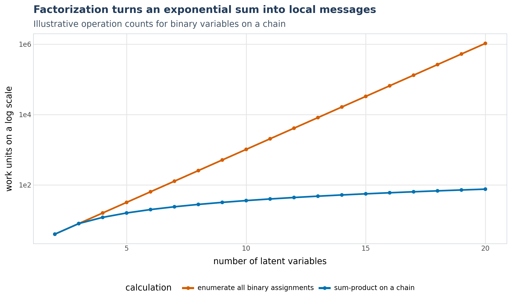

# Exact Inference, Elimination, and Message Passing {#sec-pp-exact-inference}

Sampling is not the default simply because a model contains latent variables.
When the latent state is finite or a subgraph is conjugate, summation,
integration, and dynamic programming can produce an exact answer up to floating-
point rounding. Exact calculations are also indispensable reference oracles for
testing approximate inference on deliberately small models.

**Preparation route.** Read Chapters 2 and 4 for conditioning and graphical
factorization, Chapter 7 for log-scale arithmetic, and Chapter 22 for the idea
of marginalizing discrete choices. This chapter develops the algorithms; no
graph-theory course is assumed.

## Factors and queries

A **factor** is a nonnegative function of a subset of variables. A factor need
not be a normalized distribution. If a finite joint mass factorizes as

$$
p(x_1,\ldots,x_d)=\frac{1}{Z}\prod_{a=1}^A
\psi_a(x_{N(a)}),
$$

then $N(a)$ lists the variables touched by factor $a$, and the partition
function $Z$ normalizes the product. A marginal query keeps variables $Q$ and
sums out the others:

$$
p(x_Q)=\frac{1}{Z}
\sum_{x_{\{1,\ldots,d\}\setminus Q}}
\prod_{a=1}^A\psi_a(x_{N(a)}).
$$

The formula is finite and therefore executable, but naive enumeration visits
every joint assignment. With $d$ binary variables that is $2^d$ assignments.
The crucial observation is distributivity: factors that do not involve a
variable can be taken outside its sum.

**Definition 23.1.** A factor graph is a bipartite graph with variable nodes and
factor nodes. It records which arguments each factor uses. It does not record a
causal direction.

**Nonexample.** A normalized posterior table is not required at every
intermediate step. Premature normalization can hide an omitted likelihood
factor; zero or unnormalized messages are legitimate until the query is
assembled.

## Variable elimination by hand

Consider a chain

$$
p(x_1,x_2,x_3,y)
=p(x_1)p(x_2\mid x_1)p(x_3\mid x_2)p(y\mid x_3).
$$

To obtain $p(y)$, eliminate $x_1$ first:

$$
m_{1\to2}(x_2)=\sum_{x_1}p(x_1)p(x_2\mid x_1).
$$

Next eliminate $x_2$:

$$
m_{2\to3}(x_3)=\sum_{x_2}m_{1\to2}(x_2)p(x_3\mid x_2),
$$

and finish with

$$
p(y)=\sum_{x_3}m_{2\to3}(x_3)p(y\mid x_3).
$$

Each message is a two-entry table. The calculation never constructs the full
eight-entry latent table. The same algebra underlies the forward algorithm,
Kalman filtering, inside–outside parsing, and many tensor-network
contractions.

The three displayed eliminations are matrix–vector contractions for binary
states.  The routine keeps each intermediate two-entry message available for
inspection rather than building the full latent joint table.

```python
from math import fsum, isclose, isfinite

def binary_chain_evidence(
    initial: list[float],
    first_transition: list[list[float]],
    second_transition: list[list[float]],
    observation_likelihood: list[float],
) -> tuple[list[float], list[float], float]:
    """Eliminate three binary latent states and return both messages and evidence."""
    if len(initial) != 2 or len(observation_likelihood) != 2:
        raise ValueError("initial and likelihood tables must have two entries")
    if any(
        len(matrix) != 2 or any(len(row) != 2 for row in matrix)
        for matrix in (first_transition, second_transition)
    ):
        raise ValueError("both transition tables must be two by two")
    tables = [initial, observation_likelihood, *first_transition, *second_transition]
    if any(
        not isfinite(value) or value < 0.0
        for table in tables
        for value in table
    ):
        raise ValueError("all factors must be finite and nonnegative")
    if not isclose(fsum(initial), 1.0, abs_tol=1e-12):
        raise ValueError("initial probabilities must sum to one")
    if any(
        not isclose(fsum(row), 1.0, abs_tol=1e-12)
        for matrix in (first_transition, second_transition)
        for row in matrix
    ):
        raise ValueError("transition rows must sum to one")
    first_message = [
        fsum(
            initial[first_state] * first_transition[first_state][second_state]
            for first_state in range(2)
        )
        for second_state in range(2)
    ]
    second_message = [
        fsum(
            first_message[second_state]
            * second_transition[second_state][third_state]
            for second_state in range(2)
        )
        for third_state in range(2)
    ]
    evidence = fsum(
        second_message[third_state] * observation_likelihood[third_state]
        for third_state in range(2)
    )
    return first_message, second_message, evidence

messages = binary_chain_evidence(
    [0.6, 0.4],
    [[0.9, 0.1], [0.2, 0.8]],
    [[0.7, 0.3], [0.1, 0.9]],
    [0.25, 0.80],
)
print(messages)
```

The output is an exact finite sum-product calculation apart from floating-point
rounding.  Its linear message schedule depends on the chain structure; loopy
graphs and large induced factors need different exactness and complexity
claims.

Elimination has four mechanical steps:

1. collect every factor containing the next variable;
2. multiply those factors on their joint scope;
3. sum the variable out;
4. return the smaller factor to the pool.

Multiplication and summation commute only when their scopes permit it. Summing
each likelihood separately, for example, usually destroys dependencies.

<figure id="fig-pp-exact-scaling">


<figcaption>

Figure 23.1: Enumeration grows exponentially while local sum-product messages on a binary chain grow linearly in this operation-count illustration.

</figcaption>
</figure>

The figure compares structures, not measured wall-clock time. Constants,
vectorization, memory traffic, and sparsity matter in real implementations.

## The forward and backward recursions

For a hidden Markov model with state $X_t$, observation $Y_t$, transition
$A_{ij}=p(X_t=j\mid X_{t-1}=i)$, and emission
$B_j(y)=p(Y_t=y\mid X_t=j)$, define the unnormalized forward message

$$
\alpha_t(j)=p(y_{1:t},X_t=j).
$$

Initialization and recursion are

$$
\alpha_1(j)=\pi_jB_j(y_1),\qquad
\alpha_t(j)=B_j(y_t)\sum_i\alpha_{t-1}(i)A_{ij}.
$$

The evidence is $p(y_{1:T})=\sum_j\alpha_T(j)$. Repeated multiplication can
underflow, so implementations normalize at every time. If
$c_t=\sum_j\widetilde\alpha_t(j)$ and
$a_t(j)=\widetilde\alpha_t(j)/c_t$, then

$$
\log p(y_{1:T})=\sum_{t=1}^T\log c_t.
$$

Here $a_t(j)=p(X_t=j\mid y_{1:t})$ is the filtering distribution. A backward
message

$$
\beta_t(i)=\sum_jA_{ij}B_j(y_{t+1})\beta_{t+1}(j)
$$

combines with the forward message to give smoothed state probabilities. A
maximum in place of a sum yields the Viterbi score for a most probable path;
that is a different query from marginal smoothing.

## Sum-product on trees

On a tree factor graph, the message from factor $a$ to variable $x$ is

$$
m_{a\to x}(x)=
\sum_{x_{N(a)\setminus\{x\}}}
\psi_a(x_{N(a)})
\prod_{u\in N(a)\setminus\{x\}}m_{u\to a}(u),
$$

and a variable sends the product of its other incoming messages. Once messages
have passed in both directions, multiplying all messages incident to a
variable and normalizing gives its exact marginal.

This is **sum-product belief propagation**. Replacing sum-product by
max-product produces maximum-a-posteriori messages. On a tree, the schedule
terminates after finitely many edge passes and is exact. On a graph with loops,
reusing the same equations defines *loopy* belief propagation: it may converge,
oscillate, or converge to beliefs that are not exact marginals.

## Elimination order and treewidth

Eliminating a variable connects all of its current neighbors because the new
factor spans them. The largest intermediate scope, not the number of original
factors, controls memory and time. An elimination order with maximum
intermediate clique size $w+1$ has induced width $w$; minimizing this width
defines **treewidth**.

Finding an optimal order is itself hard, so systems use heuristics such as
min-fill or min-degree. Sparse-looking models can still have large treewidth.
A two-dimensional grid, for example, develops wide separators even though each
node begins with few neighbors.

A **junction tree** clusters variables into cliques satisfying the running-
intersection property, then runs tree message passing between cliques. It
makes the exponential dependence on clique width explicit. Exact inference is
therefore feasible for a long thin chain but may be impossible for a modest
dense graph.

## Hybrid exact and approximate programs

Exact inference need not cover the entire program. Useful combinations include:

- summing discrete mixture labels before applying HMC to continuous
  parameters;
- integrating a conjugate parameter rather than sampling it;
- using Kalman messages inside a nonlinear outer sampler;
- Rao–Blackwellizing a Monte Carlo estimator by replacing a sampled variable
  with its exact conditional expectation; and
- using a tiny enumerated version of a model as a regression test for a large
  approximate implementation.

The semantic obligation is to preserve the same marginal joint law. Removing a
latent variable also removes queries about that variable unless conditional
draws are reconstructed afterward.

## Failure modes and an audit checklist

Before calling a calculation exact, check:

- Are all supposedly finite state spaces actually enumerated?
- Are factor scopes and axis orders explicit?
- Does every transition or conditional table normalize along the intended
  axis?
- Is impossible evidence detected instead of divided by zero?
- Are scale factors or log-sum-exp used for long recursions?
- Is the elimination order recorded and its largest factor monitored?
- Are loopy messages described as approximate?
- Is floating-point rounding distinguished from statistical approximation?

**Nonexample.** Running sum-product for ten iterations on a loopy graph is not
exact inference merely because each individual update is an exact finite sum.
The iteration count is an algorithmic choice, and fixed points need not equal
the model marginals.

<!-- inline-formula-code:start -->
## Formula-to-Python map: a scaled binary forward algorithm

For filtering, Python names translate the notation directly:

| Mathematics | Python | Meaning |
|---|---|---|
| $\pi_i$ | `initial_probabilities[i]` | initial state probability |
| $A_{ij}$ | `transition_matrix[i, j]` | transition from state $i$ to $j$ |
| $B_j(y_t)$ | `emission_matrix[j, observation]` | observation mass in state $j$ |
| $a_t(j)$ | `filtered[j]` | normalized forward message |
| $c_t$ | `scale` | evidence increment |

The executable recursions are

$$
\widetilde a_t(j)=B_j(y_t)\sum_i a_{t-1}(i)A_{ij},\qquad
a_t(j)=\frac{\widetilde a_t(j)}{c_t},\qquad
\log p(y_{1:T})=\sum_t\log c_t.
$$

```python
from math import isfinite, log

import numpy as np

def binary_hmm_filter(
    initial_probabilities: list[float],
    transition_probabilities: list[list[float]],
    emission_probabilities: list[list[float]],
    observations: list[int],
) -> tuple[list[list[float]], float]:
    initial = np.asarray(initial_probabilities, dtype=float)
    transition = np.asarray(transition_probabilities, dtype=float)
    emission = np.asarray(emission_probabilities, dtype=float)
    if initial.shape != (2,) or transition.shape != (2, 2) or emission.shape != (2, 2):
        raise ValueError("this teaching implementation requires binary states and observations")
    if not observations or any(value not in (0, 1) for value in observations):
        raise ValueError("observations must be a nonempty binary sequence")
    arrays_are_finite = all(
        np.all(np.isfinite(array)) for array in (initial, transition, emission)
    )
    if not arrays_are_finite:
        raise ValueError("all probabilities must be finite")
    if np.any(initial < 0.0) or np.any(transition < 0.0) or np.any(emission < 0.0):
        raise ValueError("probabilities cannot be negative")
    if not np.isclose(initial.sum(), 1.0):
        raise ValueError("initial probabilities must sum to one")
    transition_rows_normalized = np.allclose(transition.sum(axis=1), 1.0)
    emission_rows_normalized = np.allclose(emission.sum(axis=1), 1.0)
    if not transition_rows_normalized or not emission_rows_normalized:
        raise ValueError("each transition and emission row must sum to one")

    filtered = initial.copy()
    history: list[list[float]] = []
    log_evidence = 0.0
    for time_index, observation in enumerate(observations):
        predicted = filtered if time_index == 0 else filtered @ transition
        unnormalized = predicted * emission[:, observation]
        scale = float(unnormalized.sum())
        if not isfinite(scale) or scale <= 0.0:
            raise ValueError("the observation sequence has zero or invalid evidence")
        filtered = unnormalized / scale
        history.append(filtered.tolist())
        log_evidence += log(scale)
    return history, log_evidence

filters, log_probability = binary_hmm_filter(
    initial_probabilities=[0.65, 0.35],
    transition_probabilities=[[0.90, 0.10], [0.25, 0.75]],
    emission_probabilities=[[0.80, 0.20], [0.15, 0.85]],
    observations=[0, 0, 1, 1, 1],
)
print("last filtering distribution:", filters[-1])
print("log evidence:", log_probability)
```

**What the computation establishes.** The function evaluates a finite,
scaled sum-product recursion for one validated binary hidden Markov model. It
is exact for the declared tables apart from floating-point rounding. It does
not prove the general message-passing theorem, choose an efficient elimination
order, or make loopy belief propagation exact.
<!-- inline-formula-code:end -->

## Summary

Variable elimination reorganizes finite sums so that local structure is used
before global enumeration. Forward–backward and tree belief propagation are
instances of the same sum-product algebra. Exactness depends on the model
structure and query; computational cost is exponential in induced width, not
automatically in the total number of variables. Hybrid inference should exploit
tractable substructure while preserving the intended marginal law.

The factor-graph, elimination, junction-tree, and message-passing conventions
used here follow the standard graphical-model treatment ([Koller and Friedman 2009](bibliography.md#ref-koller2009probabilistic)).

## Exercises

<div class="exercise" id="probabilistic_programming-23-exact-inference-message-passing-ex-1">
<p class="exercise-title"><strong>Exercise 1</strong></p>

Enumerate the eight assignments in the three-state binary chain and verify
the first two messages above.

</div>

<div class="exercise" id="probabilistic_programming-23-exact-inference-message-passing-ex-2">
<p class="exercise-title"><strong>Exercise 2</strong></p>

Derive the backward recursion and the normalized smoothed marginal
$p(X_t\mid y_{1:T})$.

<details class="solution"><summary>Solution</summary>

For Exercise 2, initialize $\beta_T(j)=1$ and recurse backward with
$\beta_t(i)=\sum_jA_{ij}B_j(y_{t+1})\beta_{t+1}(j)$. The product
$\alpha_t(i)\beta_t(i)$ contains the probability of observations before and
after time $t$ together with state $i$; normalizing over $i$ gives
$p(X_t=i\mid y_{1:T})$. With scaled forward messages, backward messages must use
compatible scale factors or be normalized before the final product.

</details>

</div>

<div class="exercise" id="probabilistic_programming-23-exact-inference-message-passing-ex-3">
<p class="exercise-title"><strong>Exercise 3</strong></p>

Modify the code to return one-step predictive observation probabilities.

</div>

<div class="exercise" id="probabilistic_programming-23-exact-inference-message-passing-ex-4">
<p class="exercise-title"><strong>Exercise 4</strong></p>

Explain why replacing the sum by a maximum answers a different query.

</div>

<div class="exercise" id="probabilistic_programming-23-exact-inference-message-passing-ex-5">
<p class="exercise-title"><strong>Exercise 5</strong></p>

Compare elimination orders for a four-cycle and list the intermediate
factor scopes.

</div>

<div class="exercise" id="probabilistic_programming-23-exact-inference-message-passing-ex-6">
<p class="exercise-title"><strong>Exercise 6</strong></p>

Give a chain with a deterministic transition and show how zero messages
propagate.

</div>

<div class="exercise" id="probabilistic_programming-23-exact-inference-message-passing-ex-7">
<p class="exercise-title"><strong>Exercise 7</strong></p>

Explain why a long chain has small treewidth even though it has exponentially
many complete assignments.

</div>

<div class="exercise" id="probabilistic_programming-23-exact-inference-message-passing-ex-8">
<p class="exercise-title"><strong>Exercise 8</strong></p>

Design an exact-enumeration regression test for a two-component mixture
fitted by MCMC.

</div>

### Selected solution

For Exercise 2, initialize $\beta_T(j)=1$ and recurse backward with
$\beta_t(i)=\sum_jA_{ij}B_j(y_{t+1})\beta_{t+1}(j)$. The product
$\alpha_t(i)\beta_t(i)$ contains the probability of observations before and
after time $t$ together with state $i$; normalizing over $i$ gives
$p(X_t=i\mid y_{1:T})$. With scaled forward messages, backward messages must use
compatible scale factors or be normalized before the final product.
