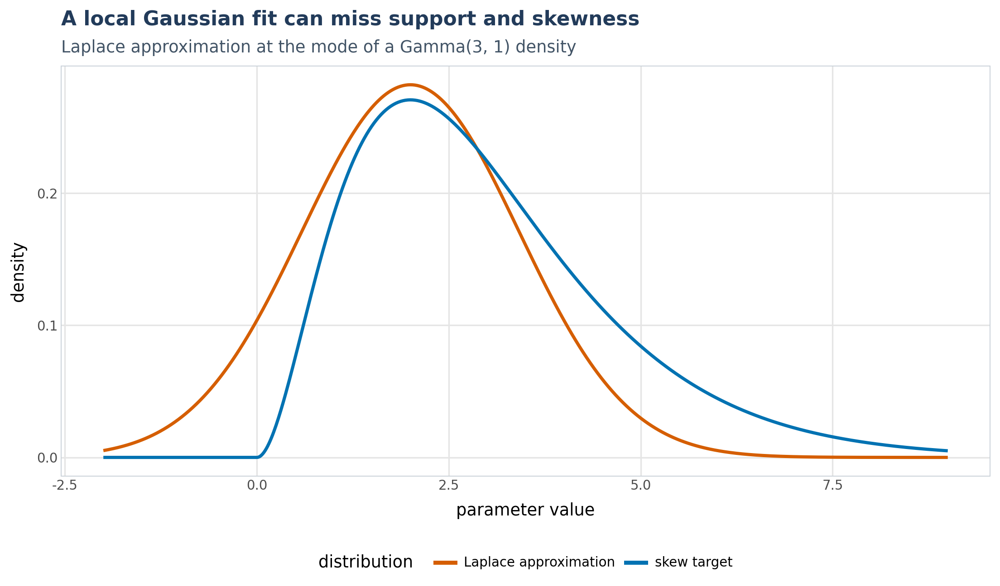

# Deterministic Approximations and Normalizing Flows {#sec-pp-deterministic-approximation}

Monte Carlo represents uncertainty with weighted or dependent draws.
Deterministic approximation instead chooses a tractable representation—often a
Gaussian or a transformed base density—and computes parameters intended to
reproduce selected features of the posterior. The result can be fast and
differentiable, but every guarantee is relative to an approximation family,
local expansion, numerical quadrature, or fixed-point assumption.

**Preparation route.** Chapter 3 supplies changes of variables, Chapter 7
supplies gradients and stable log densities, and Chapter 19 supplies KL
variational inference. Readers who know Taylor expansion can begin immediately;
the Hessian is introduced below as a matrix of second derivatives.

## Laplace approximation

Let $\ell(\theta)=\log p(y,\theta)$ be twice differentiable, and suppose
$\widehat\theta$ is an interior local maximum. A second-order Taylor expansion
gives

$$
\ell(\theta)\approx
\ell(\widehat\theta)
-\frac12(\theta-\widehat\theta)^\mathsf T
H(\theta-\widehat\theta),
\qquad
H=-\nabla^2\ell(\widehat\theta).
$$

If $H$ is positive definite, exponentiating and normalizing produces

$$
q_{\mathrm L}(\theta)
=\operatorname{Normal}(\widehat\theta,H^{-1}).
$$

This is the **Laplace approximation**. It is local: only the mode and curvature
at that mode enter. In $d$ dimensions it also yields the evidence approximation

$$
\log p(y)\approx
\ell(\widehat\theta)
+\frac d2\log(2\pi)-\frac12\log\det H.
$$

The evidence formula requires the joint density with every normalizing constant
and Jacobian included. A log posterior known only up to an additive constant is
enough for the Gaussian shape but not enough for marginal likelihood.

For a Gamma density with shape $a>1$ and rate $b$,

$$
\ell(\theta)=(a-1)\log\theta-b\theta+C,
$$

so the mode is $(a-1)/b$ and local variance is $(a-1)/b^2$. The Gaussian puts
mass on negative values even though the target does not, and it cannot match
the target's right skew.

<figure id="fig-pp-laplace-limit">


<figcaption>

Figure 24.1: A Gaussian Laplace approximation matches local curvature at a gamma mode but extends outside support and misses skewness.

</figcaption>
</figure>

The picture is not an argument that Laplace approximation always fails. With
concentrated, nearly quadratic posteriors it can be excellent. It shows exactly
which global features a local construction cannot inspect.

## Boundary modes, multiple modes, and coordinates

Three conditions deserve separate checks:

- **Boundary mode.** A zero gradient is not the correct optimality condition at
  a constrained boundary. Transform to unconstrained coordinates or use a
  boundary-aware approximation.
- **Multiple modes.** Expanding around one mode ignores the others. A mixture of
  local approximations can help only if the relevant modes are found and their
  relative normalizing masses are estimated.
- **Parameterization.** A Gaussian in $\theta$ and a Gaussian in $\log\theta$
  are different approximations after transformation. Include the Jacobian
  before locating a mode in the chosen coordinate system.

Near singular $H$ indicates weak local identification or a ridge. Blindly
adding diagonal jitter may produce a numerical inverse while concealing the
scientific ambiguity. Inspect eigenvectors, priors, units, and transformations
before treating regularization as a repair.

## The delta method

If $\theta$ has approximate mean $m$ and covariance $V$, and $g$ is smooth,
first-order propagation gives

$$
g(\theta)\approx g(m)+J_g(m)(\theta-m),
\qquad
\operatorname{Cov}(g(\theta))
\approx J_g(m)VJ_g(m)^\mathsf T.
$$

The Jacobian $J_g$ contains first derivatives. This approximation is useful for
derived quantities but can be poor across thresholds, near boundaries, or for
strong nonlinearities. For $g(\theta)=\exp(\theta)$, a symmetric normal interval
for $\theta$ maps to an asymmetric interval for $g$; transforming endpoints is
often clearer than reporting a symmetric delta interval on the original scale.

## Expectation propagation

Suppose the posterior factors as

$$
p(\theta\mid y)\propto p_0(\theta)\prod_{i=1}^n f_i(\theta).
$$

Expectation propagation (EP) approximates each $f_i$ by a tractable site
$\widetilde f_i$ so that

$$
q(\theta)\propto p_0(\theta)
\prod_{i=1}^n\widetilde f_i(\theta).
$$

To update site $i$, remove its current approximation to form the **cavity**

$$
q_{-i}(\theta)\propto
\frac{q(\theta)}{\widetilde f_i(\theta)},
$$

construct the **tilted distribution**

$$
\widehat p_i(\theta)
\propto f_i(\theta)q_{-i}(\theta),
$$

and choose a new site so the revised $q$ matches selected tilted moments.
Gaussian EP usually matches mean and variance. The tilted moments may require
quadrature, analytic identities, or nested Monte Carlo, so “deterministic” does
not imply cost-free.

EP is a fixed-point algorithm, not ordinary coordinate ascent on the standard
ELBO. Updates can oscillate or yield an improper Gaussian site even when the
global approximation is temporarily proper. Damping replaces a full natural-
parameter update by a convex combination with the old site. It can stabilize a
run but does not prove convergence or posterior accuracy.

## Normalizing flows

A **normalizing flow** composes invertible differentiable maps
$z_K=T_K\circ\cdots\circ T_1(z_0)$ from a base density $q_0$. Change of variables
gives

$$
\log q_K(z_K)
=\log q_0(z_0)
-\sum_{k=1}^K
\log\left|\det J_{T_k}(z_{k-1})\right|.
$$

This equation is both a sampling program—draw $z_0$ and transform forward—and
a density program—invert the maps and accumulate log-Jacobians. The direction
must be stated. Accidentally adding the forward Jacobian when the inverse is
required changes the density.

An affine one-dimensional flow

$$
z=\mu+\exp(s)u,\qquad u\sim\operatorname{Normal}(0,1),
$$

has

$$
\log q(z)=\log\phi\bigl((z-\mu)e^{-s}\bigr)-s.
$$

Affine maps represent location and scale but cannot create skew or
multimodality from a Gaussian. Coupling layers, autoregressive maps, splines,
and continuous-time flows offer richer families with different tradeoffs
between inversion, sampling, Jacobian cost, and expressiveness.

Topology remains a constraint: a globally invertible continuous map cannot
turn one connected support into disconnected islands. Augmentation, mixtures,
or specialized maps may be needed. A flexible flow trained with reverse KL (the ELBO) can
still ignore a mode if the objective and optimization permit it.

## Choosing an approximation

The methods answer different engineering questions:

| Method | Representation | Main computation | Typical blind spot |
|---|---|---|---|
| Laplace | one local Gaussian | mode and Hessian | skewness and unseen modes |
| delta method | local linear transform | Jacobian | thresholds and curvature |
| EP | moment-matched sites | repeated tilted moments | unstable fixed points |
| mean-field VI | factorized family | ELBO optimization | dependence and modes |
| normalizing flow | transformed base density | gradients and Jacobians | support topology and optimization |

Validate against exact results on small cases, multiple optimization starts,
importance ratios, simulation-based calibration, and decision-relevant
summaries. A fast approximation that fails visibly can still be useful as an
initializer or proposal, but it should not silently become the reported
posterior.

**Nonexample.** A positive-definite numerical Hessian at one optimizer output
does not establish unimodality, global optimality, or reliable tail
probabilities.

<!-- inline-formula-code:start -->
## Formula-to-Python map: local curvature and an affine flow

The formulas below translate as follows:

| Mathematics | Python | Meaning |
|---|---|---|
| $a,b$ | `shape`, `rate` | gamma parameters |
| $\widehat\theta$ | `mode` | local expansion point |
| $H^{-1}$ | `local_variance` | inverse negative curvature |
| $z,\mu,s$ | `transformed_value`, `location`, `log_scale` | affine-flow quantities |
| $u=(z-\mu)e^{-s}$ | `base_value` | inverse-transformed coordinate |
| $J_g(m)$ | `derivative_at_mean` | local slope for delta propagation |
| $\widehat p_i$ grid | `log_unnormalized_masses` | finite tilted-distribution approximation |

For the gamma target and affine flow,

$$
\widehat\theta=\frac{a-1}{b},\qquad
H^{-1}=\frac{a-1}{b^2},\qquad
\log q(z)=-\frac12u^2-\frac12\log(2\pi)-s,
\qquad
\operatorname{Var}(g(\theta))\approx J_g(m)^2V.
$$

An equally spaced finite grid can expose EP's moment-matching operation:

$$
\widehat m=\sum_j\overline w_j\theta_j,\qquad
\widehat V=\sum_j\overline w_j(\theta_j-\widehat m)^2,\qquad
\overline w_j=\frac{e^{\ell_j}}{\sum_ke^{\ell_k}}.
$$

```python
from math import exp, isfinite, log, pi, sqrt

def gamma_laplace_parameters(shape: float, rate: float) -> tuple[float, float]:
    if not isfinite(shape) or not isfinite(rate) or shape <= 1.0 or rate <= 0.0:
        raise ValueError("require finite shape > 1 and finite positive rate")
    mode = (shape - 1.0) / rate
    local_variance = (shape - 1.0) / rate**2
    return mode, sqrt(local_variance)

def affine_normal_flow_log_density(
    transformed_value: float, location: float, log_scale: float
) -> float:
    if not all(isfinite(value) for value in (transformed_value, location, log_scale)):
        raise ValueError("flow inputs must be finite")
    scale = exp(log_scale)
    if not isfinite(scale) or scale <= 0.0:
        raise ValueError("the represented scale must be finite and positive")
    base_value = (transformed_value - location) / scale
    base_log_density = -0.5 * base_value**2 - 0.5 * log(2.0 * pi)
    return base_log_density - log_scale

def delta_method_variance(
    derivative_at_mean: float, input_variance: float
) -> float:
    if not isfinite(derivative_at_mean) or not isfinite(input_variance):
        raise ValueError("derivative and input variance must be finite")
    if input_variance < 0.0:
        raise ValueError("input variance cannot be negative")
    return derivative_at_mean**2 * input_variance

def finite_grid_moments(
    grid_values: list[float], log_unnormalized_masses: list[float]
) -> tuple[float, float]:
    if len(grid_values) != len(log_unnormalized_masses) or not grid_values:
        raise ValueError("grid and log masses must be nonempty and equally long")
    if any(
        not isfinite(value)
        for value in grid_values + log_unnormalized_masses
    ):
        raise ValueError("grid and log masses must be finite")
    maximum = max(log_unnormalized_masses)
    raw_masses = [exp(value - maximum) for value in log_unnormalized_masses]
    total_mass = sum(raw_masses)
    normalized_masses = [value / total_mass for value in raw_masses]
    mean = sum(
        weight * value
        for weight, value in zip(normalized_masses, grid_values, strict=True)
    )
    variance = sum(
        weight * (value - mean) ** 2
        for weight, value in zip(normalized_masses, grid_values, strict=True)
    )
    return mean, variance

mode, local_sd = gamma_laplace_parameters(shape=3.0, rate=1.0)
print("Laplace center and standard deviation:", mode, local_sd)
print("affine-flow log density at 2:", affine_normal_flow_log_density(2.0, mode, log(local_sd)))
print("delta variance:", delta_method_variance(derivative_at_mean=3.0, input_variance=0.2))
print("tilted grid moments:", finite_grid_moments([-1.0, 0.0, 1.0], [-2.0, 0.0, -0.5]))
```

**What the computation establishes.** The functions evaluate the exact gamma
mode and local curvature, one affine change-of-variables density, a scalar delta
variance, and normalized moments on one declared finite grid. The resulting
Gaussian is only a local approximation to the gamma target, and grid moments
approximate a continuous tilted distribution only after a quadrature rule is
specified. The code neither discovers other modes nor validates EP convergence
or a trained multi-layer flow.
<!-- inline-formula-code:end -->

## Summary

Laplace and delta approximations use local derivatives. EP matches moments of
one factor at a time, while normalizing flows learn invertible changes of
coordinates with explicit Jacobians. All can be valuable computational
components. None turns optimization success into a universal posterior
guarantee; support, multimodality, parameterization, tail behavior, and the
scientific estimand remain part of the audit.

The EP and flow sections are anchored in their primary algorithmic accounts
([Minka 2001](bibliography.md#ref-minka2001expectation); [Rezende and Mohamed 2015](bibliography.md#ref-rezende2015variational)).

## Exercises

<div class="exercise" id="probabilistic_programming-24-deterministic-approximations-flows-ex-1">
<p class="exercise-title"><strong>Exercise 1</strong></p>

Derive the gamma mode and local variance used in the code.

<details class="solution"><summary>Solution</summary>

For Exercise 1, differentiating
$\ell(\theta)=(a-1)\log\theta-b\theta+C$ gives
$\ell'(\theta)=(a-1)/\theta-b$, so the interior mode is
$(a-1)/b$. The second derivative is
$\ell''(\theta)=-(a-1)/\theta^2$. At the mode, negative curvature is
$H=b^2/(a-1)$, and its inverse is $(a-1)/b^2$. This derivation requires
$a>1$; otherwise the gamma mode is at the boundary.

</details>

</div>

<div class="exercise" id="probabilistic_programming-24-deterministic-approximations-flows-ex-2">
<p class="exercise-title"><strong>Exercise 2</strong></p>

Compute the Laplace evidence approximation for a one-dimensional quadratic
log joint whose normalizer is known.

</div>

<div class="exercise" id="probabilistic_programming-24-deterministic-approximations-flows-ex-3">
<p class="exercise-title"><strong>Exercise 3</strong></p>

Apply the delta method to the odds $g(\theta)=\theta/(1-\theta)$.

</div>

<div class="exercise" id="probabilistic_programming-24-deterministic-approximations-flows-ex-4">
<p class="exercise-title"><strong>Exercise 4</strong></p>

Explain why a boundary mode at zero invalidates an unconstrained quadratic
expansion.

</div>

<div class="exercise" id="probabilistic_programming-24-deterministic-approximations-flows-ex-5">
<p class="exercise-title"><strong>Exercise 5</strong></p>

Write the Gaussian natural parameters of an EP cavity after removing one
site.

</div>

<div class="exercise" id="probabilistic_programming-24-deterministic-approximations-flows-ex-6">
<p class="exercise-title"><strong>Exercise 6</strong></p>

Derive the log density of $z=\mu+\sigma u$ in both forward and inverse
notation.

</div>

<div class="exercise" id="probabilistic_programming-24-deterministic-approximations-flows-ex-7">
<p class="exercise-title"><strong>Exercise 7</strong></p>

Give a target support that no continuous bijection of the real line can
produce from a standard normal support.

</div>

<div class="exercise" id="probabilistic_programming-24-deterministic-approximations-flows-ex-8">
<p class="exercise-title"><strong>Exercise 8</strong></p>

Design a simulation study comparing Laplace, mean-field, and MCMC estimates
of a tail probability.

</div>

### Selected solution

For Exercise 1, differentiating
$\ell(\theta)=(a-1)\log\theta-b\theta+C$ gives
$\ell'(\theta)=(a-1)/\theta-b$, so the interior mode is
$(a-1)/b$. The second derivative is
$\ell''(\theta)=-(a-1)/\theta^2$. At the mode, negative curvature is
$H=b^2/(a-1)$, and its inverse is $(a-1)/b^2$. This derivation requires
$a>1$; otherwise the gamma mode is at the boundary.
