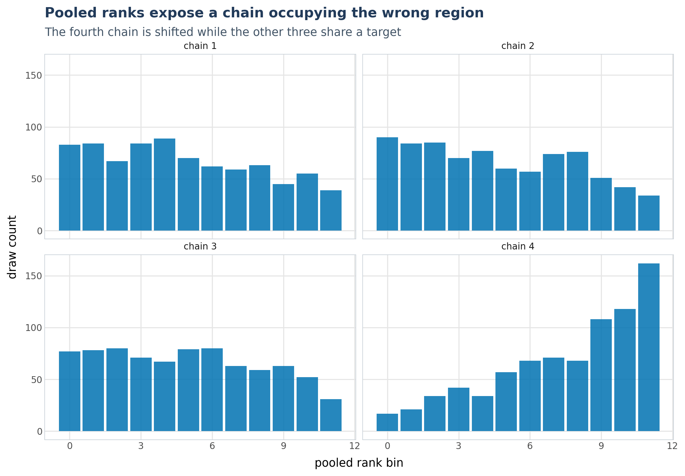

# Modern MCMC Diagnostics and Precision Budgets {#sec-pp-modern-diagnostics}

A Markov chain Monte Carlo run is not a bag of independent posterior draws. It
is a collection of finite, autocorrelated trajectories produced after an
adaptive or transient phase. Diagnostics must answer two separate questions:

1. did the chains explore the same stationary distribution well enough to
   reveal obvious failures? and
2. is there enough effective information for each reported estimand?

No finite diagnostic proves convergence, discovers a mode no chain visited, or
validates the model. Modern practice combines multiple-chain ranks, effective
sample sizes, Monte Carlo standard errors, sampler-specific warnings, and
simulation tests.

**Preparation route.** Chapters 10–13 introduce MCMC, HMC, and a first ESS
calculation. This chapter replaces the crude single-chain summary with a
multi-chain, estimand-specific workflow. Only sample means and variances are
required.

## Warmup is not posterior output

Warmup may adapt step size, metric, proposal scales, or other transition
parameters. These changing kernels are useful for tuning but are normally
discarded before posterior estimation. Each saved chain should then use a fixed
post-warmup transition rule that preserves the target.

Run several chains with independently generated random streams and initial
states dispersed on a scientifically plausible unconstrained scale. Four
copies of the same initial value and seed are not four independent chains.
Initialization so extreme that every chain fails before reaching typical set
is also uninformative; dispersion must respect support and numerical stability.

Record warmup and sampling lengths, seeds, adaptation settings, rejected or
divergent transitions, and software versions. A summary table without these
conditions is not a reproducible computational result.

## Split R-hat from within- and between-chain variation

After splitting each chain in half, suppose there are $M$ sequences of length
$N$. Let $\overline\theta_m$ and $s_m^2$ be their means and sample variances.
The within-chain variance and between-chain variance are

$$
W=\frac1M\sum_{m=1}^M s_m^2,
\qquad
B=\frac{N}{M-1}\sum_{m=1}^M
(\overline\theta_m-\overline\theta_{\cdot})^2.
$$

The overdispersed variance estimate and potential scale reduction are

$$
\widehat V^+=\frac{N-1}{N}W+\frac{1}{N}B,
\qquad
\widehat R=\sqrt{\frac{\widehat V^+}{W}}.
$$

Splitting turns a within-chain drift into a between-sequence difference. But
ordinary variance calculations behave poorly for heavy tails and can miss
scale differences between chains.

## Rank normalization and folding

Pool all $S=MN$ draws, give draw $s$ rank $r_s$, and transform it to a normal
score, for example with the Blom offset,

$$
z_s=\Phi^{-1}\left(\frac{r_s-3/8}{S+1/4}\right).
$$

Compute split $\widehat R$ on the $z_s$. This **rank normalization** removes
dependence on finite moments and makes the comparison invariant under monotone
transformations. To detect chains with different scales, fold the original
draws around their pooled median,

$$
\zeta_s=
\left|\theta_s-\operatorname{median}(\theta)\right|,
$$

then rank-normalize the $\zeta_s$ and compute another split $\widehat R$.
Folding after normal-score transformation is not equivalent for an asymmetric
distribution. Report the larger of the rank and folded values.

<figure id="fig-pp-rank-diagnostic">


<figcaption>

Figure 25.1: Pooled rank histograms reveal that one chain spends disproportionate time in high ranks even when every trace appears locally mobile.

</figcaption>
</figure>

Rank plots show *where* chains disagree. Approximately flat, overlapping rank
histograms are reassuring; slopes or U-shapes localize location or scale
mismatch. They still cannot display a region absent from every chain.

A common warning threshold is $\widehat R>1.01$, but a value below it is only
one necessary check. Rounding a reported value to `1.00` can hide a failure, so
retain sufficient digits and inspect the worst parameters and transformed
quantities.

## Multi-chain effective sample size

For a scalar estimand with autocorrelation sequence $\rho_t$, the idealized
effective sample size is

$$
N_{\mathrm{eff}}
=\frac{MN}{1+2\sum_{t=1}^{\infty}\rho_t}.
$$

Estimating the infinite sum naively is noisy. Modern multi-chain estimators use
$\widehat V^+$ in autocorrelation estimates, pair adjacent lags, stop at the
first negative pair sum, and enforce a monotone sequence. Rank-normalized draws
produce **bulk ESS**. Indicator functions for lower and upper tail events
produce **tail ESS**, which is relevant to quantiles and intervals.

ESS can exceed the raw draw count for antithetic chains. That is not a paradox:
negative correlation can reduce variance for a particular mean. Conversely,
one ESS does not apply to every transformation. A well-estimated mean can
coexist with a poorly estimated 0.99 quantile.

The old shortcut of thinning every $k$th draw generally discards information.
Thin only when storage or the cost of downstream evaluation dominates, and
calculate accuracy from the retained estimator rather than assuming it has
become independent.

## Monte Carlo standard error

For a posterior mean with marginal standard deviation $s$, the Monte Carlo
standard error is approximately

$$
\operatorname{MCSE}(\overline\theta)
=\frac{s}{\sqrt{N_{\mathrm{eff}}}}.
$$

Posterior standard deviation measures uncertainty *under the model*; MCSE
measures numerical uncertainty in estimating a posterior summary. They should
not be combined. State a precision target before extending chains, such as an
MCSE below one percent of the posterior standard deviation or below a
decision-relevant tolerance.

Quantile MCSE is not given by substituting tail ESS into the mean formula.
Options include an order-statistic interval based on the effective sample size,
batch methods for the indicator $1\{\theta\le q_p\}$, or a density estimate at
the quantile. Report the method. For a posterior probability
$P(\theta>c)$, analyze the indicator directly.

## HMC-specific diagnostics

R-hat and ESS describe output; HMC diagnostics interrogate the trajectory
mechanism.

**Divergences.** A divergent transition marks numerical integration error large
enough to violate the intended exploration. Divergences concentrated near a
funnel neck or boundary indicate unresolved geometry and can bias estimates.
Increasing the target acceptance rate may reduce discretization error, but
reparameterization or a better model is often the durable repair. Zero
reported divergences is not proof that all regions were explored.

**Tree depth.** NUTS doubles trajectory work with depth. Repeatedly hitting the
maximum means trajectories are being truncated or posterior geometry demands
excessive travel. Simply raising the cap can turn a warning into a large runtime
without fixing curvature or multimodality.

**Energy behavior.** One convention for energy Bayesian fraction of missing
information is

$$
\operatorname{E\text{-}BFMI}
=\frac{\frac{1}{N-1}\sum_{n=2}^N(E_n-E_{n-1})^2}
{\frac1N\sum_{n=1}^N(E_n-\overline E)^2}.
$$

Low values suggest the momentum refresh is not moving effectively across the
target's energy distribution. Follow the exact convention used by the
software, because finite-sample denominators differ. Energy warnings often
point to heavy tails, weak priors, or poor parameterization rather than a knob
that should be tuned in isolation.

## Simulation-based calibration revisited

For simulation $r$, draw $\theta_r^\star$ from the prior, data from the model,
and posterior draws $\theta_{r,1:S}$. The scalar rank

$$
R_r=\sum_{s=1}^S1\{\theta_{r,s}<\theta_r^\star\}
$$

is uniform on $\{0,\ldots,S\}$ when the posterior computation is exact and the
draws plus truth are exchangeable. With discrete parameters or ties, randomized
tie breaking is required. Correlated posterior draws make rank histograms
spiky; thinning or generating approximately independent posterior ranks can be
appropriate *for this calibration experiment*, even though routine thinning
usually wastes estimation information.

Histogram shapes are clues, not uniquely identified diagnoses. U-shapes can
indicate underdispersion, humps overdispersion, and slopes bias, but dependence,
few simulations, or mixtures of failures can imitate these shapes. Test rank
uniformity with methods that acknowledge discrete bins, inspect several scalar
functions, and localize simulations by data regime. Passing prior-averaged SBC
does not establish calibration where the prior assigns negligible mass.

## A diagnostic decision table

| Signal | First interpretation | Useful next action |
|---|---|---|
| high rank/folded $\widehat R$ | chains disagree in location or scale | inspect rank plots, starts, and parameterization |
| low bulk ESS | inefficient central exploration | extend only after geometry is acceptable |
| low tail ESS | uncertain intervals or tail probabilities | inspect tails, transform, and run longer |
| divergences | unresolved HMC integration geometry | locate divergences; reparameterize or revise priors |
| maximum tree depth | excessively long/truncated trajectories | inspect scales, curvature, and metric |
| low energy diagnostic | poor exploration of energy levels | inspect tails and hierarchy geometry |
| failed SBC | implementation or approximation miscalibration | reproduce a small failing simulation |
| failed predictive check | model cannot reproduce a data feature | revise likelihood or data mechanism |

Do not respond to every warning by collecting more draws. More iterations of a
biased or trapped transition can make a wrong answer look more precise.

**Nonexample.** “All parameters have ESS above 400” is not an analysis-wide
precision statement. A nonlinear contrast, rare-event probability, or decision
boundary can have much lower effective information.

<!-- inline-formula-code:start -->
## Formula-to-Python map: rank-normalized folded split R-hat

| Mathematics | Python | Meaning |
|---|---|---|
| $M,N$ | `split_array.shape` | split-chain count and length |
| $r_s$ | `ranks` | pooled average ranks |
| $z_s$ | `normal_scores` | rank-normalized draws |
| $W,B$ | `within_variance`, `between_variance` | variance components |
| $\widehat R$ | `rhat` | potential scale reduction |
| $N_{\mathrm{eff}}$ | `effective_sample_size` | estimand-specific information |
| $E_n$ | `energies` | HMC energy sequence |
| $R_r$ | `simulation_based_calibration_rank` | randomized truth rank |

The code implements

$$
z_s=\Phi^{-1}\left(\frac{r_s-3/8}{S+1/4}\right),
\qquad
\widehat R=\sqrt{
\frac{(N-1)W/N+B/N}{W}},
\qquad
\operatorname{MCSE}=sN_{\mathrm{eff}}^{-1/2}.
$$

```python
from math import isfinite, sqrt
from statistics import NormalDist

import numpy as np

def _average_ranks(values: np.ndarray) -> np.ndarray:
    order = np.argsort(values, kind="mergesort")
    ranks = np.empty(len(values), dtype=float)
    start = 0
    while start < len(values):
        end = start + 1
        while end < len(values) and values[order[end]] == values[order[start]]:
            end += 1
        average_rank = 0.5 * ((start + 1) + end)
        ranks[order[start:end]] = average_rank
        start = end
    return ranks

def _normal_scores(values: np.ndarray) -> np.ndarray:
    ranks = _average_ranks(values)
    probabilities = (ranks - 0.375) / (len(values) + 0.25)
    inverse_standard_normal = NormalDist().inv_cdf
    return np.array([inverse_standard_normal(float(value)) for value in probabilities])

def _basic_rhat(split_values: np.ndarray) -> float:
    sequence_count, sequence_length = split_values.shape
    within_variance = float(np.var(split_values, axis=1, ddof=1).mean())
    if within_variance <= 0.0 or not isfinite(within_variance):
        raise ValueError("within-sequence variance must be finite and positive")
    between_variance = sequence_length * float(
        np.var(split_values.mean(axis=1), ddof=1)
    )
    variance_plus = (
        (sequence_length - 1.0) * within_variance / sequence_length
        + between_variance / sequence_length
    )
    return sqrt(variance_plus / within_variance)

def rank_normalized_split_rhat(chains: list[list[float]]) -> float:
    array = np.asarray(chains, dtype=float)
    if array.ndim != 2 or array.shape[0] < 2 or array.shape[1] < 8:
        raise ValueError("require at least two rectangular chains with eight draws each")
    if not np.all(np.isfinite(array)):
        raise ValueError("all chain values must be finite")
    half_length = array.shape[1] // 2
    split_array = np.concatenate(
        [array[:, :half_length], array[:, -half_length:]], axis=0
    )
    normal_scores = _normal_scores(split_array.ravel()).reshape(split_array.shape)
    rank_rhat = _basic_rhat(normal_scores)
    folded = np.abs(split_array - np.median(split_array))
    folded_scores = _normal_scores(folded.ravel()).reshape(folded.shape)
    folded_rhat = _basic_rhat(folded_scores)
    return max(rank_rhat, folded_rhat)

def mean_mcse(posterior_standard_deviation: float, effective_sample_size: float) -> float:
    if not isfinite(posterior_standard_deviation) or posterior_standard_deviation < 0.0:
        raise ValueError("posterior standard deviation must be finite and nonnegative")
    if not isfinite(effective_sample_size) or effective_sample_size <= 0.0:
        raise ValueError("effective sample size must be finite and positive")
    return posterior_standard_deviation / sqrt(effective_sample_size)

def energy_bfmi(energies: list[float]) -> float:
    if len(energies) < 3 or any(not isfinite(value) for value in energies):
        raise ValueError("require at least three finite energy values")
    array = np.asarray(energies, dtype=float)
    marginal_variance = float(np.mean((array - array.mean()) ** 2))
    if marginal_variance <= 0.0:
        raise ValueError("energy variance must be positive")
    transition_energy = float(np.mean(np.diff(array) ** 2))
    return transition_energy / marginal_variance

def simulation_based_calibration_rank(
    true_value: float, posterior_draws: list[float], seed: int
) -> int:
    if not isfinite(true_value) or not posterior_draws:
        raise ValueError("truth must be finite and posterior draws nonempty")
    if any(not isfinite(value) for value in posterior_draws):
        raise ValueError("posterior draws must be finite")
    lower_count = sum(value < true_value for value in posterior_draws)
    tie_count = sum(value == true_value for value in posterior_draws)
    rng = np.random.default_rng(seed)
    randomized_tie_offset = int(rng.integers(0, tie_count + 1))
    return lower_count + randomized_tie_offset

reference_chains = [
    [-1.1, -0.6, -0.2, 0.1, 0.4, 0.8, 0.2, -0.3, -0.7, 0.0, 0.5, 0.9],
    [-0.9, -0.4, 0.0, 0.3, 0.7, 1.0, 0.4, -0.1, -0.5, 0.2, 0.6, 0.8],
    [-1.0, -0.5, -0.1, 0.2, 0.5, 0.9, 0.3, -0.2, -0.6, 0.1, 0.7, 1.1],
    [-0.8, -0.3, 0.1, 0.4, 0.6, 1.2, 0.5, 0.0, -0.4, 0.3, 0.8, 1.0],
]
print("rank-normalized folded split R-hat:", rank_normalized_split_rhat(reference_chains))
print("mean MCSE:", mean_mcse(1.7, 900.0))
print("energy BFMI:", energy_bfmi([1.2, 1.6, 1.1, 2.0, 1.4]))
print("randomized SBC rank:", simulation_based_calibration_rank(1.0, [0.2, 1.0, 1.0, 1.7], 91))
```

**What the computation establishes.** The functions exactly perform the stated
finite rank, split, fold, variance, mean-MCSE, energy-ratio, and randomized-tie
rank calculations. They are educational implementations, not replacements for
a tested diagnostics library: production ESS truncation, MCMC-aware SBC,
missing values, and multivariate workflows require additional machinery. A
small result cannot prove stationarity or reveal an unvisited mode.
<!-- inline-formula-code:end -->

## Summary

Modern diagnostics rank-normalize and split multiple chains, inspect both
location and scale, estimate bulk and tail information, and attach MCSE to each
reported estimand. HMC divergences, trajectory depth, and energy behavior probe
mechanisms that R-hat cannot see. SBC tests repeated calibration under the
generative model. These tools can falsify a computation much more readily than
they can certify one.

The rank, fold, local-ESS, and SBC recommendations follow the primary
diagnostics literature and current Stan practice ([Vehtari et al. 2021](bibliography.md#ref-vehtari2021rank); [Talts et al. 2018](bibliography.md#ref-talts2018validating); [Team 2025](bibliography.md#ref-stan2025manual)).

## Exercises

<div class="exercise" id="probabilistic_programming-25-modern-mcmc-diagnostics-ex-1">
<p class="exercise-title"><strong>Exercise 1</strong></p>

Compute $W$, $B$, and ordinary split $\widehat R$ for two short sequences.

</div>

<div class="exercise" id="probabilistic_programming-25-modern-mcmc-diagnostics-ex-2">
<p class="exercise-title"><strong>Exercise 2</strong></p>

Explain why rank normalization remains meaningful for a Cauchy target whose
variance does not exist.

</div>

<div class="exercise" id="probabilistic_programming-25-modern-mcmc-diagnostics-ex-3">
<p class="exercise-title"><strong>Exercise 3</strong></p>

Construct four chains with equal means but unequal scales and predict which
of rank or folded R-hat responds.

<details class="solution"><summary>Solution</summary>

For Exercise 3, let every chain be centered near zero but give one chain a much
smaller variance. Their ordinary rank-normalized values can have similar means,
so location R-hat may remain near one. Folding the original draws by absolute
distance from their pooled median converts the small scale into systematically
low folded values; rank-normalizing those distances then creates a between-chain
difference that folded R-hat detects.

</details>

</div>

<div class="exercise" id="probabilistic_programming-25-modern-mcmc-diagnostics-ex-4">
<p class="exercise-title"><strong>Exercise 4</strong></p>

Define an indicator estimand for a posterior safety threshold and describe
its ESS and MCSE.

</div>

<div class="exercise" id="probabilistic_programming-25-modern-mcmc-diagnostics-ex-5">
<p class="exercise-title"><strong>Exercise 5</strong></p>

Explain why warmup draws should not usually be included in posterior means.

</div>

<div class="exercise" id="probabilistic_programming-25-modern-mcmc-diagnostics-ex-6">
<p class="exercise-title"><strong>Exercise 6</strong></p>

Give two distinct causes of divergences and a targeted response to each.

</div>

<div class="exercise" id="probabilistic_programming-25-modern-mcmc-diagnostics-ex-7">
<p class="exercise-title"><strong>Exercise 7</strong></p>

Describe randomized SBC ranking for a discrete Bernoulli parameter.

</div>

<div class="exercise" id="probabilistic_programming-25-modern-mcmc-diagnostics-ex-8">
<p class="exercise-title"><strong>Exercise 8</strong></p>

Write a precision budget for a mean, a 0.95 quantile, and a treatment
decision.

</div>

### Selected solution

For Exercise 3, let every chain be centered near zero but give one chain a much
smaller variance. Their ordinary rank-normalized values can have similar means,
so location R-hat may remain near one. Folding the original draws by absolute
distance from their pooled median converts the small scale into systematically
low folded values; rank-normalizing those distances then creates a between-chain
difference that folded R-hat detects.
