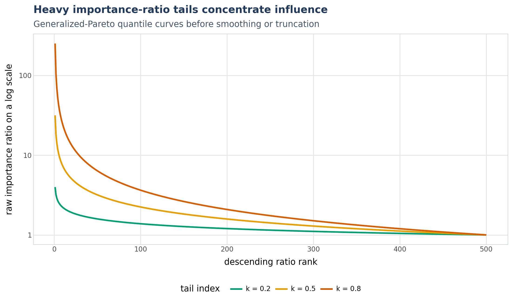

# PSIS-LOO and Predictive Evaluation {#sec-pp-psis-loo}

Posterior computation answers questions inside a fitted model. Predictive
evaluation asks how that model performs on observations not used in the
corresponding fit. The distinction matters: a flexible model can reproduce its
training data and still generalize poorly, while an honest holdout design can
fail if it does not match the deployment unit.

**Preparation route.** Chapter 9 introduces importance ratios and their
effective sample size. Chapter 20 introduces log predictive scores and model
comparison. This chapter develops leave-one-out computation, Pareto smoothing,
diagnostics, uncertainty, and model averaging.

## Define the predictive task first

For the pointwise formulas below, assume conditional likelihood factorization
$p(y\mid\theta)=\prod_jp(y_j\mid\theta)$ and proper full and leave-one-out
posteriors. Exchangeability alone does not imply this factorization. Dependent
data need the appropriate conditional likelihood or a declared blocked unit
([Vehtari et al. 2017](bibliography.md#ref-vehtari2017loo), Sections 2 and 2.1). The leave-one-out predictive density is

$$
p(y_i\mid y_{-i})
=\int p(y_i\mid\theta)p(\theta\mid y_{-i})\,d\theta,
$$

and expected log predictive density is estimated by

$$
\operatorname{elpd}_{\mathrm{loo}}
=\sum_{i=1}^n\log p(y_i\mid y_{-i}).
$$

The word “observation” hides the most important design choice. If future use is
prediction for a new patient, leaving out one measurement while retaining the
patient's other measurements leaks group information. If use is forecasting,
training on observations after the held-out time leaks the future. If a survey
uses clusters, spatial neighbors, or repeated events, pointwise factorization
does not create independent validation units.

Choose among:

- leave-one-row-out for conditionally exchangeable rows;
- leave-one-group-out for new-group prediction;
- blocked spatial or temporal folds for dependence;
- forward-chaining validation for forecasting; and
- an external test set when the future population or measurement process
  changes.

Cross-validation estimates performance for the chosen split mechanism. It
cannot establish robustness to a shift that the splits never represent.

## LOO from full-posterior draws {#sec-pp-loo-support}

Write $Q$ for the normalized LOO posterior, $L(\theta)=p(y_i\mid\theta)$,
and $Z=E_Q[L]=p(y_i\mid y_{-i})$. Assume $L$ is measurable, nonnegative,
finite $Q$-almost surely, and $0<Z<\infty$. A likelihood **density** can
exceed one. Bayes' rule defines the full posterior $P$ by

$$
P(B)=\frac1Z\int_B L(\theta)\,dQ(\theta).
$$

Let $A=\{\theta:L(\theta)>0\}$. Because $Z>0$, also $Q(A)>0$.
Then $P(A)=1$, so $1/L$ is defined
$P$-almost surely. Cancellation inside this set gives the exact identity

$$
E_P\!\left[\frac1L\right]
=\frac1Z\int_A\frac1L L\,dQ
=\frac{Q(A)}Z.
$$

Consequently, $Z=1/E_P[1/L]$ requires **$Q(A)=1$**: the full posterior must
cover all LOO-posterior mass. Equivalently, $Q\ll P$, meaning that every set
with zero $P$ probability also has zero $Q$ probability. If $Q(A)<1$,
normalized reciprocal weighting recovers $Q$ conditioned on $A$, not $Q$.
This is the support requirement from [Chapter 9](#sec-pp-importance), stated
explicitly for self-normalized importance sampling in
([Owen 2013](bibliography.md#ref-owen2013mc), Section 9.2, Theorem 9.2).

For full-posterior draws $\theta^s$, raw ratios are $r_i^s=1/L(\theta^s)$.
Because $r_i^sL(\theta^s)=1$, the finite self-normalized predictive estimate is

$$
\widehat p(y_i\mid y_{-i})
=\frac{S}{\sum_{s=1}^S r_i^s}
=\left[\frac1S\sum_{s=1}^S
\frac{1}{p(y_i\mid\theta^s)}\right]^{-1}.
$$

For iid draws from $P$, the strong law gives convergence of the denominator
to $Q(A)/Z$, so this density-scale estimate converges almost surely to
$Z/Q(A)$. It is consistent for $Z$ under the coverage condition. For dependent
MCMC output the corresponding law of large numbers needs its own conditions.
Neither consistency nor this exact population identity makes a finite
reciprocal sample mean unbiased after inversion.

This identity explains both the speed and the danger. An observation with tiny
likelihood under a few full-posterior draws produces enormous ratios. A finite
estimate may then be dominated by one draw, and ordinary weight ESS can be
misleading in very heavy tails.

Always save the pointwise log likelihood
$\ell_i^s=\log p(y_i\mid\theta^s)$. A single aggregate log likelihood cannot
construct observation-level LOO, localize influential cases, or respect a
different validation unit after fitting.

The [finite counterexample](#sec-pp-loo-support-clinic) separates missing
support from finite-sample bias under full coverage.

## Missing support versus finite-sample bias {#sec-pp-loo-support-clinic}

**Worked counterexample.** Let $\theta$ be a fair binary parameter and let
$Y=\theta$ deterministically. With no other observations, $Q(0)=Q(1)=1/2$.
For the observed value $Y=1$, $L(0)=0$, $L(1)=1$, and the true LOO predictive
probability is $Z=1/2$. The full posterior is $P=\delta_1$, however, so
every saved log likelihood is zero. The existing raw helper returns log
estimate zero, hence density estimate one, for **every** positive draw count.
Here $Q(A)=1/2$, and the wrong limit $Z/Q(A)=1$ follows from the proof.

All observed ratios are constant. Increasing the number of full-posterior
draws or smoothing their upper tail cannot create the missing state. This
example does not predict a fitted Pareto $\widehat k$ value: a tail diagnostic
is not a proof of proposal support. Refit the LOO posterior or use a proposal
that actually covers it.

The following exact certificate receives the **complete stipulated finite
model**, including states absent from the full posterior. It can establish
support coverage from that table; a list of saved posterior likelihoods
cannot. Integers and fractions make finiteness exact, and likelihoods above
one are allowed because the same calculation covers densities.

```python
from fractions import Fraction

def finite_loo_reference(
    loo_probabilities: tuple[int | Fraction, ...],
    likelihoods: tuple[int | Fraction, ...],
) -> tuple[Fraction, Fraction, tuple[Fraction, ...], Fraction, Fraction]:
    """Return Z, represented Q mass, P, reciprocal mean, and raw-density limit."""
    if not loo_probabilities or len(loo_probabilities) != len(likelihoods):
        raise ValueError("provide a complete nonempty, equally long Q/L table")
    if any(isinstance(value, bool) or not isinstance(value, (int, Fraction))
           for value in (*loo_probabilities, *likelihoods)):
        raise TypeError("use integers or Fraction values")
    probabilities = tuple(map(Fraction, loo_probabilities))
    likelihoods = tuple(map(Fraction, likelihoods))
    if any(value < 0 for value in (*probabilities, *likelihoods)):
        raise ValueError("probabilities and likelihoods must be nonnegative")
    if sum(probabilities) != 1:
        raise ValueError("LOO probabilities must sum exactly to one")
    predictive = sum(probability * likelihood for probability, likelihood
                     in zip(probabilities, likelihoods, strict=True))
    if predictive <= 0:
        raise ValueError("predictive density must be positive")
    posterior = tuple(probability * likelihood / predictive
                      for probability, likelihood
                      in zip(probabilities, likelihoods, strict=True))
    represented_mass = sum(probability for probability, likelihood
                           in zip(probabilities, likelihoods, strict=True)
                           if likelihood > 0)
    reciprocal_mean = sum(probability / likelihood
                          for probability, likelihood
                          in zip(posterior, likelihoods, strict=True)
                          if likelihood > 0)
    return predictive, represented_mass, posterior, reciprocal_mean, 1 / reciprocal_mean

print(finite_loo_reference((Fraction(1, 2), Fraction(1, 2)), (0, 1)))
```

The output is $Z=1/2$, represented mass $1/2$, posterior $(0,1)$,
reciprocal mean $1$, and raw-density limit $1$. Zero-likelihood states are
kept in the complete model but skipped in the reciprocal sum, avoiding
$0/0$. The certificate is a finite reference calculation, not a sampler or
an empirical support detector.

**A different issue with full support.** If $Q(A)=1$, iid sampling makes
$\overline R=S^{-1}\sum_s1/L(\theta^s)$ unbiased for $1/Z$.
But $1/x$ is strictly convex on positive values: when its expectation is
finite, Jensen gives $E[1/\overline R]\ge Z$, strictly for a nonconstant
$\overline R$. The [changed task](#sec-pp-loo-task) computes this finite
density bias exactly in a model where no support is missing. The helper
returns $\log(1/\overline R)$; density bias and log-score bias are different
quantities.

## Pareto-smoothed importance sampling

Pareto-smoothed importance sampling (PSIS) stabilizes the largest ratios. In
outline it:

1. shifts log ratios before exponentiation;
2. selects an upper tail of the raw ratios;
3. fits a generalized Pareto distribution to that tail;
4. replaces ordered tail ratios by fitted expected order statistics; and
5. applies a finite-sample truncation before normalization.

For exceedance $x\ge0$, a generalized Pareto distribution with scale
$\sigma>0$ and shape $k$ has survival function

$$
P(X>x)=
\left(1+\frac{kx}{\sigma}\right)^{-1/k}
$$

on the values where the bracket is positive, with the exponential limit at
$k=0$. The fitted shape $\widehat k$ summarizes how heavy the importance-ratio
tail appears. For an idealized generalized Pareto tail, the mean exists for
$k<1$ and variance for $k<1/2$.

<figure id="fig-pp-importance-ratio-tails">


<figcaption>

Figure 26.1: Larger Pareto shape parameters produce importance-ratio tails whose top few values increasingly dominate a finite estimate.

</figcaption>
</figure>

The plotted curves are deterministic Pareto quantiles, not fitted PSIS output.
Smoothing reduces variance; it does not manufacture overlap between the full
posterior and a very different leave-one-out posterior.

Current diagnostics use both a bias-oriented ceiling and a sample-size
threshold. With nominal draw count $S$, a commonly implemented reliability
threshold is

$$
k_{\mathrm{threshold}}
=\min\left(1-\frac{1}{\log_{10}S},\,0.7\right).
$$

Below it, PSIS and its MCSE estimate are considered reliable under the method's
conditions. Between the sample-size threshold and $0.7$, more effective draws
may help; from $0.7$ to $1$, bias can be large; at or above $1$, the idealized
ratio mean is not finite. These are diagnostics, not universal physical
boundaries, and estimated $k$ itself has uncertainty.

Nominal $S$ can be optimistic when MCMC draws are strongly autocorrelated.
Production implementations account for relative MCMC efficiency in PSIS ESS
and error calculations. Do not reproduce PSIS by merely clipping the top one
percent of ratios; tail fitting, order replacement, truncation, and diagnostics
are a coherent procedure.

## Repairing problematic observations

When $\widehat k$ is too large, first inspect the case. It may reveal data error,
separation, a non-robust likelihood, an omitted group structure, or a genuinely
influential valid observation. Deleting it because it is influential changes
the scientific target.

Computational options include:

- refit the model without that observation;
- moment-match or transform draws toward the LOO posterior;
- sample from a mixture proposal covering several LOO posteriors;
- use $K$-fold cross-validation; or
- adopt a robust model when scientific reasoning supports one.

Exact refitting is the reference calculation for a small number of problematic
cases. If many cases fail, the full posterior is a poor universal proposal, and
a different validation strategy is preferable.

## Comparing models with pointwise differences

For models $A$ and $B$, define pointwise differences

$$
d_i=\operatorname{elpd}_{i,A}-\operatorname{elpd}_{i,B},
\qquad
\widehat\Delta=\sum_{i=1}^n d_i.
$$

Under an exchangeable pointwise approximation, a standard-error estimate is

$$
\widehat{\operatorname{se}}(\widehat\Delta)
=\sqrt{n\operatorname{Var}_{i}(d_i)}.
$$

Pairing matters: model predictions for the same held-out case are correlated,
so subtract pointwise before estimating uncertainty. For clustered, spatial,
or temporal folds, use variation among the appropriate independent units.

The formula is itself an approximation, especially with small $n$, heavy-
tailed differences, or repeated model searching. A difference smaller than its
uncertainty is not evidence that models are identical; it says this validation
design cannot resolve their predictive difference reliably.

## Stacking predictive distributions

Selecting one model discards useful diversity. Given LOO predictive densities
$p_{ik}=p(y_i\mid y_{-i},M_k)$, stacking chooses simplex weights

$$
\widehat w
=\arg\max_{w_k\ge0,\,\sum_k w_k=1}
\sum_{i=1}^n\log\left(\sum_{k=1}^Kw_kp_{ik}\right).
$$

The resulting mixture combines predictions. Stacking weights are not posterior
probabilities that a candidate is true, and they depend on the candidate set
and validation distribution. Similar models may split weight arbitrarily while
producing stable combined predictions.

Optimize with log-sum-exp and honest pointwise predictive densities. Averaging
log scores rather than densities defines a different operation and cannot
represent a mixture predictive distribution.

## Predictive accuracy is not calibration or adequacy

Log score is strictly proper when the outcome distribution is fully specified,
but one aggregate score can hide systematic failures. Pair it with:

- calibration plots or probability integral transform diagnostics;
- interval coverage stratified by relevant subgroups;
- tail, zero, and extreme-event scores;
- posterior predictive checks for structural discrepancies;
- sensitivity to priors and likelihood family; and
- downstream decision loss stated in real units.

Cross-validation compares models under observed data regimes. It does not
prove causal identification, mechanistic truth, fairness across unmeasured
groups, or safe extrapolation. Repeatedly revising models against the same LOO
results also overfits the validation signal; retain a workflow ledger and, when
stakes demand, fresh confirmatory data.

**Nonexample.** A model with the largest estimated elpd is not automatically
the scientifically preferred model. The difference may be unresolved, driven
by one case with unreliable PSIS, or irrelevant to the intended decision.

<!-- inline-formula-code:start -->
## Formula-to-Python map: raw LOO, reliability, and two-model stacking

| Mathematics | Python | Meaning |
|---|---|---|
| $\ell_i^s$ | `log_likelihood_draws` | pointwise log likelihood over draws |
| $r_i^s=e^{-\ell_i^s}$ | implicit in `log_sum_exp` | raw LOO ratio |
| $\log\widehat p(y_i\mid y_{-i})$ | `loo_log_predictive` | raw-IS LOO log density |
| $k_{\mathrm{threshold}}$ | `psis_k_threshold` | nominal diagnostic threshold |
| $w$ | `weight_for_first_model` | stacking weight for model A |
| $d_i$ | `pointwise_differences` | paired predictive-score difference |

The exact finite raw-importance and two-model stacking objectives are

$$
\log\widehat p(y_i\mid y_{-i})
=\log S-\log\sum_s\exp(-\ell_i^s),
$$

$$
\widehat w=\arg\max_{0\le w\le1}
\sum_i\log\left(wp_{iA}+(1-w)p_{iB}\right).
$$

```python
from math import exp, isfinite, log, log10, sqrt
from statistics import variance

def _log_sum_exp(log_values: list[float]) -> float:
    if not log_values or any(not isfinite(value) for value in log_values):
        raise ValueError("log values must be nonempty and finite")
    maximum = max(log_values)
    return maximum + log(sum(exp(value - maximum) for value in log_values))

def raw_importance_loo_log_predictive(log_likelihood_draws: list[float]) -> float:
    if not log_likelihood_draws or any(
        not isfinite(value) for value in log_likelihood_draws
    ):
        raise ValueError("pointwise log likelihood draws must be nonempty and finite")
    return log(len(log_likelihood_draws)) - _log_sum_exp(
        [-value for value in log_likelihood_draws]
    )

def psis_k_threshold(draw_count: int) -> float:
    if draw_count < 20:
        raise ValueError("use at least twenty draws before interpreting the threshold")
    return min(1.0 - 1.0 / log10(draw_count), 0.7)

def paired_elpd_difference(
    first_pointwise_elpd: list[float], second_pointwise_elpd: list[float]
) -> tuple[float, float]:
    if len(first_pointwise_elpd) != len(second_pointwise_elpd):
        raise ValueError("pointwise elpd lists must have equal length")
    if len(first_pointwise_elpd) < 2:
        raise ValueError("at least two validation units are required")
    if any(
        not isfinite(value)
        for value in first_pointwise_elpd + second_pointwise_elpd
    ):
        raise ValueError("pointwise elpd values must be finite")
    pointwise_differences = [
        first - second
        for first, second in zip(
            first_pointwise_elpd, second_pointwise_elpd, strict=True
        )
    ]
    total_difference = sum(pointwise_differences)
    approximate_standard_error = sqrt(
        len(pointwise_differences) * variance(pointwise_differences)
    )
    return total_difference, approximate_standard_error

def two_model_stacking_weight(
    first_log_predictions: list[float],
    second_log_predictions: list[float],
    grid_intervals: int = 1_000,
) -> tuple[float, float]:
    if len(first_log_predictions) != len(second_log_predictions) or not first_log_predictions:
        raise ValueError("models need equally long, nonempty pointwise predictions")
    if any(
        not isfinite(value)
        for value in first_log_predictions + second_log_predictions
    ):
        raise ValueError("log predictions must be finite")
    if grid_intervals < 10 or grid_intervals > 100_000:
        raise ValueError("grid_intervals must be between 10 and 100000")
    best_weight = 0.0
    best_objective = float("-inf")
    for grid_index in range(grid_intervals + 1):
        weight_for_first_model = grid_index / grid_intervals
        terms = []
        for first, second in zip(
            first_log_predictions, second_log_predictions, strict=True
        ):
            components = []
            if weight_for_first_model > 0.0:
                components.append(log(weight_for_first_model) + first)
            if weight_for_first_model < 1.0:
                components.append(log(1.0 - weight_for_first_model) + second)
            terms.append(_log_sum_exp(components))
        objective = sum(terms)
        if objective > best_objective:
            best_weight = weight_for_first_model
            best_objective = objective
    return best_weight, best_objective

print("raw LOO log density:", raw_importance_loo_log_predictive([-0.8, -1.0, -1.5, -0.7]))
print("nominal PSIS k threshold:", psis_k_threshold(2_000))
print(
    "paired elpd difference and SE:",
    paired_elpd_difference([-1.0, -0.4, -1.8], [-1.3, -0.7, -1.1]),
)
print(
    "stacking weight and objective:",
    two_model_stacking_weight(
        [-0.2, -2.0, -0.3, -1.4],
        [-1.1, -0.4, -1.0, -0.5],
    ),
)
```

**What the computation establishes.** The functions evaluate raw
importance-sampling LOO for one finite pointwise likelihood vector, the
documented nominal threshold, an exchangeable-unit paired score difference,
and a bounded-grid two-model stacking objective. The code intentionally does
not claim to implement PSIS tail fitting. Use a tested PSIS library for
smoothing, MCMC-relative efficiency, $\widehat k$, ESS, and MCSE. Finite LOO
scores do not prove future calibration. In particular, finite saved log
likelihoods certify neither the required LOO support coverage nor unbiasedness
of the exponentiated finite raw-IS estimate. The functions remain arithmetic
calculations conditional on the sampling/model assumptions above.
<!-- inline-formula-code:end -->

## Summary

LOO evaluates a declared predictive unit, and raw importance ratios expose why
full-posterior draws can approximate each leave-one-out fit. PSIS stabilizes the
tail and supplies a Pareto diagnostic that tells when refitting or a different
validation design is needed. Pointwise paired differences quantify comparative
uncertainty, while stacking combines predictive distributions. Evaluation
still requires leakage control, calibration checks, scientific criticism, and
an honest account of repeated model revision.

The tail diagnostic, finite-sample reliability guidance, and stacking objective
follow the current primary treatments ([Vehtari et al. 2024](bibliography.md#ref-vehtari2024psis); [Yao et al. 2018](bibliography.md#ref-yao2018stacking)).

## Exercises {#sec-pp-loo-task}

<div class="exercise" id="probabilistic_programming-26-psis-loo-predictive-evaluation-ex-1">
<p class="exercise-title"><strong>Exercise 1</strong></p>

State the conditional factorization and proper-posterior assumptions, then
derive $E_P[1/L]=Q(L>0)/Z$. Identify the extra condition for the
reciprocal of that expectation, $1/E_P[1/L]$, to equal the LOO predictive
density $Z$.

<details class="solution"><summary>Solution</summary>

For Exercise 1, the pointwise factorization makes $P=LQ/Z$ the full-posterior
update from the proper LOO posterior. For $A=\{L>0\}$, integration only over
$A$ gives $E_P[1/L]=Q(A)/Z$. Dividing posterior densities pointwise cannot
recover LOO mass on $A^c$. Thus $Z=1/E_P[1/L]$ holds when $Q(A)=1$,
equivalently $Q\ll P$. A finite reciprocal average is an estimator of the
expectation; its inverse need not be unbiased.

</details>

</div>

<div class="exercise" id="probabilistic_programming-26-psis-loo-predictive-evaluation-ex-2">
<p class="exercise-title"><strong>Exercise 2</strong></p>

Explain why storing only the total log likelihood prevents pointwise LOO.

</div>

<div class="exercise" id="probabilistic_programming-26-psis-loo-predictive-evaluation-ex-3">
<p class="exercise-title"><strong>Exercise 3</strong></p>

Construct a grouped data example where row-wise LOO leaks information.

</div>

<div class="exercise" id="probabilistic_programming-26-psis-loo-predictive-evaluation-ex-4">
<p class="exercise-title"><strong>Exercise 4</strong></p>

For $S=100$, $1{,}000$, and $10{,}000$, calculate the nominal
$k_{\mathrm{threshold}}$.

</div>

<div class="exercise" id="probabilistic_programming-26-psis-loo-predictive-evaluation-ex-5">
<p class="exercise-title"><strong>Exercise 5</strong></p>

Describe what $k\ge1$ says about an idealized importance-ratio tail and what
it does not say about the observation.

</div>

<div class="exercise" id="probabilistic_programming-26-psis-loo-predictive-evaluation-ex-6">
<p class="exercise-title"><strong>Exercise 6</strong></p>

Derive the paired standard error for an elpd difference and state the
exchangeability assumption.

</div>

<div class="exercise" id="probabilistic_programming-26-psis-loo-predictive-evaluation-ex-7">
<p class="exercise-title"><strong>Exercise 7</strong></p>

Show numerically that averaging predictive densities is not the same as
averaging their logarithms.

</div>

<div class="exercise" id="probabilistic_programming-26-psis-loo-predictive-evaluation-ex-8">
<p class="exercise-title"><strong>Exercise 8</strong></p>

Design a validation scheme for forecasting multiple measurements from new
machines.

</div>

<div class="exercise" id="probabilistic_programming-26-psis-loo-predictive-evaluation-ex-9">
<p class="exercise-title"><strong>Exercise 9</strong></p>

**Changed task with full support.** Let $Q(0)=Q(1)=1/2$ and let the
observed likelihoods be $L(0)=1/4$, $L(1)=3/4$. Find $Z$, the full
posterior $P$, and $Q(L>0)$. From four iid draws from $P$, let $K$ count
draws equal to zero. Derive the density estimate as a function of $K$,
its exact five-point law, its expectation and bias for $Z$, and the
probability that all four draws are state one. Compare with the worked
zero-likelihood example: which error vanishes under the strong law? Test
the existing log helper on all 16 ordered samples, exponentiating its
output before comparing density estimates. Do not assign the resulting
density bias to the helper's log estimate.

Try the task before opening its [hint](#sec-pp-loo-hint) and
[explanation](#sec-pp-loo-solution).

<details class="solution"><summary>Solution</summary>

For Exercise 9, $Z=(1/4+3/4)/2=1/2$, $P=(1/4,3/4)$, and represented
mass is one. Now $K\sim\operatorname{Binomial}(4,1/4)$ and

$$
\widehat Z=\frac4{4K+(4/3)(4-K)}=\frac3{4+2K}.
$$

| $K$ | $0$ | $1$ | $2$ | $3$ | $4$ |
|:--|:--|:--|:--|:--|:--|
| Probability | $81/256$ | $108/256$ | $54/256$ | $12/256$ | $1/256$ |
| Density estimate | $3/4$ | $1/2$ | $3/8$ | $3/10$ | $1/4$ |

Multiplying each estimate by its probability and summing gives
$E[\widehat Z]=2777/5120$, with density bias $217/5120$. The all-state-one
event has probability $(3/4)^4=81/256$ and estimate $3/4$. Executing the
existing helper on each ordered sample gives log estimates whose
exponentials match this table up to floating-point rounding; its log bias is
not $217/5120$.

Here $E_P[1/L]=2$, so the strong law makes $\widehat Z\to1/2$ almost
surely as draw count grows. In the deterministic worked example the limit
stays one because $Q(A)=1/2$. A larger finite sample can reduce Monte Carlo
error under coverage; it cannot repair missing support. Return to the
[support proof](#sec-pp-loo-support) when interpreting either result.

</details>

</div>

### Hint for the changed task {#sec-pp-loo-hint}

Compute $P(\theta)=Q(\theta)L(\theta)/Z$ first. Then
$K\sim\operatorname{Binomial}(4,P(0))$ and the reciprocal sum is
$4K+(4/3)(4-K)$. Keep the five binomial masses exact. The
[selected solution](#sec-pp-loo-solution) separates this finite bias from
support failure.

### Selected solution {#sec-pp-loo-solution}

For Exercise 1, the pointwise factorization makes $P=LQ/Z$ the full-posterior
update from the proper LOO posterior. For $A=\{L>0\}$, integration only over
$A$ gives $E_P[1/L]=Q(A)/Z$. Dividing posterior densities pointwise cannot
recover LOO mass on $A^c$. Thus $Z=1/E_P[1/L]$ holds when $Q(A)=1$,
equivalently $Q\ll P$. A finite reciprocal average is an estimator of the
expectation; its inverse need not be unbiased.

For Exercise 9, $Z=(1/4+3/4)/2=1/2$, $P=(1/4,3/4)$, and represented
mass is one. Now $K\sim\operatorname{Binomial}(4,1/4)$ and

$$
\widehat Z=\frac4{4K+(4/3)(4-K)}=\frac3{4+2K}.
$$

| $K$ | $0$ | $1$ | $2$ | $3$ | $4$ |
|:--|:--|:--|:--|:--|:--|
| Probability | $81/256$ | $108/256$ | $54/256$ | $12/256$ | $1/256$ |
| Density estimate | $3/4$ | $1/2$ | $3/8$ | $3/10$ | $1/4$ |

Multiplying each estimate by its probability and summing gives
$E[\widehat Z]=2777/5120$, with density bias $217/5120$. The all-state-one
event has probability $(3/4)^4=81/256$ and estimate $3/4$. Executing the
existing helper on each ordered sample gives log estimates whose
exponentials match this table up to floating-point rounding; its log bias is
not $217/5120$.

Here $E_P[1/L]=2$, so the strong law makes $\widehat Z\to1/2$ almost
surely as draw count grows. In the deterministic worked example the limit
stays one because $Q(A)=1/2$. A larger finite sample can reduce Monte Carlo
error under coverage; it cannot repair missing support. Return to the
[support proof](#sec-pp-loo-support) when interpreting either result.
