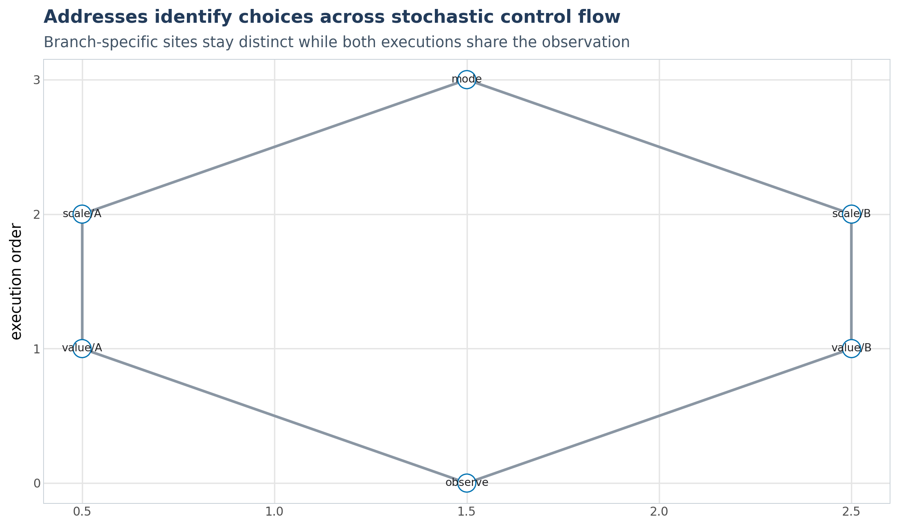

# Probabilistic-Programming Semantics and Compilation {#sec-pp-ppl-semantics}

A probabilistic program has at least three readings: executable code that can
generate a trace, a mathematical object defining a probability law or
unnormalized measure, and an intermediate representation consumed by an
inference engine. Confusing these layers produces bugs that ordinary unit tests
miss. The same source can simulate correctly while assigning the wrong density,
or assign a correct density while exposing geometry that defeats a chosen
sampler.

**Preparation route.** Chapter 6 introduces traces and reference measures;
Chapter 7 introduces transforms and automatic differentiation; Chapter 22
introduces amortized and hybrid inference. This chapter explains how systems
turn those ideas into language machinery. No compiler background is required.

## A program denotes more than one operation

A deterministic function maps an input to one output. A probabilistic kernel
maps input $x$ to a probability measure $K(x,\cdot)$. Composition integrates
over the intermediate value:

$$
(K_1K_2)(x,A)
=\int K_2(z,A)K_1(x,dz).
$$

This is the denotational reading of “sample $z$ using $K_1$, then sample an
output using $K_2$.” A density implementation chooses reference measures and
represents a kernel with evaluable factors. A simulator implementation only
needs a way to draw. Neither interface automatically supplies the other.

Common capabilities are:

- `sample(address, distribution)`: introduce a random choice;
- `observe(address, distribution, value)`: score a fixed value;
- `factor(address, log_weight)`: add an arbitrary potential;
- `param(name, initial_value)`: expose an optimizable program parameter; and
- `plate(name, size)`: express replicated conditional structure.

Names differ across systems. Their semantics should not. An `observe` of a
continuous value contributes a log *density* relative to a declared base
measure; it does not assign positive probability to an exact real-valued event.

## Traces, addresses, and scores

For one execution, let $\tau$ map addresses $a$ to realized choices $z_a$.
Given observations $y$, a fixed-support trace score is

$$
\log\gamma(\tau;y)
=\sum_{a\in\mathcal S(\tau)}
\log p_a(z_a\mid\tau_{<a})
+\sum_{b\in\mathcal O(\tau)}
\log p_b(y_b\mid\tau),
$$

where $\gamma$ is unnormalized. The address set may itself depend on earlier
choices. An address must identify the *semantic random choice*, not merely the
line of source code: a sample site inside a loop needs an iteration component,
and recursive or stochastic control flow needs a stable structural convention.

<figure id="fig-pp-trace-addresses">


<figcaption>

Figure 27.1: A branch creates distinct branch-specific addresses while preserving a shared address for the downstream observation.

</figcaption>
</figure>

The diagram is an address schema, not a static directed acyclic graph. Only one
branch-specific path exists in a single execution.

**Address collision.** If all loop iterations use address `latent`, later
values overwrite earlier ones or an inference proposal confuses distinct
variables.

**Address instability.** If inserting an unrelated sample changes positional
addresses for every later choice, saved traces and learned proposals may no
longer correspond to the same semantics.

Names alone do not solve identity. Data-dependent collections require a policy
for insertion, deletion, and object identity across executions.

## Static graphs and universal programs

A static model fixes its random-variable graph after data shapes are known.
Compilers can allocate arrays, schedule gradients, marginalize finite nodes,
and reject unsupported discrete parameters before execution. This restriction
enables aggressive optimization and predictable diagnostics.

A universal probabilistic language permits stochastic branches, recursion, and
potentially changing trace dimension. It can express simulators naturally, but
inference must compare executions with different address sets. A single-site
proposal that changes a branch may create and delete downstream choices. Its
Metropolis–Hastings acceptance ratio must include:

$$
\alpha(\tau,\tau')
=\min\left\{1,
\frac{\gamma(\tau';y)q(\tau\mid\tau')}
{\gamma(\tau;y)q(\tau'\mid\tau)}
\left|J_{\tau\leftarrow\tau'}\right|
\right\},
$$

where a Jacobian or dimension-matching construction is needed when continuous
coordinates change dimension. Reusing retained values and proposing newly
created choices from their priors is one possible kernel, not a universal
default.

A Turing-complete generative language can describe nontermination. Production
systems need resource limits, interruption, and diagnostics for traces whose
runtime or memory has a heavy tail. Mathematical existence of a distribution
also requires almost-sure termination or a semantics that explicitly accounts
for lost mass.

## Conditioning, scoring, and zero-probability events

Hard conditioning on a discrete event can be implemented by rejecting traces
outside it, but rejection becomes useless for rare events. For continuous
observations, matching an exact simulated floating-point value is not
conditioning. A density-based `observe` statement contributes a likelihood;
likelihood-free inference instead uses summaries, kernels, or learned density
ratios and therefore introduces an approximation.

A `factor` primitive is powerful enough to encode likelihoods, soft constraints,
and variational objectives. Its log weight must be dimensionless. Adding a
quantity with physical units directly to a log density is a modeling error, as
is applying the same minibatch scaling factor to priors that should appear only
once.

**Nonexample.** Executing a simulator and retaining runs whose continuous output
equals the observed decimal exactly does not implement a continuous posterior.
It almost surely retains nothing under an ideal continuous law and has behavior
determined by floating-point coincidences otherwise.

## Constraint lowering and Jacobians

Many inference engines operate on unconstrained coordinates $u\in\mathbb R^d$.
For a bijection $\theta=T(u)$, the compiler-generated target is

$$
\log\gamma_U(u;y)
=\log\gamma_\Theta(T(u);y)
+\log\left|\det J_T(u)\right|.
$$

For $\theta=\operatorname{logit}^{-1}(u)$,

$$
\log\left|\frac{d\theta}{du}\right|
=\log\theta+\log(1-\theta).
$$

The adjustment belongs in a density transformation, not in a purely
deterministic generated quantity. If a user explicitly places a prior on the
unconstrained variable $u$, transforming it to $\theta$ describes a different
model from placing a prior on $\theta$ and using $u$ only for computation.

Transforms for ordered vectors, simplices, correlation matrices, and positive-
definite matrices have nontrivial Jacobians and boundary behavior. A compiler
should centralize and test these rules instead of requiring every model author
to reproduce them.

## Worked clinic: keep the logistic logs before rounding {#sec-pp-logistic-stability}

The real logistic map sends every finite $u$ into $(0,1)$. Its floating-point
approximation can round to $0$ or $1$. That difference matters when the
compiler evaluates a density: an endpoint-rounded reported probability does
not mean that the real input lies outside the transformed target's support.

For example, computing the Jacobian by first rounding
$\theta=(1+e^{-u})^{-1}$ and then taking
$\log\theta+\log(1-\theta)$ can fail. On the runtime used for this clinic, at
$u=36$ that approach gives approximately $-36.04365$ instead of a value
indistinguishable from $-36$ at the displayed precision. At $u=37$ the
probability rounds to one and its complement's logarithm fails; at $u=-1000$
the probability rounds to zero. These are reproduced examples, not universal
thresholds for every arithmetic implementation.

### Derive both logs from the unconstrained coordinate {#sec-pp-logistic-proof}

Put

$$
c(u)=\log(1+e^{-|u|}).
$$

For $u\ge0$, factoring the denominator gives
$\log\theta=-c(u)$ and $\log(1-\theta)=-u-c(u)$. For $u<0$, write
$\theta=e^u/(1+e^u)$ instead, giving $\log\theta=u-c(u)$ and
$\log(1-\theta)=-c(u)$. Thus, in one expression,

$$
\begin{aligned}
\log\theta&=\min(u,0)-c(u),\\
\log(1-\theta)&=-\max(u,0)-c(u),\\
\log J(u)&=-|u|-2c(u).
\end{aligned}
$$

The last identity uses $J(u)=\theta(1-\theta)$. Evaluate $c$ with
`log1p(exp(-abs(u)))`: its exponential argument is never positive, and
`log1p` preserves small corrections. Chapter 15's sign-branched softplus
uses the same idea. The identities also give two useful checks:
$\log\theta-\log(1-\theta)=u$, and $\log J(-u)=\log J(u)$.

The helper in [Section 27.10](#sec-pp-logistic-code) returns the two log coordinates directly
from $u$. The separate `logistic_transform` probability output remains a
rounded approximation; the logs must not be reconstructed from that output. Clipping a probability
to an arbitrary interior interval would change the mathematical map and
create a plateau. Stable log coordinates avoid that alteration, while still
being finite-precision approximations. The Stan manual explicitly discusses
boundary rounding; its actual bounded-transform implementation evaluates this
same log-Jacobian identity directly from the unconstrained input
([Team 2026](bibliography.md#ref-stan2026transforms); [Team 2026](bibliography.md#ref-stanmath2026bounded)).

### A complete transformed target {#sec-pp-logistic-beta}

Let $\Theta\sim\operatorname{Beta}(\alpha,\beta)$ with
$\alpha,\beta>0$, and let $U=\operatorname{logit}(\Theta)$. The constrained
density is

$$
p_\Theta(\theta)=\frac{\theta^{\alpha-1}(1-\theta)^{\beta-1}}
{B(\alpha,\beta)},\qquad 0<\theta<1.
$$

Multiplication by $d\theta/du=\theta(1-\theta)$ adds one to both exponents.
Therefore the log density in the engine coordinate is

$$
\ell(u)=\log p_U(u)
=\alpha\log\theta+\beta\log(1-\theta)-\log B(\alpha,\beta).
$$

Both logs come from the stable helper, independently of the rounded
probability. Substituting $\theta=\operatorname{logit}^{-1}(u)$ into the
integral proves $\int_{\mathbb R}p_U(u)\,du=1$; finite computations do not
supply that normalization proof. Differentiating the real expression gives

$$
\ell'(u)=\alpha-(\alpha+\beta)\theta,\qquad
\ell''(u)=-(\alpha+\beta)\theta(1-\theta)<0.
$$

Its unique density mode is $u=\log(\alpha/\beta)$, corresponding to
$\theta=\alpha/(\alpha+\beta)$. Density modes depend on the coordinate;
the change of variables preserves probabilities, not the location of a
density's maximum.

**Worked target.** For $\operatorname{Beta}(2,3)$, $B(2,3)=1/12$, so

$$
p_U(u)=12\theta^2(1-\theta)^3.
$$

At $u=\log3$, $\theta=3/4$, giving $p_U(u)=27/256$ and
$\ell'(u)=-7/4$. The transformed density has its mode at
$u=\log(2/3)$, corresponding to $\theta=2/5$; the constrained Beta density
has its interior mode at $\theta=1/3$. At $u=1000$, the reported probability
can round to one while the stable transformed log density remains approximately
$\log12-3000$.

The exact tail behavior also follows from the two log coordinates:

$$
\begin{aligned}
\ell(u)-\alpha u&\longrightarrow-\log B(\alpha,\beta)
&&\text{as }u\to-\infty,\\
\ell(u)+\beta u&\longrightarrow-\log B(\alpha,\beta)
&&\text{as }u\to+\infty.
\end{aligned}
$$

The left and right limiting slopes of the log density are respectively
$\alpha$ and $-\beta$. Positive shapes give decaying tails on both sides.

**Numerical boundary.** Stable coordinate logs and a stable Jacobian do not
guarantee that every subsequent density calculation fits into a float.
Even positive finite shapes can overflow when multiplied by extreme log
coordinates; computing a general log-Beta normalizer can also overflow or
lose precision. For example, at the largest finite positive float $u$, the
real $\operatorname{Beta}(2,3)$ log density is finite but lies below the
floating-point range because its leading term is $-3u$. An overflow there is
an evaluation limit, not zero mathematical density or excluded support.
The code's fixed-shape example uses the known constant $\log12$ and ordinary
inputs with $|u|\le1000$. It implements no general Beta-density API and makes
no claim of universal finite target arithmetic. This demonstration range
limits the numerical example, not the target's mathematical support.

## Automatic differentiation and intermediate representations

Reverse-mode automatic differentiation records elementary operations and
propagates adjoints backward. It computes derivatives of the implemented
floating-point program, including its branches and approximations. It does not
verify that the log density is mathematically correct or smooth where HMC needs
it.

Useful compiler passes include:

- shape and support checking;
- translating distribution syntax into log-density increments;
- lowering constraints and accumulating Jacobians;
- identifying conjugate or finite subgraphs for marginalization;
- common-subexpression elimination and partial evaluation of data-only terms;
- vectorizing plates and planning parallel reductions;
- generating gradients, Hessian-vector products, or simulation code; and
- retaining source locations so a numerical error points back to the model.

An intermediate representation should distinguish random choices, observations,
deterministic transforms, and effects. Treating all calls as opaque host-
language functions prevents analyses that inference needs.

## Effects and inference handlers

Algebraic-effect or handler designs interpret `sample` and `observe` operations
outside the model body. One handler may draw from priors, another replay a
trace, another accumulate a log joint, and another replace selected choices
with proposal draws. This separates model structure from an inference policy.

The separation is not magical. Handler order changes behavior when effects
interact; replay must define what happens to missing or extra addresses; and a
gradient handler must know which values are differentiable. Inference
combinators require contracts such as:

- what target or extended target the component preserves;
- whether returned draws are weighted, unweighted, or correlated;
- how randomness is split across nested components;
- whether normalization constants are estimated unbiasedly; and
- which diagnostics remain meaningful after composition.

Without these contracts, nesting “resample,” “condition,” and “move” operations
can produce plausible output with no identified target.

## Testing a probabilistic compiler

Ordinary example tests are insufficient. A layered suite should include:

1. exact density tests for each distribution and boundary;
2. transform round trips and analytic log-Jacobian comparisons;
3. gradient checks away from nonsmooth points;
4. trace-address snapshots under loops and branches;
5. enumeration comparisons on small discrete programs;
6. simulation moments with uncertainty-aware tolerances;
7. SBC for complete model-to-inference pipelines; and
8. adversarial tests for impossible evidence, nontermination, NaN, and shape
   mismatch.

Finite simulation moments should use statistical tolerances and deterministic
random streams; a single expected random vector is brittle across valid RNG
implementations. Exact enumeration and symbolic identities should be preferred
where available.

<!-- inline-formula-code:start -->
## Formula-to-Python map: one branching trace and one transform {#sec-pp-logistic-code}

| Mathematics | Python | Meaning |
|---|---|---|
| $a$ | `address` | stable trace key |
| $z_a$ | `trace[address]` | realized random choice |
| $\log\gamma(\tau;y)$ | `log_joint` | sum of sample and observe log masses |
| $u$ | `unconstrained_value` | real-valued engine coordinate |
| $\theta$ | `probability` | logistic constrained coordinate |
| $\log\theta,\log(1-\theta)$ | `log_probability`, `log_complement` | direct log coordinates before probability rounding |
| $q(\tau'\mid\tau)$ | `forward_log_proposal` | proposal log density in the forward direction |

For a finite trace and a logistic transform,

$$
\log\gamma(\tau;y)=\sum_a\log p_a,
\qquad
\theta=\frac{1}{1+e^{-u}},
\qquad
\log|d\theta/du|=\log\theta+\log(1-\theta).
$$

A finite trace proposal uses

$$
\log\alpha=\min\{0,
\log\gamma(\tau';y)-\log\gamma(\tau;y)
+\log q(\tau\mid\tau')-\log q(\tau'\mid\tau)
+\log|J_{\tau\leftarrow\tau'}|\}.
$$

```python
from math import exp, isfinite, log, log1p

import numpy as np

def _bernoulli_log_mass(outcome: int, probability: float) -> float:
    if outcome not in (0, 1) or not isfinite(probability) or not 0.0 < probability < 1.0:
        raise ValueError("require a binary outcome and a finite probability in (0,1)")
    return log(probability) if outcome == 1 else log1p(-probability)

def execute_branching_trace(
    probability_of_branch_b: float,
    signal_probability_in_a: float,
    signal_probability_in_b: float,
    observed_bit: int,
    seed: int,
) -> tuple[dict[str, int], float]:
    probabilities = (
        probability_of_branch_b,
        signal_probability_in_a,
        signal_probability_in_b,
    )
    if any(not isfinite(value) or not 0.0 < value < 1.0 for value in probabilities):
        raise ValueError("all branch and signal probabilities must be finite and in (0,1)")
    if observed_bit not in (0, 1):
        raise ValueError("observed_bit must be zero or one")
    rng = np.random.default_rng(seed)
    branch_b = int(rng.random() < probability_of_branch_b)
    branch_name = "B" if branch_b else "A"
    signal_probability = (
        signal_probability_in_b if branch_b else signal_probability_in_a
    )
    signal = int(rng.random() < signal_probability)
    observation_probability = 0.85 if signal else 0.20
    trace = {"mode": branch_b, f"signal/{branch_name}": signal}
    log_joint = _bernoulli_log_mass(branch_b, probability_of_branch_b)
    log_joint += _bernoulli_log_mass(signal, signal_probability)
    log_joint += _bernoulli_log_mass(observed_bit, observation_probability)
    return trace, log_joint

def logistic_log_coordinates(unconstrained_value: float) -> tuple[float, float]:
    """Return log(theta) and log(1-theta) directly from the finite logit."""
    if not isfinite(unconstrained_value):
        raise ValueError("unconstrained value must be finite")
    if unconstrained_value >= 0.0:
        correction = log1p(exp(-unconstrained_value))
        return -correction, -unconstrained_value - correction
    correction = log1p(exp(unconstrained_value))
    return unconstrained_value - correction, -correction

def logistic_transform(unconstrained_value: float) -> tuple[float, float]:
    if not isfinite(unconstrained_value):
        raise ValueError("unconstrained value must be finite")
    if unconstrained_value >= 0.0:
        probability = 1.0 / (1.0 + exp(-unconstrained_value))
    else:
        exponential = exp(unconstrained_value)
        probability = exponential / (1.0 + exponential)
    log_absolute_jacobian = (
        -abs(unconstrained_value)
        - 2.0 * log1p(exp(-abs(unconstrained_value)))
    )
    return probability, log_absolute_jacobian

def metropolis_trace_acceptance_probability(
    current_log_joint: float,
    proposed_log_joint: float,
    forward_log_proposal: float,
    reverse_log_proposal: float,
    log_absolute_jacobian: float = 0.0,
) -> float:
    values = (
        current_log_joint,
        proposed_log_joint,
        forward_log_proposal,
        reverse_log_proposal,
        log_absolute_jacobian,
    )
    if any(not isfinite(value) for value in values):
        raise ValueError("joint, proposal, and Jacobian log values must be finite")
    log_acceptance = min(
        0.0,
        proposed_log_joint
        - current_log_joint
        + reverse_log_proposal
        - forward_log_proposal
        + log_absolute_jacobian,
    )
    return exp(log_acceptance)

print(execute_branching_trace(0.35, 0.20, 0.75, observed_bit=1, seed=73))
print("transform and log-Jacobian:", logistic_transform(1.4))
for logit_value in (-1_000.0, 0.0, 1_000.0):
    log_probability, log_complement = logistic_log_coordinates(logit_value)
    # Fixed Beta(2,3) target, demonstrated only on the stated ordinary range.
    beta_two_three_log_density = (
        2.0 * log_probability + 3.0 * log_complement + log(12.0)
    )
    print("logit and Beta(2,3) log density:", logit_value, beta_two_three_log_density)
print(
    "trace proposal acceptance:",
    metropolis_trace_acceptance_probability(-5.0, -4.4, -1.2, -1.5),
)
```

**What the computation establishes.** The trace function executes one bounded
finite program with branch-specific stable addresses and adds every declared
sample and observe mass. The transform helpers return a rounded probability
and evaluate its log coordinates and log-Jacobian directly from the logit.
The fixed $\operatorname{Beta}(2,3)$ demonstration uses those logs at three
ordinary inputs; normalization and tails follow from the proof above.
The supplied finite Metropolis–Hastings trace ratio is also evaluated. These
computations do not
construct a valid dimension-matching proposal, define a production trace
protocol, prove almost-sure termination, or validate a compiler's inference
target.
<!-- inline-formula-code:end -->

## Summary

Probabilistic-programming systems connect generative execution, density
semantics, trace identity, transformations, differentiation, and inference.
Static graphs enable strong compilation; universal control flow requires
address and variable-dimension discipline. Effects and intermediate
representations can separate models from algorithms only when their target and
weight contracts remain explicit. Exact density, transform, address, and
calibration tests are all required.

Trace addressing and inference compilation are benchmarked against primary PPL
implementations ([Wingate et al. 2011](bibliography.md#ref-wingate2011lightweight); [Le et al. 2017](bibliography.md#ref-le2017inference)).

## Exercises

<div class="exercise" id="probabilistic_programming-27-ppl-semantics-compilation-ex-1">
<p class="exercise-title"><strong>Exercise 1</strong></p>

Write the trace and log joint for two loop iterations with distinct
addresses.

</div>

<div class="exercise" id="probabilistic_programming-27-ppl-semantics-compilation-ex-2">
<p class="exercise-title"><strong>Exercise 2</strong></p>

Explain why `observe` on a continuous density is not event probability.

</div>

<div class="exercise" id="probabilistic_programming-27-ppl-semantics-compilation-ex-3">
<p class="exercise-title"><strong>Exercise 3</strong></p>

Construct an address collision caused by data-dependent filtering.

</div>

<div class="exercise" id="probabilistic_programming-27-ppl-semantics-compilation-ex-4">
<p class="exercise-title"><strong>Exercise 4</strong></p>

Derive the logistic log-Jacobian and both log coordinates directly from
$u$. Explain why taking logs of a rounded probability can fail without
placing $u$ outside the real support. Check the value at $u=0$.

<details class="solution"><summary>Solution</summary>

For Exercise 4, if $\theta=(1+e^{-u})^{-1}$, then
$d\theta/du=\theta(1-\theta)$. Taking absolute value and logarithm gives
$\log J=\log\theta+\log(1-\theta)$ in real arithmetic. With
$c=\log(1+e^{-|u|})$, the direct formulas are
$\log\theta=\min(u,0)-c$, $\log(1-\theta)=-\max(u,0)-c$ and
$\log J=-|u|-2c$. At zero, the two logs are $-\log2$ and
$\log J=-2\log2$. A rounded probability may equal an endpoint even though
the real logistic value does not, so use the logit formulas rather than its
rounded output. Add the Jacobian for a density specified on $\theta$ and
evaluated on $u$; a reported deterministic quantity alone receives no density
adjustment.

</details>

</div>

<div class="exercise" id="probabilistic_programming-27-ppl-semantics-compilation-ex-5">
<p class="exercise-title"><strong>Exercise 5</strong></p>

List every factor needed when a proposal changes a branch and creates two
new choices.

</div>

<div class="exercise" id="probabilistic_programming-27-ppl-semantics-compilation-ex-6">
<p class="exercise-title"><strong>Exercise 6</strong></p>

Distinguish a prior on a constrained parameter from a prior on the engine's
unconstrained coordinate.

</div>

<div class="exercise" id="probabilistic_programming-27-ppl-semantics-compilation-ex-7">
<p class="exercise-title"><strong>Exercise 7</strong></p>

Design three exact tests and three stochastic tests for a new distribution
primitive.

</div>

<div class="exercise" id="probabilistic_programming-27-ppl-semantics-compilation-ex-8">
<p class="exercise-title"><strong>Exercise 8</strong></p>

State a contract for a particle-filter inference combinator.

</div>

<div class="exercise" id="probabilistic_programming-27-ppl-semantics-compilation-ex-9">
<p class="exercise-title"><strong>Exercise 9</strong></p>

Complete the changed Beta task in [Section 27.13](#sec-pp-logistic-task), including the
deliberately omitted Jacobian.

</div>

### Selected solution

For Exercise 4, if $\theta=(1+e^{-u})^{-1}$, then
$d\theta/du=\theta(1-\theta)$. Taking absolute value and logarithm gives
$\log J=\log\theta+\log(1-\theta)$ in real arithmetic. With
$c=\log(1+e^{-|u|})$, the direct formulas are
$\log\theta=\min(u,0)-c$, $\log(1-\theta)=-\max(u,0)-c$ and
$\log J=-|u|-2c$. At zero, the two logs are $-\log2$ and
$\log J=-2\log2$. A rounded probability may equal an endpoint even though
the real logistic value does not, so use the logit formulas rather than its
rounded output. Add the Jacobian for a density specified on $\theta$ and
evaluated on $u$; a reported deterministic quantity alone receives no density
adjustment.

## Changed task: a different Beta target {#sec-pp-logistic-task}

Let $\Theta\sim\operatorname{Beta}(1/2,3/2)$ and
$U=\operatorname{logit}(\Theta)$.

1. Find $B(1/2,3/2)$ and the density and log density of $U$.
2. Find the unique transformed density mode and its left/right limiting
   log-density slopes. Compare with the shape of the constrained density.
3. Evaluate the transformed density and its log-density derivative at
   $u=\log3$ and $u=-\log3$.
4. Deliberately omit the Jacobian. Simplify the composed constrained density
   and decide whether it can be normalized on $\mathbb R$.
5. Explain how the stable log coordinates evaluate this target when a reported
   probability rounds to an endpoint, and what finite arithmetic still cannot
   guarantee.

[A hint](#sec-pp-logistic-hint) and [the explanation](#sec-pp-logistic-solution)
follow; attempt the changed case before reading the answer.

### Hint {#sec-pp-logistic-hint}

Use $\Gamma(1/2)=\sqrt\pi$, $\Gamma(3/2)=\sqrt\pi/2$ and
$\Gamma(2)=1$, or substitute $\theta=\sin^2t$ in the Beta integral.
The two specified logits give $\theta=3/4$ and $1/4$. Derive the real
identities first, then evaluate them numerically using the direct logs.

### Explanation of the changed task {#sec-pp-logistic-solution}

The normalizer is $B(1/2,3/2)=\pi/2$. Including the Jacobian gives

$$
p_U(u)=\frac2\pi\theta^{1/2}(1-\theta)^{3/2},\qquad
\ell(u)=\tfrac12\log\theta+\tfrac32\log(1-\theta)+\log(2/\pi).
$$

The score is $\ell'(u)=1/2-2\theta$ and the curvature is
$\ell''(u)=-2\theta(1-\theta)<0$. Thus the unique transformed mode is
$\theta=1/4$, $u=-\log3$. The constrained density is strictly decreasing
on $(0,1)$ and unbounded as $\theta\downarrow0$; it has no attained interior
maximum. The limiting left/right log-density slopes are $1/2$ and $-3/2$.

| Logit | Transformed density | Log-density derivative |
|---|---:|---:|
| $\log3$ | $\sqrt3/(8\pi)$ | $-1$ |
| $-\log3$ | $3\sqrt3/(8\pi)$ | $0$ |

Omitting the Jacobian gives exactly

$$
p_\Theta(\operatorname{logit}^{-1}(u))
=\frac2\pi\sqrt{\frac{1-\theta}{\theta}}
=\frac2\pi e^{-u/2}.
$$

Its integral diverges at $-\infty$. In this changed case the omission
produces an expression that cannot be normalized on the real line.
The two stable log coordinates and the Jacobian are needed for the intended
transformed density. A rounded reported probability alone cannot supply those
logs, and clipping it changes the map. Using the known constant $\log(2/\pi)$
avoids introducing a general normalizer, but shape multiplication at arbitrary
extreme inputs can still exceed floating-point range. Neither that numerical
limit nor an endpoint-rounded report removes a finite real logit from support.
