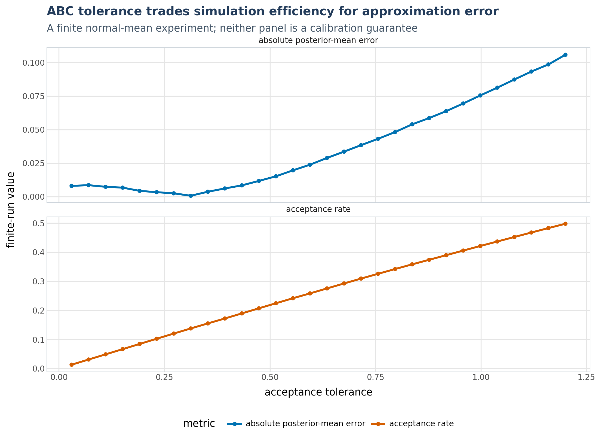

# Simulation-Based and Likelihood-Free Inference {#sec-pp-sbi}

Some scientific models can generate realistic data but have no tractable
likelihood. Population genetics, stochastic epidemics, queueing networks, and
large physical simulators often fall into this category. Simulation-based
inference (SBI) uses forward simulations to approximate a posterior, likelihood,
or likelihood ratio. It removes the need to evaluate the likelihood; it does
not remove the need to specify a prior, validate the simulator, cover the
relevant parameter region, or quantify approximation error.

**Preparation route.** Chapters 1 and 5 cover generative models and workflow,
Chapter 9 covers importance sampling, Chapter 13 covers SBC, and Chapter 22
introduces amortization. This chapter begins with rejection approximate Bayesian
computation and builds toward learned conditional estimators.

## The simulator and the target

Let a simulator draw

$$
x\sim p(x\mid\theta),\qquad \theta\sim p(\theta),
$$

even though $p(x\mid\theta)$ cannot be evaluated. The intended posterior is

$$
p(\theta\mid y)\propto p(\theta)p(y\mid\theta).
$$

Being able to simulate from $p(x\mid\theta)$ does not automatically give
$p(y\mid\theta)$. SBI constructs a different computational route to an
approximation of the posterior or its functionals.

Before inference, define:

- which simulator randomness is intrinsic and which represents unknown fixed
  conditions;
- how observed data are mapped into the simulator's data representation;
- measurement noise, selection, missingness, and preprocessing;
- the prior or proposal region over which simulations are credible; and
- the scientific quantity to report.

A simulator calibrated on the same observation later used for “likelihood-free”
inference can double-use information. Freeze or propagate calibration
uncertainty.

## Rejection approximate Bayesian computation

Choose a summary $s(\cdot)$, distance $d$, tolerance $\varepsilon$, and kernel
$K_\varepsilon$. Rejection ABC draws $\theta$ from the prior, simulates $x$, and
accepts with weight based on closeness to the observed summary. Its population
target is

$$
p_\varepsilon(\theta\mid y)
\propto p(\theta)
\int K_\varepsilon\bigl(d(s(x),s(y))\bigr)
p(x\mid\theta)\,dx.
$$

With the hard kernel

$$
K_\varepsilon(d)=1\{d\le\varepsilon\},
$$

accepted prior draws approximate $p_\varepsilon$. There are three distinct
errors:

1. **summary error:** $s(y)$ may discard posterior-relevant information;
2. **tolerance error:** nonzero $\varepsilon$ smooths the conditioning event;
3. **Monte Carlo error:** finitely many accepted draws represent the ABC target.

If $s$ is sufficient and regularity holds, the ABC target can approach the
desired posterior as $\varepsilon\to0$. This limit is not a finite-run
guarantee. For continuous high-dimensional summaries, acceptance probability
typically collapses rapidly as tolerance shrinks.

<figure id="fig-pp-abc-tradeoff">


<figcaption>

Figure 28.1: Smaller ABC tolerance reduces approximation error in this finite normal example while sharply reducing the fraction of accepted simulations.

</figcaption>
</figure>

The error curve fluctuates because it uses finite simulations. It is not a
theorem of monotone error and should not be used to choose a universal
tolerance.

## Summaries, distances, and scaling

A sufficient statistic preserves all likelihood information about $\theta$,
but low-dimensional sufficient summaries rarely exist for complex simulators.
Domain-chosen summaries should probe mechanisms relevant to the estimand:
means, tails, autocorrelations, spatial clustering, event durations, or
cross-channel relationships.

Distances require scaling. If

$$
d(s_x,s_y)^2=(s_x-s_y)^\mathsf T
W(s_x-s_y),
$$

then $W$ determines which discrepancies matter. Standardizing by prior-
predictive variances prevents a high-unit component from dominating, while a
Mahalanobis matrix also accounts for correlation. Estimating $W$ from observed
data can leak information into algorithm design; document the choice and test
sensitivity.

Learned summaries can optimize prediction of parameters from simulations, but
that objective may emphasize common prior regions and ignore rare scientific
regimes. A low parameter-prediction loss is not proof of posterior sufficiency.

## Sequential and regression-adjusted ABC

Sequential Monte Carlo ABC moves a population through tolerances
$\varepsilon_1>\cdots>\varepsilon_T$. At stage $t$, particles are proposed from
a mixture based on the previous population and receive an importance weight

$$
w_t^{(i)}\propto
\frac{p(\theta_t^{(i)})}
{\sum_jw_{t-1}^{(j)}
q_t(\theta_t^{(i)}\mid\theta_{t-1}^{(j)})}
$$

when the simulation passes the new tolerance. The denominator is essential:
particles are no longer proposed from the prior. Resampling, perturbation, and
duplicate ancestry create dependence, so raw particle count is not independent
information.

Regression adjustment fits a local relation between accepted parameters and
summary discrepancies, then extrapolates draws toward zero discrepancy. It can
reduce leading tolerance bias when the local model is adequate, but it can also
move draws outside prior support or amplify a poor summary. Validate adjusted
and unadjusted outputs on simulated truths.

## Synthetic likelihood

Synthetic likelihood assumes a summary distribution such as

$$
s(X)\mid\theta
\approx\operatorname{Normal}
\bigl(\mu_\theta,\Sigma_\theta\bigr).
$$

At each $\theta$, repeated simulations estimate $\mu_\theta$ and
$\Sigma_\theta$, producing an estimated log likelihood

$$
\widehat\ell(\theta)
=-\frac12(s_y-\widehat\mu_\theta)^\mathsf T
\widehat\Sigma_\theta^{-1}(s_y-\widehat\mu_\theta)
-\frac12\log\det\widehat\Sigma_\theta+C.
$$

The approximation assumes more than ABC: summary normality and stable covariance
estimation. The estimated likelihood is noisy. Plugging it into an ordinary MCMC
acceptance ratio without accounting for estimator properties need not preserve
a clearly defined target. Correlated simulation randomness, shrinkage covariance
estimators, and pseudo-marginal methods can improve behavior under appropriate
conditions.

## Neural posterior, likelihood, and ratio estimation

Modern SBI often trains one of three objects on simulated pairs
$(\theta,x)$.

**Neural posterior estimation** learns $q_\phi(\theta\mid x)$ directly, often
with a conditional normalizing flow. Training over prior simulations targets

$$
\max_\phi E_{p(\theta)p(x\mid\theta)}
[\log q_\phi(\theta\mid x)].
$$

The result is amortized across observations drawn from the training
distribution. If simulations use proposal $\widetilde p(\theta)$ instead of the
prior, training or posterior reconstruction needs the corresponding correction.

**Neural likelihood estimation** learns $q_\phi(x\mid\theta)$ and combines it
with the prior through MCMC or importance sampling. It can be reused under new
priors if its conditional density remains accurate in their support.

**Neural ratio estimation** trains a classifier to distinguish joint pairs
$(\theta,x)\sim p(\theta,x)$ from independent pairs
$(\theta,x)\sim p(\theta)p(x)$. With equal class probabilities and optimal
classifier $D(\theta,x)$,

$$
\frac{p(x\mid\theta)}{p(x)}
=\frac{D(\theta,x)}{1-D(\theta,x)}.
$$

Finite classifiers are not optimal, and a high held-out classification accuracy
can be bad: the classes may be trivially separable in training regions while
ratio estimates at the observation are poorly calibrated. Inspect loss,
calibration, coverage, and local simulation support.

## Sequential proposals and truncation

Simulating from the prior is wasteful when the posterior occupies a tiny region.
Sequential SBI trains an initial estimator, proposes simulations nearer the
observation, and retrains. This introduces feedback:

- proposal corrections must recover the declared prior target;
- early approximation errors can exclude a true region;
- stopping and truncation rules become part of the algorithm; and
- the same observed data shape simulation allocation, so a separate simulation
  test set is needed.

Truncating the prior to a learned high-density region is efficient only if
discarded posterior mass is negligible. Report the truncation rule and test
broader proposals on simulated truths, including boundary and multimodal cases.

## Validation under simulation and reality

SBI needs layered validation.

**Algorithm calibration.** Use SBC or coverage tests with parameters and data
drawn from the same distribution used to define the intended operating region.
Because an amortized network is deterministic after training, repeat over many
truths, not only many posterior draws for one observation.

**Local calibration.** Condition simulations on neighborhoods of summary or
data space, or use coverage diagnostics stratified by parameter regime. Global
prior-averaged coverage can hide failure near the actual observation.

**Posterior predictive checking.** Simulate replicated raw data from inferred
parameters and compare features not used as summaries. Matching summaries by
construction is a weak check.

**Simulation-gap analysis.** Real observations are not sampled from the code by
assumption. Compare simulator and real data using held-out features, domain
expertise, experimental benchmarks, and sensitivity to discrepancy models. If
the observation is outside the simulation cloud, a neural posterior may still
return a confident normalized density; add out-of-distribution detection and an
abstention path.

**Nonexample.** A flat SBC histogram under the simulator does not validate the
simulator as a description of reality. It says the inference procedure is
calibrated on average for that simulated joint experiment, subject to finite
test resolution.

<!-- inline-formula-code:start -->
## Formula-to-Python map: bounded rejection ABC

For a normal teaching model,

$$
\theta\sim\operatorname{Normal}(0,1),\qquad
X\mid\theta\sim\operatorname{Normal}(\theta,1),
$$

the hard-kernel ABC rule is

$$
\text{accept }\theta^{(s)}
\quad\Longleftrightarrow\quad
|X^{(s)}-y|\le\varepsilon.
$$

| Mathematics | Python | Meaning |
|---|---|---|
| $y$ | `observed_value` | observed scalar summary |
| $\varepsilon$ | `tolerance` | maximum accepted discrepancy |
| $\theta^{(s)}$ | `parameter_draws` | prior proposals |
| $X^{(s)}$ | `simulated_values` | forward simulations |
| $1\{\vert X-y\vert \le\varepsilon\}$ | `accepted_mask` | hard ABC kernel |
| $\widehat\mu_\theta,\widehat\Sigma_\theta$ | `simulated_mean`, `simulated_variance` | scalar synthetic-likelihood estimates |
| $D(\theta,x)$ | `joint_class_probability` | calibrated classifier probability |

```python
from math import isfinite, log, log1p, pi

import numpy as np

def rejection_abc_normal_mean(
    observed_value: float,
    tolerance: float,
    simulation_count: int,
    seed: int,
) -> tuple[list[float], float]:
    if not isfinite(observed_value):
        raise ValueError("observed value must be finite")
    if not isfinite(tolerance) or tolerance <= 0.0:
        raise ValueError("tolerance must be finite and positive")
    if simulation_count < 100 or simulation_count > 10_000_000:
        raise ValueError("simulation_count must be between 100 and 10000000")
    rng = np.random.default_rng(seed)
    parameter_draws = rng.normal(size=simulation_count)
    simulated_values = parameter_draws + rng.normal(size=simulation_count)
    accepted_mask = np.abs(simulated_values - observed_value) <= tolerance
    accepted_parameters = parameter_draws[accepted_mask]
    if len(accepted_parameters) == 0:
        raise ValueError("no proposals were accepted; increase simulations or tolerance")
    acceptance_rate = float(accepted_mask.mean())
    return accepted_parameters.tolist(), acceptance_rate

def gaussian_synthetic_log_likelihood(
    observed_summary: float, simulated_summaries: list[float]
) -> float:
    if not isfinite(observed_summary) or len(simulated_summaries) < 3:
        raise ValueError("require a finite observation and at least three simulations")
    if any(not isfinite(value) for value in simulated_summaries):
        raise ValueError("simulated summaries must be finite")
    array = np.asarray(simulated_summaries, dtype=float)
    simulated_mean = float(array.mean())
    simulated_variance = float(array.var(ddof=1))
    if simulated_variance <= 0.0:
        raise ValueError("simulated summary variance must be positive")
    squared_standardized_error = (
        (observed_summary - simulated_mean) ** 2 / simulated_variance
    )
    return -0.5 * (
        squared_standardized_error + log(2.0 * pi * simulated_variance)
    )

def classifier_log_likelihood_to_evidence_ratio(
    joint_class_probability: float,
) -> float:
    if not isfinite(joint_class_probability) or not 0.0 < joint_class_probability < 1.0:
        raise ValueError("classifier probability must be finite and in (0,1)")
    return log(joint_class_probability) - log1p(-joint_class_probability)

accepted, rate = rejection_abc_normal_mean(
    observed_value=1.0,
    tolerance=0.10,
    simulation_count=200_000,
    seed=826,
)
print("accepted draws and rate:", len(accepted), rate)
print("ABC posterior mean:", sum(accepted) / len(accepted))
print("exact posterior mean for comparison:", 0.5)
print(
    "synthetic log likelihood:",
    gaussian_synthetic_log_likelihood(1.0, [0.2, 0.7, 1.1, 1.4, 0.8]),
)
print(
    "classifier log ratio:",
    classifier_log_likelihood_to_evidence_ratio(0.8),
)
```

**What the computation establishes.** The functions execute a fixed-budget,
reproducible rejection ABC experiment, evaluate a plug-in scalar Gaussian
synthetic likelihood, and translate a supplied calibrated classifier
probability into a log density ratio. The exact posterior mean is available only
because this teaching model has a tractable likelihood. The simulation does not
prove convergence as tolerance shrinks, establish summary sufficiency,
calibrate a neural estimator, or validate any real simulator.
<!-- inline-formula-code:end -->

## Summary

Likelihood-free inference replaces likelihood evaluation with forward
simulation plus a kernel, synthetic density, or learned conditional object.
ABC makes summary and tolerance errors explicit; sequential methods improve
allocation but require proposal weights. Neural posterior, likelihood, and
ratio estimators amortize simulations while introducing training, coverage, and
simulation-gap risks. Calibration under the simulator and criticism against
reality are both necessary and answer different questions.

The taxonomy of neural posterior, likelihood, and ratio estimation follows the
simulation-based-inference literature ([Cranmer et al. 2020](bibliography.md#ref-cranmer2020frontier)).

## Exercises

<div class="exercise" id="probabilistic_programming-28-simulation-based-inference-ex-1">
<p class="exercise-title"><strong>Exercise 1</strong></p>

Derive the ABC target by integrating out simulated data under a hard kernel.

</div>

<div class="exercise" id="probabilistic_programming-28-simulation-based-inference-ex-2">
<p class="exercise-title"><strong>Exercise 2</strong></p>

Give a sufficient statistic for a normal mean with known variance and a
plausible but insufficient summary for a mixture.

</div>

<div class="exercise" id="probabilistic_programming-28-simulation-based-inference-ex-3">
<p class="exercise-title"><strong>Exercise 3</strong></p>

Show why Euclidean distance changes when one summary component changes
measurement units.

</div>

<div class="exercise" id="probabilistic_programming-28-simulation-based-inference-ex-4">
<p class="exercise-title"><strong>Exercise 4</strong></p>

Derive the SMC-ABC importance denominator for a mixture proposal.

</div>

<div class="exercise" id="probabilistic_programming-28-simulation-based-inference-ex-5">
<p class="exercise-title"><strong>Exercise 5</strong></p>

Explain the assumptions behind a Gaussian synthetic likelihood.

</div>

<div class="exercise" id="probabilistic_programming-28-simulation-based-inference-ex-6">
<p class="exercise-title"><strong>Exercise 6</strong></p>

Derive the density-ratio identity from Bayes' rule for an equal-prior binary
classifier.

<details class="solution"><summary>Solution</summary>

For Exercise 6, label joint pairs with $C=1$ and independently paired samples
with $C=0$. Equal class priors give
$D(\theta,x)=p(\theta,x)/[p(\theta,x)+p(\theta)p(x)]$. Therefore
$D/(1-D)=p(\theta,x)/[p(\theta)p(x)]=p(x\mid\theta)/p(x)$. The identity assumes
the population-optimal classifier; a finite trained classifier only estimates
the ratio.

</details>

</div>

<div class="exercise" id="probabilistic_programming-28-simulation-based-inference-ex-7">
<p class="exercise-title"><strong>Exercise 7</strong></p>

Design local coverage checks for a two-dimensional parameter whose boundary
is scientifically important.

</div>

<div class="exercise" id="probabilistic_programming-28-simulation-based-inference-ex-8">
<p class="exercise-title"><strong>Exercise 8</strong></p>

Write an abstention and simulator-discrepancy plan for a real observation
outside the training simulation cloud.

</div>

### Selected solution

For Exercise 6, label joint pairs with $C=1$ and independently paired samples
with $C=0$. Equal class priors give
$D(\theta,x)=p(\theta,x)/[p(\theta,x)+p(\theta)p(x)]$. Therefore
$D/(1-D)=p(\theta,x)/[p(\theta)p(x)]=p(x\mid\theta)/p(x)$. The identity assumes
the population-optimal classifier; a finite trained classifier only estimates
the ratio.
