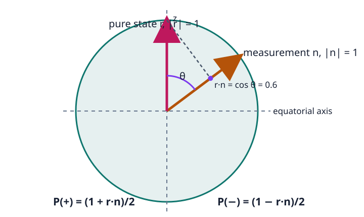

# Two-state systems and Bloch geometry

## The simplest quantum system

A two-level quantum system---a qubit---is the simplest Hilbert space that exhibits genuine quantum behavior: superposition, interference, and nontrivial time evolution. Despite its simplicity, the qubit is the building block of quantum information science and provides a geometric visualization that aids intuition for higher-dimensional systems. This chapter develops the Bloch sphere representation, connects it to the Pauli matrices, and works explicit examples of state evolution and measurement.

## Density matrices and the Bloch vector

Every $2 \times 2$ density matrix can be written as

$$\rho = \frac{1}{2}\bigl(I + \mathbf{r}\cdot\boldsymbol{\sigma}\bigr),$$

where $\mathbf{r} = (r_x, r_y, r_z) \in \mathbb{R}^{3}$ and $\boldsymbol{\sigma} = (\sigma_x, \sigma_y, \sigma_z)$ are the Pauli matrices:

$$\sigma_x = \begin{pmatrix}0&1\\1&0\end{pmatrix}, \quad \sigma_y = \begin{pmatrix}0&-i\\i&0\end{pmatrix}, \quad \sigma_z = \begin{pmatrix}1&0\\0&-1\end{pmatrix}.$$

The matrix $\rho$ is Hermitian because $\mathbf{r}\cdot\boldsymbol{\sigma}$ is Hermitian (each $\sigma_j$ is Hermitian and the $r_j$ are real). It has unit trace because each Pauli matrix is traceless. Positivity requires that the eigenvalues of $\rho$ be nonnegative.

## Worked example: eigenvalues of the Bloch-form density matrix

To find the eigenvalues, note that $(\mathbf{r}\cdot\boldsymbol{\sigma})^{2} = |\mathbf{r}|^{2}I$. This follows from the Pauli algebra $\sigma_j\sigma_k = \delta_{jk}I + i\varepsilon_{jkl}\sigma_l$. Hence

$$\rho = \frac{1}{2}\bigl(I + \mathbf{r}\cdot\boldsymbol{\sigma}\bigr), \qquad \rho^{2} = \frac{1}{4}\bigl(I + 2\mathbf{r}\cdot\boldsymbol{\sigma} + |\mathbf{r}|^{2}I\bigr).$$

The eigenvalues are $(1 \pm |\mathbf{r}|)/2$. Positivity requires $|\mathbf{r}| \leq 1$. The state is **pure** when $|\mathbf{r}| = 1$ and **maximally mixed** when $\mathbf{r} = \mathbf{0}$.

**Direct example.** For $\mathbf{r} = (0, 0, 0.6)$, the eigenvalues are $0.8$ and $0.2$, both positive. For $\mathbf{r} = (0, 0, 1)$, the eigenvalues are $1$ and $0$, confirming purity.

## The Bloch sphere and Bloch ball

Pure states with $|\mathbf{r}| = 1$ form the **Bloch sphere** $S^{2}$. Mixed states with $|\mathbf{r}| < 1$ fill the **Bloch ball**. The north pole $\mathbf{r} = (0,0,1)$ corresponds to $\rho = |0\rangle\langle 0|$; the south pole to $|1\rangle\langle 1|$; the equator contains equal superpositions with varying relative phase.

The Bloch ball is special to two levels. In $d$ dimensions the mixed-state space is a $(d^{2}-1)$-dimensional convex body, not a ball for $d > 2$.

The diagram shows the geometric ingredients of a projective spin measurement. A pure state is a unit vector $\mathbf r$ on the sphere, the measurement direction is a unit vector $\mathbf n$, and the signed projection $\mathbf r\cdot\mathbf n=\cos\theta$ determines the two outcome probabilities.

*Bloch measurement geometry. The two probabilities are $(1+\mathbf r\cdot\mathbf n)/2$ and $(1-\mathbf r\cdot\mathbf n)/2$; the picture supplies intuition, while the dot-product formula carries the quantitative claim.*

## Hamiltonian evolution on the Bloch sphere

A Hamiltonian $H = (\hbar/2)\boldsymbol{\omega}\cdot\boldsymbol{\sigma}$ generates unitary evolution $U(t) = e^{-iHt/\hbar} = e^{-i(\boldsymbol{\omega}\cdot\boldsymbol{\sigma})t/2}$. Using the Pauli identity,

$$U(t) = \cos\Bigl(\frac{|\boldsymbol{\omega}|t}{2}\Bigr)I - i\sin\Bigl(\frac{|\boldsymbol{\omega}|t}{2}\Bigr)\frac{\boldsymbol{\omega}\cdot\boldsymbol{\sigma}}{|\boldsymbol{\omega}|}.$$

The Bloch vector evolves according to the **Bloch equation**

$$\frac{d\mathbf{r}}{dt} = \boldsymbol{\omega} \times \mathbf{r}.$$

This is classical precession: $\mathbf{r}$ rotates about the axis $\boldsymbol{\omega}$ at angular speed $|\boldsymbol{\omega}|$ while maintaining constant length. Global identity terms in $H$ shift all energies but do not change isolated-state rays, though relative phases against other sectors may matter.

## Measurement probabilities from the Bloch vector

For spin measurement along a unit vector $\mathbf{n}$, the observable is $S_{\mathbf{n}} = (\hbar/2)\mathbf{n}\cdot\boldsymbol{\sigma}$. Its eigenvalues are $\pm\hbar/2$. In a state with Bloch vector $\mathbf{r}$, the probabilities are

$$\mathbb{P}(\pm) = \frac{1 \pm \mathbf{r}\cdot\mathbf{n}}{2}.$$

This connects the operator spectral projections to a geometric dot product. For a pure state on the sphere, $\mathbf{r}\cdot\mathbf{n} = \cos\theta$ where $\theta$ is the angle between the state and measurement directions.

## Common error: treating the Bloch ball as a classical probability simplex

The Bloch ball is not a classical probability space. Two different decompositions of the same mixed state into pure states are physically indistinguishable. For example, the maximally mixed state $I/2$ can be written as $(|0\rangle\langle 0| + |1\rangle\langle 1|)/2$ or as $(|+\rangle\langle +| + |-\rangle\langle -|)/2$. These are different ensembles but the same density operator. A second common error is to assume that the time evolution of a mixed state is always a rotation of its Bloch vector. This holds only for unitary evolution; open-system dynamics (discussed in a later chapter) can shrink the Bloch vector toward the origin.

## Practice exercises

### Exercise 1

For $\rho = (I + r\sigma_z)/2$, find the eigenvalues and determine when $\rho$ is pure.

**Solution.** In the $\sigma_z$ basis, $\rho = \operatorname{diag}((1+r)/2, (1-r)/2)$. The eigenvalues are $(1+r)/2$ and $(1-r)/2$. Positivity requires $|r| \leq 1$. Purity $\operatorname{Tr}(\rho^{2}) = 1$ occurs when $((1+r)/2)^{2} + ((1-r)/2)^{2} = 1$, which simplifies to $(1+r^{2})/2 = 1$, so $r^{2} = 1$. Thus $|r| = 1$ gives a pure state; $r = 0$ gives the maximally mixed state.

### Exercise 2

Show that for any unit vectors $\mathbf{m}, \mathbf{n} \in \mathbb{R}^{3}$, the commutator $[\mathbf{m}\cdot\boldsymbol{\sigma}, \mathbf{n}\cdot\boldsymbol{\sigma}] = 2i(\mathbf{m}\times\mathbf{n})\cdot\boldsymbol{\sigma}$.

**Solution.** Expand the product using the Pauli algebra:

$$(\mathbf{m}\cdot\boldsymbol{\sigma})(\mathbf{n}\cdot\boldsymbol{\sigma}) = \sum_{j,k}m_j n_k \sigma_j \sigma_k = \sum_{j,k}m_j n_k(\delta_{jk}I + i\varepsilon_{jkl}\sigma_l) = (\mathbf{m}\cdot\mathbf{n})I + i(\mathbf{m}\times\mathbf{n})\cdot\boldsymbol{\sigma}.$$

Subtracting the reverse product gives $2i(\mathbf{m}\times\mathbf{n})\cdot\boldsymbol{\sigma}$.

### Exercise 3

A qubit starts in $\rho(0)$ with Bloch vector $\mathbf{r}(0) = (1,0,0)$. The Hamiltonian is $H = (\hbar\omega/2)\sigma_z$. Find $\mathbf{r}(t)$ and the probability of obtaining $+\hbar/2$ when measuring $S_x$ at time $t$.

**Solution.** The Bloch equation gives $d\mathbf{r}/dt = \omega(0,0,1) \times \mathbf{r} = \omega(-r_y, r_x, 0)$. With initial condition $(1,0,0)$, the solution is $\mathbf{r}(t) = (\cos(\omega t), \sin(\omega t), 0)$. The probability of $+\hbar/2$ for $S_x = (\hbar/2)\sigma_x$ is $(1 + \mathbf{r}(t)\cdot(1,0,0))/2 = (1 + \cos(\omega t))/2 = \cos^{2}(\omega t/2)$.

## Looking backward and forward

This chapter specialized the general formalism of *Observables and the spectral theorem* and *Unitary dynamics and generators* to the two-level case, revealing a beautiful geometric picture. The Bloch sphere will reappear when we discuss composite systems and entanglement in *Composite systems and entanglement*. The next chapter, *Canonical commutation and uncertainty*, returns to infinite-dimensional systems and derives the uncertainty principle from the Cauchy–Schwarz inequality.
