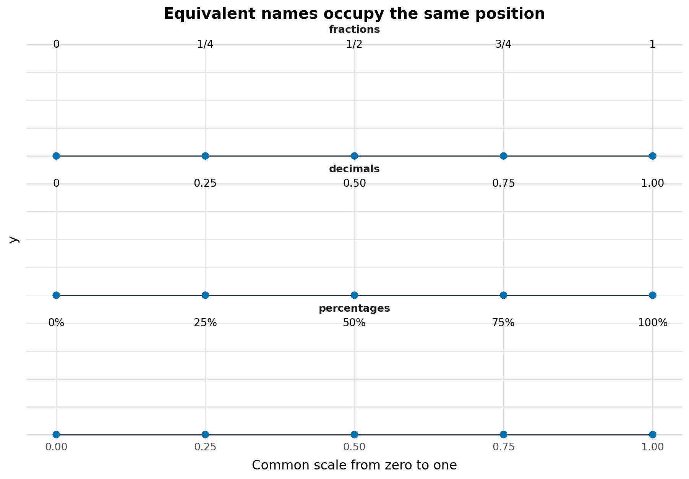
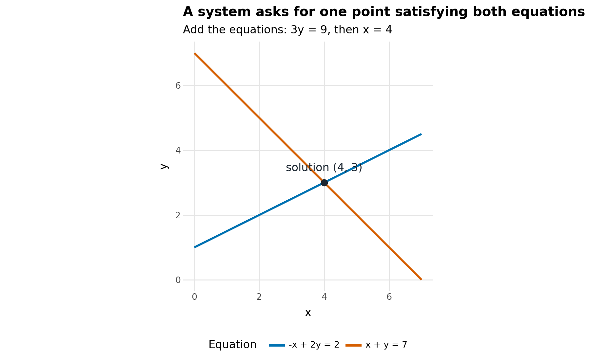
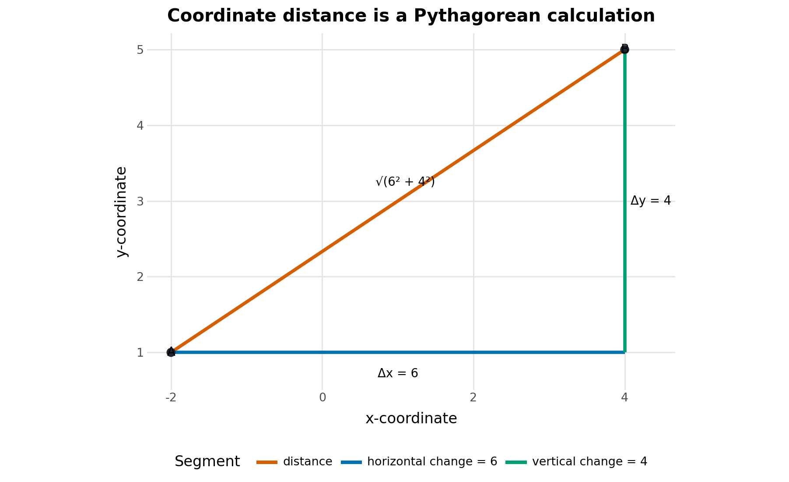
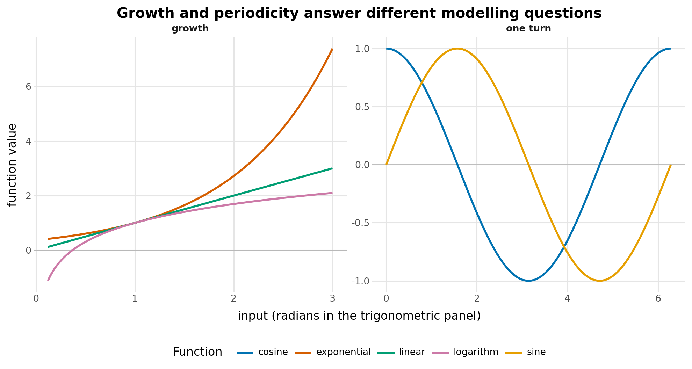
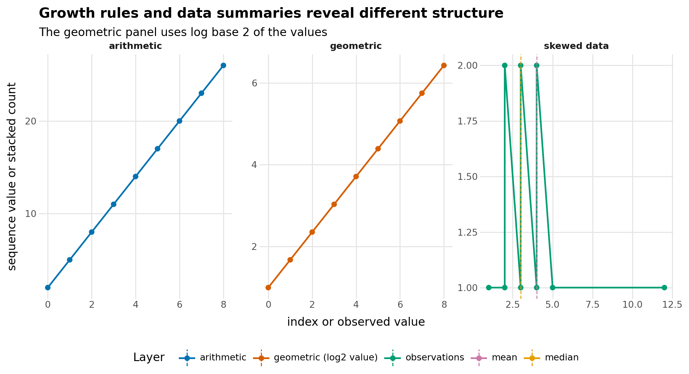

# A concise starting toolkit {#sec-calculus-bridge}

This book assumes no previous analysis course, but it does not delay analysis with a
long elementary pre-course. Calculus, sequences and series, and elementary proof remain prerequisites; this compact chapter is a reference for notation
used immediately. Later chapters introduce algebra, calculus, probability, and
linear algebra again at the exact point where they are needed. Read what is new
and skim what is familiar.

## Numbers and arithmetic essentials {#sec-foundation-arithmetic}

The natural numbers are $1,2,3,\ldots$; the integers add $0$ and negative
numbers; rational numbers have the form $a/b$ with integers $a,b$ and $b\ne0$.
The real numbers also contain limits such as $\sqrt2$ that no rational number
equals. Addition combines, multiplication scales, and division reverses a
nonzero multiplication. Parentheses settle order of operations.

Absolute value is distance from zero:

$$
|x|=\begin{cases}x,&x\ge0,\\-x,&x<0.\end{cases}
$$

Consequently $|x-y|$ is the distance between $x$ and $y$. This one expression
will eventually carry most epsilon arguments.

<figure id="fig-primer-number-line">


<figcaption>

Figure 1: Arithmetic and distance are represented as directed motion on a number line.

</figcaption>
</figure>

## Fractions, ratios, and approximation {#sec-foundation-rationals}

A fraction $a/b$ is defined only when $b\ne0$. To add fractions, use a common
denominator:

$$
\frac ab+\frac cd=\frac{ad+bc}{bd}.
$$

A decimal may name an exact rational number or a rounded measurement. Write
$=$ for exact equality and $\approx$ for approximation. Analysis repeatedly
separates the object being studied from a finite decimal, graph, or sample of
that object.

<figure id="fig-primer-fractions">


<figcaption>

Figure 2: Fractions, decimals, and percentages are different names for positions on one common scale.

</figcaption>
</figure>

## Algebra as reversible bookkeeping {#sec-foundation-algebra}

A variable names a quantity. An equation asserts equality; applying the same
reversible operation to both sides preserves solutions. From $3x+5=20$, subtract
$5$ and divide by $3$ to get $x=5$, then substitute to check. Factoring reverses
expansion, as in $x^2-1=(x-1)(x+1)$. Inequalities require care: multiplying by a
negative number reverses their direction. Denominators, even roots, and
logarithms impose domain restrictions that must be recorded.

<figure id="fig-primer-linear-model">


<figcaption>

Figure 3: Two linear equations are solved by their single intersection point.

</figcaption>
</figure>

## Geometry and coordinates in one paragraph {#sec-foundation-geometry}

A point in the plane is $(x,y)$. The distance formula

$$
\sqrt{(x_2-x_1)^2+(y_2-y_1)^2}
$$

comes from the Pythagorean theorem. Slope is vertical change divided by
horizontal change when that denominator is nonzero. Analysis generalizes these
ideas: absolute value is distance on the line, a metric is an abstract distance,
and a norm measures vector or function size. Each generalization is defined
before use.

<figure id="fig-primer-coordinate-geometry">


<figcaption>

Figure 4: Coordinate changes form a right triangle whose hypotenuse gives distance.

</figcaption>
</figure>

## Functions and graphs {#sec-foundation-functions}

A function assigns one output to each allowed input. In $f(x)=x^2+1$, $x$ is
the input and $f(3)=10$. The domain is the allowed input set, while the range is
the set of outputs. A graph records $(x,f(x))$. Composition means
$(f\circ g)(x)=f(g(x))$. An inverse reverses a function only where distinct
inputs give distinct outputs.

<figure id="fig-primer-functions">


<figcaption>

Figure 5: Several common function families show how formulas control graphical shape.

</figcaption>
</figure>

## Powers, logarithms, and trigonometric notation {#sec-foundation-transcendentals}

Powers abbreviate repeated multiplication. For $a>0$, $a\ne1$, the statement
$\log_a x=y$ means $a^y=x$. The exponential and logarithm are inverse
functions. Sine and cosine give the coordinates $(\cos\theta,\sin\theta)$ on a
unit circle. These functions supply standard examples of growth and
oscillation; their analytic properties are proved later rather than assumed
from a formula sheet.

<figure id="fig-primer-exp-log-trig">


<figcaption>

Figure 6: Linear, exponential, logarithmic, and trigonometric functions encode different kinds of change.

</figcaption>
</figure>

## Statements, quantifiers, and proof {#sec-foundation-proof}

“For every $x$” is universal and one counterexample disproves it. “There exists
an $x$” is existential and one example can prove it. The implication
$P\Rightarrow Q$ is equivalent to its contrapositive
$\neg Q\Rightarrow\neg P$, not to its converse. Definitions establish the
rules of a concept; theorems state consequences; proofs justify those
consequences from hypotheses.

Analysis depends heavily on quantifier order. The phrase “for every
$\varepsilon>0$ there exists $N$” permits $N$ to depend on $\varepsilon$.
Reversing the order says something stronger. Direct proof, cases,
contrapositive, contradiction, and induction are introduced in Chapter 1 with
worked examples.

<figure id="fig-primer-logic">


<figcaption>

Figure 7: A complete finite truth table separates implication from its converse.

</figcaption>
</figure>

## Sequences, sums, data, and finite computation {#sec-foundation-computation}

A sequence is an ordered list $a_1,a_2,\ldots$. Sigma notation abbreviates a
finite sum:

$$
\sum_{k=1}^{n}k=1+2+\cdots+n=\frac{n(n+1)}2.
$$

The loop is the left-hand formula written as a finite procedure. The closed
formula checks the result; induction proves the identity for every nonnegative
$n$.

<figure id="fig-primer-sequences-data">


<figcaption>

Figure 8: Arithmetic and geometric sequences differ from a finite data summary.

</figcaption>
</figure>

```python
def triangular_sum(limit: int) -> int:
    """Return the finite sum from one through limit."""
    if limit < 0:
        raise ValueError("limit must be nonnegative")
    total = 0
    for term in range(1, limit + 1):
        total += term
    if total != limit * (limit + 1) // 2:
        raise RuntimeError("sum certificate failed")
    return total

print(triangular_sum(100))
```

Code can inspect finite samples, test a conjectured bound, or exhibit a
counterexample. It does not turn a sampled graph into a proof about a continuum.

## From rates and accumulation to analysis

For a function $f$, the average rate of change from $a$ to $a+h$ is

$$
\frac{f(a+h)-f(a)}{h},\qquad h\ne0.
$$

The derivative, when it exists, is the limit of this quotient as $h$ approaches
zero. An integral accumulates many small contributions. The Fundamental Theorem
of Calculus connects the derivative of an accumulated-area function with the
original rate. Chapters 6–8 rebuild these statements rigorously from limits,
continuity, completeness, and partitions.

```python
def secant_slope(point: float, step: float) -> float:
    """Return the secant slope of f(x)=x**2 at point over one nonzero step."""
    if step == 0.0:
        raise ValueError("step must be nonzero")
    function = lambda x: x * x
    return (function(point + step) - function(point)) / step

for h in (1.0, 0.1, 0.01):
    print(h, secant_slope(3.0, h))
```

The numbers suggest the derivative $2a=6$ at $a=3$; the epsilon argument later
proves the limit. You are ready for Chapter 1 if you can substitute into a
formula, read a quantifier, and distinguish a finite computation from a proof.
