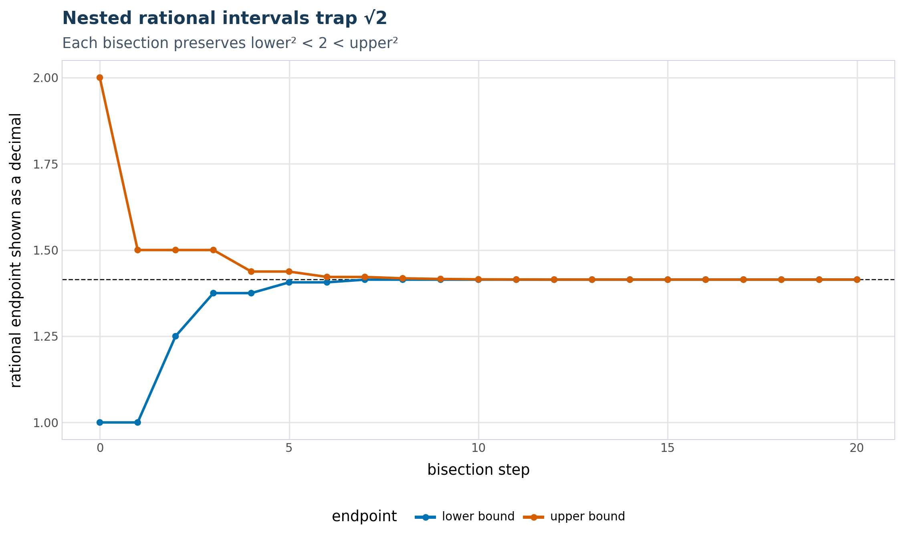

# The real numbers and completeness {#sec-real-numbers}

The algebraic rules of $\mathbb R$ are familiar from calculus. What distinguishes
the real numbers analytically is that they have no order gaps. The completeness
axiom formalizes that idea and powers nearly every existence theorem in the book.

## Ordered fields and rational gaps

An **ordered field** supports addition, multiplication, and a total order compatible
with both: adding the same number preserves order, and a product of positive
numbers is positive. The rationals $\mathbb Q$ form an ordered field, so algebra
alone cannot explain the analytic strength of $\mathbb R$.

Consider $S=\{q\in\mathbb Q:q>0, q^2<2\}$. It is nonempty and bounded above in
$\mathbb Q$, but has no rational least upper bound. If a positive rational $r$
satisfied $r^2<2$, a small rational increase would remain below square root two;
if $r^2>2$, a small rational decrease would still be an upper bound. Equality is
impossible by the classical parity proof. Thus the rational line contains a gap.

## Bounds, suprema, and infima

Let $S\subseteq\mathbb R$. A number $u$ is an **upper bound** if $s\le u$ for all
$s\in S$. A **least upper bound** or **supremum** is an upper bound no larger than
any other; it is denoted $\sup S$. A maximum must belong to the set, whereas a
supremum need not. For $S=(0,1)$, $\sup S=1$ but $S$ has no maximum.

The key approximation property is:

**Proposition 2.1.** If $s^*=\sup S$ and $S$ is nonempty, then for every
$\varepsilon>0$ there exists $s\in S$ such that
$s^*-\varepsilon<s\le s^*$.

**Proof.** If no such $s$ existed, $s^*-\varepsilon$ would be an upper bound smaller
than the least upper bound. $\square$

Lower bounds and the infimum are defined dually. Negation gives
$\inf S=-\sup(-S)$ whenever the relevant bounds exist.

## The completeness axiom

**Least-upper-bound property.** Every nonempty subset of $\mathbb R$ that is bounded
above has a supremum in $\mathbb R$.

This is an axiom for our presentation: it characterizes the no-gap feature of the
real system. It does not say every set is bounded or has a maximum. It guarantees a
specific real number only after nonemptiness and boundedness have been checked.

**Archimedean property.** For every real $x$, there exists $n\in\mathbb N$ with
$n>x$.

**Proof.** If $\mathbb N$ were bounded above, let $a=\sup\mathbb N$. By supremum
approximation, some $n\in\mathbb N$ satisfies $n>a-1$. Then $n+1>a$, contradicting
that $a$ is an upper bound. $\square$

It follows that for every $\varepsilon>0$ there is $n$ with $1/n<\varepsilon$.
This bridges continuous tolerances and discrete cutoffs—the basic move in sequence
proofs.

## Density and approximation

**Theorem 2.2.** If $x<y$, then there is a rational $r$ with $x<r<y$.

**Proof.** Choose $n$ so large that $n(y-x)>1$. By the integer-part property, there
is an integer $m$ with $m-1\le nx<m$. Then $nx<m\le nx+1<ny$, and
$r=m/n$ lies between $x$ and $y$. $\square$

Irrationals are also dense: choose a rational between $x/\sqrt2$ and $y/\sqrt2$
and multiply by $\sqrt2$, adjusting the trivial zero case if needed. Thus density
does not measure cardinal size. Both rationals and irrationals occur in every open
interval, although only the first are countable.

Decimal expansions can be understood through completeness. Truncations of a
bounded decimal form an increasing bounded sequence; its supremum is the number
represented. The ambiguity $0.999\ldots=1$ is not a paradox: both digit strings
generate truncations with the same supremum.

## Equivalent faces of completeness

Several principles will later be proved equivalent in $\mathbb R$:

1. every nonempty bounded-above set has a supremum;
2. every increasing bounded sequence converges;
3. every Cauchy sequence converges;
4. every nested sequence of nonempty closed bounded intervals whose lengths tend
   to zero has exactly one common point; and
5. every bounded sequence has a convergent subsequence.

The hypotheses differ, but each prohibits escape through a gap. We prove one link
now.

**Theorem 2.3 (Monotone convergence).** If $(a_n)$ is increasing and bounded above, then
it converges to $\sup\{a_n:n\in\mathbb N\}$.

**Proof.** Let $L$ be the supremum of the range. Given $\varepsilon>0$, supremum
approximation supplies $N$ with $L-\varepsilon<a_N\le L$. For $n\ge N$,
monotonicity gives $L-\varepsilon<a_N\le a_n\le L$, hence
$|a_n-L|<\varepsilon$. $\square$

Observe the division of labour: completeness constructs $L$; monotonicity makes
one near-hit persist along the entire tail.

## Nested intervals

<!-- uni-06-nested-intervals:start -->

Let $I_n=[a_n,b_n]$, for $n\ge1$, be nonempty closed bounded real
intervals with $I_{n+1}\subseteq I_n$. Nesting gives
$$
a_1\le a_n\le a_{n+1}\le b_{n+1}\le b_n\le b_1.
$$
Thus $(a_n)$ is nondecreasing and bounded above by $b_1$, while $(b_n)$
is nonincreasing and bounded below by $a_1$. Monotone convergence gives
limits $A=\lim a_n$ and $B=\lim b_n$.

**Proof of the intersection statement.** Fix $n$. For every $m\ge n$,
$$
a_n\le a_m\le b_m\le b_n.
$$
Letting $m\to\infty$ gives $a_n\le A\le B\le b_n$. Consequently every
point of $[A,B]$ belongs to every $I_n$. Conversely, a common point $y$
satisfies $a_n\le y\le b_n$ for every $n$; taking limits gives
$A\le y\le B$. Therefore
$$
\bigcap_{n=1}^{\infty} I_n=[A,B]\ne\varnothing.
$$
If the lengths also satisfy $b_n-a_n\to0$, then $B-A=0$, so the
intersection consists of the single point $A=B$. Closedness and the fixed
finite endpoint bounds establish existence; shrinking lengths give
uniqueness. An arbitrary point of $I_1$ need not bound either endpoint
sequence in the direction required for monotone convergence.

**Changed example: choose the bounds before the limit.** For $n\ge1$, set
$$
J_n=[1-4^{-n},\,1+2^{-n}].
$$
Identify fixed bounds for its endpoint sequences and determine its
intersection. The number $7/8$ lies in $J_1$; can it serve as an upper bound
for all the left endpoints? Then replace the upper endpoint by
$2+2^{-n}$, obtaining $K_n=[1-4^{-n},\,2+2^{-n}]$. Does existence or
uniqueness change?

**Full answer.** Both families are nested. For $J_n$, the left endpoints
increase from $3/4$ toward $1$ and the right endpoints decrease from
$3/2$ toward $1$:
$$
\frac34\le1-4^{-n}\le1+2^{-n}\le\frac32.
$$
Its width is $4^{-n}+2^{-n}\to0$, so the intersection is $\{1\}$.
Although $7/8\in J_1$, the second left endpoint is $15/16>7/8$.
Membership in the first interval therefore supplies no such upper bound.
For $K_n$, the endpoint limits are $1$ and $2$ and the widths tend to $1$,
so the same intersection proof gives $[1,2]$. Existence persists, while
uniqueness fails.

<!-- uni-06-nested-intervals:end -->

Without closedness, $(0,1/n)$ is nested with shrinking length and empty
intersection. Without shrinking lengths, $[0,1]$ has many common points. This is a
typical hypothesis audit: existence and uniqueness use different assumptions.

## Absolute value and the line

The distance $d(x,y)=|x-y|$ converts order into geometry. The open ball of radius
$r$ about $x$ is the interval $(x-r,x+r)$. A statement holds **near** $x$ when it
holds on some such interval, and on a **punctured neighborhood** when $x$ itself is
removed. The identity

$$
|x-a|<r \quad\Longleftrightarrow\quad a-r<x<a+r
$$

lets us switch between metric and order language.

The extended symbols $+\infty$ and $-\infty$ are useful for describing unbounded
limits and defining suprema of unbounded sets, but they are not real numbers and do
not obey field arithmetic. Expressions such as $\infty-\infty$ are deliberately
undefined.

## Visual checkpoint: completeness by nested bounds

<figure id="fig-ra-real-bisection">


<figcaption>

Figure 2.1: Rational bisection bounds trap the square root of two.

</figcaption>
</figure>

Every point in [Figure 2.1](#fig-ra-real-bisection) comes from exact rational arithmetic.
The shrinking widths and preserved inequalities construct compatible finite
information; completeness is the theorem that supplies a real number common to
all those nested intervals.

<!-- inline-formula-code:start -->
## Formula and finite computation

A useful formula in this chapter is

$$
L_n\le\sqrt2\le U_n,\qquad U_n-L_n\to0
$$

Exact rational endpoints preserve the nested-interval certificate. The following standalone Python block expresses that finite rule with its inputs and stopping conditions visible.

```python
from fractions import Fraction

def sqrt_two_brackets(steps: int) -> list[tuple[Fraction, Fraction]]:
    """Return nested rational brackets containing the positive square root of 2."""
    if steps < 0:
        raise ValueError("steps must be nonnegative")
    left, right = Fraction(1), Fraction(2)
    brackets = [(left, right)]
    for _ in range(steps):
        middle = (left + right) / 2
        if middle * middle < 2:
            left = middle
        else:
            right = middle
        brackets.append((left, right))
    return brackets

for left, right in sqrt_two_brackets(6):
    print(left, right, right - left)
```

**What the computation establishes.** The calculation checks a declared finite instance; the surrounding argument explains what is true beyond those inputs.
<!-- inline-formula-code:end -->

## Chapter synthesis

Completeness is the real numbers' decisive structural property. Suprema turn
bounded information into an actual point, the Archimedean property connects real
tolerances with integer scales, and monotonicity converts a one-time approximation
into tail control. Later compactness and convergence theorems are elaborations of
this architecture.

## Exercises

<div class="exercise" id="real_analysis-02-real-numbers-ex-1">
<p class="exercise-title"><strong>Exercise 1</strong></p>

Find the supremum and infimum of $\{n/(n+1):n\in\mathbb N\}$ and decide whether
either is attained.

</div>

<div class="exercise" id="real_analysis-02-real-numbers-ex-2">
<p class="exercise-title"><strong>Exercise 2</strong></p>

Prove that if $S$ is nonempty and bounded below, then $\inf S=-\sup(-S)$.

</div>

<div class="exercise" id="real_analysis-02-real-numbers-ex-3">
<p class="exercise-title"><strong>Exercise 3</strong></p>

Prove the integer-part property used in the density theorem.

</div>

<div class="exercise" id="real_analysis-02-real-numbers-ex-4">
<p class="exercise-title"><strong>Exercise 4</strong></p>

Show directly that between two distinct reals lies an irrational.

</div>

<div class="exercise" id="real_analysis-02-real-numbers-ex-5">
<p class="exercise-title"><strong>Exercise 5</strong></p>

If $a=\sup A$ and $b=\sup B$, prove $\sup(A+B)=a+b$ for nonempty bounded sets,
where $A+B=\{x+y:x\in A,y\in B\}$.

<details class="hint"><summary>Hint 1</summary>

First prove every $x+y$ is at most $a+b$. Then approximate $a$ and $b$
from below separately with half the requested tolerance.

</details>

</div>

<div class="exercise" id="real_analysis-02-real-numbers-ex-6">
<p class="exercise-title"><strong>Exercise 6</strong></p>

Give a nested family of closed bounded intervals with non-shrinking lengths and
infinitely many common points.

</div>

<div class="exercise" id="real_analysis-02-real-numbers-ex-7">
<p class="exercise-title"><strong>Exercise 7</strong></p>

† Use a supremum construction to prove that every positive real has a positive
square root.

<details class="hint"><summary>Hint 1</summary>

Let $S=\{x\ge0:x^2\le a\}$ and audit nonemptiness and boundedness before
taking its supremum.

</details>

</div>

<div class="exercise" id="real_analysis-02-real-numbers-ex-8">
<p class="exercise-title"><strong>Exercise 8</strong></p>

Identify exactly where boundedness is used in monotone convergence.

</div>
