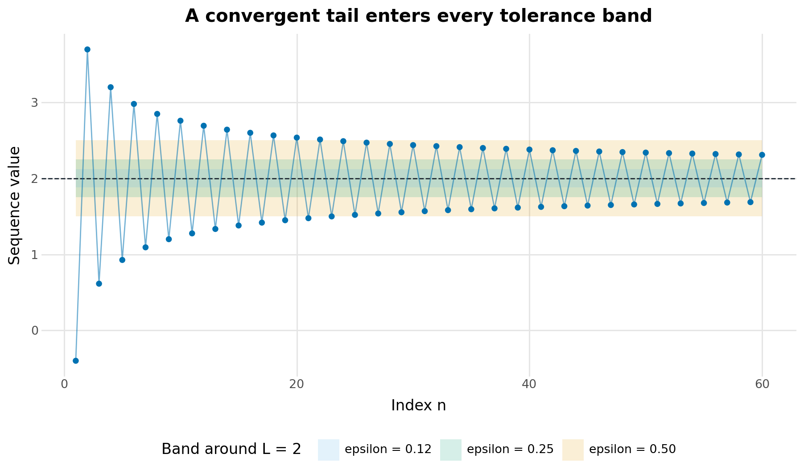

# Sequences and subsequences {#sec-sequences}

A sequence is a function from $\mathbb N$ to $\mathbb R$, but its useful geometry
lies in the tail. Convergence ignores any finite beginning and demands that every
later term eventually fit inside any prescribed tolerance.

## Convergence as eventual control

We say $a_n$ **converges** to $L$, and write $a_n\to L$, if for every
$\varepsilon>0$ there exists $N\in\mathbb N$ such that $n\ge N$ implies
$|a_n-L|<\varepsilon$. The cutoff may depend on $\varepsilon$, but not on $n$ once
chosen.

**Worked example.** For $a_n=(3n+1)/(n+2)$, subtraction rather than informal
division finds the estimate:

$$
\left|\frac{3n+1}{n+2}-3\right|=\frac5{n+2}.
$$

Given $\varepsilon>0$, choose $N>5/\varepsilon$. Then $n\ge N$ makes the last
quantity smaller than $\varepsilon$. Thus $a_n\to3$.

<figure id="fig-sequence-epsilon">


<figcaption>

Figure 3.1: A convergent sequence whose tail eventually enters progressively narrower epsilon bands around its limit.

</figcaption>
</figure>

In [Figure 3.1](#fig-sequence-epsilon), early terms may leave a tolerance band; convergence asks
only that an entire tail enter it. A narrower band generally requires a later
cutoff. The image illustrates the quantifier dependency $N=N(\varepsilon)$, not a
single universal cutoff.

**Theorem 3.1 (Uniqueness).** A sequence has at most one limit.

**Proof.** Suppose $a_n\to L$ and $a_n\to M$. If $L\ne M$, take
$\varepsilon=|L-M|/3$. Far enough out, both $|a_n-L|$ and $|a_n-M|$ are less than
$\varepsilon$. The triangle inequality then gives
$|L-M|<2|L-M|/3$, impossible. $\square$

Every convergent sequence is bounded. Choose a tail within distance $1$ of its
limit, then take the maximum of the finitely many early absolute values and
$|L|+1$. The finite-prefix step is essential: convergence controls only a tail.

## Limit laws and order

If $a_n\to a$ and $b_n\to b$, then

$$
a_n+b_n\to a+b,
\qquad a_nb_n\to ab,
\qquad |a_n|\to|a|.
$$

For products, write

$$
|a_nb_n-ab|
\le |a_n||b_n-b|+|b||a_n-a|.
$$

Convergence makes $(a_n)$ bounded, so the first variable factor can be replaced by
a constant. If $b\ne0$, then $a_n/b_n\to a/b$: eventually $|b_n|>|b|/2$, keeping
denominators away from zero.

Order passes to limits in a weak form. If $a_n\le b_n$ eventually and both
sequences converge, then $a\le b$. Strict inequality need not persist: $0<1/n$ but
both sides tend to zero. The **squeeze theorem** says that if $a_n\le c_n\le b_n$
eventually and $a_n,b_n\to L$, then $c_n\to L$.

## Monotone and recursive sequences

By the monotone convergence theorem from [sec-real-numbers](02-real-numbers.md#sec-real-numbers), an increasing sequence
converges exactly when it is bounded above. Consider

$$
x_1=1,
\qquad
x_{n+1}=\frac12\left(x_n+\frac2{x_n}\right).
$$

For $x_n>0$, arithmetic shows $x_{n+1}^2\ge2$, so $x_{n+1}\ge\sqrt2$. Also, once
$x_n\ge\sqrt2$, we have $x_{n+1}\le x_n$. The tail is decreasing and bounded
below, hence convergent. Passing through the continuous algebraic operations in
the recursion yields $L=(L+2/L)/2$, so $L=\sqrt2$. Notice the proof first establishes
existence of a limit; only then may it solve for that limit.

For a fixed iteration budget, the recurrence is an exact algorithm over
rational numbers. Keeping the values as fractions makes the translation from
the displayed formula visible and avoids hiding roundoff in the first steps.

```python
from fractions import Fraction

def babylonian_sqrt_two(iterations: int) -> list[Fraction]:
    """Return x_1 through x_{iterations+1} for the displayed recurrence."""
    if iterations < 0:
        raise ValueError("iterations must be nonnegative")
    approximations = [Fraction(1)]
    for _ in range(iterations):
        current = approximations[-1]
        approximations.append((current + Fraction(2, 1) / current) / 2)
    return approximations

approximations = babylonian_sqrt_two(5)
errors = [abs(float(value) ** 2 - 2.0) for value in approximations]
print(approximations)
print(errors)
```

The output shows rapid finite improvement and preserves the recurrence exactly
through five updates. It does not prove that all iterates stay bounded and
monotone or that the infinite sequence converges; those are the roles of the
preceding inequalities and completeness.

## Subsequences and cluster behavior

A **subsequence** has the form $(a_{n_k})$, where
$n_1<n_2<\cdots$. Since $n_k\ge k$, indices tend to infinity. Every subsequence of
a convergent sequence converges to the same limit. Conversely, if two subsequences
converge to different limits, the original sequence diverges. Thus $(-1)^n$
diverges because its even and odd subsequences tend to $1$ and $-1$.

**Theorem 3.2 (Bolzano–Weierstrass).** Every bounded real sequence has a convergent
subsequence.

**Proof.** Enclose the range in a closed interval. Bisect it and retain a half
containing infinitely many terms. Repeat, producing nested closed intervals with
lengths tending to zero. Their unique common point is $L$. Choose successively an
index from each interval, always later than the previous index. The chosen terms
approach $L$ because the containing intervals shrink to $L$. $\square$

This theorem does not claim the full sequence converges. Boundedness prevents
escape to infinity; subsequence selection removes oscillatory indecision.

## Cauchy sequences

A sequence is **Cauchy** if for every $\varepsilon>0$ there exists $N$ such that
$m,n\ge N$ implies $|a_m-a_n|<\varepsilon$. The definition compares terms without
naming a proposed limit.

Every convergent sequence is Cauchy by the triangle inequality. In $\mathbb R$, the
converse holds.

**Theorem 3.3 (Cauchy completeness).** Every real Cauchy sequence converges.

**Proof.** A Cauchy sequence is bounded: take a tail whose terms lie within $1$ of
$a_N$ and absorb the finite prefix. Bolzano–Weierstrass supplies a subsequence
$a_{n_k}\to L$. Given $\varepsilon>0$, choose the Cauchy tail to make any two late
terms differ by less than $\varepsilon/2$, then choose a subsequence term within
$\varepsilon/2$ of $L$ and inside that tail. Every sufficiently late $a_n$ is then
within $\varepsilon$ of $L$. $\square$

The rational decimal approximations to $\sqrt2$ are Cauchy in $\mathbb Q$ but have
no rational limit. Hence “Cauchy implies convergent” describes completeness of the
ambient space, not logic alone.

## Limsup and liminf

For a bounded sequence, define tail bounds

$$
s_n=\sup\{a_k:k\ge n\},
\qquad
i_n=\inf\{a_k:k\ge n\}.
$$

The sequence $(s_n)$ decreases and $(i_n)$ increases, so both converge. Their
limits are $\limsup a_n$ and $\liminf a_n$. They are respectively the largest and
smallest subsequential limits. The original sequence converges precisely when they
agree; then their common value is the limit.

For $a_n=(-1)^n+1/n$, the even terms tend to $1$ and odd terms to $-1$, so
$\limsup a_n=1$ and $\liminf a_n=-1$. Limsup and liminf record stable upper and
lower tail behaviour even when a single limit is absent.

## Common pitfalls

- Finding a plausible $L$ does not prove convergence to $L$.
- A bounded sequence need not converge, only possess a convergent subsequence.
- In a Cauchy proof, $m$ and $n$ vary independently beyond the same cutoff.
- Passing a limit through a recursion requires justified limit laws and a
  denominator bounded away from zero.

<!-- inline-formula-code:start -->
## Formula and finite computation

A useful formula in this chapter is

$$
n\ge N\Longrightarrow |1/n|<\varepsilon
$$

The function converts a positive tolerance into a valid integer witness. The following standalone Python block expresses that finite rule with its inputs and stopping conditions visible.

```python
from math import floor

def reciprocal_witness(epsilon: float) -> int:
    """Return N such that 1/n < epsilon for every integer n >= N."""
    if epsilon <= 0.0:
        raise ValueError("epsilon must be positive")
    candidate = floor(1.0 / epsilon) + 1
    if not 1.0 / candidate < epsilon:
        candidate += 1
    return candidate

for epsilon in (0.2, 0.01, 1e-6):
    witness = reciprocal_witness(epsilon)
    print(epsilon, witness, 1.0 / witness)
```

**What the computation establishes.** The calculation checks a declared finite instance; the surrounding argument explains what is true beyond those inputs.
<!-- inline-formula-code:end -->

## Chapter synthesis

Convergence is eventual uniformity across a tail. Completeness appears through
monotone convergence, nested intervals, Bolzano–Weierstrass, and the Cauchy
criterion. Subsequences expose persistent behaviour, while limsup and liminf
summarize all asymptotic oscillation.

## Exercises

<div class="exercise" id="real_analysis-03-sequences-ex-1">
<p class="exercise-title"><strong>Exercise 1</strong></p>

Prove directly that $(2n-1)/(n+4)\to2$.

</div>

<div class="exercise" id="real_analysis-03-sequences-ex-2">
<p class="exercise-title"><strong>Exercise 2</strong></p>

Show that changing finitely many terms does not change convergence or its limit.

</div>

<div class="exercise" id="real_analysis-03-sequences-ex-3">
<p class="exercise-title"><strong>Exercise 3</strong></p>

Prove that if $a_n\to a>0$, then $a_n>0$ eventually.

</div>

<div class="exercise" id="real_analysis-03-sequences-ex-4">
<p class="exercise-title"><strong>Exercise 4</strong></p>

Analyze $x_{n+1}=\sqrt{2+x_n}$ with $x_1=1$.

</div>

<div class="exercise" id="real_analysis-03-sequences-ex-5">
<p class="exercise-title"><strong>Exercise 5</strong></p>

Find all subsequential limits of $\sin(n\pi/2)$.

</div>

<div class="exercise" id="real_analysis-03-sequences-ex-6">
<p class="exercise-title"><strong>Exercise 6</strong></p>

Prove that a Cauchy sequence is bounded.

<details class="solution"><summary>Solution</summary>

Let $(a_n)$ be Cauchy. Choose $N$ such that $m,n\ge N$ implies
$|a_m-a_n|<1$. Taking $m=N$ gives $|a_n|\le|a_N|+1$ for $n\ge N$. Let

$$
M=\max\{|a_1|,\ldots,|a_{N-1}|,|a_N|+1\}.
$$

Then $|a_n|\le M$ for every $n$. The finite prefix is handled explicitly because
the Cauchy condition controls only the tail.

</details>

</div>

<div class="exercise" id="real_analysis-03-sequences-ex-7">
<p class="exercise-title"><strong>Exercise 7</strong></p>

If every subsequence of $(a_n)$ has a further subsequence converging to $L$,
prove $a_n\to L$.

<details class="hint"><summary>Hint 1</summary>

If convergence to $L$ failed, choose a subsequence staying a fixed distance
from $L$; apply the stated property to it.

</details>

</div>

<div class="exercise" id="real_analysis-03-sequences-ex-8">
<p class="exercise-title"><strong>Exercise 8</strong></p>

Compute limsup and liminf of $a_n=(-1)^n+n^{-1}\sin n$.

</div>

<div class="exercise" id="real_analysis-03-sequences-ex-9">
<p class="exercise-title"><strong>Exercise 9</strong></p>

† Prove that the set of subsequential limits of a bounded sequence is closed.

<details class="hint"><summary>Hint 1</summary>

Take a convergent sequence of subsequential limits. Use a diagonal choice
of original indices, making both the value error and index lower bound improve.

</details>

</div>
