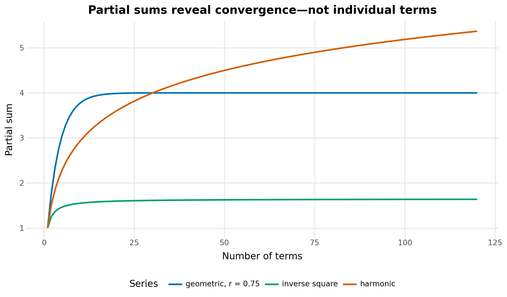

# Infinite series {#sec-series}

An infinite series is not an infinite act of addition. It is the limit of a
sequence of finite sums. This definition makes convergence tests rigorous and
keeps algebraic rearrangements accountable.

## Partial sums and first models

For a sequence $(a_n)$, define $s_N=\sum_{n=1}^N a_n$. The series
$\sum_{n=1}^\infty a_n$ **converges** to $S$ if $s_N\to S$. Necessarily $a_n\to0$
because $a_n=s_n-s_{n-1}$. The converse is false: the harmonic series has terms
tending to zero but diverges.

For $|r|<1$, the finite identity

$$
\sum_{n=0}^{N}r^n=\frac{1-r^{N+1}}{1-r}
$$

and $r^{N+1}\to0$ give $\sum_{n=0}^\infty r^n=1/(1-r)$. A telescoping series uses
cancellation in finite partial sums. Since
$1/[n(n+1)]=1/n-1/(n+1)$, its $N$th partial sum is $1-1/(N+1)$ and the series sums
to $1$.

The Cauchy criterion says a series converges exactly when, for every
$\varepsilon>0$, all sufficiently late finite blocks satisfy

$$
\left|\sum_{n=m}^{k}a_n\right|<\varepsilon
\quad (k\ge m\ge N).
$$

It is stronger than $a_n\to0$: a single term is only one special late block.

<figure id="fig-series-partial">


<figcaption>

Figure 4.1: Partial sums of several positive series, showing convergence at different rates and harmonic divergence.

</figcaption>
</figure>

[Figure 4.1](#fig-series-partial) distinguishes a convergent sequence of partial sums from slow
divergence. A finite plot cannot prove divergence; the harmonic proof below does.
It can, however, reveal why numerical evidence alone is treacherous.

## Positive-term series

If $a_n\ge0$, partial sums increase, so the series converges exactly when its
partial sums are bounded above. This converts completeness into a convergence
test.

**Comparison test.** If $0\le a_n\le b_n$ eventually and $\sum b_n$ converges,
then $\sum a_n$ converges. If $0\le b_n\le a_n$ eventually and $\sum b_n$
diverges, then $\sum a_n$ diverges.

Finite initial terms do not affect convergence. If $a_n/b_n\to c$ with
$0<c<\infty$, then eventually each sequence is bounded above and below by fixed
positive multiples of the other; they converge or diverge together.

**Integral test.** If $f:[1,\infty)\to[0,\infty)$ is decreasing, then
$\sum f(n)$ and $\int_1^\infty f(x)\,dx$ have the same convergence behaviour. The
proof compares rectangle areas on each unit interval. Consequently
$\sum n^{-p}$ converges exactly when $p>1$.

For the harmonic series, grouping gives

$$
1+\frac12+\left(\frac13+\frac14\right)
+\left(\frac15+\cdots+\frac18\right)+\cdots.
$$

Every block after the first contains $2^{k-1}$ terms at least $1/2^k$, so each
block contributes at least $1/2$. Partial sums are unbounded.

The Cauchy condensation test says that for decreasing positive $a_n$,
$\sum a_n$ converges exactly when $\sum 2^k a_{2^k}$ converges. It turns logarithmic
borderlines into geometric-looking expressions; for example,
$\sum 1/[n(\log n)^p]$ converges exactly when $p>1$ (starting at $n=2$).

## Ratio and root tests

If

$$
\limsup_{n\to\infty}\left|\frac{a_{n+1}}{a_n}\right|<1,
$$

then $\sum a_n$ converges absolutely: eventually the ratios are bounded by some
$r<1$, so the tail is dominated by a geometric series. If the ratio is eventually
at least $1$, the terms fail to tend to zero. A ratio limit equal to $1$ is
inconclusive; both $\sum n^{-2}$ and $\sum n^{-1}$ have that limit.

The root test uses $L=\limsup |a_n|^{1/n}$. The series converges absolutely for
$L<1$ and diverges for $L>1$. It is especially natural when $a_n$ contains an
$n$th power.

## Absolute and conditional convergence

The series is **absolutely convergent** if $\sum|a_n|$ converges. Then the Cauchy
criterion and

$$
\left|\sum_{n=m}^k a_n\right|\le\sum_{n=m}^k|a_n|
$$

show that $\sum a_n$ converges. Absolute convergence licenses regrouping and
rearrangement because discarded absolute tails are small independently of order.

**Theorem 4.1 (Alternating-series).** If $b_n\ge0$ is nonincreasing and tends to zero, then
$\sum(-1)^{n-1}b_n$ converges, and the error after $N$ terms has magnitude at most
$b_{N+1}$. Even partial sums are nondecreasing, odd partial sums are nonincreasing, and both approach
the same limit from below and above, respectively. Thus the alternating harmonic series converges but not absolutely.

Conditional convergence is order-sensitive. The Riemann rearrangement theorem
states that a conditionally convergent real series can be rearranged to converge to
any prescribed real number, or to diverge. The construction alternately takes
unused positive terms until overshooting the target and unused negative terms
until undershooting. Individual terms tend to zero, so overshoots shrink. This is
not a permission to manipulate such series; it is a warning that commutativity of
finite addition does not automatically survive a limit.

For the alternating harmonic series, the theorem gives both an approximation
and a certified finite error bound. The code keeps the partial sum exact and
uses the next term as the certificate.

```python
from fractions import Fraction
from math import log

def alternating_harmonic(terms: int) -> tuple[Fraction, Fraction]:
    """Return the N-term sum and its alternating-series error bound."""
    if terms <= 0:
        raise ValueError("terms must be positive")
    partial_sum = sum(
        (Fraction(1 if index % 2 else -1, index) for index in range(1, terms + 1)),
        start=Fraction(0),
    )
    return partial_sum, Fraction(1, terms + 1)

partial_sum, error_bound = alternating_harmonic(40)
observed_error = abs(float(partial_sum) - log(2.0))
if observed_error > float(error_bound):
    raise RuntimeError("the observed error exceeded the theorem's bound")
print(float(partial_sum), observed_error, float(error_bound))
```

The computation certifies the displayed finite approximation once the
alternating-series theorem has been proved. The comparison with `log(2)` is a
check for this example, not a numerical proof of the infinite identity.

## Cauchy products and double sums

Given $\sum a_n$ and $\sum b_n$, their formal Cauchy product has
$c_n=\sum_{k=0}^n a_kb_{n-k}$. If both original series converge absolutely, then
$\sum c_n$ converges absolutely and equals the product of their sums. The proof
controls tails in the double array of terms.

For nonnegative double sequences $a_{m,n}$, iterated sums may be interchanged,
possibly with value $+\infty$:

$$
\sum_m\sum_n a_{m,n}=\sum_n\sum_m a_{m,n}.
$$

For signed terms, absolute convergence is the safe sufficient condition. This
finite-to-countable interchange principle will reappear as Tonelli's and Fubini's
theorems in measure theory.

## Power series

A power series $\sum a_n(x-c)^n$ has a radius $R\in[0,\infty]$ such that it
converges absolutely for $|x-c|<R$ and diverges for $|x-c|>R$. The root test yields

$$
\frac1R=\limsup_{n\to\infty}|a_n|^{1/n},
$$

with the usual conventions. Endpoints must be checked separately. For
$\sum x^n/n$, the radius is $1$; it converges at $x=-1$ and diverges at $x=1$.
Inside every smaller closed interval $|x-c|\le r<R$, a geometric majorant gives
uniform convergence, enabling termwise integration and differentiation later.

<!-- inline-formula-code:start -->
## Formula and finite computation

A useful formula in this chapter is

$$
S_N=\sum_{n=0}^{N}r^n=\frac{1-r^{N+1}}{1-r}
$$

The loop and closed form are evaluated side by side for the same finite sum. The following standalone Python block expresses that finite rule with its inputs and stopping conditions visible.

```python
from fractions import Fraction

ratio = Fraction(2, 3)
degree = 12
direct = sum((ratio**n for n in range(degree + 1)), start=Fraction(0))
closed = (1 - ratio ** (degree + 1)) / (1 - ratio)
print(direct, closed, direct == closed)
```

**What the computation establishes.** The output certifies only the declared finite case. The theorem, if one is claimed, still requires the argument developed in the chapter.
<!-- inline-formula-code:end -->

## Chapter synthesis

Series inherit all rigor from their partial sums. Positive terms invite order and
comparison; signs require absolute control or a specialized cancellation theorem.
Tests encode different scales, and borderline cases demand a new idea. Infinite
reordering is a theorem with hypotheses, not an algebraic reflex.

## Exercises

<div class="exercise" id="real_analysis-04-series-ex-1">
<p class="exercise-title"><strong>Exercise 1</strong></p>

Determine the sum of $\sum_{n=1}^\infty 1/[n(n+2)]$ by telescoping.

</div>

<div class="exercise" id="real_analysis-04-series-ex-2">
<p class="exercise-title"><strong>Exercise 2</strong></p>

Prove the necessary term test using partial sums.

</div>

<div class="exercise" id="real_analysis-04-series-ex-3">
<p class="exercise-title"><strong>Exercise 3</strong></p>

Test $\sum (3n+1)/(n^3+2)$ by comparison.

</div>

<div class="exercise" id="real_analysis-04-series-ex-4">
<p class="exercise-title"><strong>Exercise 4</strong></p>

Determine convergence of $\sum 1/[n(\log n)^2]$.

</div>

<div class="exercise" id="real_analysis-04-series-ex-5">
<p class="exercise-title"><strong>Exercise 5</strong></p>

Find how many alternating harmonic terms guarantee error below $10^{-3}$.

</div>

<div class="exercise" id="real_analysis-04-series-ex-6">
<p class="exercise-title"><strong>Exercise 6</strong></p>

Give two series for which the ratio test is inconclusive, one convergent and one
divergent.

</div>

<div class="exercise" id="real_analysis-04-series-ex-7">
<p class="exercise-title"><strong>Exercise 7</strong></p>

Find the radius and endpoint behaviour of $\sum x^n/n^2$.

<details class="hint"><summary>Hint 1</summary>

The root test gives radius one. Endpoint tests reduce to a $p$-series and
its signed version.

</details>

</div>

<div class="exercise" id="real_analysis-04-series-ex-8">
<p class="exercise-title"><strong>Exercise 8</strong></p>

Prove that deleting finitely many terms does not affect convergence.

</div>

<div class="exercise" id="real_analysis-04-series-ex-9">
<p class="exercise-title"><strong>Exercise 9</strong></p>

† Show that an absolutely convergent series has the same sum under every
permutation of its terms.

<details class="hint"><summary>Hint 1</summary>

Trap the total change under a permutation by an absolute tail; only
finitely many large terms need to be located.

</details>

</div>
