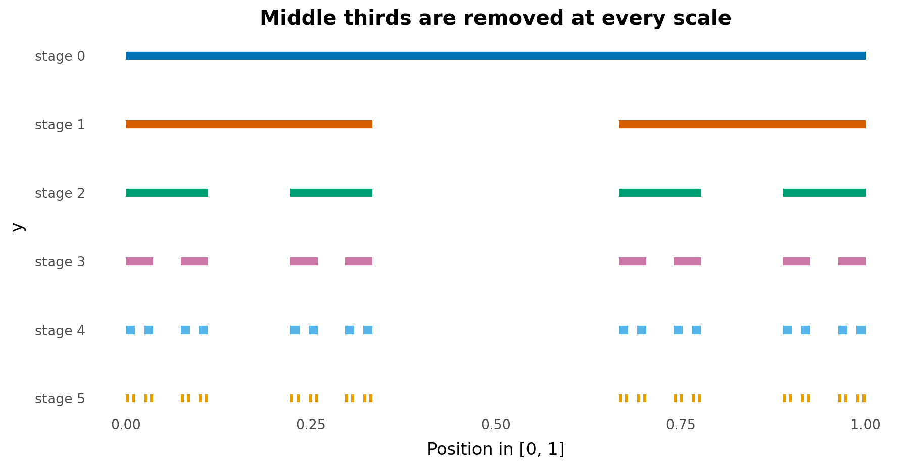

# Open, closed, compact, and connected sets {#sec-topology}

Topology records which points can be approached from within a set. On the real
line, order and distance make the basic shapes familiar, but the definitions are
designed to survive in spaces where intervals no longer exist.

## Open and closed sets

A set $U\subseteq\mathbb R$ is **open** if for every $x\in U$ there is $r>0$ with
$(x-r,x+r)\subseteq U$. A set $F$ is **closed** if its complement is open. Arbitrary
unions of open sets are open, and finite intersections of open sets are open.
Dually, arbitrary intersections of closed sets are closed, and finite unions of
closed sets are closed.

The finite qualification matters. Each $(-1/n,1/n)$ is open, but their intersection
is $\{0\}$, which is not open. Both $\varnothing$ and $\mathbb R$ are open and
closed; “closed” does not mean “not open.”

A point $x$ lies in the **interior** $A^\circ$ if a neighborhood of $x$ lies in
$A$. It lies in the **closure** $\overline A$ if every neighborhood meets $A$. The
**boundary** is $\partial A=\overline A\setminus A^\circ$. A point is an
**accumulation point** if every punctured neighborhood meets $A$.

**Sequential characterization.** A set $F\subseteq\mathbb R$ is closed exactly
when every convergent sequence in $F$ has its limit in $F$.

For the nontrivial direction, if $x\in\overline F$, choose
$x_n\in F\cap(x-1/n,x+1/n)$. Then $x_n\to x$, so sequential closure puts $x$ in
$F$. This choice may equal $x$; for accumulation points one additionally chooses a
different point.

## Compactness

An **open cover** of $K$ is a family of open sets whose union contains $K$. The set
$K$ is **compact** if every open cover has a finite subcover. Compactness turns
possibly infinitely many local pieces of information into finitely many pieces,
which can then be combined by maxima and minima.

**Theorem 5.1 (Heine–Borel).** A subset of $\mathbb R$ is compact exactly when it is
closed and bounded.

**Proof sketch, closed interval direction.** Let an open cover of $[a,b]$ be given
and define $S$ as the points $x$ for which $[a,x]$ has a finite subcover. The set is
nonempty and bounded above; let $c=\sup S$. Some covering open set contains $c$ and
therefore a small interval around it. Supremum approximation extends finite
coverability to $c$ and slightly beyond unless $c=b$. Hence $c=b$.

A closed subset of a compact set is compact. Conversely, compact subsets of
$\mathbb R$ are bounded (cover by $(-n,n)$) and closed (separate an exterior point
from the compact set using finitely many neighborhoods).

Compactness is also sequential on the line: $K$ is compact exactly when every
sequence in $K$ has a subsequence converging to a point of $K$. Boundedness supplies
a convergent subsequence by Bolzano–Weierstrass; closedness keeps its limit inside.

## Finite control from compactness

Suppose each $x\in K$ has a neighborhood on which some estimate holds, but the
neighborhood radius depends on $x$. If $K$ is compact, finitely many neighborhoods
cover $K$. A minimum of finitely many positive radii or a maximum of finitely many
bounds can yield global control. This pattern proves uniform continuity and the
extreme value theorem in [sec-continuity](06-continuity.md#sec-continuity).

Compactness fails on $(0,1)$: the open cover
$\{(1/n,1):n\ge2\}$ has no finite subcover. It also fails on $\mathbb R$: the cover
$\{(-n,n):n\in\mathbb N\}$ has none. The examples isolate missing closedness and
missing boundedness.

## Connectedness

A set $E$ is **disconnected** if it can be written as the union of two disjoint,
nonempty sets that are open relative to $E$. Otherwise it is **connected**.

**Theorem 5.2.** The connected subsets of $\mathbb R$ are exactly the intervals,
including singletons and the empty set.

**Proof.** If $E$ is connected and $x<z<y$ with $x,y\in E$, then $z$ must belong to
$E$; otherwise $E\cap(-\infty,z)$ and $E\cap(z,\infty)$ separate $E$. Thus $E$ is
an interval. Conversely, if an interval were separated into relative open sets
containing $x<y$, take the supremum of the portion of one side lying between them.
Neighborhood openness at that boundary produces a contradiction whichever side
contains it. $\square$

Continuous images of connected sets are connected. This topological statement is
the engine behind the intermediate value theorem: the image of an interval under
a continuous real function is an interval.

## The Cantor set

Start with $C_0=[0,1]$. Delete the open middle third to form
$C_1=[0,1/3]\cup[2/3,1]$, then delete the middle third of each remaining interval,
and continue. The **Cantor set** is $C=\bigcap_{n=0}^\infty C_n$.

<figure id="fig-cantor">


<figcaption>

Figure 5.1: The first five stages of the middle-thirds Cantor construction.

</figcaption>
</figure>

[Figure 5.1](#fig-cantor) shows finite stages only. The limit set is closed as an intersection of
closed sets, bounded, and hence compact. It has empty interior because every
interval eventually exceeds the length $3^{-n}$ of a stage component and therefore
meets a removed gap. Yet it is uncountable: each infinite binary sequence chooses
left or right at every stage, determining a unique point. Equivalently, its points
have a ternary expansion using only digits $0$ and $2$ (with endpoint conventions).

The total length removed is
$1/3+2/9+4/27+\cdots=1$, suggesting the remaining set has length zero. Making that
statement rigorous requires measure, introduced in [sec-measure](11-measure.md#sec-measure). The Cantor set is
a useful warning: empty interior, measure zero, and countability are distinct kinds
of smallness.

## Countability and a category vista

The rationals are countable and dense: every interval contains one. A dense set can
therefore be small in cardinality. The Baire category theorem, proved in complete
metric spaces, gives a different restriction: a complete nonempty space cannot be
a countable union of closed sets with empty interior. We will use only the idea in
the functional-analysis vista. “Measure zero,” “nowhere dense,” and “countable” are
not synonyms; each belongs to a different structure.

<!-- inline-formula-code:start -->
## Formula and finite computation

A useful formula in this chapter is

$$
C(x)=\sum_{j\ge1}\frac{2b_j}{3^j}\mapsto\sum_{j\ge1}\frac{b_j}{2^j}
$$

Finite ternary digits give a careful truncation of the Cantor function. The following standalone Python block expresses that finite rule with its inputs and stopping conditions visible.

```python
from fractions import Fraction

def cantor_stage(point: Fraction, digits: int) -> Fraction:
    """Return a finite-digit Cantor-function approximation on [0, 1]."""
    if point < 0 or point > 1 or digits <= 0:
        raise ValueError("point must lie in [0,1] and digits must be positive")
    if point == 1:
        return Fraction(1)
    working = point
    value = Fraction(0)
    weight = Fraction(1, 2)
    for _ in range(digits):
        scaled = 3 * working
        if scaled < 1:
            working = scaled
        elif scaled >= 2:
            value += weight
            working = scaled - 2
        else:
            return value + weight
        weight /= 2
    return value

for point in (Fraction(1, 4), Fraction(1, 3), Fraction(1, 2), Fraction(3, 4)):
    print(point, [cantor_stage(point, digits) for digits in (1, 2, 4, 8)])
```

**What the computation establishes.** The calculation checks a declared finite instance; the surrounding argument explains what is true beyond those inputs.
<!-- inline-formula-code:end -->

## Chapter synthesis

Closedness retains limits; compactness converts local information into finite
global information; connectedness prohibits gaps. On the line, these abstract
notions become closed-and-bounded sets and intervals, but the definitions are the
forms that generalize.

## Exercises

<div class="exercise" id="real_analysis-05-topology-ex-1">
<p class="exercise-title"><strong>Exercise 1</strong></p>

Find the interior, closure, and boundary of $\mathbb Q$ in $\mathbb R$.

</div>

<div class="exercise" id="real_analysis-05-topology-ex-2">
<p class="exercise-title"><strong>Exercise 2</strong></p>

Prove arbitrary unions of open sets are open.

</div>

<div class="exercise" id="real_analysis-05-topology-ex-3">
<p class="exercise-title"><strong>Exercise 3</strong></p>

Give a countable union of closed sets that is not closed.

</div>

<div class="exercise" id="real_analysis-05-topology-ex-4">
<p class="exercise-title"><strong>Exercise 4</strong></p>

Use the open-cover definition to show a finite set is compact.

</div>

<div class="exercise" id="real_analysis-05-topology-ex-5">
<p class="exercise-title"><strong>Exercise 5</strong></p>

Prove a compact subset of $\mathbb R$ has a maximum and minimum without using
the extreme value theorem for functions.

<details class="hint"><summary>Hint 1</summary>

Apply compactness to the identity function, or use a sequence approaching
the supremum and closedness to retain its limit.

</details>

</div>

<div class="exercise" id="real_analysis-05-topology-ex-6">
<p class="exercise-title"><strong>Exercise 6</strong></p>

Determine which of $(0,1)$, $[0,1)$, $\mathbb Z$, and
$\{0\}\cup\{1/n:n\in\mathbb N\}$ are closed, bounded, and compact.

</div>

<div class="exercise" id="real_analysis-05-topology-ex-7">
<p class="exercise-title"><strong>Exercise 7</strong></p>

Prove the continuous image of a connected set is connected.

</div>

<div class="exercise" id="real_analysis-05-topology-ex-8">
<p class="exercise-title"><strong>Exercise 8</strong></p>

Show that the Cantor set contains no nonempty open interval.

</div>

<div class="exercise" id="real_analysis-05-topology-ex-9">
<p class="exercise-title"><strong>Exercise 9</strong></p>

† Show directly that every point of the Cantor set is an accumulation point of
the Cantor set.

<details class="hint"><summary>Hint 1</summary>

Change one late left/right choice in the ternary coding while keeping the
point arbitrarily close.

</details>

</div>
