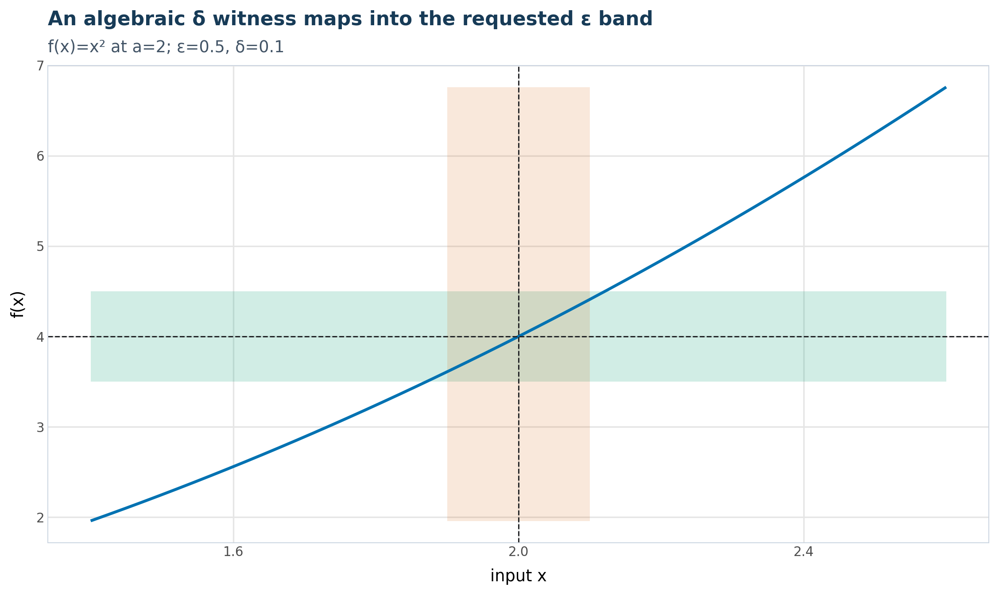

# Limits and continuity {#sec-continuity}

Sequences describe approach along discrete observations. Function limits demand the
same control for every input sufficiently near a point. Continuity adds agreement
between that nearby behaviour and the value at the point.

## Limits of functions

Let $f$ be defined on a punctured neighborhood of $a$. We write
$\lim_{x\to a}f(x)=L$ if for every $\varepsilon>0$ there exists $\delta>0$ such
that

$$
0<|x-a|<\delta \quad\Longrightarrow\quad |f(x)-L|<\varepsilon.
$$

The value $f(a)$ is irrelevant and may be undefined. The input tolerance $\delta$
may depend on $\varepsilon$ but not on the particular $x$.

**Worked example.** To prove $\lim_{x\to2}x^2=4$, factor
$|x^2-4|=|x-2||x+2|$. Requiring $|x-2|<1$ gives $|x+2|<5$; then choose
$\delta=\min\{1,\varepsilon/5\}$. This “restrict, bound, choose” pattern handles
many polynomial and rational limits.

**Sequential criterion.** The limit of $f(x)$ as $x\to a$ equals $L$ exactly when
$f(x_n)\to L$ for every sequence $x_n\to a$ with $x_n\ne a$.

One direction substitutes eventually close sequence terms into the epsilon–delta
condition. For the converse, negate the limit: some fixed $\varepsilon_0$ is
violated at points $x_n$ with $0<|x_n-a|<1/n$. This sequence approaches $a$ while
its images do not approach $L$.

Limit laws follow from sequence laws or direct estimates. One-sided limits restrict
$x$ to $x>a$ or $x<a$. A two-sided limit exists exactly when both one-sided limits
exist and agree. The function $\sin(1/x)$ has no limit at zero: sequences chosen so
that $1/x$ hits alternating quarter-turns give image limits $1$ and $-1$.

We write $f(x)\to+\infty$ as $x\to a$ when every real threshold $M$ is eventually
exceeded. This describes unbounded growth, not convergence to a real number.

## Continuity and inverse images

A function $f:D\to\mathbb R$ is **continuous at $a\in D$** if for every
$\varepsilon>0$ there exists $\delta>0$ such that $x\in D$ and
$|x-a|<\delta$ imply $|f(x)-f(a)|<\varepsilon$. At an isolated domain point this
holds automatically.

Equivalent formulations are:

- $x_n\to a$ in $D$ implies $f(x_n)\to f(a)$;
- for every open set $U$ containing $f(a)$, some relative neighborhood of $a$ maps
  into $U$; and
- $f^{-1}(V)$ is open in $D$ for every open $V$ in the codomain.

Sums, products, quotients with nonzero denominator, and compositions of continuous
functions are continuous. Polynomials are continuous everywhere; rational
functions are continuous on their domains.

## Compact domains: extrema and uniformity

**Theorem 6.1 (Extreme value).** A continuous function on a compact set $K\subseteq
\mathbb R$ attains its maximum and minimum.

**Proof.** The continuous image $f(K)$ is compact. To see this, pull any open cover
of $f(K)$ back to an open cover of $K$, take a finite subcover, and map forward.
Hence $f(K)$ is closed and bounded. Its supremum belongs to it because the set is
closed, so it is attained; similarly for the infimum. $\square$

The hypotheses are sharp. On $(0,1)$, $f(x)=x$ has neither extremum. On the closed
unbounded set $\mathbb R$, the same function is unbounded.

Continuity at each point allows $δ$ to depend on the point. A function is
**uniformly continuous** on $D$ if for every $\varepsilon>0$ there is one
$\delta>0$ such that all $x,y\in D$ with $|x-y|<\delta$ satisfy
$|f(x)-f(y)|<\varepsilon$.

**Theorem 6.2 (Heine–Cantor).** Every continuous function on a compact set is uniformly
continuous.

**Sequential proof.** If uniform continuity failed, some $\varepsilon_0>0$ and
pairs $x_n,y_n\in K$ would satisfy $|x_n-y_n|<1/n$ but
$|f(x_n)-f(y_n)|\ge\varepsilon_0$. Compactness gives a subsequence $x_{n_k}\to x$.
Then $y_{n_k}\to x$ as well. Continuity sends both image subsequences to $f(x)$,
contradicting their fixed separation. $\square$

The function $x^2$ is not uniformly continuous on $\mathbb R$: take
$x_n=n$ and $y_n=n+1/n$. Inputs approach one another, but output differences tend
to $2$. The failure occurs because local slopes grow without a global bound.

## Connected domains: intermediate values

**Theorem 6.3 (Intermediate value).** If $f:[a,b]\to\mathbb R$ is continuous and $u$
lies between $f(a)$ and $f(b)$, then $f(c)=u$ for some $c\in[a,b]$.

One proof observes that $f([a,b])$ is connected and therefore an interval. A
supremum proof instead studies $S=\{x\in[a,b]:f(x)<u\}$ after arranging strict
endpoint inequalities and shows that $c=\sup S$ must satisfy $f(c)=u$.

As a consequence, if $f:[a,b]\to[a,b]$ is continuous, then it has a fixed point.
Apply the theorem to $g(x)=f(x)-x$: $g(a)\ge0$ and $g(b)\le0$. Existence is
guaranteed, but uniqueness is not. The contraction principle in
[sec-metric-spaces](10-metric-spaces.md#sec-metric-spaces) adds a quantitative hypothesis that gives both.

## Types of discontinuity

A discontinuity is **removable** when the finite limit exists but disagrees with
the value or the value is absent. It is a **jump** when finite one-sided limits
exist but differ. Oscillation or unbounded behaviour produces an essential
discontinuity under this elementary classification.

Monotone functions have one-sided limits at every interior point. Every
discontinuity is a jump, and there can be only countably many: for each positive
rational threshold, only finitely many jumps of at least that size occur on a
bounded interval; then take a countable union over thresholds and intervals.

## Common pitfalls

- The limit at $a$ does not use $f(a)$; continuity does.
- Pointwise continuity permits $δ$ to depend on the base point; uniform
  continuity forbids that dependency.
- A continuous function need not attain extrema unless its domain is compact.
- The intermediate value theorem guarantees a value, not a formula or uniqueness.

## Visual checkpoint: an epsilon band and a delta interval

<figure id="fig-ra-continuity-epsilon-delta">


<figcaption>

Figure 6.1: An algebraic delta interval maps inside a requested epsilon band for the square function.

</figcaption>
</figure>

[Figure 6.1](#fig-ra-continuity-epsilon-delta) displays the geometry of one verified
witness. The algebraic estimate proves that every point in the entire delta
interval works; plotting many points alone would leave uninspected gaps.

<!-- inline-formula-code:start -->
## Formula and finite computation

A useful formula in this chapter is

$$
|x-a|<\delta\Longrightarrow|x^2-a^2|<\varepsilon
$$

The helper computes a safe delta from the algebraic estimate. The following standalone Python block expresses that finite rule with its inputs and stopping conditions visible.

```python
def square_delta(point: float, epsilon: float) -> float:
    """Return a valid delta for x squared at point and tolerance epsilon."""
    if epsilon <= 0.0:
        raise ValueError("epsilon must be positive")
    return min(1.0, epsilon / (2.0 * abs(point) + 1.0))

for epsilon in (1.0, 0.1, 1e-6):
    delta = square_delta(point=2.0, epsilon=epsilon)
    boundary_error = abs((2.0 + 0.999 * delta) ** 2 - 4.0)
    print(epsilon, delta, boundary_error, boundary_error < epsilon)
```

**What the computation establishes.** The calculation checks a declared finite instance; the surrounding argument explains what is true beyond those inputs.
<!-- inline-formula-code:end -->

## Chapter synthesis

Limits transfer closeness of inputs to closeness of outputs. Continuity can be read
metrically, sequentially, or topologically. Compactness upgrades pointwise control
to extrema and uniform control, while connectedness upgrades continuity to the
intermediate value property.

## Exercises

<div class="exercise" id="real_analysis-06-continuity-ex-1">
<p class="exercise-title"><strong>Exercise 1</strong></p>

Give an epsilon–delta proof that $\lim_{x\to3}(2x-1)=5$.

</div>

<div class="exercise" id="real_analysis-06-continuity-ex-2">
<p class="exercise-title"><strong>Exercise 2</strong></p>

Prove the sequential criterion in both directions.

</div>

<div class="exercise" id="real_analysis-06-continuity-ex-3">
<p class="exercise-title"><strong>Exercise 3</strong></p>

Classify the discontinuity at zero of $f(x)=x/|x|$ for $x\ne0$.

</div>

<div class="exercise" id="real_analysis-06-continuity-ex-4">
<p class="exercise-title"><strong>Exercise 4</strong></p>

Prove that a continuous function positive at $a$ remains positive near $a$.

</div>

<div class="exercise" id="real_analysis-06-continuity-ex-5">
<p class="exercise-title"><strong>Exercise 5</strong></p>

Show $\sqrt{x}$ is uniformly continuous on $[0,\infty)$.

<details class="solution"><summary>Solution</summary>

For $x,y\ge0$, assume $x\ge y$. Then

$$
|\sqrt{x}-\sqrt y|
=\frac{x-y}{\sqrt{x}+\sqrt y}
\le\sqrt{x-y}.
$$

The last inequality follows because $\sqrt{x}+\sqrt y\ge\sqrt{x-y}$. Given
$\varepsilon>0$, choose $\delta=\varepsilon^2$. If $|x-y|<\delta$, then
$|\sqrt x-\sqrt y|<\varepsilon$, with one $\delta$ valid across the entire
half-line.

</details>

</div>

<div class="exercise" id="real_analysis-06-continuity-ex-6">
<p class="exercise-title"><strong>Exercise 6</strong></p>

Show $1/x$ is uniformly continuous on $[1,\infty)$ but not on $(0,1)$.

</div>

<div class="exercise" id="real_analysis-06-continuity-ex-7">
<p class="exercise-title"><strong>Exercise 7</strong></p>

Use the intermediate value theorem to show $x^5+x-1=0$ has a real root.

</div>

<div class="exercise" id="real_analysis-06-continuity-ex-8">
<p class="exercise-title"><strong>Exercise 8</strong></p>

If $f$ is continuous and injective on an interval, prove it is strictly
monotone.

<details class="hint"><summary>Hint 1</summary>

If a continuous injective function is not monotone, find three ordered
points with a middle value forming a peak or valley, then apply intermediate values
on both sides.

</details>

</div>

<div class="exercise" id="real_analysis-06-continuity-ex-9">
<p class="exercise-title"><strong>Exercise 9</strong></p>

† Prove that a uniformly continuous function sends Cauchy sequences to Cauchy
sequences.

<details class="hint"><summary>Hint 1</summary>

Choose a uniform-continuity tolerance for $\varepsilon$, then use the
Cauchy cutoff of the input sequence for the resulting $\delta$.

</details>

</div>
