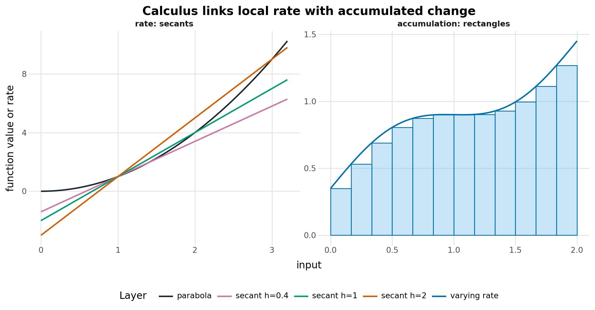

# Differentiation and local approximation {#sec-differentiation}

The derivative is the coefficient of the best first-order local model. Its major
theorems turn that local information into global comparisons across an interval.

## Derivative as linear approximation

For an interior point $a$, the derivative is

$$
f'(a)=\lim_{h\to0}\frac{f(a+h)-f(a)}h,
$$

when the limit exists. Equivalently,

$$
f(a+h)=f(a)+f'(a)h+r(h),
\qquad \frac{r(h)}h\to0.
$$

The remainder formulation says the error is negligible relative to the step. It
also makes clear why differentiability implies continuity: both $f'(a)h$ and
$r(h)$ tend to zero. The converse fails; $|x|$ is continuous at zero but its
one-sided difference quotients are $1$ and $-1$.

Finite algebra on difference quotients proves the sum, product, and quotient rules.
For the chain rule, if $g$ is differentiable at $a$ and $f$ at $g(a)$, use their
linear-remainder forms; this avoids dividing by $g(a+h)-g(a)$ when that difference
might vanish.

If $f$ is one-to-one near $a$, $f'(a)\ne0$, and its inverse is continuous at
$f(a)$, then

$$
(f^{-1})'(f(a))=\frac1{f'(a)}.
$$

The nonzero derivative prevents the inverse difference quotient from degenerating.

## Mean value principles

**Theorem 7.1 (Rolle's).** If $f$ is continuous on $[a,b]$, differentiable on $(a,b)$,
and $f(a)=f(b)$, then $f'(c)=0$ for some $c\in(a,b)$.

The extreme value theorem supplies a maximum and minimum. If both occur only at
equal endpoints, the function is constant; otherwise an interior extremum has
zero derivative by comparing one-sided difference quotients.

**Theorem 7.2 (Mean value).** Under the same continuity and differentiability hypotheses,
there is $c\in(a,b)$ such that

$$
f'(c)=\frac{f(b)-f(a)}{b-a}.
$$

Subtract the secant line from $f$ and apply Rolle's theorem. This simple reduction
is the local-to-global core of differential calculus.

Consequences include:

- if $f'=0$ on an interval, then $f$ is constant;
- if $f'\ge0$, then $f$ is increasing;
- if $|f'|\le M$, then $|f(x)-f(y)|\le M|x-y|$; and
- if $f'=g'$, then $f-g$ is constant.

Continuity on the closed interval and differentiability only in the interior are
both relevant. The function $\sqrt{x}$ on $[0,1]$ shows the derivative may fail at
an endpoint without harming the theorem; a jump function shows interior
differentiability alone cannot replace endpoint continuity.

## Taylor approximation

If $f$ has $n+1$ derivatives near $a$, Taylor's theorem with Lagrange remainder
states that for suitable $\xi$ between $a$ and $x$,

$$
f(x)=\sum_{k=0}^{n}\frac{f^{(k)}(a)}{k!}(x-a)^k
+\frac{f^{(n+1)}(\xi)}{(n+1)!}(x-a)^{n+1}.
$$

The theorem is useful because a derivative bound becomes an explicit error bound.
For $f(x)=e^x$ and $|x|\le1$, truncating after degree $n$ has error at most
$e/(n+1)!$.

Infinite differentiability does not imply equality with the Taylor series. Define
$f(x)=e^{-1/x^2}$ for $x\ne0$ and $f(0)=0$. Repeated differentiation has the form
$P(1/x)e^{-1/x^2}$ away from zero, and exponential decay dominates every power;
all derivatives at zero vanish. Its Taylor series there is identically zero, but
$f(x)>0$ off zero. **Analyticity** is the stronger property of locally equaling a
convergent power series.

## Convexity

A function $f$ on an interval is **convex** if

$$
f((1-t)x+ty)\le(1-t)f(x)+tf(y)
\qquad (0\le t\le1).
$$

Its graph lies below its chords. If $f$ is differentiable, convexity is equivalent
to increasing derivative, and to the supporting-line inequality

$$
f(y)\ge f(x)+f'(x)(y-x).
$$

If $f''\ge0$, the mean value theorem shows $f'$ is increasing, hence $f$ is convex.

Finite Jensen inequality follows by induction:

$$
f\left(\sum_{k=1}^n\lambda_kx_k\right)
\le \sum_{k=1}^n\lambda_k f(x_k),
\quad \lambda_k\ge0,
\quad \sum_k\lambda_k=1.
$$

Taking $f(x)=x^2$ says the square of a weighted mean does not exceed the weighted
mean of squares.

## Pathologies and careful expectations

Derivatives need not be continuous, but they possess the intermediate value
property. Darboux's theorem proves this by applying extrema to a tilted function;
a derivative cannot jump over a value. Thus derivative behaviour occupies a subtle
middle ground between arbitrary functions and continuous ones.

There also exist continuous nowhere-differentiable functions. A classical family
sums increasingly rapid oscillations with decreasing amplitudes. We do not prove
the full theorem here, but its message is precise: continuity controls values, not
the stabilization of secant slopes. The existence is a theorem, not merely a
computer-graph observation.

## Visual checkpoint: secants becoming a local linear model

<figure id="fig-ra-differentiation-secant-limit">


<figcaption>

Figure 7.1: Secant slopes approach the tangent slope at a fixed point.

</figcaption>
</figure>

The secant portion of [Figure 7.1](#fig-ra-differentiation-secant-limit) shows the finite
difference quotient before its limit is taken. A graph can suggest the tangent;
the derivative definition and its estimates determine whether that suggestion
is valid.

<!-- inline-formula-code:start -->
## Formula and finite computation

A useful formula in this chapter is

$$
f'(x)=\lim_{h\to0}\frac{f(x+h)-f(x-h)}{2h}
$$

Centered differences display the approach to the derivative while keeping $h$ visible. The following standalone Python block expresses that finite rule with its inputs and stopping conditions visible.

```python
from math import exp

point = 1.0
for step in (0.5, 0.1, 0.01, 0.001):
    slope = (exp(point + step) - exp(point - step)) / (2.0 * step)
    print(step, slope, slope - exp(point))
```

**What the computation establishes.** The output certifies only the declared finite case. The theorem, if one is claimed, still requires the argument developed in the chapter.
<!-- inline-formula-code:end -->

## Chapter synthesis

Differentiability supplies a first-order local model. Rolle's theorem and the mean
value theorem turn local slopes into interval-wide consequences. Taylor's theorem
adds higher-order error control, while convexity packages monotonic slope behaviour.
Smoothness alone does not guarantee power-series representation.

## Exercises

<div class="exercise" id="real_analysis-07-differentiation-ex-1">
<p class="exercise-title"><strong>Exercise 1</strong></p>

Derive the product rule from the definition.

</div>

<div class="exercise" id="real_analysis-07-differentiation-ex-2">
<p class="exercise-title"><strong>Exercise 2</strong></p>

Prove differentiability implies continuity using the remainder formulation.

</div>

<div class="exercise" id="real_analysis-07-differentiation-ex-3">
<p class="exercise-title"><strong>Exercise 3</strong></p>

Show that $f(x)=x^{1/3}$ has no finite derivative at zero and identify why the
inverse derivative formula does not apply there.

</div>

<div class="exercise" id="real_analysis-07-differentiation-ex-4">
<p class="exercise-title"><strong>Exercise 4</strong></p>

Use the mean value theorem to prove $|\sin x-\sin y|\le|x-y|$.

</div>

<div class="exercise" id="real_analysis-07-differentiation-ex-5">
<p class="exercise-title"><strong>Exercise 5</strong></p>

Bound the error when $e^{0.2}$ is approximated by $1+0.2+0.2^2/2$.

</div>

<div class="exercise" id="real_analysis-07-differentiation-ex-6">
<p class="exercise-title"><strong>Exercise 6</strong></p>

Prove a differentiable function with bounded derivative is uniformly continuous.

</div>

<div class="exercise" id="real_analysis-07-differentiation-ex-7">
<p class="exercise-title"><strong>Exercise 7</strong></p>

Prove the supporting-line characterization of differentiable convex functions.

<details class="hint"><summary>Hint 1</summary>

Compare secant slopes on nested intervals, or apply the mean value theorem
to show increasing derivative.

</details>

</div>

<div class="exercise" id="real_analysis-07-differentiation-ex-8">
<p class="exercise-title"><strong>Exercise 8</strong></p>

Show that $\log x\le x-1$ for $x>0$.

</div>

<div class="exercise" id="real_analysis-07-differentiation-ex-9">
<p class="exercise-title"><strong>Exercise 9</strong></p>

† Prove Darboux's theorem for derivatives by minimizing
$f(x)-\lambda x$ on a suitable interval.

<details class="hint"><summary>Hint 1</summary>

If $f'(a)<\lambda<f'(b)$, minimize $f(x)-\lambda x$ on $[a,b]$ after
shrinking endpoints so the minimum is interior.

</details>

</div>
