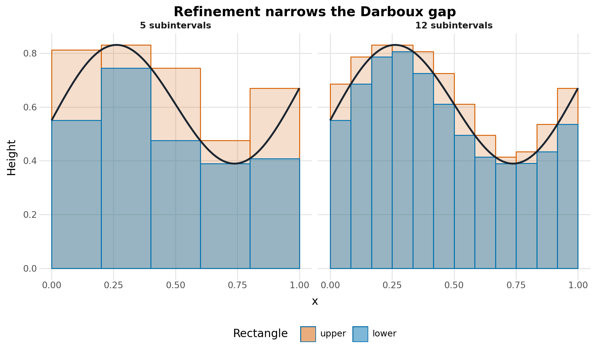

# The Riemann integral {#sec-riemann}

Differentiation extracts local rate; integration accumulates global quantity. The
Riemann theory succeeds when a bounded function can be trapped between upper and
lower step approximations whose total discrepancy is arbitrarily small.

## Partitions, sums, and integrability

A partition $P$ of $[a,b]$ is
$a=x_0<x_1<\cdots<x_n=b$. On $I_k=[x_{k-1},x_k]$, let

$$
m_k=\inf_{I_k}f,
\qquad M_k=\sup_{I_k}f.
$$

For bounded $f$, the lower and upper Darboux sums are

$$
L(f,P)=\sum_{k=1}^n m_k\Delta x_k,
\qquad
U(f,P)=\sum_{k=1}^n M_k\Delta x_k.
$$

Refining a partition raises lower sums and lowers upper sums. The function is
**Riemann integrable** if the supremum of all lower sums equals the infimum of all
upper sums. Their common value is $\int_a^b f$.

<figure id="fig-darboux">


<figcaption>

Figure 8.1: Upper and lower rectangular sums trapping the area under a continuous curve.

</figcaption>
</figure>

In [Figure 8.1](#fig-darboux), each rectangle discrepancy is local oscillation times interval
width. Integrability requires the sum of all such discrepancies to become small;
no visual area assumption enters the definition.

The equivalent tagged-sum formulation chooses $t_k\in I_k$ and studies
$\sum f(t_k)\Delta x_k$ as the mesh $\max\Delta x_k$ tends to zero. The Darboux
criterion is often cleaner for proofs:

$$
f\text{ is integrable}
\quad\Longleftrightarrow\quad
\forall\varepsilon>0\;\exists P,
\quad U(f,P)-L(f,P)<\varepsilon.
$$

## Classes of integrable functions

Every continuous function on $[a,b]$ is uniformly continuous. Given
$\varepsilon>0$, choose intervals narrow enough that the oscillation of $f$ on
each is less than $\varepsilon/(b-a)$. Then

$$
U(f,P)-L(f,P)
=\sum_k(M_k-m_k)\Delta x_k<\varepsilon.
$$

A monotone bounded function is integrable: for an equal partition with width
$\Delta x$, telescoping bounds the upper-lower gap by
$(f(b)-f(a))\Delta x$.

The Dirichlet function $1_{\mathbb Q}$ on $[0,1]$ is not Riemann integrable.
Every subinterval contains rational and irrational points, so every lower sum is
$0$ and every upper sum is $1$. By contrast, a function differing from zero at
only finitely many points is integrable with integral zero; narrow intervals around
those points make their total contribution small.

## Properties and estimates

For integrable $f$ and $g$ and scalar $c$,

$$
\int_a^b(f+g)=\int_a^b f+\int_a^b g,
\qquad
\int_a^b cf=c\int_a^b f.
$$

If $f\le g$, then $\int f\le\int g$. Splitting at $c\in[a,b]$ gives
$\int_a^b f=\int_a^c f+\int_c^b f$. Since $-|f|\le f\le|f|$,

$$
\left|\int_a^b f(x)\,dx\right|
\le\int_a^b|f(x)|\,dx.
$$

If $m\le f\le M$, then $m(b-a)\le\int_a^b f\le M(b-a)$. For continuous $f$, the
intermediate value theorem and this estimate imply the mean value theorem for
integrals: $\int_a^b f=f(c)(b-a)$ for some $c$.

## Fundamental theorem of calculus

**FTC, accumulation form.** If $f$ is continuous on $[a,b]$ and
$F(x)=\int_a^x f(t)\,dt$, then $F$ is differentiable on $(a,b)$ and $F'=f$.

**Proof.** For small nonzero $h$,

$$
\frac{F(x+h)-F(x)}h
=\frac1h\int_x^{x+h}f(t)\,dt.
$$

Subtract $f(x)$. Continuity makes $|f(t)-f(x)|<\varepsilon$ throughout a short
interval, so the absolute difference of the average from $f(x)$ is at most
$\varepsilon$. $\square$

**FTC, evaluation form.** If $G$ is differentiable with continuous derivative on
$[a,b]$, then

$$
\int_a^b G'(x)\,dx=G(b)-G(a).
$$

The accumulation function for $G'$ has the same derivative as $G$, so their
difference is constant by the mean value theorem. Together, the two forms show
that continuous local rates and accumulated change invert one another.

The substitution and integration-by-parts formulas follow from the chain and
product rules plus evaluation:

$$
\int_a^b f(g(x))g'(x)\,dx
=\int_{g(a)}^{g(b)}f(u)\,du,
$$

under standard continuous differentiability hypotheses, and

$$
\int_a^b u(x)v'(x)\,dx
=[u(x)v(x)]_a^b-\int_a^b u'(x)v(x)\,dx.
$$

## Improper integrals

An improper integral is a limit of proper integrals. For example,

$$
\int_1^\infty x^{-p}\,dx
=\lim_{R\to\infty}\int_1^R x^{-p}\,dx
$$

converges exactly when $p>1$. At a singular endpoint,
$\int_0^1x^{-p}\,dx$ converges exactly when $p<1$. Each problematic endpoint must
be handled separately; cancellation across two divergent pieces is not the usual
improper integral.

Absolute convergence, $\int|f|<\infty$, implies convergence by the Cauchy
criterion. Conditional convergence can occur: $\int_1^\infty \sin x/x\,dx$
converges by integration by parts or Dirichlet's test but not absolutely.

## Passing limits through integrals

If $f_n\to f$ uniformly on $[a,b]$ and every $f_n$ is integrable, then $f$ is
integrable and

$$
\left|\int_a^b f_n-\int_a^b f\right|
\le(b-a)\|f_n-f\|_\infty\to0.
$$

Pointwise convergence is insufficient. For $f_n(x)=6n^2x(1-nx)$ on $[0,1/n]$ and
$0$ elsewhere, every fixed $x>0$ eventually sees zero, while $\int_0^1 f_n=1$ for
every $n$. Cleaner noncontinuous spikes such as
$f_n=n1_{(0,1/n)}$ have integral $1$ and pointwise limit $0$ on $(0,1]$. The
Lebesgue chapter will show that domination, rather than uniformity, is another route
to legal interchange.

<!-- inline-formula-code:start -->
## Formula and finite computation

A useful formula in this chapter is

$$
L(f,P)\le\int_a^b f\le U(f,P)
$$

For an increasing function, each panel's endpoints give certified lower and upper sums. The following standalone Python block expresses that finite rule with its inputs and stopping conditions visible.

```python
def square_darboux_bounds(panels: int) -> tuple[float, float]:
    """Return lower and upper equal-mesh Darboux sums for x squared on [0, 1]."""
    if panels <= 0:
        raise ValueError("panels must be positive")
    lower = sum((index / panels) ** 2 for index in range(panels)) / panels
    upper = sum(((index + 1) / panels) ** 2 for index in range(panels)) / panels
    return lower, upper

for panels in (4, 16, 64):
    lower, upper = square_darboux_bounds(panels)
    print(panels, lower, 1.0 / 3.0, upper, upper - lower)
```

**What the computation establishes.** The calculation checks a declared finite instance; the surrounding argument explains what is true beyond those inputs.
<!-- inline-formula-code:end -->

## Chapter synthesis

The Riemann integral is a completeness construction from upper and lower sums.
Uniform continuity proves continuous functions integrable, the fundamental theorem
links accumulation with local rate, and improper integrals add a second limiting
process. Interchanging that process with integration requires explicit control.

## Exercises

<div class="exercise" id="real_analysis-08-riemann-ex-1">
<p class="exercise-title"><strong>Exercise 1</strong></p>

Compute upper and lower sums for $f(x)=x$ on $[0,1]$ with $n$ equal pieces.

</div>

<div class="exercise" id="real_analysis-08-riemann-ex-2">
<p class="exercise-title"><strong>Exercise 2</strong></p>

Prove that changing an integrable function at one point preserves its integral.

</div>

<div class="exercise" id="real_analysis-08-riemann-ex-3">
<p class="exercise-title"><strong>Exercise 3</strong></p>

Prove the integral triangle inequality.

</div>

<div class="exercise" id="real_analysis-08-riemann-ex-4">
<p class="exercise-title"><strong>Exercise 4</strong></p>

Use the FTC to differentiate $F(x)=\int_0^{x^2}\cos(t^2)\,dt$.

</div>

<div class="exercise" id="real_analysis-08-riemann-ex-5">
<p class="exercise-title"><strong>Exercise 5</strong></p>

Determine convergence of $\int_2^\infty 1/[x(\log x)^p]\,dx$.

</div>

<div class="exercise" id="real_analysis-08-riemann-ex-6">
<p class="exercise-title"><strong>Exercise 6</strong></p>

Give separate definitions for an improper integral with singularities at both
endpoints.

</div>

<div class="exercise" id="real_analysis-08-riemann-ex-7">
<p class="exercise-title"><strong>Exercise 7</strong></p>

Prove the integration-by-parts formula from the product rule.

</div>

<div class="exercise" id="real_analysis-08-riemann-ex-8">
<p class="exercise-title"><strong>Exercise 8</strong></p>

Find a pointwise convergent sequence of continuous functions on $[0,1]$ whose
integrals do not converge to the integral of the limit.

<details class="hint"><summary>Hint 1</summary>

Use triangular continuous spikes with height and width chosen to keep area
fixed while support shrinks toward zero.

</details>

</div>

<div class="exercise" id="real_analysis-08-riemann-ex-9">
<p class="exercise-title"><strong>Exercise 9</strong></p>

† Prove that every bounded function with only finitely many discontinuities is
Riemann integrable.

<details class="hint"><summary>Hint 1</summary>

Enclose each discontinuity in an interval whose total length is small;
uniform continuity on the remaining closed pieces controls oscillation.

</details>

</div>
