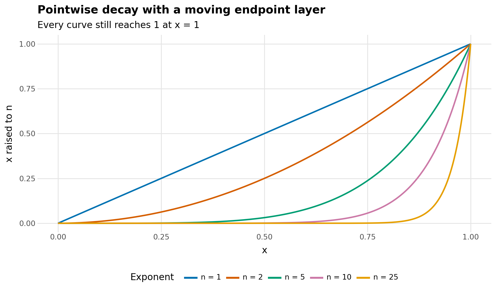
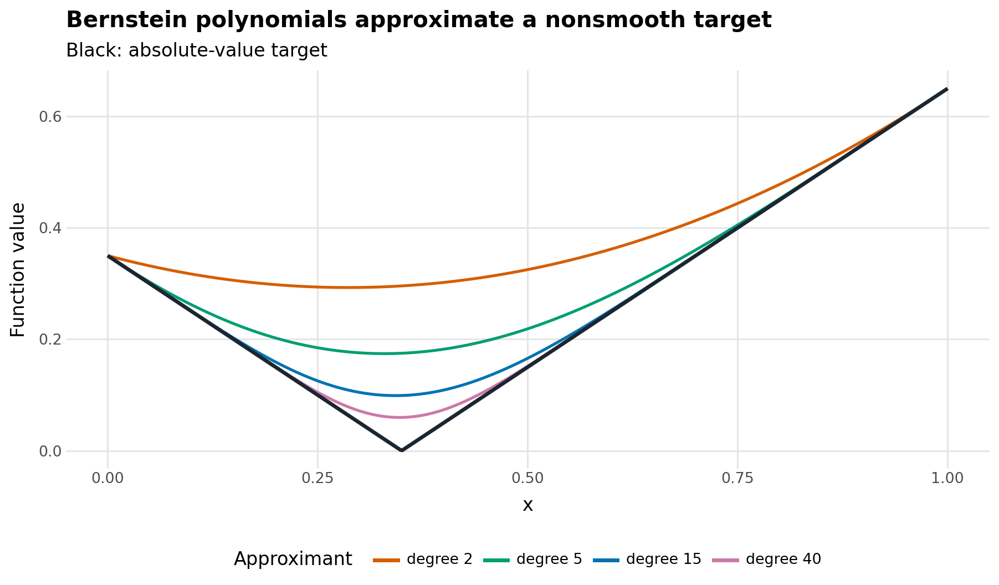

# Sequences and series of functions {#sec-function-sequences}

For numbers, convergence has one moving index. For functions, both the index and
the input vary, and the order in which they are controlled changes what the limit
preserves.

## Pointwise and uniform convergence

A sequence $f_n:E\to\mathbb R$ converges **pointwise** to $f$ if

$$
\forall x\in E\;\forall\varepsilon>0\;\exists N=N(x,\varepsilon)
\;\forall n\ge N,
\quad |f_n(x)-f(x)|<\varepsilon.
$$

It converges **uniformly** if

$$
\forall\varepsilon>0\;\exists N=N(\varepsilon)
\;\forall x\in E\;\forall n\ge N,
\quad |f_n(x)-f(x)|<\varepsilon.
$$

Uniform convergence forbids the cutoff from depending on $x$. Equivalently,
$\|f_n-f\|_\infty=\sup_{x\in E}|f_n(x)-f(x)|\to0$ when the supremum is finite.

<figure id="fig-pointwise-uniform">


<figcaption>

Figure 9.1: Graphs of x to the n on the unit interval, displaying pointwise convergence but failure of uniform convergence near one.

</figcaption>
</figure>

For $f_n(x)=x^n$ on $[0,1]$, the pointwise limit is $0$ for $x<1$ and $1$ at
$x=1$. [Figure 9.1](#fig-pointwise-uniform) shows the steep transition moving toward the
endpoint. The convergence cannot be uniform because the limit is discontinuous,
or directly because $\sup_{0\le x<1}x^n=1$. On $[0,r]$ for $r<1$, it is uniform
since the supremum is $r^n\to0$.

The uniform Cauchy criterion says $f_n$ converges uniformly to some real-valued
function exactly when for every $\varepsilon>0$ there is $N$ such that
$|f_n(x)-f_m(x)|<\varepsilon$ for all $x\in E$ and $m,n\ge N$. Pointwise
completeness of $\mathbb R$ constructs $f(x)$, and the same uniform estimate passes
to the limit in $m$.

## Preservation theorems

**Theorem 9.1 (Uniform limit).** A uniform limit of continuous functions is continuous.

**Proof.** Fix $a$ and $\varepsilon>0$. Choose $n$ so that
$\|f_n-f\|_\infty<\varepsilon/3$. Continuity of that one $f_n$ supplies $\delta$
with $|f_n(x)-f_n(a)|<\varepsilon/3$ near $a$. Then

$$
|f(x)-f(a)|
\le |f(x)-f_n(x)|+|f_n(x)-f_n(a)|+|f_n(a)-f(a)|
<\varepsilon.
$$

The “choose a good approximant, then use its regularity” argument is fundamental.
Uniformity controls both moving endpoints with the same chosen $n$.

If $f_n$ are Riemann integrable on $[a,b]$ and converge uniformly to $f$, then $f$
is integrable and $\int f_n\to\int f$, by the supremum-norm estimate established
in [sec-riemann](08-riemann.md#sec-riemann). Pointwise convergence does not suffice; moving spikes can retain
area.

## Differentiating a limit

Uniform convergence of $f_n$ alone does not control derivatives. The functions
$f_n(x)=\sin(nx)/n$ converge uniformly to zero, while
$f_n'(x)=\cos(nx)$ does not converge pointwise at most inputs.

A useful theorem reverses the control.

**Theorem 9.2 (Differentiation).** Suppose $f_n$ are continuously differentiable on
$[a,b]$, the derivatives $f_n'$ converge uniformly to $g$, and for one anchor
$x_0\in[a,b]$ the numbers $f_n(x_0)$ converge. Then $f_n$ converges uniformly to a
function $f$, and $f'=g$.

**Proof idea.** The FTC gives

$$
f_n(x)=f_n(x_0)+\int_{x_0}^{x}f_n'(t)\,dt.
$$

The anchor values are Cauchy, and uniform derivative convergence makes the
integrals uniformly Cauchy in $x$. Their limit is
$f(x)=A+\int_{x_0}^x g(t)\,dt$, whose derivative is $g$. Without the anchor, adding
arbitrary constants would leave every derivative unchanged.

## Function series and the M-test

The series $\sum f_n(x)$ converges uniformly when its partial sums do. The
**Weierstrass M-test** says: if $|f_n(x)|\le M_n$ for every $x\in E$ and
$\sum M_n$ converges, then $\sum f_n$ converges absolutely and uniformly. Indeed,
every uniform tail is bounded by the corresponding numerical tail.

For a power series $\sum a_n(x-c)^n$ with radius $R$, choose $r<R$. At some
$s$ with $r<s<R$, convergence implies $|a_n|s^n$ is bounded, so
$|a_n(x-c)^n|\le C(r/s)^n$ on $|x-c|\le r$. The M-test supplies uniform
convergence. Similar bounds justify termwise differentiation and integration on
smaller closed intervals. The resulting derived series has the same radius.

## Equicontinuity and Arzelà–Ascoli

A family $\mathcal F$ is **equicontinuous** on $E$ if for every
$\varepsilon>0$ there is $\delta>0$ such that
$|f(x)-f(y)|<\varepsilon$ whenever $f\in\mathcal F$ and $|x-y|<\delta$. The same
input tolerance works across the entire family. A common Lipschitz constant implies
equicontinuity.

**Theorem 9.3 (Arzelà–Ascoli on an interval).** A uniformly bounded, equicontinuous
sequence of continuous functions on $[a,b]$ has a uniformly convergent subsequence.

The proof first uses Bolzano–Weierstrass and diagonal selection to obtain convergence
on a countable dense set. Equicontinuity then fills the gaps uniformly. This is a
function-space counterpart of Bolzano–Weierstrass: boundedness of values alone is
insufficient because functions can oscillate ever more rapidly; equicontinuity
prevents that escape.

## Bernstein approximation

For continuous $f:[0,1]\to\mathbb R$, define

$$
B_nf(x)=\sum_{k=0}^n
f\left(\frac{k}{n}\right){n\choose k}x^k(1-x)^{n-k}.
$$

This is a polynomial. The coefficients form binomial probabilities, so
$B_nf(x)$ is the average of $f(k/n)$ when $k$ has a binomial distribution with
parameters $n,x$. The sample proportion clusters near $x$; uniform continuity of
$f$ turns that concentration into uniform approximation.

<figure id="fig-bernstein">


<figcaption>

Figure 9.2: Bernstein polynomial approximations converging to an absolute-value cusp.

</figcaption>
</figure>

[Figure 9.2](#fig-bernstein) illustrates approximation of a continuous but nondifferentiable
target. The approximants are smooth, so convergence of functions does not imply
convergence of derivatives. Bernstein's construction also preserves positivity and
range bounds because it is a convex combination of sampled values.

**Theorem 9.4 (Weierstrass approximation).** Every continuous real function on a closed
bounded interval can be uniformly approximated by polynomials.

An affine change of variables reduces a general interval to $[0,1]$, and Bernstein
polynomials provide a constructive proof. The theorem says polynomials are dense
in the supremum norm; it does not say a function equals its Taylor series.

<!-- inline-formula-code:start -->
## Formula and finite computation

A useful formula in this chapter is

$$
\|f_n-f\|_{\infty}=\sup_x|f_n(x)-f(x)|
$$

A declared grid turns the supremum into a transparent finite diagnostic. The following standalone Python block expresses that finite rule with its inputs and stopping conditions visible.

```python
import numpy as np
from numpy.typing import NDArray

def convergence_diagnostics(power: int) -> tuple[float, float]:
    """Return a fixed-grid error and a moving boundary-layer lower bound."""
    if power <= 0:
        raise ValueError("power must be positive")
    x = np.linspace(0.0, 1.0, 1_001)
    limit = np.where(x < 1.0, 0.0, 1.0)
    fixed_grid_error = float(np.max(np.abs(x**power - limit)))
    moving_point = 1.0 - 1.0 / max(power, 2)
    moving_lower_bound = moving_point**power
    return fixed_grid_error, moving_lower_bound

for power in (10, 1_000, 100_000):
    print(power, convergence_diagnostics(power))
```

**What the computation establishes.** The calculation checks a declared finite instance; the surrounding argument explains what is true beyond those inputs.
<!-- inline-formula-code:end -->

## Chapter synthesis

Pointwise and uniform convergence differ by one quantifier order, yet preserve
different mathematics. Uniform limits retain continuity and integrals. Derivatives
require uniform derivative control plus one value. Equicontinuity creates
subsequence compactness, and Bernstein polynomials turn continuity into uniform
polynomial approximation.

## Exercises

<div class="exercise" id="real_analysis-09-function-sequences-ex-1">
<p class="exercise-title"><strong>Exercise 1</strong></p>

Find the pointwise limit of $f_n(x)=nx/(1+n^2x^2)$ on $\mathbb R$ and decide
whether convergence is uniform.

<details class="hint"><summary>Hint 1</summary>

At each nonzero $x$, compare numerator and denominator powers of $n$.
Maximize by scaling $y=nx$.

</details>

</div>

<div class="exercise" id="real_analysis-09-function-sequences-ex-2">
<p class="exercise-title"><strong>Exercise 2</strong></p>

Prove that uniform convergence implies pointwise convergence.

</div>

<div class="exercise" id="real_analysis-09-function-sequences-ex-3">
<p class="exercise-title"><strong>Exercise 3</strong></p>

Show $x^n\to0$ uniformly on $[0,r]$ for $r<1$.

</div>

<div class="exercise" id="real_analysis-09-function-sequences-ex-4">
<p class="exercise-title"><strong>Exercise 4</strong></p>

Prove the uniform Cauchy criterion.

</div>

<div class="exercise" id="real_analysis-09-function-sequences-ex-5">
<p class="exercise-title"><strong>Exercise 5</strong></p>

Apply the M-test to $\sum \sin(nx)/n^2$ on $\mathbb R$.

<details class="solution"><summary>Solution</summary>

For all real $x$,

$$
\left|\frac{\sin(nx)}{n^2}\right|\le\frac1{n^2}.
$$

Since $\sum n^{-2}$ converges, the Weierstrass M-test shows
$\sum\sin(nx)/n^2$ converges absolutely and uniformly on $\mathbb R$. Each summand
is continuous, so its sum is continuous by the uniform limit theorem.

</details>

</div>

<div class="exercise" id="real_analysis-09-function-sequences-ex-6">
<p class="exercise-title"><strong>Exercise 6</strong></p>

Explain why $f_n(x)=\sin(nx)$ is uniformly bounded but not equicontinuous.

</div>

<div class="exercise" id="real_analysis-09-function-sequences-ex-7">
<p class="exercise-title"><strong>Exercise 7</strong></p>

Compute $B_n f$ for $f(x)=1$, $x$, and $x^2$.

</div>

<div class="exercise" id="real_analysis-09-function-sequences-ex-8">
<p class="exercise-title"><strong>Exercise 8</strong></p>

Prove that a uniform limit of bounded functions is bounded.

</div>

<div class="exercise" id="real_analysis-09-function-sequences-ex-9">
<p class="exercise-title"><strong>Exercise 9</strong></p>

† Complete a proof of Bernstein uniform convergence by splitting the binomial
average into $|k/n-x|<\delta$ and its complement.

<details class="hint"><summary>Hint 1</summary>

Uniform continuity handles the near event. For the far event, use
$(k/n-x)^2\ge\delta^2$ and the binomial variance $x(1-x)/n$.

</details>

</div>
