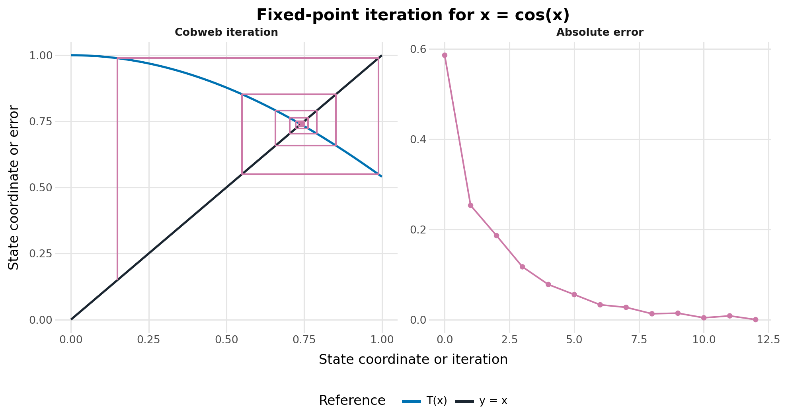

# Metric spaces and contraction {#sec-metric-spaces}

The proofs of earlier chapters often used only a distance, not the order or algebra
of real numbers. Metric spaces isolate that distance structure and reveal which
theorems are genuinely geometric.

## Metrics and examples

A **metric** on a set $X$ is a function $d:X\times X\to[0,\infty)$ satisfying

1. $d(x,y)=0$ exactly when $x=y$;
2. $d(x,y)=d(y,x)$; and
3. $d(x,z)\le d(x,y)+d(y,z)$.

The pair $(X,d)$ is a metric space. Standard examples include Euclidean distance
on $\mathbb R^n$, the discrete metric $d(x,y)=1$ for $x\ne y$, and the supremum
metric

$$
d_\infty(f,g)=\sup_{x\in E}|f(x)-g(x)|
$$

on bounded functions. On sequences, one may use
$d(x,y)=\sum_{n=1}^\infty 2^{-n}\min\{1,|x_n-y_n|\}$; the weights guarantee
convergence and make closeness mean agreement in many initial coordinates.

Different metrics can generate the same open sets. On $\mathbb R^n$, the
Euclidean, taxicab, and maximum metrics satisfy fixed comparison inequalities, so
they define the same convergent sequences and topology even though distances
differ.

## Convergence and continuity

Open balls are $B_r(x)=\{y:d(x,y)<r\}$. Open sets, closed sets, convergence,
Cauchy sequences, and continuity use the earlier definitions with $|x-y|$ replaced
by $d(x,y)$. A map $f:(X,d_X)\to(Y,d_Y)$ is continuous at $x$ if inputs close to
$x$ map close to $f(x)$.

A map is **Lipschitz** if
$d_Y(f(x),f(y))\le Ld_X(x,y)$ for some $L$. It is **Hölder** with exponent
$0<\alpha\le1$ if the right side is $C d_X(x,y)^\alpha$. Both imply uniform
continuity. The square-root function on $[0,\infty)$ is Hölder with exponent
$1/2$ because $|\sqrt{x}-\sqrt y|\le\sqrt{|x-y|}$.

Sequential characterizations of closedness and continuity remain valid in every
metric space. Their proofs use radius $1/n$ choices, a feature called first
countability in more general topology.

## Completeness

A metric space is **complete** if every Cauchy sequence converges to a point of the
space. The real line is complete; the rationals are not. The open interval $(0,1)$
is not complete in its inherited metric because $1/(n+1)$ is Cauchy but converges to a
missing endpoint.

A closed subspace of a complete metric space is complete. Conversely, a complete
subspace of a metric space is closed: any ambient limit of its sequence makes that
sequence Cauchy, so completeness supplies a subspace limit, and uniqueness equates
the two.

Every metric space has a **completion**, unique up to distance-preserving
bijection. The construction represents new points by equivalence classes of Cauchy
sequences, identifying two sequences when their termwise distance tends to zero.
The real numbers can be built as a completion of the rationals.

A complete normed vector space is a **Banach space**. The continuous functions
$C([a,b])$ are complete under the supremum norm: a uniformly Cauchy sequence has a
uniform limit, and the uniform limit theorem keeps it continuous.

## Compactness beyond the line

In metric spaces, compactness is equivalent to **sequential compactness**: every
sequence has a subsequence converging to a point of the space. The property that
every sequence has a Cauchy subsequence is equivalent to **total boundedness**,
meaning that for every $\varepsilon>0$ finitely many epsilon-balls cover $X$.
A useful characterization is: $X$ is compact exactly when it is complete and
totally bounded. The interval $(0,1)$ is totally bounded but not compact: the
sequence $1/(n+1)$ has no subsequence converging to a point of $(0,1)$.

Ordinary boundedness is weaker. The infinite discrete space is bounded—its diameter
is $1$—but not totally bounded for any $\varepsilon<1$, since each such ball is a
singleton. In infinite-dimensional normed spaces, closed and bounded sets need not
be compact. For example, the unit coordinate vectors in $\ell^2$ all have norm one
and pairwise distance $\sqrt2$, so no subsequence is Cauchy. Heine–Borel's
closed-and-bounded characterization is therefore special to finite-dimensional
Euclidean spaces.

## Banach contraction principle

A map $T:X\to X$ is a **contraction** if some $0\le q<1$ satisfies
$d(Tx,Ty)\le qd(x,y)$ for all $x,y$.

**Theorem 10.1 (Banach contraction).** Every contraction on a nonempty complete metric
space has a unique fixed point $x^*$, and the iteration $x_{n+1}=T(x_n)$ converges
to it from any start. Moreover,

$$
d(x_n,x^*)\le\frac{q^n}{1-q}d(x_1,x_0).
$$

**Proof.** Repeated contraction gives
$d(x_{n+1},x_n)\le q^n d(x_1,x_0)$. For $m>n$, the triangle inequality and a
geometric sum yield

$$
d(x_m,x_n)
\le\frac{q^n}{1-q}d(x_1,x_0).
$$

Thus $(x_n)$ is Cauchy; completeness gives $x_n\to x^*$. Lipschitz continuity of
$T$ gives $Tx^*=x^*$. If $y^*$ is another fixed point, then
$d(x^*,y^*)\le qd(x^*,y^*)$, forcing equality to zero. Letting $m\to\infty$ in the
tail estimate gives the error bound. $\square$

<figure id="fig-contraction">


<figcaption>

Figure 10.1: Iterates of a contraction map approaching its unique fixed point, with geometric error decay.

</figcaption>
</figure>

[Figure 10.1](#fig-contraction) displays both geometric iteration and quantitative decay. The
picture alone would not guarantee convergence; the global contraction factor
$q<1$ and completeness do.

## Applications

To solve $x=\cos x$ on $[0,1]$, the map $T(x)=\cos x$ sends the interval to itself,
and its derivative has absolute value at most $\sin 1<1$ there, so it is a
contraction. The theorem gives a unique solution and an error estimate for
fixed-point iteration.

For an integral equation

$$
u(x)=g(x)+\int_a^x K(x,t,u(t))\,dt,
$$

assume $g$ is continuous on $[a,b]$ and $K$ is continuous on
$\{(x,t):a\le t\le x\le b\}\times\mathbb R$. Then the right side defines
$Tu\in C([a,b])$ for every $u\in C([a,b])$. If $K$ is uniformly Lipschitz
in its last variable with constant $L$ and $L(b-a)<1$, then
$\|Tu-Tv\|_\infty\le L(b-a)\|u-v\|_\infty$. Completeness supplies a unique
continuous solution. This is the prototype for existence proofs in differential
equations.

<!-- inline-formula-code:start -->
## Formula and finite computation

A useful formula in this chapter is

$$
\operatorname{diam}\{a_n:N\le n\le M\}=\max a_n-\min a_n
$$

The sampled diameter is a finite diagnostic for the Cauchy condition. The following standalone Python block expresses that finite rule with its inputs and stopping conditions visible.

```python
from collections.abc import Callable

import numpy as np
from numpy.typing import NDArray

def sampled_tail_diameter(
    sequence: Callable[[NDArray[np.int64]], NDArray[np.float64]],
    start: int,
    stop: int,
) -> float:
    """Return the diameter of sampled terms a_start through a_stop."""
    if start < 1 or stop < start:
        raise ValueError("require 1 <= start <= stop")
    indices = np.arange(start, stop + 1)
    values = sequence(indices)
    return float(values.max() - values.min())

for start in (10, 100, 1_000):
    diameter = sampled_tail_diameter(lambda n: (-1.0) ** n / n, start, 2 * start)
    print(start, diameter)
```

**What the computation establishes.** The calculation checks a declared finite instance; the surrounding argument explains what is true beyond those inputs.
<!-- inline-formula-code:end -->

## Chapter synthesis

Metric language reveals which ideas depend only on distance. Completeness retains
Cauchy limits; total boundedness gives finite-scale control; together they
characterize compactness. A contraction combines completeness with geometric decay
to produce existence, uniqueness, an algorithm, and an error bound in one theorem.

## Exercises

<div class="exercise" id="real_analysis-10-metric-spaces-ex-1">
<p class="exercise-title"><strong>Exercise 1</strong></p>

Verify that the discrete metric satisfies the metric axioms.

</div>

<div class="exercise" id="real_analysis-10-metric-spaces-ex-2">
<p class="exercise-title"><strong>Exercise 2</strong></p>

Prove that Lipschitz maps are uniformly continuous.

</div>

<div class="exercise" id="real_analysis-10-metric-spaces-ex-3">
<p class="exercise-title"><strong>Exercise 3</strong></p>

Show a closed subspace of a complete metric space is complete.

</div>

<div class="exercise" id="real_analysis-10-metric-spaces-ex-4">
<p class="exercise-title"><strong>Exercise 4</strong></p>

Determine whether $(0,1)$ is complete under $d(x,y)=|1/x-1/y|$.

<details class="hint"><summary>Hint 1</summary>

Map the space by $x\mapsto1/x$ and identify its image in the usual real
metric.

</details>

</div>

<div class="exercise" id="real_analysis-10-metric-spaces-ex-5">
<p class="exercise-title"><strong>Exercise 5</strong></p>

Show the coordinate vectors in $\ell^2$ have no convergent subsequence.

</div>

<div class="exercise" id="real_analysis-10-metric-spaces-ex-6">
<p class="exercise-title"><strong>Exercise 6</strong></p>

Apply contraction iteration to $x=(x+2/x)/2$ on a suitable closed interval.

</div>

<div class="exercise" id="real_analysis-10-metric-spaces-ex-7">
<p class="exercise-title"><strong>Exercise 7</strong></p>

Derive the posterior estimate
$d(x_n,x^*)\le q\,d(x_n,x_{n-1})/(1-q)$.

<details class="solution"><summary>Solution</summary>

From the contraction property,

$$
d(x_{n+k+1},x_{n+k})\le q^{k+1}d(x_n,x_{n-1}).
$$

Sum the finite chain from $x_n$ to $x_m$, then let $m\to\infty$:

$$
d(x_n,x^*)
\le\sum_{k=0}^\infty q^{k+1}d(x_n,x_{n-1})
=\frac{q}{1-q}d(x_n,x_{n-1}).
$$

Unlike the prior estimate involving the initial step, this posterior estimate can be
computed during iteration.

</details>

</div>

<div class="exercise" id="real_analysis-10-metric-spaces-ex-8">
<p class="exercise-title"><strong>Exercise 8</strong></p>

Explain which step of the contraction proof fails in an incomplete space.

</div>

<div class="exercise" id="real_analysis-10-metric-spaces-ex-9">
<p class="exercise-title"><strong>Exercise 9</strong></p>

† Prove that a compact metric space is complete and totally bounded.

<details class="hint"><summary>Hint 1</summary>

Compactness immediately gives finite epsilon-ball covers. For
completeness, any Cauchy sequence has a convergent subsequence and must share its
limit.

</details>

</div>
