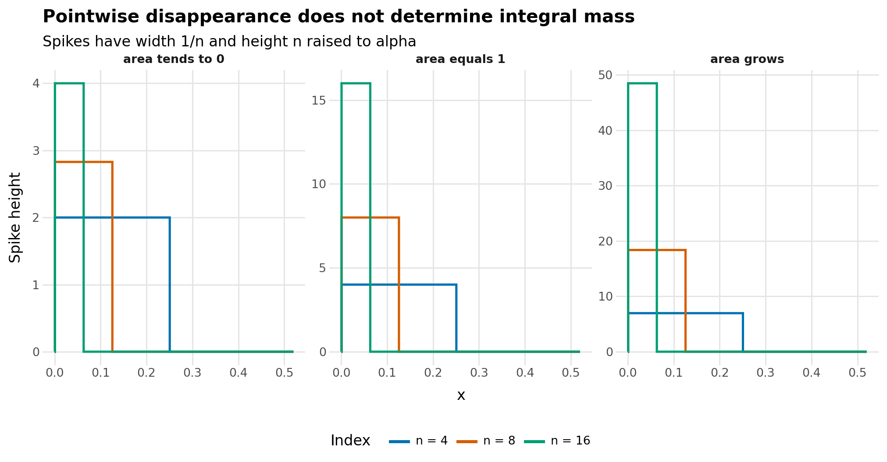

# Measure and the Lebesgue integral: a rigorous vista {#sec-measure}

Riemann integration partitions the domain into intervals. Lebesgue integration
instead groups points according to function values and allows countable set
operations. This chapter gives a precise architectural introduction while leaving
the full extension machinery to a later course.

## Why measure sets first?

The Riemann theory struggles with dense discontinuities and with limits of moving
spikes. A broader integral needs a consistent notion of size for more sets than
finite unions of intervals. Length should satisfy translation invariance and
countable additivity: disjoint pieces should have total size equal to the sum of
their sizes.

No such length can consistently measure every subset of $\mathbb R$ while
retaining the desired properties; choice-based nonmeasurable sets obstruct it. The
solution is to specify a rich collection of measurable sets closed under the
operations analysis needs.

## Sigma-algebras and measures

A **sigma-algebra** $\mathcal A$ on $X$ contains $X$, is closed under complements,
and is closed under countable unions. It follows from De Morgan's laws that it is
also closed under countable intersections and differences. A **measure** is a map
$\mu:\mathcal A\to[0,\infty]$ with $\mu(\varnothing)=0$ and

$$
\mu\left(\bigcup_{n=1}^\infty E_n\right)
=\sum_{n=1}^\infty\mu(E_n)
$$

for pairwise disjoint measurable sets.

The Borel sigma-algebra is generated by open subsets of $\mathbb R$. Lebesgue
measurable sets enlarge it by including all subsets of sets of measure zero. The
Lebesgue measure $m$ assigns $m((a,b))=b-a$ and is translation invariant.

Countable additivity yields continuity from below: if $E_n\uparrow E$, then
$\mu(E_n)\uparrow\mu(E)$. If $E_n\downarrow E$ and $\mu(E_1)<\infty$, then
$\mu(E_n)\downarrow\mu(E)$. The finite-measure hypothesis in the second statement
cannot be discarded without care.

The Cantor set from [sec-topology](05-topology.md#sec-topology) has measure zero. At stage $n$, it is covered by
$2^n$ intervals of total length $(2/3)^n$, which tends to zero. Yet it is
uncountable, again separating cardinality from measure.

## Measurable functions and almost everywhere

A function $f:X\to[-\infty,\infty]$ is **measurable** if
$\{x:f(x)>a\}$ is measurable for every real $a$. Equivalent formulations use
inverse images of open sets. Pointwise limits of measurable functions are
measurable.

A **simple function** takes finitely many values and can be written
$s=\sum_{k=1}^n a_k1_{E_k}$ with measurable $E_k$. Its integral, for nonnegative
coefficients, is

$$
\int_X s\,d\mu=\sum_{k=1}^n a_k\mu(E_k).
$$

A property holds **almost everywhere** if its failure set has measure zero.
Lebesgue integration treats changes on null sets as invisible. This motivates
identifying functions that agree almost everywhere in $L^p$ spaces.

## Building the integral

For a nonnegative measurable function $f$, define

$$
\int f\,d\mu
=\sup\left\{\int s\,d\mu:0\le s\le f,
\ s\text{ simple}\right\}.
$$

This echoes Darboux lower sums, but simple functions can follow arbitrary measurable
level sets rather than intervals. For a signed measurable $f$, write
$f^+=\max(f,0)$ and $f^-=\max(-f,0)$. If both integrals are finite, then $f$ is
integrable and
$\int f=\int f^+-\int f^-$. Equivalently, $\int|f|<\infty$.

The indicator identity $\int1_E\,d\mu=\mu(E)$ makes measure and integration two
views of one construction. Linearity, monotonicity, and the integral triangle
inequality extend from simple approximations.

## Convergence theorems

Three results govern legal limit interchange.

**Theorem 11.1 (Monotone convergence).** If $0\le f_n\uparrow f$ pointwise, then
$\int f_n\uparrow\int f$, allowing value $+\infty$.

**Lemma 11.2 (Fatou's).** For nonnegative measurable $f_n$,

$$
\int\liminf_{n\to\infty}f_n\,d\mu
\le\liminf_{n\to\infty}\int f_n\,d\mu.
$$

**Theorem 11.3 (Dominated convergence).** If $f_n\to f$ almost everywhere and
$|f_n|\le g$ for an integrable $g$, then $f$ is integrable and
$\int|f_n-f|\to0$; in particular, $\int f_n\to\int f$.

Domination prevents mass from escaping into ever taller, thinner spikes. The fixed
$g$ must be integrable and independent of $n$.

<figure id="fig-measure-spikes">


<figcaption>

Figure 11.1: Three moving spike families contrasting pointwise convergence with retained, vanishing, and exploding integral mass.

</figcaption>
</figure>

[Figure 11.1](#fig-measure-spikes) shows why pointwise convergence alone says nothing decisive
about integrals. Height-times-width controls mass. For $f_n=n1_{(0,1/n)}$, the
pointwise limit is zero for every $x>0$, but all integrals equal one. No integrable
function dominates the entire family near zero.

Monotone convergence proves Fatou by applying it to
$g_n=\inf_{k\ge n}f_k$. Fatou applied to $g+f_n$ and $g-f_n$ then proves dominated
convergence. This dependency illustrates how positivity substitutes for absolute
cancellation control.

## Comparison with Riemann integration

Every continuous function on $[a,b]$ is both Riemann and Lebesgue integrable, and
the values agree. More generally, a bounded function on $[a,b]$ is Riemann
integrable exactly when its discontinuity set has Lebesgue measure zero. This is
Lebesgue's criterion, stated here without proof.

The indicator of the rationals is zero almost everywhere and has Lebesgue integral
zero, though it is not Riemann integrable. The distinction is not a contradiction:
the integrals use different approximation families.

## The spaces Lp

For $1\le p<\infty$, define

$$
\|f\|_p=\left(\int|f|^p\,d\mu\right)^{1/p},
$$

and let $L^p$ consist of finite-norm measurable functions modulo equality almost
everywhere. The essential supremum defines $L^\infty$. Hölder's inequality,
$\|fg\|_1\le\|f\|_p\|g\|_q$ when $1/p+1/q=1$, yields Minkowski's triangle
inequality. Each $L^p$ is complete; $L^2$ additionally has inner product
$\langle f,g\rangle=\int f\overline g$.

Different norms encode different convergence. A narrow spike can be small in
$L^1$ while large in supremum norm. There is no universally correct norm; the
question determines which form of error matters.

<!-- inline-formula-code:start -->
## Formula and finite computation

A useful formula in this chapter is

$$
\int f_n\,d\mu\uparrow\int f\,d\mu
$$

The table exhibits the monotone quantities while keeping truncation explicit. The following standalone Python block expresses that finite rule with its inputs and stopping conditions visible.

```python
def truncated_monotone_integral(level: int, cutoff: int) -> tuple[float, float]:
    """Return a finite integral and a bound for omitted weighted tail mass."""
    if level <= 0 or cutoff <= 0:
        raise ValueError("level and cutoff must be positive")
    subtotal = sum(min(k, level) * 2.0 ** (-k) for k in range(1, cutoff + 1))
    tail_bound = level * 2.0 ** (-cutoff)
    return subtotal, tail_bound

for level in (1, 2, 4, 8):
    subtotal, tail = truncated_monotone_integral(level, cutoff=40)
    print(level, subtotal, tail)
```

**What the computation establishes.** The calculation checks a declared finite instance; the surrounding argument explains what is true beyond those inputs.
<!-- inline-formula-code:end -->

## Chapter synthesis

Measure makes countable set operations compatible with size. The Lebesgue integral
builds nonnegative functions from below by simple functions and handles signs via
absolute integrability. Its convergence theorems replace uniform control with
positivity or domination. Almost-everywhere equivalence naturally produces the
complete spaces $L^p$.

## Exercises

<div class="exercise" id="real_analysis-11-measure-ex-1">
<p class="exercise-title"><strong>Exercise 1</strong></p>

Prove a sigma-algebra is closed under countable intersections.

</div>

<div class="exercise" id="real_analysis-11-measure-ex-2">
<p class="exercise-title"><strong>Exercise 2</strong></p>

Derive continuity from below from countable additivity.

</div>

<div class="exercise" id="real_analysis-11-measure-ex-3">
<p class="exercise-title"><strong>Exercise 3</strong></p>

Compute the integral of a nonnegative simple function with disjoint level sets.

</div>

<div class="exercise" id="real_analysis-11-measure-ex-4">
<p class="exercise-title"><strong>Exercise 4</strong></p>

Show a countable subset of $\mathbb R$ has Lebesgue measure zero.

</div>

<div class="exercise" id="real_analysis-11-measure-ex-5">
<p class="exercise-title"><strong>Exercise 5</strong></p>

For $f_n=n^\alpha1_{(0,1/n)}$, determine the integral behaviour as a function of
$\alpha$.

</div>

<div class="exercise" id="real_analysis-11-measure-ex-6">
<p class="exercise-title"><strong>Exercise 6</strong></p>

Explain why $f_n=n1_{(0,1/n)}$ has no common integrable dominator.

</div>

<div class="exercise" id="real_analysis-11-measure-ex-7">
<p class="exercise-title"><strong>Exercise 7</strong></p>

Apply dominated convergence to compute
$\lim_n\int_0^1 x^n/(1+x)\,dx$.

<details class="hint"><summary>Hint 1</summary>

The integrand tends pointwise to zero except possibly at one endpoint and
is dominated by one.

</details>

</div>

<div class="exercise" id="real_analysis-11-measure-ex-8">
<p class="exercise-title"><strong>Exercise 8</strong></p>

Compare the $L^1$, $L^2$, and supremum norms of $1_{(0,\varepsilon)}$.

<details class="solution"><summary>Solution</summary>

For $f_\varepsilon=1_{(0,\varepsilon)}$ on $(0,1)$,

$$
\|f_\varepsilon\|_1=\varepsilon,\qquad
\|f_\varepsilon\|_2=\sqrt{\varepsilon},\qquad
\|f_\varepsilon\|_\infty=1.
$$

Thus the functions tend to zero in $L^1$ and $L^2$ as
$\varepsilon\downarrow0$, but not in supremum norm. The error is large on a
shrinking set, and the norms weight that geometry differently.

</details>

</div>

<div class="exercise" id="real_analysis-11-measure-ex-9">
<p class="exercise-title"><strong>Exercise 9</strong></p>

† Use Fatou's lemma to prove the integral triangle inequality for a pointwise
limit of partial sums under suitable nonnegativity assumptions.

</div>
