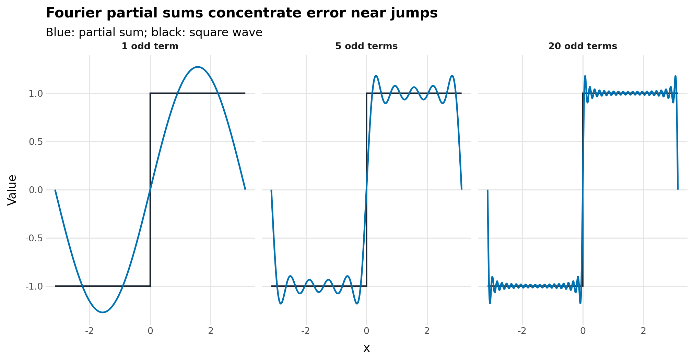

# Fourier analysis: oscillation and approximation {#sec-fourier}

Polynomial approximation builds from powers of $x$. For periodic phenomena, sines
and cosines are the natural building blocks. Fourier analysis asks how well these
oscillatory modes represent a function and in which sense convergence occurs.

## Periodicity and orthogonality

Work first with real $2\pi$-periodic functions. Define

$$
\langle f,g\rangle=\frac1\pi\int_{-\pi}^{\pi}f(x)g(x)\,dx.
$$

Direct trigonometric identities show that $\cos(nx)$ and $\sin(nx)$ are mutually
orthogonal for distinct nonnegative integer frequencies, with the constant mode
handled separately. Orthogonality means cross-terms vanish when measuring
mean-square error.

For integrable $f$, define Fourier coefficients

$$
a_0=\frac1\pi\int_{-\pi}^{\pi}f(x)\,dx,
\quad
a_n=\frac1\pi\int_{-\pi}^{\pi}f(x)\cos(nx)\,dx,
\quad
b_n=\frac1\pi\int_{-\pi}^{\pi}f(x)\sin(nx)\,dx.
$$

The $N$th Fourier partial sum is

$$
S_Nf(x)=\frac{a_0}{2}
+\sum_{n=1}^{N}\bigl(a_n\cos(nx)+b_n\sin(nx)\bigr).
$$

These coefficients are not arbitrary: orthogonality makes $S_Nf$ the trigonometric
polynomial of degree at most $N$ minimizing the $L^2$ error.

Midpoint quadrature gives a finite, inspectable approximation to all the
coefficients through a chosen frequency. The factor `2 / sample_count` is the
formula's $1/\pi$ normalisation multiplied by the mesh width $2\pi/m$.

```python
from collections.abc import Callable

import numpy as np
from numpy.typing import NDArray

def approximate_fourier_coefficients(
    function: Callable[[NDArray[np.float64]], NDArray[np.float64]],
    maximum_frequency: int,
    sample_count: int,
) -> tuple[float, NDArray[np.float64], NDArray[np.float64]]:
    """Approximate real Fourier coefficients by periodic midpoint sums."""
    if maximum_frequency < 0 or sample_count <= 2 * maximum_frequency:
        raise ValueError("use a nonnegative frequency and more than 2N samples")
    points = -np.pi + (np.arange(sample_count) + 0.5) * 2.0 * np.pi / sample_count
    values = np.asarray(function(points), dtype=float)
    if values.shape != points.shape or not np.all(np.isfinite(values)):
        raise ValueError("function must return one finite value per sample point")
    frequencies = np.arange(1, maximum_frequency + 1)[:, None]
    scale = 2.0 / sample_count
    cosine = scale * np.sum(values * np.cos(frequencies * points), axis=1)
    sine = scale * np.sum(values * np.sin(frequencies * points), axis=1)
    return float(scale * np.sum(values)), cosine, sine

constant, cosine, sine = approximate_fourier_coefficients(
    lambda points: np.cos(2.0 * points) + 0.5 * np.sin(3.0 * points),
    maximum_frequency=4,
    sample_count=512,
)
print(constant, cosine, sine)
```

For this trigonometric polynomial the output isolates $a_2=1$ and $b_3=1/2$
up to floating-point error. Quadrature on a finite mesh does not by itself
establish coefficient convergence for an arbitrary integrable function.

## Kernels and convergence

The partial sum can be written as a convolution

$$
S_Nf(x)=\frac1{2\pi}\int_{-\pi}^{\pi}
f(x-t)D_N(t)\,dt,
$$

where the Dirichlet kernel is

$$
D_N(t)=1+2\sum_{n=1}^N\cos(nt)
=\frac{\sin((N+\tfrac12)t)}{\sin(t/2)}.
$$

Its integral is fixed, but its absolute integral grows. Thus it is not a uniformly
well-behaved averaging kernel, and convergence can be delicate.

A classical Dirichlet theorem says that if a periodic function is piecewise
continuously differentiable, then $S_Nf(x)$ converges to
$[f(x^-)+f(x^+)]/2$. At continuity points this equals $f(x)$; at a jump it equals
the midpoint. This sufficient condition is not the final word, but it is a reliable
first theorem.

## Energy and best approximation

Orthogonality gives Bessel's inequality:

$$
\frac{a_0^2}{2}+\sum_{n=1}^{\infty}(a_n^2+b_n^2)
\le\frac1\pi\int_{-\pi}^{\pi}|f(x)|^2\,dx.
$$

Every finite partial sum uses no more energy than $f$. If the trigonometric system
is complete in $L^2$, the inequality becomes Parseval's identity:

$$
\frac{a_0^2}{2}+\sum_{n=1}^{\infty}(a_n^2+b_n^2)
=\frac1\pi\int_{-\pi}^{\pi}|f(x)|^2\,dx.
$$

“Complete” here means that no nonzero $L^2$ function is orthogonal to every
trigonometric mode. This is a function-space version of spanning by an orthonormal
basis.

## Gibbs behavior and choice of norm

For a square wave, Fourier partial sums converge pointwise away from jumps and to
midpoints at jumps. Near each jump they overshoot by a persistent proportion of the
jump height, while the overshoot region narrows.

<figure id="fig-fourier-gibbs">


<figcaption>

Figure 12.1: Fourier partial sums of a square wave showing narrowing but persistent Gibbs overshoot near a jump.

</figcaption>
</figure>

[Figure 12.1](#fig-fourier-gibbs) distinguishes several notions. The narrowing region makes the
$L^2$ error tend to zero, and pointwise convergence holds away from jumps, but
uniform convergence fails because the maximum discrepancy near each jump does not
vanish. The visual does not establish the universal Gibbs constant; it displays the
mechanism.

Uniform limits of continuous functions are continuous, so no sequence of continuous
trigonometric polynomials can converge uniformly to a discontinuous square wave.
Mean-square convergence permits errors concentrated on small sets and is therefore
compatible with jumps.

## Fejér averaging

Instead of using the last partial sum, average them:

$$
\sigma_Nf=\frac1{N+1}\sum_{k=0}^N S_kf.
$$

This is Cesàro summation. Its Fejér kernel is nonnegative, has integral $2\pi$, and
concentrates near zero. Positivity prevents the large cancellation instability of
the Dirichlet kernel.

**Theorem 12.1 (Fejér).** If $f$ is continuous and periodic, then $\sigma_Nf\to f$
uniformly.

**Proof idea.** Uniform continuity makes $f(x-t)-f(x)$ small for small $t$,
uniformly in $x$. Split the kernel integral into a small neighborhood of zero and
its complement. The first part is controlled by continuity; concentration makes
the second part small. This is another “near/far” estimate and yields a constructive
trigonometric approximation theorem.

## Fourier transform vista

For a suitably integrable function on $\mathbb R$, one normalisation of the Fourier
transform is

$$
\widehat f(\xi)=\int_{\mathbb R}f(x)e^{-2\pi i x\xi}\,dx.
$$

Translation changes phase, differentiation multiplies by frequency, and convolution
becomes multiplication. These identities explain why the transform is central to
differential equations and signal processing. Their exact hypotheses matter:
pointwise formulas may require smoothness and decay, while $L^2$ theory extends the
transform by completeness.

An uncertainty principle states, in one precise form, that a nonzero function and
its transform cannot both have arbitrarily small variance. It is a quantitative
theorem about simultaneous localization, not the vague claim that “measurement
creates uncertainty.”

<!-- inline-formula-code:start -->
## Formula and finite computation

A useful formula in this chapter is

$$
S_N(x)=\sum_{|k|\le N}\widehat f(k)e^{ikx}
$$

The finite partial sum translates directly into a bounded loop. The following standalone Python block expresses that finite rule with its inputs and stopping conditions visible.

```python
import numpy as np
from numpy.typing import NDArray

def square_wave_partial_sum(
    points: NDArray[np.float64], odd_terms: int
) -> NDArray[np.float64]:
    """Return a finite odd-harmonic Fourier sum for a square wave."""
    if odd_terms <= 0:
        raise ValueError("odd_terms must be positive")
    total = np.zeros_like(points)
    for position in range(odd_terms):
        harmonic = 2 * position + 1
        total += np.sin(harmonic * points) / harmonic
    return (4.0 / np.pi) * total

grid = np.linspace(-np.pi, np.pi, 4_001)
for terms in (1, 5, 25, 100):
    approximation = square_wave_partial_sum(grid, terms)
    print(terms, float(approximation.max()), float(approximation.min()))
```

**What the computation establishes.** The calculation checks a declared finite instance; the surrounding argument explains what is true beyond those inputs.
<!-- inline-formula-code:end -->

## Chapter synthesis

Fourier coefficients are orthogonal projections onto oscillatory modes. Pointwise,
uniform, and mean-square convergence answer different questions. Dirichlet partial
sums can misbehave near jumps, while Fejér averaging restores stable uniform
approximation for continuous periodic functions. The Fourier transform carries the
same frequency viewpoint to the real line.

## Exercises

<div class="exercise" id="real_analysis-12-fourier-ex-1">
<p class="exercise-title"><strong>Exercise 1</strong></p>

Prove orthogonality of $\sin(nx)$ and $\cos(mx)$ on $[-\pi,\pi]$.

</div>

<div class="exercise" id="real_analysis-12-fourier-ex-2">
<p class="exercise-title"><strong>Exercise 2</strong></p>

Compute the Fourier coefficients of the odd square wave.

</div>

<div class="exercise" id="real_analysis-12-fourier-ex-3">
<p class="exercise-title"><strong>Exercise 3</strong></p>

Derive the closed form of the Dirichlet kernel from a geometric sum.

</div>

<div class="exercise" id="real_analysis-12-fourier-ex-4">
<p class="exercise-title"><strong>Exercise 4</strong></p>

Prove a finite-dimensional version of Bessel's inequality.

</div>

<div class="exercise" id="real_analysis-12-fourier-ex-5">
<p class="exercise-title"><strong>Exercise 5</strong></p>

Explain why square-wave Fourier sums cannot converge uniformly.

</div>

<div class="exercise" id="real_analysis-12-fourier-ex-6">
<p class="exercise-title"><strong>Exercise 6</strong></p>

Show the Fejér kernel is the average of Dirichlet kernels.

</div>

<div class="exercise" id="real_analysis-12-fourier-ex-7">
<p class="exercise-title"><strong>Exercise 7</strong></p>

Interpret the constant Fourier coefficient as the mean value.

</div>

<div class="exercise" id="real_analysis-12-fourier-ex-8">
<p class="exercise-title"><strong>Exercise 8</strong></p>

Verify formally that translation of $f$ multiplies $\widehat f$ by a phase.

</div>

<div class="exercise" id="real_analysis-12-fourier-ex-9">
<p class="exercise-title"><strong>Exercise 9</strong></p>

† Prove that Fourier partial sums minimize $L^2$ error among trigonometric
polynomials of their degree.

<details class="hint"><summary>Hint 1</summary>

Write any competing polynomial as $S_Nf+h$ with $h$ in the same finite
span, and show the residual is orthogonal to $h$.

</details>

</div>
