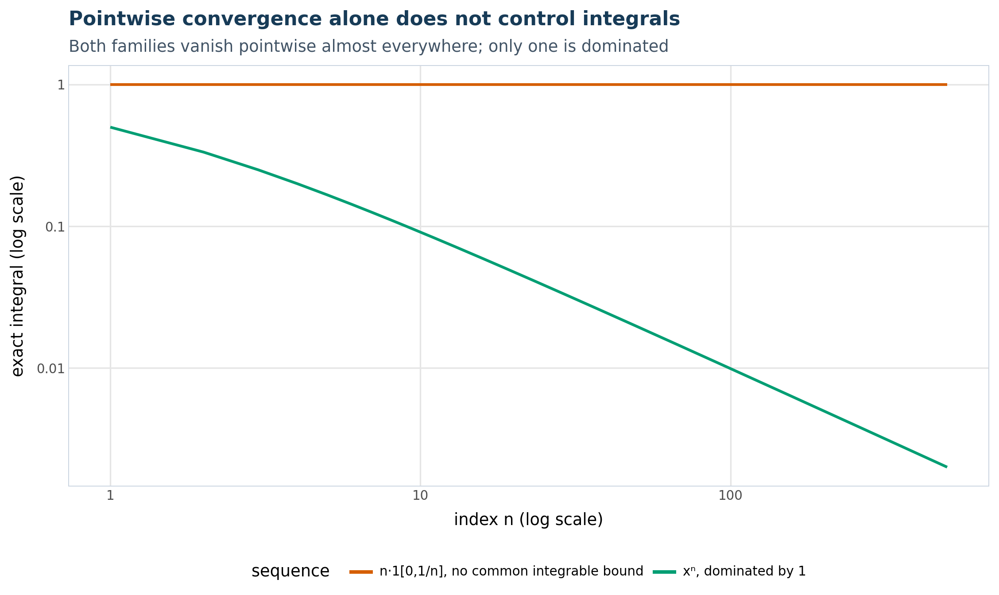

# A theorem network and problem-solving laboratory {#sec-synthesis}

The strongest way to retain analysis is not as a list of named theorems but as a
network of reusable proof mechanisms. This chapter makes that network explicit and
then uses it in two capstone arguments.

## Equivalent faces of completeness

The least-upper-bound property began as an order axiom. It produced monotone
convergence by taking the supremum of a sequence's range. Monotone convergence
proved the nested-interval principle by following left and right endpoints.
Nested intervals produced Bolzano–Weierstrass by repeated bisection.
Bolzano–Weierstrass plus the Cauchy property proved Cauchy completeness.

The reverse route is also available. Given a nonempty bounded-above set $S$, use
bisection to produce a Cauchy sequence of nested endpoints separating points that
are upper bounds from points that are not. Its limit is $\sup S$. Thus these
principles are different interfaces to one no-gap structure.

On closed bounded intervals, completeness combines with boundedness to produce
sequential compactness. Compactness then powers the extreme value theorem and
uniform continuity. The chain is:

$$
\text{completeness}
\Rightarrow \text{subsequence convergence}
\Rightarrow \text{compactness}
\Rightarrow \text{finite global control}.
$$

Whenever an existence proof on the real line seems to create a mysterious point,
look for a supremum, a convergent subsequence, or a Cauchy construction.

## Local-to-global patterns

The finite-subcover pattern begins with a local radius $r_x$ for every point
$x\in K$. Compactness selects finitely many centres. A minimum of finitely many
positive scales and a maximum of finitely many bounds convert point-dependent data
into uniform data. Heine–Cantor is the model.

The mean-value pattern subtracts a simple comparison function—a secant line or a
target slope—and applies an extremum theorem. It converts a derivative assertion at
some unknown point into a difference estimate across the full interval.

The integration pattern traps an object between lower and upper approximations.
Completeness identifies their common limiting value once the gap can be made
arbitrarily small. Darboux integration and the nonnegative Lebesgue integral both
fit this design with different approximation families.

The contraction pattern turns a local-looking recurrence into geometric tail
control. Completeness supplies the limit, continuity verifies the equation, and a
strict contraction gives uniqueness.

## Quantifier diagnostics

Many false statements in analysis arise by exchanging two quantifiers:

| Weak form | Strong form | Missing uniform object |
|---|---|---|
| continuity at each $x$ | uniform continuity | one $\delta$ for all $x$ |
| pointwise convergence | uniform convergence | one $N$ for all $x$ |
| each $T_\alpha x$ bounded in $\alpha$ | operators uniformly bounded | one norm bound |
| each local neighborhood works | a global estimate | finite subcover or common scale |

To diagnose a proposed proof, mark every dependency. Writing $N=N(x,\varepsilon)$
prevents it from being silently reused as though independent of $x$. A compactness,
domination, or equicontinuity hypothesis often exists precisely to remove one
dependency.

## Counterexample design studio

**Moving spikes** preserve a pointwise limit while relocating error. Change height
and width to control integral mass and supremum error independently.

**Oscillation** prevents a unique asymptotic choice. Alternating sequences, rapid
sines, and Fourier ripples test convergence and equicontinuity claims.

**Missing endpoints** create Cauchy sequences without internal limits and continuous
functions without extrema. Open intervals are the standard laboratory.

**Infinite-dimensional escape** uses coordinate vectors that remain mutually
separated. It refutes attempts to extend “closed and bounded implies compact” to
general normed spaces.

**Dense exceptional sets** distinguish topological from measure-theoretic size. The
rationals and the Cantor set show that dense, uncountable, nowhere dense, and null
describe different phenomena.

Good counterexamples preserve every stated hypothesis except the one under audit.
Random experimentation may suggest a candidate, but the final example should have
transparent verification.

## Capstone I: compactness, continuity, and integration

Let $(f_n)$ be an increasing sequence of continuous functions on a compact interval
$[a,b]$, and suppose $f_n(x)\to f(x)$ pointwise for a continuous $f$. Then the
convergence is uniform. This is Dini's theorem.

**Proof.** Define $g_n=f-f_n$. Then each $g_n$ is continuous, nonnegative, and
decreases pointwise to zero. Fix $\varepsilon>0$ and set
$U_n=\{x:g_n(x)<\varepsilon\}$. These are open relative to $[a,b]$, increase with
$n$, and cover the interval. Compactness gives a finite subcover. Because the sets
are nested, the largest selected index alone covers $[a,b]$. Hence
$0\le g_N(x)<\varepsilon$ for every $x$, proving uniform convergence. $\square$

The proof exposes the exact cooperation: continuity makes the sets open,
pointwise convergence makes them cover, monotonicity nests them, and compactness
makes the cover finite. Remove monotonicity and moving spikes refute the result;
remove continuity of the limit and $1-x^n$ on $[0,1]$ refutes it.

Uniform convergence now permits $\int f_n\to\int f$. One theorem chain has converted
order plus pointwise information into convergence of global accumulated quantities.

## Capstone II: existence with an error certificate

Consider the equation

$$
u(x)=1+\int_0^x \frac12\sin(u(t))\,dt
\qquad (0\le x\le1).
$$

On the Banach space $C([0,1])$, define the right side as $Tu$. Since sine is
Lipschitz with constant one,

$$
\|Tu-Tv\|_\infty
\le\frac12\|u-v\|_\infty.
$$

The contraction theorem gives a unique continuous fixed point. Starting from
$u_0(x)=1$, the iterates $u_{n+1}=Tu_n$ converge uniformly, and

$$
\|u_n-u^*\|_\infty
\le2^{-n+1}\|u_1-u_0\|_\infty.
$$

The construction provides four outputs at once: existence, uniqueness, a practical
iteration, and a certified worst-case error. Differentiating the integral equation
using the FTC then shows the solution satisfies
$u'(x)=\tfrac12\sin u(x)$ and $u(0)=1$.

## Routes onward

Complex analysis adds a strong interaction between differentiability and topology.
Probability uses measure to model expectation and convergence of random variables.
Partial differential equations combine Sobolev spaces, weak derivatives, compactness,
and functional analysis. Differential geometry transfers local approximation to
curved spaces. Each route changes the objects but retains the central questions:
what is the topology, which sequences converge, what compactness is available, and
which estimates survive limits?

When reading a research statement, separate proved theorem, conjecture, heuristic,
and numerical evidence. Check the ambient space and convergence mode. Find whether
constants depend on hidden parameters. These habits are the mature form of the
quantifier discipline with which the book began.

## Visual synthesis: a hypothesis can control an integral

<figure id="fig-ra-synthesis-dominated-comparison">


<figcaption>

Figure 14.1: A dominated family and a concentrating spike have different integral limits.

</figcaption>
</figure>

The comparison in [Figure 14.1](#fig-ra-synthesis-dominated-comparison) condenses the book's
central habit: inspect the hypothesis that legalizes a limiting operation. Both
families converge pointwise almost everywhere, but only one has the common
integrable bound needed for the dominated convergence conclusion.

## Final synthesis

Real analysis is the study of reliable passage to a limit. Completeness supplies
missing points, compactness compresses infinitely local information, connectedness
forbids gaps, uniformity makes operations commute with limits, and function spaces
turn approximation itself into geometry. The same small architecture supports both
elementary calculus and its modern extensions.

<!-- inline-formula-code:start -->
## Formula and finite computation

A useful formula in this chapter is

$$
L_n^2<2<U_n^2
$$

Exact rational brackets turn completeness reasoning into a checkable sequence. The following standalone Python block expresses that finite rule with its inputs and stopping conditions visible.

```python
from fractions import Fraction

def square_root_two_bounds(steps: int) -> list[tuple[Fraction, Fraction]]:
    """Return nested rational intervals that trap the positive square root of two."""
    if steps < 0:
        raise ValueError("steps must be nonnegative")
    lower = Fraction(1)
    upper = Fraction(2)
    bounds: list[tuple[Fraction, Fraction]] = []
    for _ in range(steps + 1):
        bounds.append((lower, upper))
        middle = (lower + upper) / 2
        if middle * middle < 2:
            lower = middle
        else:
            upper = middle
    return bounds

for step, (lower, upper) in enumerate(square_root_two_bounds(8)):
    print(step, lower, upper, upper - lower, lower * lower < 2 < upper * upper)
```

**What the computation establishes.** The calculation checks a declared finite instance; the surrounding argument explains what is true beyond those inputs.
<!-- inline-formula-code:end -->

## Exercises

<div class="exercise" id="real_analysis-14-synthesis-ex-1">
<p class="exercise-title"><strong>Exercise 1</strong></p>

Draw a dependency graph from least-upper-bound completeness to Heine–Cantor.

</div>

<div class="exercise" id="real_analysis-14-synthesis-ex-2">
<p class="exercise-title"><strong>Exercise 2</strong></p>

Prove the reverse direction from Cauchy completeness to existence of suprema.

</div>

<div class="exercise" id="real_analysis-14-synthesis-ex-3">
<p class="exercise-title"><strong>Exercise 3</strong></p>

Give a pointwise but nonuniform sequence where the cutoff visibly depends on $x$.

</div>

<div class="exercise" id="real_analysis-14-synthesis-ex-4">
<p class="exercise-title"><strong>Exercise 4</strong></p>

Audit every hypothesis in Dini's theorem with a counterexample or explanation.

<details class="hint"><summary>Hint 1</summary>

For monotonicity, use a travelling spike. For continuity of the limit, use
$1-x^n$. For compactness, use a suitable noncompact domain.

</details>

</div>

<div class="exercise" id="real_analysis-14-synthesis-ex-5">
<p class="exercise-title"><strong>Exercise 5</strong></p>

Modify the capstone integral equation to have contraction factor $1/3$.

</div>

<div class="exercise" id="real_analysis-14-synthesis-ex-6">
<p class="exercise-title"><strong>Exercise 6</strong></p>

Show its fixed-point iterates are continuously differentiable after the first
iteration.

</div>

<div class="exercise" id="real_analysis-14-synthesis-ex-7">
<p class="exercise-title"><strong>Exercise 7</strong></p>

Classify each use of completeness, compactness, and continuity in the capstones.

</div>

<div class="exercise" id="real_analysis-14-synthesis-ex-8">
<p class="exercise-title"><strong>Exercise 8</strong></p>

Design a false theorem and the smallest counterexample that diagnoses it.

</div>

<div class="exercise" id="real_analysis-14-synthesis-ex-9">
<p class="exercise-title"><strong>Exercise 9</strong></p>

† Prove Dini's theorem on an arbitrary compact metric space.

</div>
