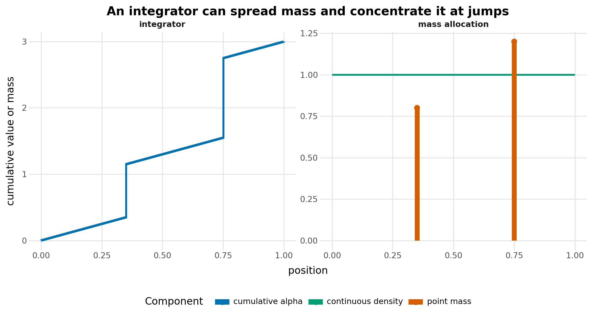

# Bounded Variation and Riemann–Stieltjes Integration {#sec-bv-stieltjes}

Chapter 8 accumulated values against interval length. A Riemann–Stieltjes integral
replaces length by the increments of another function. This single change handles
ordinary integrals, weighted point masses, and distribution functions in one
notation. The price is that we must control how violently the integrator changes.

**Prerequisites.** Partitions and Riemann integration from [sec-riemann](08-riemann.md#sec-riemann), monotone
functions and compactness from [sec-continuity](06-continuity.md#sec-continuity), and uniform continuity. Measure
language from [sec-measure](11-measure.md#sec-measure) is helpful for interpretation but is not required for
the construction.

## Total variation and Jordan decomposition

Let $f:[a,b]\to\mathbb R$. For a partition
$P=\{a=x_0<x_1<\cdots<x_n=b\}$, define

$$
V(f,P)=\sum_{i=1}^{n}|f(x_i)-f(x_{i-1})|.
$$

The **total variation** of $f$ is

$$
V_a^b(f)=\sup_P V(f,P).
$$

We say $f$ has **bounded variation**, written $f\in BV([a,b])$, when this
supremum is finite. Variation measures total travel, not net displacement.
Always $|f(b)-f(a)|\le V_a^b(f)$.

**Worked example 1.** If $f$ is increasing, every partition sum telescopes:

$$
V(f,P)=\sum_i(f(x_i)-f(x_{i-1}))=f(b)-f(a).
$$

Hence increasing functions are BV. For $f(x)=|x|$ on $[-1,2]$, the function
decreases from $1$ to $0$ and then increases to $2$, so its variation is $3$,
whereas its net change is only $1$.

If $f$ is continuously differentiable, then

$$
V_a^b(f)=\int_a^b|f'(x)|\,dx.
$$

The inequality “at most” follows from the fundamental theorem and the integral
triangle inequality on every partition. The reverse inequality follows by
partitioning finely enough to capture intervals where the derivative has nearly
constant sign; a complete proof uses uniform continuity of $f'$.

For any declared partition, $V(f,P)$ is just a sum of adjacent absolute
increments. Supplying sampled values rather than a callable function keeps the
routine honest about what has actually been observed.

```python
from math import isfinite

def partition_variation(sample_values: list[float]) -> float:
    """Evaluate V(f, P) from values ordered along one finite partition."""
    if len(sample_values) < 2:
        raise ValueError("a partition needs at least two endpoint values")
    if not all(isfinite(value) for value in sample_values):
        raise ValueError("sample values must be finite")
    return sum(
        abs(sample_values[index] - sample_values[index - 1])
        for index in range(1, len(sample_values))
    )

variation = partition_variation([1.0, 0.0, 2.0])  # |x| at -1, 0, 2
print(variation)
```

The result $3$ is the variation on this partition and, because it includes the
turning point of $|x|$, equals the total variation in the worked example. For
general data it is only a lower bound on the supremum over all partitions.

Define the **variation function**

$$
v(x)=V_a^x(f).
$$

It is increasing. Moreover, $v+f$ and $v-f$ are increasing because
$v(y)-v(x)\ge|f(y)-f(x)|$ for $x<y$.

**Jordan decomposition for BV functions.** A function on $[a,b]$ has bounded
variation exactly when it is the difference of two increasing functions.

**Proof.** If $f$ is BV, then
$f=[(v+f)/2]-[(v-f)/2]$, a difference of increasing functions. Conversely, if
$f=p-q$ with $p,q$ increasing, then

$$
V(f,P)\le[p(b)-p(a)]+[q(b)-q(a)]
$$

for every partition. Taking the supremum proves bounded variation. $\square$

This decomposition is not unique unless a normalisation and minimality convention
are imposed. It anticipates the Jordan decomposition of signed measures in
[sec-signed-measures](20-signed-measures.md#sec-signed-measures).

## Monotone integrators

A monotone function $\alpha:[a,b]\to\mathbb R$ assigns a nonnegative increment

$$
\Delta\alpha_i=\alpha(x_i)-\alpha(x_{i-1})
$$

to every subinterval. Think of $\alpha$ as a cumulative mass: the interval
$(x_{i-1},x_i]$ receives mass $\Delta\alpha_i$. Flat portions receive none; jumps
concentrate mass at points.

The familiar case is $\alpha(x)=x$, where $\Delta\alpha_i=\Delta x_i$. If
$\alpha$ is differentiable with continuous derivative, increments satisfy

$$
\alpha(x_i)-\alpha(x_{i-1})
=\int_{x_{i-1}}^{x_i}\alpha'(x)\,dx,
$$

suggesting $\int f\,d\alpha=\int f\alpha'\,dx$.

**Worked example 2.** On $[0,1]$, let $\alpha(x)=x^2$. The integrator allocates
more mass near $1$ because equal $x$-intervals have larger $\alpha$-increments
there. For $f(x)=x$,

$$
\int_0^1x\,d(x^2)
=\int_0^1x(2x)\,dx
=\frac23.
$$

The notation $d(x^2)$ records the integrator; it is not an invitation to cancel
symbols informally.

## Riemann–Stieltjes sums

For a tagged partition $(P,T)$, where $t_i\in[x_{i-1},x_i]$, define

$$
S(f,\alpha;P,T)
=\sum_{i=1}^n f(t_i)
[\alpha(x_i)-\alpha(x_{i-1})].
$$

We say $f$ is **Riemann–Stieltjes integrable with respect to $\alpha$** if there is
a number $I$ such that for every $\varepsilon>0$ there is $\delta>0$ for which

$$
|S(f,\alpha;P,T)-I|<\varepsilon
$$

whenever the mesh of $P$ is below $\delta$, for every choice of tags. We then write
$I=\int_a^b f\,d\alpha$.

When $\alpha$ is increasing, upper and lower Stieltjes sums replace interval widths
by $\Delta\alpha_i$. Their difference is

$$
\sum_i(M_i-m_i)\Delta\alpha_i,
$$

where $M_i$ and $m_i$ are the supremum and infimum of $f$ on the subinterval.
This formula exposes the two ingredients: oscillation of $f$ and mass assigned by
$\alpha$.

Linearity holds in $f$ and in the integrator wherever the relevant integrals
exist. If $\alpha$ is increasing and $f\ge0$, then
$\int f\,d\alpha\ge0$, and

$$
\left|\int_a^b f\,d\alpha\right|
\le \|f\|_\infty[\alpha(b)-\alpha(a)].
$$

## Existence theorems and integration by parts

**Theorem 15.1 (Existence).** If $f$ is continuous on $[a,b]$ and $\alpha$ is increasing,
then $\int_a^b f\,d\alpha$ exists.

**Proof.** Uniform continuity supplies $\delta$ so the oscillation of $f$ on any
interval shorter than $\delta$ is below
$\varepsilon/[\alpha(b)-\alpha(a)]$; the constant-integrator case is immediate.
For a partition of smaller mesh, the upper-lower difference is at most

$$
\frac{\varepsilon}{\alpha(b)-\alpha(a)}
\sum_i\Delta\alpha_i=\varepsilon.
$$

The Darboux criterion completes the proof. $\square$

More generally, if $f$ is continuous and $\alpha$ is BV, use the Jordan
decomposition and linearity. There are sharper theorems allowing discontinuous
functions, but common jump points require special care.

**Integration by parts.** If one of $f,\alpha$ is continuous and both are BV, then

$$
\int_a^b f\,d\alpha+\int_a^b\alpha\,df
=f(b)\alpha(b)-f(a)\alpha(a).
$$

For finite sums, expand
$f_i\alpha_i-f_{i-1}\alpha_{i-1}$ in two ways and telescope. The limiting theorem
inherits this algebra, while continuity prevents ambiguity about evaluating
simultaneous jumps.

**Worked example 3.** On $[0,1]$, with $f(x)=x$ and $\alpha(x)=x^2$,

$$
\int_0^1x\,d(x^2)
=1-\int_0^1x^2\,dx
=1-\frac13=\frac23.
$$

This independently confirms Worked example 2.

## Step functions and weighted point masses

Let

$$
H_c(x)=
\begin{cases}
0,&x<c,\\
1,&x\ge c,
\end{cases}
$$

for $a<c<b$. Every Stieltjes sum whose partition isolates $c$ receives exactly one
unit jump, so for continuous $f$,

$$
\int_a^b f\,dH_c=f(c).
$$

If $\alpha(x)=\sum_{j=1}^m w_jH_{c_j}(x)$ with positive weights, then

$$
\int_a^b f\,d\alpha=\sum_{j=1}^m w_jf(c_j).
$$

Thus a finite weighted sum is already an integral.

<figure id="fig-stieltjes-integrator">


<figcaption>

Figure 15.1: A cumulative integrator combines a smooth increase with jumps, and its Stieltjes integral weights both continuous regions and point masses.

</figcaption>
</figure>

[Figure 15.1](#fig-stieltjes-integrator) distinguishes slope from jump. A steep continuous segment
spreads mass over an interval; a jump places positive mass at one location. The
graph alone does not determine endpoint conventions, which must be stated.

**Worked example 4.** Let
$\alpha(x)=x+2H_{1/2}(x)$ on $[0,1]$. For continuous $f$,

$$
\int_0^1 f\,d\alpha
=\int_0^1f(x)\,dx+2f(1/2).
$$

For $f(x)=x^2$, the value is $1/3+2(1/4)=5/6$. Ordinary length and a point mass
contribute side by side.

## Connections with probability distributions

A cumulative distribution function $F(x)=\mathbb P(X\le x)$ is increasing,
right-continuous, tends to $0$ at $-\infty$, and tends to $1$ at $+\infty$.
For bounded continuous $g$, expectation can be represented as

$$
\mathbb E[g(X)]=\int_{\mathbb R}g\,dF,
$$

interpreted through limits on bounded intervals or, more naturally, through the
Lebesgue–Stieltjes measure constructed from $F$. A jump of size $p$ at $c$ means
$\mathbb P(X=c)=p$; a differentiable portion with derivative $\rho$ contributes
density $\rho(x)\,dx$.

For a Bernoulli random variable taking $0$ with probability $1-p$ and $1$ with
probability $p$,

$$
\mathbb E[g(X)]=(1-p)g(0)+pg(1).
$$

The Stieltjes viewpoint unifies discrete, continuous, and mixed distributions.
Chapter 22 will supply the measure-theoretic foundation.

### Proof laboratory: finite travel versus rapid oscillation

Several familiar regularity classes sit inside $BV$. If $f$ is Lipschitz with
constant $L$, then for every partition

$$
V(f,P)\le\sum_iL(x_i-x_{i-1})=L(b-a).
$$

Thus Lipschitz functions have bounded variation. If $f$ is absolutely continuous,
the stronger identity $V_a^b(f)=\int_a^b|f'|$ holds. Continuous differentiability
is sufficient but not necessary: $|x|$ is absolutely continuous despite its
corner.

Continuity alone is far weaker. Reconsider

$$
f(x)=
\begin{cases}
x\sin(1/x),&x>0,\\
0,&x=0.
\end{cases}
$$

Choose points where $1/x$ alternates between angles with sine $1$ and $-1$.
Successive function values have opposite signs and magnitude comparable to $x$.
Across oscillations with indices from $N$ to $M$, the partition variation is
bounded below by a constant multiple of $\sum_{k=N}^M1/k$, which grows without
bound. Hence a continuous function may have infinite variation even though its
oscillation amplitude tends to zero.

This example diagnoses the relevant scale: variation adds every reversal. Uniform
continuity controls the size of each late reversal but not their number. For
Stieltjes integration, an integrator of infinite variation may still work for
special integrands, but the broad BV existence theorem no longer applies.

### Worked example: empirical distributions

Given observations $x_1,\ldots,x_n$, the empirical cumulative distribution is

$$
F_n(t)=\frac1n\sum_{j=1}^nH_{x_j}(t).
$$

It is increasing with total variation one. For continuous $g$,

$$
\int g\,dF_n=\frac1n\sum_{j=1}^ng(x_j).
$$

Thus the sample mean of $g(x_j)$ is exactly a Stieltjes integral. Repeated
observations create a larger jump at their common value. This finite identity is
the bridge between data summaries and convergence of probability distributions.

<div class="callout callout-warning">
<p class="callout-title">Pitfalls</p>

- Boundedness does not imply bounded variation; rapid oscillation can accumulate
  infinite travel.
- The integrator's increments, not its displayed height, weight the sum.
- A jump convention matters when the integrand is discontinuous at the same point.
- Writing $d\alpha=\alpha'\,dx$ is justified only when the relevant absolute
  continuity is available; a jump has no ordinary density.

</div>

<!-- inline-formula-code:start -->
## Formula and finite computation

A useful formula in this chapter is

$$
V(f;P)=\sum_{i=1}^{n}|f(x_i)-f(x_{i-1})|
$$

A declared partition turns variation into a literal finite sum. The following standalone Python block expresses that finite rule with its inputs and stopping conditions visible.

```python
partition = (-2.0, -1.0, 0.0, 0.5, 1.0, 2.0)
values = [abs(point) for point in partition]
variation = sum(abs(right - left) for left, right in zip(values, values[1:]))
print(variation)
```

**What the computation establishes.** The output certifies only the declared finite case. The theorem, if one is claimed, still requires the argument developed in the chapter.
<!-- inline-formula-code:end -->

## Exercises

<div class="exercise" id="real_analysis-15-bv-stieltjes-ex-1">
<p class="exercise-title"><strong>Exercise 1</strong></p>

Compute the variation of $f(x)=2x-3$ on $[-1,4]$.

<details class="solution"><summary>Solution</summary>

A monotone affine function has variation $|f(4)-f(-1)|=10$.

</details>

</div>

<div class="exercise" id="real_analysis-15-bv-stieltjes-ex-2">
<p class="exercise-title"><strong>Exercise 2</strong></p>

Prove $V_a^c(f)+V_c^b(f)=V_a^b(f)$ for $a<c<b$.

<details class="solution"><summary>Solution</summary>

Refine any partition by inserting $c$ for one inequality; concatenate
near-maximising partitions for the reverse inequality.

</details>

</div>

<div class="exercise" id="real_analysis-15-bv-stieltjes-ex-3">
<p class="exercise-title"><strong>Exercise 3</strong></p>

Show that the product of two bounded BV functions is BV.

<details class="hint"><summary>Hint 1</summary>

Insert and subtract $f_ig_{i-1}$ in each product increment. Bound one
factor by a supremum norm and sum the variation of the other.

</details>

<details class="solution"><summary>Solution</summary>

Use
$|f_ig_i-f_{i-1}g_{i-1}|
\le\|f\|_\infty|g_i-g_{i-1}|
+\|g\|_\infty|f_i-f_{i-1}|$.

</details>

</div>

<div class="exercise" id="real_analysis-15-bv-stieltjes-ex-4">
<p class="exercise-title"><strong>Exercise 4</strong></p>

Evaluate $\int_0^1(1+x)\,d(x^3)$.

<details class="solution"><summary>Solution</summary>

It is $\int_0^1(1+x)3x^2\,dx=7/4$.

</details>

</div>

<div class="exercise" id="real_analysis-15-bv-stieltjes-ex-5">
<p class="exercise-title"><strong>Exercise 5</strong></p>

Let $\alpha=3H_{1/4}+H_{3/4}$. Compute
$\int_0^1x\,d\alpha$.

<details class="solution"><summary>Solution</summary>

The value is $3(1/4)+3/4=3/2$.

</details>

</div>

<div class="exercise" id="real_analysis-15-bv-stieltjes-ex-6">
<p class="exercise-title"><strong>Exercise 6</strong></p>

Use integration by parts to express $\int_a^b f\,dx$ in terms of
$\int_a^b x\,df$.

<details class="solution"><summary>Solution</summary>

Since $d x$ is the ordinary integrator,
$\int_a^b f\,dx=b f(b)-a f(a)-\int_a^b x\,df$.

</details>

</div>

<div class="exercise" id="real_analysis-15-bv-stieltjes-ex-7">
<p class="exercise-title"><strong>Exercise 7</strong></p>

Give a bounded function on $[0,1]$ with infinite variation.

<details class="hint"><summary>Hint 1</summary>

Choose points at alternating extrema of $\sin(1/x)$. Compare the
resulting variation lower bound with a harmonic tail.

</details>

<details class="solution"><summary>Solution</summary>

One example is $f(x)=x\sin(1/x)$ for $x>0$, $f(0)=0$; select alternating
extrema to make partition variation diverge.

</details>

</div>

<div class="exercise" id="real_analysis-15-bv-stieltjes-ex-8">
<p class="exercise-title"><strong>Exercise 8</strong></p>

For a random variable with mass $1/3$ at $0$ and $2/3$ at $3$, compute its
mean and variance using Stieltjes sums.

<details class="solution"><summary>Solution</summary>

The mean is $2$; the second moment is $6$, so the variance is $6-2^2=2$.

</details>

</div>

### Answer support

1. A monotone affine function has variation $|f(4)-f(-1)|=10$.
2. Refine any partition by inserting $c$ for one inequality; concatenate
   near-maximising partitions for the reverse inequality.
3. Use
   $|f_ig_i-f_{i-1}g_{i-1}|
   \le\|f\|_\infty|g_i-g_{i-1}|
   +\|g\|_\infty|f_i-f_{i-1}|$.
4. It is $\int_0^1(1+x)3x^2\,dx=7/4$.
5. The value is $3(1/4)+3/4=3/2$.
6. Since $d x$ is the ordinary integrator,
   $\int_a^b f\,dx=b f(b)-a f(a)-\int_a^b x\,df$.
7. One example is $f(x)=x\sin(1/x)$ for $x>0$, $f(0)=0$; select alternating
   extrema to make partition variation diverge.
8. The mean is $2$; the second moment is $6$, so the variance is $6-2^2=2$.
