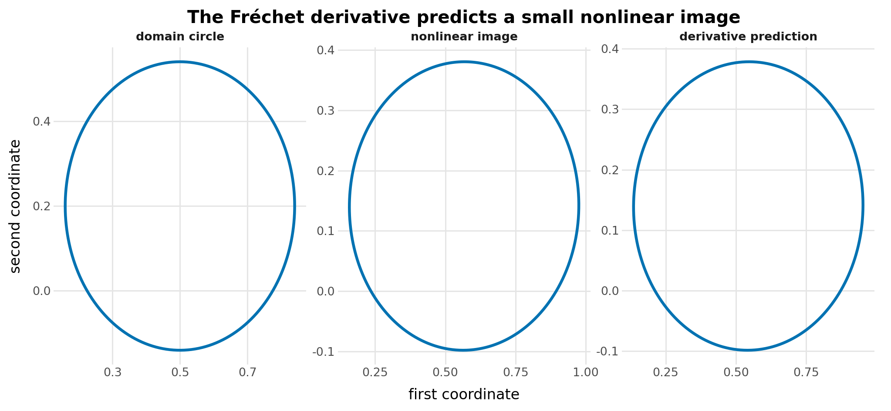

# Differentiation in Euclidean Space {#sec-euclidean-differentiation}

In one variable, the derivative is a number because every small input change has
one direction. In several variables, the derivative must transform an input vector
into an output vector. The correct replacement is therefore a linear map, not a
list of unrelated partial derivatives.

**Prerequisites.** Coordinate geometry from the [concise
toolkit](00i-calculus-bridge.md#sec-foundation-geometry), linear
approximation from [sec-differentiation](07-differentiation.md#sec-differentiation), and metric-space continuity from
[sec-metric-spaces](10-metric-spaces.md#sec-metric-spaces). We develop the needed finite-dimensional linear algebra here.

## Norms and geometry of Euclidean space

For $x=(x_1,\ldots,x_n)$, the Euclidean norm is

$$
\|x\|_2=\left(\sum_{j=1}^n x_j^2\right)^{1/2}.
$$

Two other common norms are

$$
\|x\|_1=\sum_j|x_j|,
\qquad
\|x\|_\infty=\max_j|x_j|.
$$

They satisfy

$$
\|x\|_\infty\le\|x\|_2
\le\|x\|_1\le\sqrt n\,\|x\|_2
\le n\|x\|_\infty.
$$

Fixed comparison constants imply that the norms define the same convergent
sequences, open sets, and continuous maps on finite-dimensional space. They do not
assign identical distances.

The dot product is $x\cdot y=\sum_jx_jy_j$. Cauchy–Schwarz gives
$|x\cdot y|\le\|x\|_2\|y\|_2$. Open balls, closed sets, compactness, and
connectedness use the metric induced by a norm. The finite-dimensional
Heine–Borel theorem states that a subset of $\mathbb R^n$ is compact exactly when
it is closed and bounded.

**Worked example 1.** The set

$$
K=\{(x,y):x^2+4y^2\le1\}
$$

is closed as the inverse image of $(-\infty,1]$ under a continuous polynomial and
bounded because $|x|\le1$, $|y|\le1/2$. It is compact. Any continuous function on
$K$ therefore attains extrema, even if finding them requires further work.

## Linear maps and operator norms

A map $A:\mathbb R^n\to\mathbb R^m$ is linear when
$A(x+y)=Ax+Ay$ and $A(cx)=cAx$. Relative to standard coordinates it is matrix
multiplication. Its **operator norm** is

$$
\|A\|_{\mathrm{op}}
=\sup_{\|h\|_2=1}\|Ah\|_2.
$$

Then $\|Ah\|\le\|A\|_{\mathrm{op}}\|h\|$, so every finite-dimensional linear map is
Lipschitz. The operator norm measures the largest factor by which $A$ stretches a
vector.

For a scalar-valued linear map $L(h)=a\cdot h$, Cauchy–Schwarz gives
$\|L\|_{\mathrm{op}}=\|a\|_2$, with equality in the direction of $a$ when
$a\ne0$.

**Worked example 2.** Let

$$
A=\begin{pmatrix}2&0\\0&1/2\end{pmatrix}.
$$

The unit circle maps to an ellipse. Since
$\|Ah\|_2^2=4h_1^2+h_2^2/4\le4(h_1^2+h_2^2)$, the operator norm is at most $2$.
Equality occurs at $h=(1,0)$, so $\|A\|_{\mathrm{op}}=2$.

## Fréchet differentiability

Let $U\subseteq\mathbb R^n$ be open and $f:U\to\mathbb R^m$. We say $f$ is
**Fréchet differentiable** at $a\in U$ if there is a linear map
$Df(a):\mathbb R^n\to\mathbb R^m$ such that

$$
\frac{\|f(a+h)-f(a)-Df(a)h\|}{\|h\|}
\longrightarrow0
\quad\text{as }h\to0.
$$

The derivative is unique. If two linear maps worked, their difference applied to
$tu$ would be $o(|t|)$; divide by $|t|$ and let $t\to0$ to show they agree on
every unit vector.

The definition says one linear map approximates $f$ in **all directions at once**.
It immediately implies continuity. For scalar $f$, the derivative has the form

$$
Df(a)h=\nabla f(a)\cdot h,
$$

where the gradient contains the partial derivatives. For vector-valued $f$, the
matrix of $Df(a)$ is the Jacobian.

**Worked example 3.** For

$$
f(x,y)=(x^2y,e^{x+y}),
$$

the Jacobian is

$$
Df(x,y)=
\begin{pmatrix}
2xy&x^2\\
e^{x+y}&e^{x+y}
\end{pmatrix}.
$$

At $(1,0)$, a small displacement $(h,k)$ changes the output by approximately
$(k,e(h+k))$. The approximation error is of smaller order than
$\sqrt{h^2+k^2}$.

A practical sufficient theorem says that if all first partial derivatives exist
on a neighbourhood of $a$ and are continuous at $a$, then $f$ is Fréchet
differentiable there. The proof changes coordinates one at a time and applies the
one-variable mean value theorem; continuity makes the coefficient errors uniformly
small.

## Chain rule and directional derivatives

The directional derivative in direction $v$ is

$$
D_vf(a)=\lim_{t\to0}\frac{f(a+tv)-f(a)}t.
$$

If $f$ is Fréchet differentiable, then $D_vf(a)=Df(a)v$. Thus directional
derivatives depend linearly on $v$. The converse is false: separate line tests may
miss nonuniform behaviour.

For example, define $f(0,0)=0$ and

$$
f(x,y)=\frac{x^3}{x^2+y^2}
\quad\text{away from }(0,0).
$$

It is continuous at the origin because $|f(x,y)|\le|x|$. Every directional
derivative exists, but

$$
D_vf(0)=\frac{v_1^3}{v_1^2+v_2^2}
$$

for nonzero $v$, which is not linear in $v$. Therefore no Fréchet derivative
exists.

**Chain rule.** If $f:U\to\mathbb R^m$ is differentiable at $a$ and
$g:V\to\mathbb R^p$ is differentiable at $f(a)$, then

$$
D(g\circ f)(a)=Dg(f(a))\,Df(a).
$$

Write both functions as a linear term plus a small remainder. The continuity of
$Df(a)$ controls the intermediate displacement, and boundedness of $Dg(f(a))$
keeps the first remainder small. Matrix multiplication records composition order.

<figure id="fig-frechet">


<figcaption>

Figure 16.1: A nonlinear map is approximated near a point by its derivative, sending a small circle to an ellipse.

</figcaption>
</figure>

[Figure 16.1](#fig-frechet) shows that linearisation is local. The derivative accurately models a
shrinking neighbourhood; it need not describe the map far from the base point.

## Higher derivatives and Taylor's theorem

When $Df$ varies differentiably, the second derivative $D^2f(a)$ is a bilinear
map. For scalar $f$, it is represented by the Hessian matrix

$$
H_f(a)=\left(\frac{\partial^2f}{\partial x_i\partial x_j}(a)\right).
$$

If second partials are continuous, mixed partials agree:
$\partial_i\partial_jf=\partial_j\partial_if$. This is a theorem with regularity
hypotheses, not a symbolic law.

For $f:\mathbb R^n\to\mathbb R$ with continuous third derivatives near $a$,

$$
f(a+h)
=f(a)+Df(a)h+\frac12D^2f(a)[h,h]+R_3(h),
$$

where $|R_3(h)|\le C\|h\|^3$ on a sufficiently small compact neighbourhood.
Apply the one-variable Taylor theorem to $\phi(t)=f(a+th)$.

At a critical point $\nabla f(a)=0$, a positive-definite Hessian gives a strict
local minimum; a negative-definite Hessian gives a strict local maximum; an
indefinite Hessian gives a saddle. A semidefinite Hessian is inconclusive.

**Worked example 4.** For $f(x,y)=x^2+xy+y^2$, the Hessian is

$$
\begin{pmatrix}2&1\\1&2\end{pmatrix}.
$$

Since $2h_1^2+2h_1h_2+2h_2^2
=(h_1+h_2)^2+h_1^2+h_2^2>0$ for $h\ne0$, the origin is a strict minimum.

## Constrained extrema and Lagrange multipliers

Suppose we maximize or minimize $f:\mathbb R^n\to\mathbb R$ subject to
$g(x)=c$. If $a$ is a constrained local extremum and $\nabla g(a)\ne0$, then

$$
\nabla f(a)=\lambda\nabla g(a)
$$

for some scalar $\lambda$. Tangent directions $v$ to the constraint satisfy
$\nabla g(a)\cdot v=0$. At an extremum, directional change of $f$ vanishes in
every such direction, so $\nabla f(a)$ is perpendicular to the tangent space and
therefore parallel to $\nabla g(a)$.

**Worked example 5.** Maximize $xy$ on $x^2+y^2=1$. The equations

$$
(y,x)=\lambda(2x,2y)
$$

give $x=\pm y$. Testing the four feasible points shows maximum $1/2$ at
$(1/\sqrt2,1/\sqrt2)$ and $(-1/\sqrt2,-1/\sqrt2)$, and minimum $-1/2$ at the
other two. Compactness guarantees that extrema exist; multiplier equations only
produce candidates.

### Proof laboratory: derivative bounds become global estimates

Let $U\subseteq\mathbb R^n$ be convex and suppose $f:U\to\mathbb R^m$ is
continuously differentiable with

$$
\sup_{x\in U}\|Df(x)\|_{\mathrm{op}}\le M.
$$

For $x,y\in U$, the segment $x+t(y-x)$ stays in $U$. Apply the one-variable
fundamental theorem to $\gamma(t)=f(x+t(y-x))$:

$$
f(y)-f(x)
=\int_0^1Df(x+t(y-x))(y-x)\,dt.
$$

Taking norms gives

$$
\|f(y)-f(x)\|\le M\|y-x\|.
$$

This is the multivariable mean-value estimate. There is generally no single point
$c$ for which the vector equality $f(y)-f(x)=Df(c)(y-x)$ holds; the integral form
is the reliable replacement. Convexity is not decoration: without a segment inside
the domain, the derivative bound need not connect the two points.

**Worked example 6.** Let
$f(x,y)=(\sin(xy),x^2-y)$ on the square $[-1,1]^2$. Its Jacobian is

$$
\begin{pmatrix}
y\cos(xy)&x\cos(xy)\\
2x&-1
\end{pmatrix}.
$$

Each squared entry is bounded by $1,1,4,1$, so the Frobenius-norm estimate gives
$\|Df\|_{\mathrm{op}}\le\sqrt7$. Therefore

$$
\|f(z)-f(w)\|_2\le\sqrt7\,\|z-w\|_2
$$

on the square. The constant need not be sharp; it certifies uniform continuity
and numerical stability. The same method supplies Lipschitz constants for the
fixed-point arguments in Chapters 17 and 24.

<div class="callout callout-warning">
<p class="callout-title">Pitfalls</p>

- Existence of all directional derivatives does not imply differentiability.
- A Jacobian is evaluated at a point; treating it as a constant matrix globally
  loses nonlinear behaviour.
- Mixed partials commute under a regularity theorem, not automatically.
- Lagrange multipliers can miss points where the constraint gradient vanishes and
  do not classify candidates by themselves.

</div>

<!-- inline-formula-code:start -->
## Formula and finite computation

A useful formula in this chapter is

$$
Df(x)e_j=\lim_{h\to0}\frac{f(x+he_j)-f(x)}h
$$

Coordinate perturbations assemble a numerical Jacobian column by column. The following standalone Python block expresses that finite rule with its inputs and stopping conditions visible.

```python
import numpy as np

point = np.array([1.0, 2.0])
step = 1e-6
function = lambda x: np.array([x[0] * x[1], x[0] ** 2 + x[1]])
columns = []
for axis in range(2):
    direction = np.zeros(2)
    direction[axis] = step
    columns.append((function(point + direction) - function(point)) / step)
print(np.column_stack(columns))
```

**What the computation establishes.** The output certifies only the declared finite case. The theorem, if one is claimed, still requires the argument developed in the chapter.
<!-- inline-formula-code:end -->

## Exercises

<div class="exercise" id="real_analysis-16-euclidean-differentiation-ex-1">
<p class="exercise-title"><strong>Exercise 1</strong></p>

Prove $\|x\|_2\le\|x\|_1\le\sqrt n\|x\|_2$.

<details class="solution"><summary>Solution</summary>

Square expansion gives
$(\sum|x_i|)^2\le n\sum x_i^2$; the other inequality follows because the square
of a sum contains every $x_i^2$.

</details>

</div>

<div class="exercise" id="real_analysis-16-euclidean-differentiation-ex-2">
<p class="exercise-title"><strong>Exercise 2</strong></p>

Find the operator norm of $\operatorname{diag}(3,-1)$ in Euclidean norm.

<details class="solution"><summary>Solution</summary>

The norm is $3$, attained on the first coordinate axis.

</details>

</div>

<div class="exercise" id="real_analysis-16-euclidean-differentiation-ex-3">
<p class="exercise-title"><strong>Exercise 3</strong></p>

Compute the derivative of $f(x,y)=(xy,x+y^2)$ at $(2,1)$.

<details class="solution"><summary>Solution</summary>

$Df(2,1)=\begin{pmatrix}1&2\\1&2\end{pmatrix}$.

</details>

</div>

<div class="exercise" id="real_analysis-16-euclidean-differentiation-ex-4">
<p class="exercise-title"><strong>Exercise 4</strong></p>

Prove Fréchet differentiability implies every directional derivative exists.

<details class="hint"><summary>Hint 1</summary>

Put $h=tv$ directly into the Fréchet remainder and divide by $t$.
The direction's sign is handled by the two-sided limit.

</details>

<details class="solution"><summary>Solution</summary>

Substitute $h=tv$ into the remainder definition and divide by $t$.

</details>

</div>

<div class="exercise" id="real_analysis-16-euclidean-differentiation-ex-5">
<p class="exercise-title"><strong>Exercise 5</strong></p>

Find the gradient and Hessian of $f(x,y)=e^x\cos y$.

<details class="solution"><summary>Solution</summary>

The gradient is $(e^x\cos y,-e^x\sin y)$; differentiate once more for the
symmetric Hessian.

</details>

</div>

<div class="exercise" id="real_analysis-16-euclidean-differentiation-ex-6">
<p class="exercise-title"><strong>Exercise 6</strong></p>

Classify the critical point of $x^2-4xy+y^2$ at the origin.

<details class="solution"><summary>Solution</summary>

The Hessian is indefinite because its determinant is $4-16<0$; it is a saddle.

</details>

</div>

<div class="exercise" id="real_analysis-16-euclidean-differentiation-ex-7">
<p class="exercise-title"><strong>Exercise 7</strong></p>

Find extrema of $x+y$ on $x^2+4y^2=1$.

<details class="hint"><summary>Hint 1</summary>

Compactness gives existence first. The multiplier equations give a
direction proportional to the inverse quadratic weights; normalize only at the
end.

</details>

<details class="solution"><summary>Solution</summary>

Multiplier equations give values $\pm\sqrt5/2$, attained at points proportional
to $(1,1/4)$ after enforcing the constraint.

</details>

</div>

<div class="exercise" id="real_analysis-16-euclidean-differentiation-ex-8">
<p class="exercise-title"><strong>Exercise 8</strong></p>

Give a function whose partial derivatives exist at the origin but which is not
continuous there.

<details class="solution"><summary>Solution</summary>

Set $f(x,y)=xy/(x^2+y^2)$ off the origin and $f(0,0)=0$; both coordinate
partials are zero, but along $y=x$ the values equal $1/2$.

</details>

</div>

### Answer support

1. Square expansion gives
   $(\sum|x_i|)^2\le n\sum x_i^2$; the other inequality follows because the square
   of a sum contains every $x_i^2$.
2. The norm is $3$, attained on the first coordinate axis.
3. $Df(2,1)=\begin{pmatrix}1&2\\1&2\end{pmatrix}$.
4. Substitute $h=tv$ into the remainder definition and divide by $t$.
5. The gradient is $(e^x\cos y,-e^x\sin y)$; differentiate once more for the
   symmetric Hessian.
6. The Hessian is indefinite because its determinant is $4-16<0$; it is a saddle.
7. Multiplier equations give values $\pm\sqrt5/2$, attained at points proportional
   to $(1,1/4)$ after enforcing the constraint.
8. Set $f(x,y)=xy/(x^2+y^2)$ off the origin and $f(0,0)=0$; both coordinate
   partials are zero, but along $y=x$ the values equal $1/2$.
