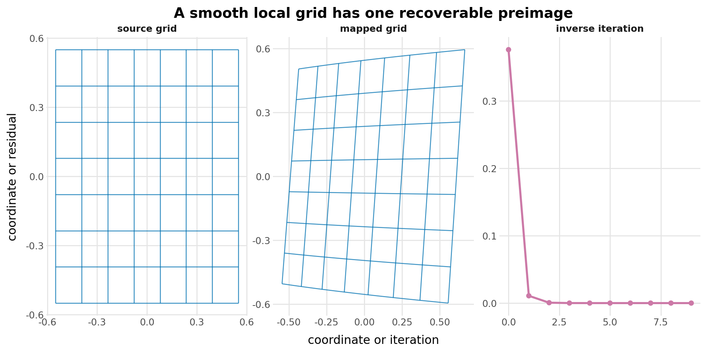

# Inverse and Implicit Function Theorems {#sec-inverse-implicit}

Solving $F(x)=y$ explicitly is often impossible. The inverse and implicit function
theorems replace a formula with local existence, uniqueness, differentiability, and
stability. Their decisive hypothesis is that the derivative solves the associated
linear problem.

**Prerequisites.** Fréchet derivatives and operator norms from
[sec-euclidean-differentiation](16-euclidean-differentiation.md#sec-euclidean-differentiation), the contraction theorem from [sec-metric-spaces](10-metric-spaces.md#sec-metric-spaces),
and compactness-based uniform estimates.

## Local invertibility and derivative information

A map $F:U\subseteq\mathbb R^n\to\mathbb R^n$ is **locally invertible at $a$** if
there are neighbourhoods $V$ of $a$ and $W$ of $F(a)$ such that
$F:V\to W$ is one-to-one, onto, and has an inverse on $W$.

If a differentiable local inverse $G$ exists, the chain rule forces

$$
DG(F(a))\,DF(a)=I.
$$

Thus $DF(a)$ must be invertible and

$$
DG(F(a))=[DF(a)]^{-1}.
$$

The remarkable fact is that, under continuity of the derivative, this necessary
linear condition is sufficient.

**Theorem 17.1 (Inverse function).** Let $F:U\to\mathbb R^n$ be continuously
differentiable on an open set. If $DF(a)$ is invertible, then $F$ maps some open
neighbourhood $V$ of $a$ bijectively onto an open neighbourhood $W$ of $F(a)$.
The inverse $G:W\to V$ is continuously differentiable, with

$$
DG(y)=[DF(G(y))]^{-1}.
$$

The theorem is local. It does not say $F$ is one-to-one on all of $U$.

**Worked example 1.** Define

$$
F(x,y)=(e^x\cos y,e^x\sin y).
$$

Its Jacobian determinant is $e^{2x}>0$, so it is locally invertible everywhere.
Yet $F(x,y+2\pi)=F(x,y)$, so it is not globally one-to-one. Restricting $y$ to an
interval shorter than $2\pi$ produces a polar-coordinate chart.

## Contraction-based proof of the inverse theorem

The proof becomes transparent after normalisation. Translate so $a=0$ and
$F(a)=0$, then compose with $[DF(0)]^{-1}$ so that $DF(0)=I$. Continuity of $DF$
gives a radius $r$ for which

$$
\|DF(x)-I\|_{\mathrm{op}}\le q<1
\quad\text{on }\overline B_r(0).
$$

For a target $y$ near zero, solving $F(x)=y$ is equivalent to finding a fixed point
of

$$
T_y(x)=x-F(x)+y.
$$

The mean-value estimate along a line segment gives

$$
\|T_y(x)-T_y(z)\|\le q\|x-z\|.
$$

If $\|y\|\le(1-q)r$, then

$$
\|T_y(x)\|
\le\|T_y(x)-T_y(0)\|+\|y\|
\le qr+(1-q)r=r,
$$

so $T_y$ maps the closed ball to itself. The ball is complete, and Banach's
contraction theorem yields a unique solution $x=G(y)$ there.

This argument provides more than existence. If $F(x)=y$ and $F(z)=w$ in the ball,

$$
\|x-z\|\le\frac1{1-q}\|y-w\|.
$$

Thus the inverse is locally Lipschitz. Differentiability follows by comparing
$F(x+h)-F(x)$ with $DF(x)h$ and applying the bounded inverse. Continuity of
$DF$ then gives continuity of $DG$.

<figure id="fig-inverse-local">


<figcaption>

Figure 17.1: A nonlinear planar map carries a neighbourhood bijectively onto a curved neighbourhood, while contraction iterates recover the preimage of a target.

</figcaption>
</figure>

[Figure 17.1](#fig-inverse-local) illustrates locality: the displayed neighbourhood avoids folds,
but the full map may overlap elsewhere. Iteration supplies a numerical inverse and
an error estimate when the contraction bound is known.

## Implicitly defined solution sets

An equation $H(x,y)=0$ may define $y$ as a function of $x$ even when algebra cannot
isolate it. Here $x\in\mathbb R^n$, $y\in\mathbb R^m$, and
$H:\mathbb R^{n+m}\to\mathbb R^m$.

**Theorem 17.2 (Implicit function).** Suppose $H$ is continuously differentiable near
$(a,b)$, $H(a,b)=0$, and the partial derivative
$D_yH(a,b):\mathbb R^m\to\mathbb R^m$ is invertible. Then near $a$ there is a
unique continuously differentiable function $y=\phi(x)$ near $b$ satisfying

$$
H(x,\phi(x))=0.
$$

Its derivative is

$$
D\phi(x)
=-[D_yH(x,\phi(x))]^{-1}D_xH(x,\phi(x)).
$$

Apply the inverse theorem to $\Phi(x,y)=(x,H(x,y))$. Its derivative is block
triangular with invertible diagonal blocks $I$ and $D_yH$, hence invertible.
The inverse has the form $(x,z)\mapsto(x,\psi(x,z))$; setting $z=0$ gives
$\phi(x)$.

**Worked example 2.** Let $H(x,y)=x^2+y^2-1$. At $(0,1)$,
$D_yH=2\ne0$, so the circle is locally a graph $y=\phi(x)$. Differentiating
implicitly gives

$$
\phi'(x)=-\frac{x}{\phi(x)}.
$$

Near $(1,0)$ this representation as $y(x)$ fails because $D_yH=0$, but
$D_xH=2$ allows a local graph $x=\psi(y)$. The geometric curve is regular; only
the chosen graph direction fails.

## Quantitative neighbourhoods and stability

Qualitative statements say “sufficiently near.” Applications need an actual
radius. Let $A=DF(a)^{-1}$ and $M=\|A\|$. If on a ball

$$
\|DF(x)-DF(a)\|\le\frac1{2M},
$$

then the normalised fixed-point map has contraction factor at most $1/2$. A
separate boundary estimate determines which target ball maps into the source
ball.

The resulting inverse estimate is approximately

$$
\|G(y)-G(w)\|\le2M\|y-w\|.
$$

Thus a poorly conditioned derivative—large $M$—amplifies target error. In
numerical analysis, the norm of the inverse derivative is a local condition
number.

For a parameter-dependent equation $H(p,y)=0$, the implicit derivative

$$
\frac{dy}{dp}
=-[D_yH]^{-1}D_pH
$$

measures sensitivity. It separates forcing $D_pH$ from the stability of the
linearized solver $[D_yH]^{-1}$.

**Worked example 3.** The equation

$$
y+\sin y=p
$$

has $D_yH=1+\cos y$. Near $(p,y)=(0,0)$ this equals $2$, so a unique smooth
solution $y(p)$ exists and $y'(0)=1/2$. A small change in $p$ produces about half
as large a change in $y$ near zero.

## Applications to nonlinear equations

The inverse theorem explains Newton's method. For scalar $f(x)=0$,

$$
x_{k+1}=x_k-\frac{f(x_k)}{f'(x_k)}
$$

solves the linear approximation at each step. In several variables,

$$
x_{k+1}=x_k-[DF(x_k)]^{-1}F(x_k).
$$

If $DF$ is Lipschitz near a solution and its inverse is uniformly bounded, the
error becomes approximately quadratic:
$\|e_{k+1}\|\le C\|e_k\|^2$. This is a local theorem; a distant starting point may
diverge or reach another root.

**Worked example 4.** To solve $x^2-2=0$, Newton iteration is

$$
x_{k+1}=\frac12\left(x_k+\frac2{x_k}\right).
$$

Starting from $x_0=1$, the next values are $1.5$, $17/12$, and approximately
$1.414216$. The derivative at $\sqrt2$ is nonzero, giving local invertibility and
rapid correction.

Implicit functions also describe level surfaces, equilibrium branches, constrained
optimisation, and parameterized roots. A nonzero gradient of scalar $H$ means the
level set $H=c$ is locally an $(n-1)$-dimensional graph.

### Application laboratory: comparative statics

Suppose a market-clearing condition is

$$
H(p,\tau)=D(p)-S(p,\tau)=0,
$$

where $p$ is price and $\tau$ is a policy parameter. If $D$ and $S$ are
continuously differentiable and

$$
D'(p_0)-\partial_pS(p_0,\tau_0)\ne0,
$$

then a unique local equilibrium price $p(\tau)$ exists. Its sensitivity is

$$
p'(\tau)
=\frac{\partial_\tau S(p(\tau),\tau)}
{D'(p(\tau))-\partial_pS(p(\tau),\tau)}.
$$

The denominator is the slope of excess demand. A small denominator means the
equilibrium is ill-conditioned: a modest modelling or policy change can produce a
large price change.

**Worked example 5.** Let $D(p)=10-p$ and $S(p,\tau)=2p+\tau$. The equation gives
$p(\tau)=(10-\tau)/3$, so $p'=-1/3$. The implicit formula agrees:

$$
\frac{\partial_\tau S}{D'-\partial_pS}
=\frac1{-1-2}=-\frac13.
$$

The theorem seems excessive for this linear example, but the same calculation
works when $D$ and $S$ involve exponentials, saturation, or several interacting
prices that cannot be isolated symbolically. It also states a local uniqueness
claim that mere implicit differentiation often assumes without justification.

The derivative formula is not causal by itself. It describes sensitivity inside a
mathematical model whose variables and assumptions must be interpreted separately.

## Failure examples when hypotheses are weakened

1. For $F(x)=x^2$ at $0$, $F'(0)=0$ and the map folds: it is not locally
   one-to-one on any two-sided neighbourhood.
2. The map $F(x)=x^3$ is globally one-to-one, but $F'(0)=0$ and its inverse
   $y^{1/3}$ is not differentiable at zero. The theorem's conclusion about a
   smooth inverse fails.
3. A derivative invertible at one point without adequate continuity nearby need
   not provide the uniform contraction estimate used in the proof. Stronger
   variants exist under different hypotheses, but the proof must replace that
   missing control.
4. In the implicit theorem, $H(x,y)=y^2-x^2=0$ at $(0,0)$ has
   $D_yH=0$ and two crossing solution branches $y=\pm x$; no unique local branch
   contains all nearby solutions.

<div class="callout callout-warning">
<p class="callout-title">Pitfalls</p>

- A nonzero Jacobian determinant gives local, not global, invertibility.
- Solving the multiplier or implicit derivative equation does not prove a branch
  exists; the theorem's hypotheses do.
- A local theorem supplies neighbourhoods that may be much smaller than a graph
  suggests.
- Newton's method needs a basin and derivative control; the formula alone is not a
  convergence proof.

</div>

<!-- inline-formula-code:start -->
## Formula and finite computation

A useful formula in this chapter is

$$
x_{n+1}=x_n-[DF(x_n)]^{-1}F(x_n)
$$

The scalar case keeps the Newton correction and residual visible at every step. The following standalone Python block expresses that finite rule with its inputs and stopping conditions visible.

```python
estimate = 1.5
trace: list[tuple[float, float]] = []
for _ in range(6):
    residual = estimate * estimate - 2.0
    trace.append((estimate, residual))
    estimate -= residual / (2.0 * estimate)
print(trace)
```

**What the computation establishes.** The output certifies only the declared finite case. The theorem, if one is claimed, still requires the argument developed in the chapter.
<!-- inline-formula-code:end -->

## Exercises

<div class="exercise" id="real_analysis-17-inverse-implicit-ex-1">
<p class="exercise-title"><strong>Exercise 1</strong></p>

Show $F(x,y)=(x+y,x-y)$ is globally invertible and find its inverse derivative.

<details class="solution"><summary>Solution</summary>

$F^{-1}(u,v)=((u+v)/2,(u-v)/2)$; its derivative is the same constant matrix.

</details>

</div>

<div class="exercise" id="real_analysis-17-inverse-implicit-ex-2">
<p class="exercise-title"><strong>Exercise 2</strong></p>

Determine where $F(x,y)=(x^2-y^2,2xy)$ is locally invertible.

<details class="solution"><summary>Solution</summary>

The determinant is $4(x^2+y^2)$, so every point except the origin.

</details>

</div>

<div class="exercise" id="real_analysis-17-inverse-implicit-ex-3">
<p class="exercise-title"><strong>Exercise 3</strong></p>

Near $(0,1)$, find $y'(0)$ and $y''(0)$ for $x+y+e^{xy}=2$.

<details class="solution"><summary>Solution</summary>

Differentiate $1+y'+e^{xy}(y+xy')=0$ and evaluate; $y'(0)=-2$.
Differentiate once more carefully to obtain $y''(0)=3$.

</details>

</div>

<div class="exercise" id="real_analysis-17-inverse-implicit-ex-4">
<p class="exercise-title"><strong>Exercise 4</strong></p>

Use the implicit theorem to show $x^3+y^3=2$ defines $y$ near $(1,1)$.

<details class="solution"><summary>Solution</summary>

$D_yH=3$ at $(1,1)$, so the theorem applies and
$y'=-x^2/y^2$.

</details>

</div>

<div class="exercise" id="real_analysis-17-inverse-implicit-ex-5">
<p class="exercise-title"><strong>Exercise 5</strong></p>

Derive the inverse Lipschitz estimate in the normalised contraction proof.

<details class="hint"><summary>Hint 1</summary>

In the normalized proof, compare fixed points of $T_y$ and $T_w$.
Add and subtract $T_y(z)$ before using the contraction estimate.

</details>

<details class="solution"><summary>Solution</summary>

Write $x-z=T_y(x)-T_w(z)$, add and subtract $T_y(z)$, and rearrange
$(1-q)\|x-z\|\le\|y-w\|$.

</details>

</div>

<div class="exercise" id="real_analysis-17-inverse-implicit-ex-6">
<p class="exercise-title"><strong>Exercise 6</strong></p>

Find the first three Newton iterates for $x^2-3=0$ starting at $2$.

<details class="solution"><summary>Solution</summary>

$2$, $7/4$, $97/56$, followed by values approaching $\sqrt3$.

</details>

</div>

<div class="exercise" id="real_analysis-17-inverse-implicit-ex-7">
<p class="exercise-title"><strong>Exercise 7</strong></p>

Explain why $(r,\theta)\mapsto(r\cos\theta,r\sin\theta)$ fails the inverse
hypothesis at $r=0$.

<details class="hint"><summary>Hint 1</summary>

Write the polar Jacobian. The geometric collapse at the origin should
match the zero determinant.

</details>

<details class="solution"><summary>Solution</summary>

The Jacobian determinant is $r$, and all angles map to the same point at
$r=0$.

</details>

</div>

<div class="exercise" id="real_analysis-17-inverse-implicit-ex-8">
<p class="exercise-title"><strong>Exercise 8</strong></p>

Construct an equation with two branches meeting where the partial derivative in
the proposed dependent variable vanishes.

<details class="solution"><summary>Solution</summary>

$H(x,y)=y^2-x^2$ is the standard example, with branches $y=x$ and $y=-x$.

</details>

</div>

### Answer support

1. $F^{-1}(u,v)=((u+v)/2,(u-v)/2)$; its derivative is the same constant matrix.
2. The determinant is $4(x^2+y^2)$, so every point except the origin.
3. Differentiate $1+y'+e^{xy}(y+xy')=0$ and evaluate; $y'(0)=-2$.
   Differentiate once more carefully to obtain $y''(0)=3$.
4. $D_yH=3$ at $(1,1)$, so the theorem applies and
   $y'=-x^2/y^2$.
5. Write $x-z=T_y(x)-T_w(z)$, add and subtract $T_y(z)$, and rearrange
   $(1-q)\|x-z\|\le\|y-w\|$.
6. $2$, $7/4$, $97/56$, followed by values approaching $\sqrt3$.
7. The Jacobian determinant is $r$, and all angles map to the same point at
   $r=0$.
8. $H(x,y)=y^2-x^2$ is the standard example, with branches $y=x$ and $y=-x$.
