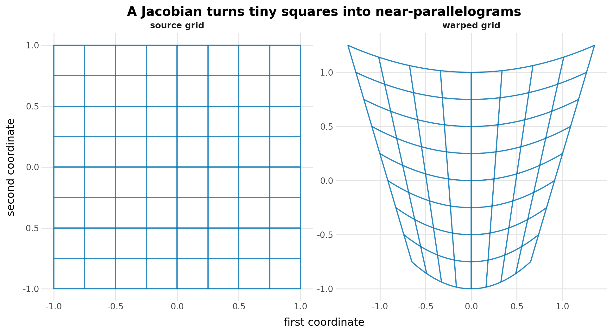

# Multiple Integration and Change of Variables {#sec-multiple-integration}

An integral over $\mathbb R^n$ accumulates small box contributions. The new
geometric issue is that a coordinate transformation can stretch, shear, reflect,
or fold those boxes. The determinant of the derivative records the first-order
volume change.

**Prerequisites.** Riemann integration from [sec-riemann](08-riemann.md#sec-riemann), compactness in Euclidean
space, and the derivative and inverse theorem from
[sec-euclidean-differentiation](16-euclidean-differentiation.md#sec-euclidean-differentiation) and [sec-inverse-implicit](17-inverse-implicit.md#sec-inverse-implicit).

## Jordan content and Riemann integration in Euclidean space

An axis-aligned box is

$$
Q=\prod_{j=1}^n[a_j,b_j],
\qquad
|Q|=\prod_{j=1}^n(b_j-a_j).
$$

A bounded set has **Jordan content zero** if for every $\varepsilon>0$ it can be
covered by finitely many boxes whose total volume is below $\varepsilon$. A bounded
set $E$ is **Jordan measurable** when its boundary has Jordan content zero. Its
content is then obtained by inner and outer finite-box approximation.

Partition a containing box into subboxes $Q_i$. For bounded $f$, upper and lower
sums are

$$
U(f,P)=\sum_i\left(\sup_{Q_i}f\right)|Q_i|,
\qquad
L(f,P)=\sum_i\left(\inf_{Q_i}f\right)|Q_i|.
$$

Their common limiting value, when the gap can be made arbitrarily small, is the
multiple Riemann integral. A continuous function on a compact box is integrable by
uniform continuity, exactly as in one dimension. A bounded function whose
discontinuities have Jordan content zero is also integrable.

For a Jordan measurable set $E$, define

$$
\int_E f=\int_Q f1_E
$$

using any containing box $Q$. The boundary condition makes the value independent
of $Q$ and prevents boundary ambiguity.

**Worked example 1.** On $Q=[0,1]\times[0,2]$,

$$
\int_Q(x+y)\,d(x,y)
=\int_0^1\int_0^2(x+y)\,dy\,dx
=\int_0^1(2x+2)\,dx=3.
$$

The notation $d(x,y)$ abbreviates ordinary area; $dA$ is also common.

## Iterated integration

**Theorem 18.1 (Fubini for continuous functions on a box).** If $f$ is continuous on
$[a,b]\times[c,d]$, then

$$
\int_{[a,b]\times[c,d]}f
=\int_a^b\left(\int_c^d f(x,y)\,dy\right)dx
=\int_c^d\left(\int_a^b f(x,y)\,dx\right)dy.
$$

The proof first verifies the identity for step functions constant on subrectangles.
Uniform approximation of continuous $f$ by such step functions passes the identity
to the limit. Chapter 22 will state the stronger measure-theoretic theorem and
explain when integrability, rather than continuity, suffices.

For a region between graphs,

$$
E=\{(x,y):a\le x\le b,\ \phi(x)\le y\le\psi(x)\},
$$

continuous bounds give

$$
\int_E f(x,y)\,dA
=\int_a^b\int_{\phi(x)}^{\psi(x)}f(x,y)\,dy\,dx.
$$

**Worked example 2.** For the triangle
$T=\{(x,y):0\le x\le1,\ 0\le y\le1-x\}$,

$$
\int_T(x+2y)\,dA
=\int_0^1\int_0^{1-x}(x+2y)\,dy\,dx
=\frac12.
$$

Reversing order requires rewriting the same set:
$0\le y\le1$ and $0\le x\le1-y$. Bounds describe geometry; they cannot simply be
swapped.

## The Jacobian determinant

Let $\Phi:U\subseteq\mathbb R^n\to\mathbb R^n$ be differentiable. Near $u$,

$$
\Phi(u+h)\approx\Phi(u)+D\Phi(u)h.
$$

A linear map $A$ multiplies oriented volume by $\det A$. Its absolute volume
factor is $|\det A|$. Therefore the local volume scaling of $\Phi$ is

$$
J_\Phi(u)=|\det D\Phi(u)|.
$$

The determinant is zero precisely when the derivative collapses some direction.
The inverse function theorem then cannot supply a local coordinate chart.

**Worked example 3.** The map

$$
\Phi(u,v)=(u+v,u-v)
$$

has derivative matrix
$\begin{pmatrix}1&1\\1&-1\end{pmatrix}$ and determinant $-2$. A small square in
the $uv$-plane maps to a parallelogram of twice the area, with reversed
orientation. Ordinary area uses the absolute value $2$.

<figure id="fig-jacobian-grid">


<figcaption>

Figure 18.1: A coordinate grid is warped by a nonlinear map; tiny source squares become near-parallelograms whose areas are predicted by the Jacobian determinant.

</figcaption>
</figure>

[Figure 18.1](#fig-jacobian-grid) shows why the derivative is enough at small scales. Curvature
affects higher-order error, while the parallelogram spanned by derivative columns
controls first-order area.

## Change-of-variables theorem

**Change of variables.** Let $U,V\subseteq\mathbb R^n$ be open, and suppose
$\Phi:U\to V$ is a continuously differentiable bijection with continuously
differentiable inverse. For suitable nonnegative or integrable $f$ and a Jordan
measurable region $E\subseteq U$,

$$
\int_{\Phi(E)}f(x)\,dx
=\int_E f(\Phi(u))|\det D\Phi(u)|\,du.
$$

In the Riemann setting, one assumes compact containment and regular boundaries to
avoid edge complications. The proof divides $E$ into tiny boxes. Differentiability
makes $\Phi$ close to its linearization on each box; the determinant gives the
linearized volume; uniform continuity and boundary estimates control accumulated
error. The measure-theoretic version has broader scope.

**Worked example 4.** Use $x=u+v$, $y=u-v$ to integrate over the diamond
$D=\{(x,y):|x+y|\le2,\ |x-y|\le2\}$. Since
$u=(x+y)/2$ and $v=(x-y)/2$, the diamond corresponds to
$[-1,1]^2$. Thus

$$
\operatorname{area}(D)
=\int_{[-1,1]^2}2\,du\,dv=8.
$$

Leaving out the absolute Jacobian would produce negative area because the map
reverses orientation.

## Polar, cylindrical, and spherical coordinates

Polar coordinates are

$$
x=r\cos\theta,\qquad y=r\sin\theta.
$$

The Jacobian determinant is $r$, so

$$
\int_E f(x,y)\,dA
=\int_{\Phi^{-1}(E)}
f(r\cos\theta,r\sin\theta)\,r\,dr\,d\theta.
$$

The factor $r$ is geometric: an angular width $d\theta$ spans arc length
approximately $r\,d\theta$.

**Worked example 5.** The area of the radius-$R$ disk is

$$
\int_0^{2\pi}\int_0^R r\,dr\,d\theta
=\pi R^2.
$$

For $\int_{x^2+y^2\le1}(x^2+y^2)\,dA$, the integrand becomes $r^2$, so the value is
$\int_0^{2\pi}\int_0^1r^3\,dr\,d\theta=\pi/2$.

Cylindrical coordinates add $z$ unchanged and retain factor $r$. Spherical
coordinates, under the convention

$$
x=\rho\sin\phi\cos\theta,\quad
y=\rho\sin\phi\sin\theta,\quad
z=\rho\cos\phi,
$$

have volume factor $\rho^2\sin\phi$, with
$0\le\phi\le\pi$. Consequently a radius-$R$ ball has volume

$$
\int_0^{2\pi}\int_0^\pi\int_0^R
\rho^2\sin\phi\,d\rho\,d\phi\,d\theta
=\frac{4\pi R^3}{3}.
$$

Coordinate conventions differ among texts, so formulas must be tied to their
definitions.

## Orientation, multiplicity, and geometric applications

The signed determinant distinguishes orientation; volume uses its absolute value.
For oriented curve and surface integrals, the sign may carry geometric information
and must not be discarded automatically.

Injectivity also matters. Polar coordinates identify every angle at $r=0$ and
identify $\theta=0$ with $\theta=2\pi$. These duplications occur on boundary sets
of zero area, so the usual half-open convention causes no integral change.
However, a map such as $z\mapsto z^2$ in planar coordinates covers most image
points twice on a full angular range. Using the simple change-of-variables formula
without accounting for multiplicity doubles the answer.

The determinant also computes densities under transformation. If mass has density
$\rho(x)$ in physical coordinates and $x=\Phi(u)$, then its coordinate density is
$\rho(\Phi(u))|\det D\Phi(u)|$. This principle underlies probability
transformations, continuum mechanics, and geometric volume calculations.

### Proof laboratory: the Gaussian integral

Let

$$
I=\int_{-\infty}^{\infty}e^{-x^2}\,dx.
$$

There is no elementary antiderivative, but product and polar geometry determine
the value. Positivity permits the product calculation; Chapter 22 names the
governing result Tonelli's theorem:

$$
I^2=\int_{\mathbb R^2}e^{-(x^2+y^2)}\,dA.
$$

Integrate first over the disk of radius $R$:

$$
\int_{x^2+y^2\le R^2}e^{-(x^2+y^2)}\,dA
=2\pi\int_0^Re^{-r^2}r\,dr
=\pi(1-e^{-R^2}).
$$

As $R\to\infty$, monotone convergence gives $I^2=\pi$, hence
$I=\sqrt\pi$ because $I>0$.

This proof is a useful dependency audit. Squaring the integral requires a product
measure theorem; polar coordinates require change of variables; passing to the
whole plane requires a convergence theorem. The formal computation is short
because three substantial theorems carry its limiting steps.

**Worked example 6.** Scaling $u=\sqrt a\,x$ gives, for $a>0$,

$$
\int_{-\infty}^{\infty}e^{-ax^2}\,dx
=\sqrt{\frac{\pi}{a}}.
$$

Differentiating with respect to $a$, once justified by domination, yields
$\int_{\mathbb R}x^2e^{-ax^2}\,dx=\sqrt\pi/(2a^{3/2})$.

<div class="callout callout-warning">
<p class="callout-title">Pitfalls</p>

- Iterated bounds encode a region; reversing order requires redrawing that region.
- The Jacobian factor is evaluated in the new variables.
- Ordinary volume uses $|\det D\Phi|$, not the signed determinant.
- A locally invertible map may cover the target several times globally.
- Polar and spherical coordinate singularities require declared ranges.

</div>

<!-- inline-formula-code:start -->
## Formula and finite computation

A useful formula in this chapter is

$$
\int_{T(U)}f(y)\,dy=\int_U f(T(x))|\det DT(x)|\,dx
$$

For $T(x)=2x$ on $[0,1]$ and $f(y)=y^2$, the transformed integrand is $(2x)^2\cdot2=8x^2$. A linear scaling makes the Jacobian factor and both midpoint sums explicit. The following standalone Python block expresses that finite rule with its inputs and stopping conditions visible.

```python
panels = 200
step = 1.0 / panels
source = sum((2.0 * (index + 0.5) * step) ** 2 * 2.0 * step for index in range(panels))
target_step = 2.0 / panels
target = sum(((index + 0.5) * target_step) ** 2 * target_step for index in range(panels))
print(source, target)
```

**What the computation establishes.** The output certifies only the declared finite case. The theorem, if one is claimed, still requires the argument developed in the chapter.
<!-- inline-formula-code:end -->

## Exercises

<div class="exercise" id="real_analysis-18-multiple-integration-ex-1">
<p class="exercise-title"><strong>Exercise 1</strong></p>

Evaluate $\int_{[0,2]\times[0,1]}xy\,dA$ in both orders.

<details class="solution"><summary>Solution</summary>

Both orders give
$(\int_0^2x\,dx)(\int_0^1y\,dy)=1$.

</details>

</div>

<div class="exercise" id="real_analysis-18-multiple-integration-ex-2">
<p class="exercise-title"><strong>Exercise 2</strong></p>

Rewrite the triangle $0\le x\le y\le1$ with $x$ as the outer variable and then
with $y$ as the outer variable.

<details class="solution"><summary>Solution</summary>

Either $0\le y\le1$, $0\le x\le y$, or
$0\le x\le1$, $x\le y\le1$.

</details>

</div>

<div class="exercise" id="real_analysis-18-multiple-integration-ex-3">
<p class="exercise-title"><strong>Exercise 3</strong></p>

Find the Jacobian of $x=au$, $y=bv$ and use it to find the area of
$x^2/a^2+y^2/b^2\le1$.

<details class="hint"><summary>Hint 1</summary>

The linear scaling maps the unit disk to the ellipse. Track the absolute
determinant rather than recomputing area from slices.

</details>

<details class="solution"><summary>Solution</summary>

The absolute determinant is $|ab|$; the ellipse area is $\pi|ab|$.

</details>

</div>

<div class="exercise" id="real_analysis-18-multiple-integration-ex-4">
<p class="exercise-title"><strong>Exercise 4</strong></p>

Evaluate $\int_{x^2+y^2\le4}(x^2+y^2)\,dA$.

<details class="solution"><summary>Solution</summary>

Polar coordinates give
$2\pi\int_0^2r^3\,dr=8\pi$.

</details>

</div>

<div class="exercise" id="real_analysis-18-multiple-integration-ex-5">
<p class="exercise-title"><strong>Exercise 5</strong></p>

Derive the spherical factor $\rho^2\sin\phi$ from the determinant.

<details class="hint"><summary>Hint 1</summary>

Treat coordinate derivative vectors as edges of a small
parallelepiped; their scalar triple product is the determinant.

</details>

<details class="solution"><summary>Solution</summary>

Compute the determinant of the three coordinate derivative columns, or take
their scalar triple product.

</details>

</div>

<div class="exercise" id="real_analysis-18-multiple-integration-ex-6">
<p class="exercise-title"><strong>Exercise 6</strong></p>

Explain why the map $(r,\theta)\mapsto(r\cos\theta,r\sin\theta)$ is not
one-to-one on $[0,1]\times[0,2\pi]$.

<details class="solution"><summary>Solution</summary>

All angles represent the origin at $r=0$, and the two angular endpoints agree.

</details>

</div>

<div class="exercise" id="real_analysis-18-multiple-integration-ex-7">
<p class="exercise-title"><strong>Exercise 7</strong></p>

Transform the Gaussian integral
$\int_{\mathbb R^2}e^{-(x^2+y^2)}\,dA$ to polar coordinates.

<details class="solution"><summary>Solution</summary>

The value is
$2\pi\int_0^\infty e^{-r^2}r\,dr=\pi$.

</details>

</div>

<div class="exercise" id="real_analysis-18-multiple-integration-ex-8">
<p class="exercise-title"><strong>Exercise 8</strong></p>

Give a map with nonzero Jacobian everywhere that is not globally one-to-one.

<details class="solution"><summary>Solution</summary>

The exponential-polar map from Worked example 1 of Chapter 17 is locally
invertible everywhere but periodic in its second variable.

</details>

</div>

### Answer support

1. Both orders give
   $(\int_0^2x\,dx)(\int_0^1y\,dy)=1$.
2. Either $0\le y\le1$, $0\le x\le y$, or
   $0\le x\le1$, $x\le y\le1$.
3. The absolute determinant is $|ab|$; the ellipse area is $\pi|ab|$.
4. Polar coordinates give
   $2\pi\int_0^2r^3\,dr=8\pi$.
5. Compute the determinant of the three coordinate derivative columns, or take
   their scalar triple product.
6. All angles represent the origin at $r=0$, and the two angular endpoints agree.
7. The value is
   $2\pi\int_0^\infty e^{-r^2}r\,dr=\pi$.
8. The exponential-polar map from Worked example 1 of Chapter 17 is locally
   invertible everywhere but periodic in its second variable.
