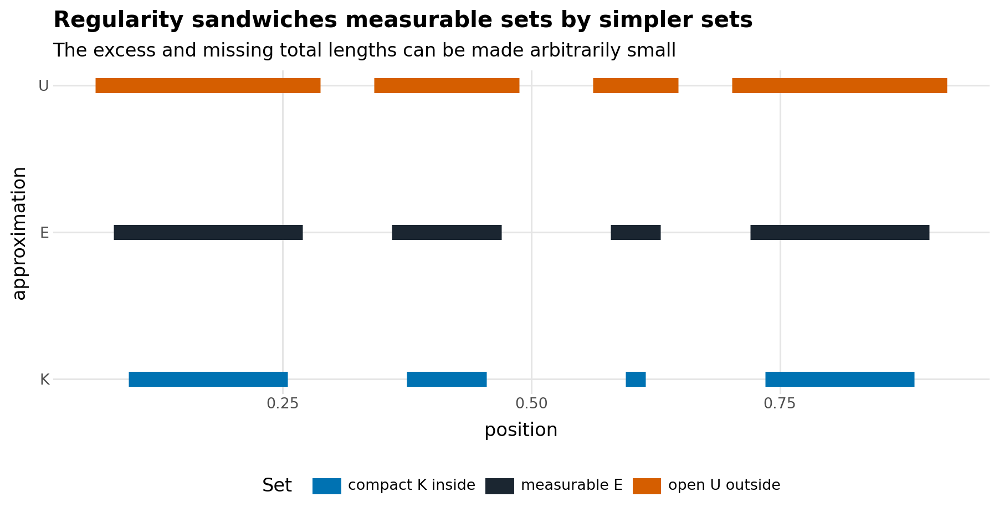

# Constructing Lebesgue Measure {#sec-lebesgue-construction}

Chapter 11 stated the architecture of measure. We now construct length from
countable interval coverings and explain why the measurable sets are exactly those
that split every outer approximation without hidden loss.

**Prerequisites.** Countability and completeness, open and compact subsets of the
line from [sec-topology](05-topology.md#sec-topology), and the measure vocabulary of [sec-measure](11-measure.md#sec-measure).

## Outer measure from interval coverings

For any set $E\subseteq\mathbb R$, define its **Lebesgue outer measure**

$$
m^*(E)=\inf\left\{
\sum_{k=1}^\infty |I_k|:
E\subseteq\bigcup_{k=1}^\infty I_k,\quad I_k\text{ open intervals}
\right\}.
$$

The infimum is over countable covers, and $|I_k|$ is interval length. Outer measure
is defined for every subset, even sets that will not be measurable.

It satisfies:

1. $m^*(\varnothing)=0$;
2. $A\subseteq B$ implies $m^*(A)\le m^*(B)$;
3. $m^*(\bigcup_nE_n)\le\sum_nm^*(E_n)$; and
4. $m^*(E+t)=m^*(E)$ for every translation $t$.

For countable subadditivity, cover each $E_n$ by intervals whose total length is
within $\varepsilon2^{-n}$ of $m^*(E_n)$. The combined list covers the union.
Sum, then let $\varepsilon\downarrow0$. This “allocate a summable error budget”
pattern is basic in measure construction.

**Worked example 1.** A countable set $E=\{x_1,x_2,\ldots\}$ has outer measure zero.
Given $\varepsilon>0$, cover $x_k$ by an interval of length
$\varepsilon2^{-k}$. The total length is $\varepsilon$. In particular, the
rationals are dense but null.

Showing $m^*([a,b])=b-a$ has two parts. One interval gives the upper bound. For any
open cover, compactness produces a finite subcover, and an interval-length lemma
shows its total length is at least $b-a$. Thus topology supplies the finite
reduction needed for the lower bound.

## Carathéodory measurability

Subadditivity always gives

$$
m^*(A)\le m^*(A\cap E)+m^*(A\setminus E).
$$

A set $E$ is **Carathéodory measurable** if equality holds for every
$A\subseteq\mathbb R$:

$$
m^*(A)=m^*(A\cap E)+m^*(A\setminus E).
$$

The reverse inequality says cutting by $E$ does not artificially reduce outer
size. The universal test set $A$ is essential; testing only $A=E$ says nothing.

**Theorem 19.1 (Carathéodory).** The measurable sets form a sigma-algebra, and the
restriction $m=m^*|_{\mathcal L}$ is a complete countably additive measure.

**Proof architecture.** Complements preserve the splitting identity by symmetry.
For disjoint measurable $E_1,\ldots,E_n$, repeatedly split a test set to obtain
finite additivity. For a countable disjoint union, finite additivity gives one
inequality after passing to the supremum of partial sums; outer subadditivity gives
the other. Closure under countable unions follows by separating the union into
disjoint pieces. If $N$ is null, then every subset $A\subseteq N$ is measurable
because all relevant outer measures vanish; this is completeness.

Sets separated by positive distance are outer-measure additive. This metric fact
helps prove that every closed set is measurable: truncate its complement into
pieces a positive distance away, then pass to a limit. Hence open sets are
measurable as complements.

## Borel sets and completion

The **Borel sigma-algebra** $\mathcal B(\mathbb R)$ is the smallest sigma-algebra
containing all open sets. It includes closed sets, intervals, countable unions of
closed sets, countable intersections of open sets, and every set built from these
by countably many operations.

The Lebesgue sigma-algebra $\mathcal L$ is the completion of the Borel
sigma-algebra with respect to Lebesgue measure: every Lebesgue measurable set can
be written

$$
E=B\cup N
$$

after harmless rearrangement, where $B$ is Borel and $N$ lies inside a Borel null
set. There are Lebesgue measurable sets that are not Borel, because every subset
of a null Borel set is Lebesgue measurable and there are too many such subsets to
all be Borel.

**Worked example 2.** The Cantor set $C$ is closed, hence Borel. Its stage-$n$
cover has total length $(2/3)^n$, so $m(C)=0$. Every subset of $C$ is Lebesgue
measurable, even though some subsets are not Borel.

Completion matters in function spaces: modifying a measurable function on any
subset of a null set should not destroy measurability or change its integral.

## Regularity of Lebesgue measure

Lebesgue measure can be approximated from outside by open sets and from inside by
compact sets. For measurable $E$,

$$
m(E)=\inf\{m(U):E\subseteq U,\ U\text{ open}\}.
$$

If $m(E)<\infty$, then

$$
m(E)=\sup\{m(K):K\subseteq E,\ K\text{ compact}\}.
$$

For infinite-measure sets, inner regularity holds with the supremum interpreted in
$[0,\infty]$ after truncation.

Outer regularity is already encoded in interval covers: their union is open.
Inner regularity follows by applying outer regularity to the complement inside a
large bounded interval and using finite measure. This is why compact and open sets
are effective approximation classes.

**Worked example 3.** Let $E$ be measurable with $m(E)<\infty$. For every
$\varepsilon>0$, choose compact $K\subseteq E$ and open $U\supseteq E$ such that

$$
m(U\setminus K)<\varepsilon.
$$

The continuous Urysohn-style cutoff

$$
\phi(x)=
\frac{d(x,U^c)}{d(x,U^c)+d(x,K)}
$$

equals $1$ on $K$, $0$ outside $U$, and lies between $0$ and $1$. Thus indicators
of measurable sets can be approximated in $L^1$ by continuous functions when the
geometry is regular.

<figure id="fig-lebesgue-regularity">


<figcaption>

Figure 19.1: Successively tighter open covers approximate a measurable set from outside, while compact pieces approximate it from inside.

</figcaption>
</figure>

[Figure 19.1](#fig-lebesgue-regularity) visualizes the sandwich $K\subseteq E\subseteq U$.
Regularity controls measure of the error set; it does not say an arbitrary
measurable set has a simple pointwise shape.

## Nonmeasurable sets and the role of choice

Define $x\sim y$ on $[0,1)$ when $x-y\in\mathbb Q$. Using a choice principle,
select one representative from each equivalence class; call the resulting set
$V$. For rational $q\in[-1,1]$, the translates $V+q$ are pairwise disjoint: an
overlap would make two chosen representatives rationally equivalent.

Every point of $[0,1)$ belongs to one such translate, and all translates lie in
$[-1,2]$. If $V$ were measurable, translation invariance and countable additivity
would force a contradiction. If $m(V)=0$, the countable union would have measure
zero despite covering $[0,1)$. If $m(V)>0$, the disjoint union inside a finite
interval would have infinite measure. Therefore $V$ is not Lebesgue measurable.

This Vitali construction does not produce a describable numerical sample. Its
nonconstructive representative selection is the point. The result says that no
translation-invariant, countably additive extension of length can assign values to
all subsets while retaining the desired properties.

Outer measure still assigns $m^*(V)$ a number, but outer measure is not additive on
arbitrary disjoint sets. Measurability is what restores the splitting law.

## Cantor measure and singular behavior

Give each left/right choice in the Cantor construction probability $1/2$. The
resulting **Cantor measure** $\mu_C$ is supported on the Cantor set:
$\mu_C(C)=1$, although $m(C)=0$. It has no atoms because the mass of a level-$n$
basic interval is $2^{-n}\to0$.

Its cumulative distribution function is the Cantor function. On a point whose
ternary expansion uses only $0$ and $2$, replace those digits by binary digits
$0$ and $1$. Extend constantly across every removed middle-third interval. The
function is continuous, increasing, begins at zero, and ends at one.

Yet its ordinary derivative is zero almost everywhere, since it is constant on the
complement of $C$, an open set of full Lebesgue measure. Thus

$$
F(1)-F(0)=1
\quad\text{but}\quad
\int_0^1F'(x)\,dx=0.
$$

This does not contradict the fundamental theorem: continuity plus almost-everywhere
differentiability is not sufficient. The missing property is absolute continuity,
developed through Radon–Nikodym theory in [sec-signed-measures](20-signed-measures.md#sec-signed-measures).

**Worked example 4.** At the first stage, the Cantor measure gives mass $1/2$ to
each retained third. At the second, each of four retained intervals has mass
$1/4$. Euclidean lengths are $1/3$ and $1/9$, so mass density relative to length
becomes increasingly concentrated rather than approaching an ordinary integrable
density.

### Proof laboratory: continuity of measure

Countable additivity has two limiting consequences used throughout analysis. If
$E_n\uparrow E$, write the union as the disjoint pieces

$$
E_1,\quad E_2\setminus E_1,\quad E_3\setminus E_2,\ldots.
$$

Partial sums give $m(E_n)\uparrow m(E)$. No finite-measure assumption is needed.
If $E_n\downarrow E$ and $m(E_1)<\infty$, apply the first result to
$E_1\setminus E_n\uparrow E_1\setminus E$ and subtract from $m(E_1)$:

$$
m(E_n)\downarrow m(E).
$$

The finite first measure matters. On $\mathbb R$, the decreasing sets
$E_n=[n,\infty)$ all have infinite measure while their intersection is empty.

These principles turn set approximation into numerical approximation. If $U$ is
open, then

$$
K_n=\{x\in U\cap[-n,n]:d(x,U^c)\ge1/n\}
$$

is compact, $K_n\uparrow U$, and $m(K_n)\uparrow m(U)$. This gives an explicit
inner approximation rather than merely asserting regularity.

**Worked example 5.** Let $E_n=(0,1/n)$. Then
$E_n\downarrow\varnothing$ and $m(E_n)=1/n\downarrow0$. Replacing Lebesgue measure
by a measure with $m(E_1)=\infty$ would invalidate subtraction of infinities,
exactly the failure guarded against by the finite-measure hypothesis.

<div class="callout callout-warning">
<p class="callout-title">Pitfalls</p>

- Outer measure is defined on every set but is only countably additive on the
  measurable sigma-algebra.
- Borel and Lebesgue measurable are not synonymous; Lebesgue measure is completed.
- A null set may be uncountable.
- An increasing continuous function need not equal the integral of its
  almost-everywhere derivative.
- A Vitali set uses a choice of representatives; it is not obtained by a finite
  algorithm.

</div>

<!-- inline-formula-code:start -->
## Formula and finite computation

A useful formula in this chapter is

$$
m^*(E)=\inf\left\{\sum_k|I_k|:E\subseteq\bigcup_k I_k\right\}
$$

One finite cover supplies an upper bound, not the infimum over all covers. The following standalone Python block expresses that finite rule with its inputs and stopping conditions visible.

```python
cover = [(-0.1, 0.4), (0.35, 0.8), (0.75, 1.1)]
total_length = sum(right - left for left, right in cover)
print(total_length)
```

**What the computation establishes.** The output certifies only the declared finite case. The theorem, if one is claimed, still requires the argument developed in the chapter.
<!-- inline-formula-code:end -->

## Exercises

<div class="exercise" id="real_analysis-19-lebesgue-measure-ex-1">
<p class="exercise-title"><strong>Exercise 1</strong></p>

Prove outer measure is monotone directly from the covering definition.

<details class="solution"><summary>Solution</summary>

Every cover of the larger set covers the smaller one; take infima.

</details>

</div>

<div class="exercise" id="real_analysis-19-lebesgue-measure-ex-2">
<p class="exercise-title"><strong>Exercise 2</strong></p>

Show every subset of a null set is Carathéodory measurable.

<details class="hint"><summary>Hint 1</summary>

A subset of a null set and every intersection with it have outer measure
zero, so the Carathéodory equality reduces to equality with a zero term.

</details>

<details class="solution"><summary>Solution</summary>

If $A\subseteq N$ and $m^*(N)=0$, both $A$ and its intersections have zero
outer measure, making the splitting identity automatic.

</details>

</div>

<div class="exercise" id="real_analysis-19-lebesgue-measure-ex-3">
<p class="exercise-title"><strong>Exercise 3</strong></p>

Prove a countable union of null sets is null.

<details class="solution"><summary>Solution</summary>

Countable subadditivity gives at most the sum of zeros.

</details>

</div>

<div class="exercise" id="real_analysis-19-lebesgue-measure-ex-4">
<p class="exercise-title"><strong>Exercise 4</strong></p>

Show $m^*((a,b))=b-a$ using compact subintervals for the lower bound.

<details class="solution"><summary>Solution</summary>

The upper bound uses one slightly larger interval; for the lower bound, cover
$[a+\delta,b-\delta]$ and let $\delta\downarrow0$.

</details>

</div>

<div class="exercise" id="real_analysis-19-lebesgue-measure-ex-5">
<p class="exercise-title"><strong>Exercise 5</strong></p>

If $E$ is measurable with finite measure, prove that for every
$\varepsilon>0$ there is a compact $K\subseteq E$ with
$m(E\triangle K)<\varepsilon$, and explain why
$E\triangle K=E\setminus K$.

<details class="solution"><summary>Solution</summary>

Inner regularity gives $m(E\setminus K)<\varepsilon$, and since
$K\subseteq E$, this is exactly $m(E\triangle K)$.

</details>

</div>

<div class="exercise" id="real_analysis-19-lebesgue-measure-ex-6">
<p class="exercise-title"><strong>Exercise 6</strong></p>

Explain why the rational translates in the Vitali construction are disjoint.

<details class="solution"><summary>Solution</summary>

An overlap would imply two chosen representatives differ by a rational and
hence belong to the same equivalence class.

</details>

</div>

<div class="exercise" id="real_analysis-19-lebesgue-measure-ex-7">
<p class="exercise-title"><strong>Exercise 7</strong></p>

Compute the Cantor function at $x=1/4$, whose ternary expansion is
$0.020202\ldots_3$.

<details class="solution"><summary>Solution</summary>

Replace ternary digits $0,2,0,2,\ldots$ by binary
$0,1,0,1,\ldots$, giving $1/3$.

</details>

</div>

<div class="exercise" id="real_analysis-19-lebesgue-measure-ex-8">
<p class="exercise-title"><strong>Exercise 8</strong></p>

Show the Cantor measure has no point masses.

<details class="hint"><summary>Hint 1</summary>

Trap a point in one basic Cantor interval at every stage, then apply
continuity from above to their measures.

</details>

<details class="solution"><summary>Solution</summary>

Nested basic intervals containing a point have masses $2^{-n}$, so continuity
from above gives singleton mass zero.

</details>

</div>

### Answer support

1. Every cover of the larger set covers the smaller one; take infima.
2. If $A\subseteq N$ and $m^*(N)=0$, both $A$ and its intersections have zero
   outer measure, making the splitting identity automatic.
3. Countable subadditivity gives at most the sum of zeros.
4. The upper bound uses one slightly larger interval; for the lower bound, cover
   $[a+\delta,b-\delta]$ and let $\delta\downarrow0$.
5. Inner regularity gives $m(E\setminus K)<\varepsilon$, and since
   $K\subseteq E$, this is exactly $m(E\triangle K)$.
6. An overlap would imply two chosen representatives differ by a rational and
   hence belong to the same equivalence class.
7. Replace ternary digits $0,2,0,2,\ldots$ by binary
   $0,1,0,1,\ldots$, giving $1/3$.
8. Nested basic intervals containing a point have masses $2^{-n}$, so continuity
   from above gives singleton mass zero.
