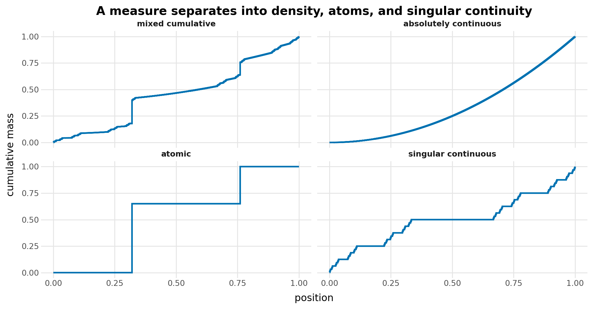

# Signed Measures and Radon–Nikodym Theory {#sec-signed-measures}

Positive measures record size. Differences of positive measures record charge,
gain minus loss, or signed accumulation. Radon–Nikodym theory answers a central
question: when can one measure be represented by a density with respect to
another?

**Prerequisites.** Lebesgue measure construction from
[sec-lebesgue-construction](19-lebesgue-measure.md#sec-lebesgue-construction), the Lebesgue integral from [sec-measure](11-measure.md#sec-measure), and bounded
variation from [sec-bv-stieltjes](15-bv-stieltjes.md#sec-bv-stieltjes).

## Signed measures and total variation

A **signed measure** $\nu$ on $(X,\mathcal A)$ is countably additive and takes
values in $[-\infty,\infty]$, but it is not allowed to take both $+\infty$ and
$-\infty$. In this chapter we usually use finite signed measures, for which
$|\nu(X)|<\infty$.

If $h$ is integrable with respect to a positive measure $\mu$, then

$$
\nu(E)=\int_Eh\,d\mu
$$

defines a finite signed measure. Positive values of $h$ contribute positive
charge; negative values contribute negative charge.

For a finite measurable partition $\{E_i\}$ of $E$, sum the magnitudes
$\sum_i|\nu(E_i)|$. The **total variation measure** is

$$
|\nu|(E)=\sup_{\{E_i\}}\sum_i|\nu(E_i)|.
$$

It is a positive measure and satisfies $|\nu(E)|\le|\nu|(E)$. The total variation
norm $\|\nu\|_{\mathrm{TV}}=|\nu|(X)$ measures total signed activity without
cancellation.

**Worked example 1.** On $[-1,1]$, let
$\nu(E)=\int_E x\,dx$. Then $\nu([-1,1])=0$, but

$$
|\nu|([-1,1])=\int_{-1}^1|x|\,dx=1.
$$

Net charge is zero; total variation is not.

## Hahn and Jordan decompositions

A measurable set $P$ is **positive for $\nu$** if every measurable subset
$E\subseteq P$ has $\nu(E)\ge0$. A set $N$ is negative if every measurable subset
has nonpositive measure.

**Theorem 20.1 (Hahn decomposition).** There is a measurable partition
$X=P\cup N$ into a positive set and a negative set. It is unique up to
$|\nu|$-null sets.

**Proof idea.** Let $s$ be the supremum of $\nu(E)$ over measurable sets. Choose
sets whose measures approach $s$, and combine them carefully so their union has no
negative measurable subset. The complement is negative; otherwise adjoining a
positive piece would exceed the supremum. A summable error budget handles the
countable construction.

Define

$$
\nu^+(E)=\nu(E\cap P),
\qquad
\nu^-(E)=-\nu(E\cap N).
$$

Then $\nu^+,\nu^-$ are positive measures,

$$
\nu=\nu^+-\nu^-,
\qquad
|\nu|=\nu^++\nu^-,
$$

and they are mutually singular. This is the **Jordan decomposition**. It is unique
among decompositions into mutually singular positive measures.

For $\nu(E)=\int_Eh\,d\mu$, the decomposition is

$$
\nu^+(E)=\int_Eh^+\,d\mu,
\qquad
\nu^-(E)=\int_Eh^-\,d\mu.
$$

This measure theorem mirrors the decomposition of a BV function in
[sec-bv-stieltjes](15-bv-stieltjes.md#sec-bv-stieltjes).

## Absolute continuity and singularity

A signed or positive measure $\nu$ is **absolutely continuous** with respect to
$\mu$, written $\nu\ll\mu$, if

$$
\mu(E)=0\quad\Longrightarrow\quad \nu(E)=0.
$$

Measures $\nu$ and $\mu$ are **mutually singular**, written $\nu\perp\mu$, if there
is a measurable $S$ such that $\nu$ is concentrated on $S$ and $\mu(S)=0$.

Absolute continuity says $\nu$ cannot see a set that $\mu$ regards as null.
Singularity says the measures live on disjoint measurable worlds.

**Worked example 2.** The point mass $\delta_0$, defined by
$\delta_0(E)=1$ when $0\in E$ and $0$ otherwise, is singular with respect to
Lebesgue measure because it is concentrated on $\{0\}$, a null set. It cannot have
a Lebesgue-integrable density: if $\delta_0(E)=\int_Eh\,dx$, then the integral over
the null singleton would have to equal both $0$ and $1$.

The Cantor measure is also singular with respect to Lebesgue measure, but it has no
atoms. Singularity does not mean “discrete.”

## Radon–Nikodym theorem

**Theorem 20.2 (Radon–Nikodym).** Let $\mu$ and $\nu$ be sigma-finite positive measures on
$(X,\mathcal A)$. If $\nu\ll\mu$, then there is a measurable
$h:X\to[0,\infty]$ such that

$$
\nu(E)=\int_Eh\,d\mu
$$

for every measurable $E$. The density $h$, denoted $d\nu/d\mu$, is unique
$\mu$-almost everywhere. For a finite signed $\nu\ll\mu$, the density is
integrable and may have either sign.

Sigma-finite means $X$ is a countable union of sets of finite measure. It permits
the finite-measure argument to be assembled countably.

One proof for finite measures works in the Hilbert space $L^2(\mu+\nu)$. The
functional $f\mapsto\int f\,d\nu$ is represented by an inner product with a
bounded function $g$. Algebra converts $g$ into a nonnegative density of $\nu$
with respect to $\mu$. Another proof maximizes integrals among candidate
subdensities. Both use completeness to turn an approximating family into an exact
density.

**Worked example 3.** Let $\nu$ on $[0,1]$ satisfy

$$
\nu(E)=\int_E 6x(1-x)\,dx.
$$

Then $\nu\ll m$ and $d\nu/dm=6x(1-x)$. Its total mass is
$\int_0^16x(1-x)\,dx=1$, so it is a probability measure. For
$g(x)=x$,

$$
\int g\,d\nu
=\int_0^1x\,6x(1-x)\,dx=\frac12.
$$

The change-of-measure identity $\int g\,d\nu=\int gh\,d\mu$ is the operational
content of the derivative.

## Lebesgue decomposition

**Theorem 20.3 (Lebesgue decomposition).** If $\mu$ is sigma-finite and $\nu$ is a
sigma-finite positive measure, then uniquely

$$
\nu=\nu_{\mathrm{ac}}+\nu_{\mathrm{s}},
\qquad
\nu_{\mathrm{ac}}\ll\mu,
\qquad
\nu_{\mathrm{s}}\perp\mu.
$$

Radon–Nikodym gives
$\nu_{\mathrm{ac}}(E)=\int_E(d\nu/d\mu)\,d\mu$. For a finite signed measure,
apply the theorem to positive and negative parts.

<figure id="fig-measure-decomposition">


<figcaption>

Figure 20.1: A mixed measure is decomposed into an absolutely continuous density, isolated atoms, and a singular continuous Cantor component.

</figcaption>
</figure>

[Figure 20.1](#fig-measure-decomposition) separates two distinct singular behaviours. Atoms create
jumps in the cumulative function; a singular continuous measure creates continuous
increase on a Lebesgue-null support.

**Worked example 4.** On $[0,1]$, define

$$
\nu(E)=\int_E2x\,dx+3\delta_{1/2}(E)+\mu_C(E).
$$

Relative to Lebesgue measure, the absolutely continuous density is $2x$ and the
singular part is $3\delta_{1/2}+\mu_C$. The total mass is $1+3+1=5$.

## Differentiating measures

A function $F:[a,b]\to\mathbb R$ is **absolutely continuous** if for every
$\varepsilon>0$ there is $\delta>0$ such that for every finite disjoint family of
intervals $(a_k,b_k)$,

$$
\sum_k(b_k-a_k)<\delta
\quad\Longrightarrow\quad
\sum_k|F(b_k)-F(a_k)|<\varepsilon.
$$

Absolute continuity implies bounded variation and uniform continuity. More
importantly:

**Theorem 20.4 (Fundamental for absolutely continuous functions).** The function $F$ is
absolutely continuous exactly when it is differentiable almost everywhere,
$F'\in L^1$, and

$$
F(x)=F(a)+\int_a^xF'(t)\,dt.
$$

For an increasing $F$, the associated Lebesgue–Stieltjes measure $\mu_F$ splits
relative to Lebesgue measure into absolutely continuous, atomic, and singular
continuous parts. Its Radon–Nikodym density is $F'$ almost everywhere for the
absolutely continuous part. The Cantor function fails absolute continuity because
its derivative integrates to zero while its total increase is one.

**Worked example 5.** The function $F(x)=x^2$ on $[0,1]$ is absolutely continuous,
and its Stieltjes measure has density $2x$. Therefore

$$
\int_0^1g\,dF=\int_0^1g(x)2x\,dx.
$$

By contrast, adding the unit step $H_{1/2}=1_{[1/2,1]}$ adds a point mass that no ordinary derivative detects.

### Application laboratory: changing the reference measure

Suppose $\lambda\ll\nu\ll\mu$. Under the standard sigma-finite hypotheses, the
Radon–Nikodym derivatives satisfy a chain rule:

$$
\frac{d\lambda}{d\mu}
=\frac{d\lambda}{d\nu}\frac{d\nu}{d\mu}
\quad\mu\text{-almost everywhere},
$$

with versions interpreted on the support where the intermediate density is
positive. To verify it, integrate the product over an arbitrary measurable set and
apply the change-of-measure identity twice.

This formula makes probability reweighting rigorous. Let $\mu$ be uniform measure
on $[0,1]$ and define a new probability $\nu$ by density
$h(x)=2x$. Then

$$
\mathbb E_\nu[g]
=\int_0^1g(x)2x\,dx.
$$

Events near one receive more weight. For example,
$\nu([1/2,1])=\int_{1/2}^12x\,dx=3/4$, whereas the uniform probability is $1/2$.
If a third measure has density $k$ with respect to $\nu$, its density relative to
uniform measure is $kh$.

**Worked example 6.** Reweight $\nu$ by $k(x)=3x^2/(2x)=3x/2$ for $x>0$.
Then $d\lambda/d\mu=3x^2$, a probability density on $[0,1]$. The apparent
division at $x=0$ is harmless because that point is $\nu$-null. Radon–Nikodym
derivatives are equivalence classes, so versions need not be defined canonically
on null sets.

The word “density” is always relative. The same measure can have density $3x/2$
with respect to $\nu$ and $3x^2$ with respect to $\mu$.

<div class="callout callout-warning">
<p class="callout-title">Pitfalls</p>

- A signed measure's small net value does not imply small total variation.
- Absolute continuity is relative to a specified reference measure.
- Singularity need not be atomic.
- The Radon–Nikodym derivative is an almost-everywhere equivalence class, not a
  uniquely defined pointwise formula.
- Continuity and bounded variation do not imply absolute continuity.

</div>

<!-- inline-formula-code:start -->
## Formula and finite computation

A useful formula in this chapter is

$$
\nu=\nu^+-\nu^-,\qquad |\nu|=\nu^++\nu^-
$$

Positive and negative parts of a finite signed measure are computed pointwise. The following standalone Python block expresses that finite rule with its inputs and stopping conditions visible.

```python
weights = {"a": 3.0, "b": -2.0, "c": 0.5, "d": -1.5}
positive = {point: max(weight, 0.0) for point, weight in weights.items()}
negative = {point: max(-weight, 0.0) for point, weight in weights.items()}
variation = {point: positive[point] + negative[point] for point in weights}
print(positive, negative, variation)
```

**What the computation establishes.** The output certifies only the declared finite case. The theorem, if one is claimed, still requires the argument developed in the chapter.
<!-- inline-formula-code:end -->

## Exercises

<div class="exercise" id="real_analysis-20-signed-measures-ex-1">
<p class="exercise-title"><strong>Exercise 1</strong></p>

Find the Jordan decomposition of $\nu(E)=\int_E(2x-1)\,dx$ on $[0,1]$.

<details class="solution"><summary>Solution</summary>

Use densities $(2x-1)^+$ and $(2x-1)^-$, supported on opposite halves.

</details>

</div>

<div class="exercise" id="real_analysis-20-signed-measures-ex-2">
<p class="exercise-title"><strong>Exercise 2</strong></p>

Compute its total variation on $[0,1]$.

<details class="solution"><summary>Solution</summary>

$\int_0^1|2x-1|\,dx=1/2$.

</details>

</div>

<div class="exercise" id="real_analysis-20-signed-measures-ex-3">
<p class="exercise-title"><strong>Exercise 3</strong></p>

Prove $\delta_0\perp m$.

<details class="solution"><summary>Solution</summary>

The point mass is concentrated on $\{0\}$ and $m(\{0\})=0$.

</details>

</div>

<div class="exercise" id="real_analysis-20-signed-measures-ex-4">
<p class="exercise-title"><strong>Exercise 4</strong></p>

If $\nu\ll\mu$ and $\lambda\ll\nu$, prove $\lambda\ll\mu$.

<details class="solution"><summary>Solution</summary>

A $\mu$-null set is $\nu$-null and hence $\lambda$-null.

</details>

</div>

<div class="exercise" id="real_analysis-20-signed-measures-ex-5">
<p class="exercise-title"><strong>Exercise 5</strong></p>

If $d\nu/d\mu=h$ and $d\lambda/d\nu=k$, identify $d\lambda/d\mu$ under the
usual sigma-finite hypotheses.

<details class="hint"><summary>Hint 1</summary>

Verify the claimed density by integrating it over an arbitrary measurable
set. Uniqueness then invokes Radon–Nikodym, not pointwise division on null sets.

</details>

<details class="solution"><summary>Solution</summary>

The chain rule is $d\lambda/d\mu=k h$ almost everywhere, with versions chosen
on the appropriate supports.

</details>

</div>

<div class="exercise" id="real_analysis-20-signed-measures-ex-6">
<p class="exercise-title"><strong>Exercise 6</strong></p>

Decompose $m+\delta_0$ relative to $m$.

<details class="solution"><summary>Solution</summary>

The absolutely continuous part is $m$ with density $1$; the singular part is
$\delta_0$.

</details>

</div>

<div class="exercise" id="real_analysis-20-signed-measures-ex-7">
<p class="exercise-title"><strong>Exercise 7</strong></p>

Show a Lipschitz function on $[a,b]$ is absolutely continuous.

<details class="hint"><summary>Hint 1</summary>

Sum the Lipschitz increment bound over a finite disjoint interval family.

</details>

<details class="solution"><summary>Solution</summary>

Sum $|F(b_k)-F(a_k)|\le L\sum(b_k-a_k)$ and choose
$\delta=\varepsilon/L$.

</details>

</div>

<div class="exercise" id="real_analysis-20-signed-measures-ex-8">
<p class="exercise-title"><strong>Exercise 8</strong></p>

Explain why the Cantor function is not absolutely continuous.

<details class="solution"><summary>Solution</summary>

Its derivative is zero almost everywhere but its endpoint increase is one,
contradicting the integral representation required by absolute continuity.

</details>

</div>

### Answer support

1. Use densities $(2x-1)^+$ and $(2x-1)^-$, supported on opposite halves.
2. $\int_0^1|2x-1|\,dx=1/2$.
3. The point mass is concentrated on $\{0\}$ and $m(\{0\})=0$.
4. A $\mu$-null set is $\nu$-null and hence $\lambda$-null.
5. The chain rule is $d\lambda/d\mu=k h$ almost everywhere, with versions chosen
   on the appropriate supports.
6. The absolutely continuous part is $m$ with density $1$; the singular part is
   $\delta_0$.
7. Sum $|F(b_k)-F(a_k)|\le L\sum(b_k-a_k)$ and choose
   $\delta=\varepsilon/L$.
8. Its derivative is zero almost everywhere but its endpoint increase is one,
   contradicting the integral representation required by absolute continuity.
