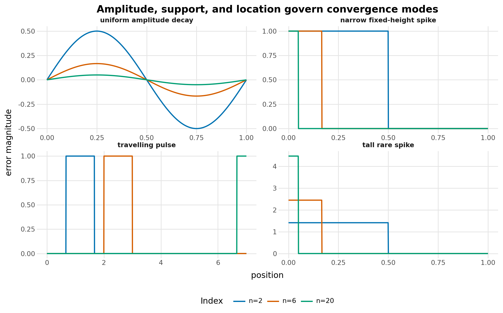

# L-p Spaces and Modes of Convergence {#sec-lp-convergence}

A mode of convergence specifies which errors matter. Supremum norm penalizes the
worst point, $L^p$ norms aggregate error, convergence in measure ignores errors on
shrinking sets, and almost-everywhere convergence follows each point separately.
None is universally strongest on every measure space.

**Prerequisites.** Lebesgue integration and convergence theorems from
[sec-measure](11-measure.md#sec-measure), Radon–Nikodym language from [sec-signed-measures](20-signed-measures.md#sec-signed-measures), and normed-space
ideas from [sec-functional-analysis](13-functional-analysis.md#sec-functional-analysis).

## Equivalence classes and essential bounds

On a measure space $(X,\mathcal A,\mu)$, functions equal almost everywhere are
identified. For $1\le p<\infty$,

$$
\|f\|_p=
\left(\int_X|f|^p\,d\mu\right)^{1/p},
$$

and $L^p(\mu)$ is the set of almost-everywhere equivalence classes with finite
norm. Identification is necessary: $\|f-g\|_p=0$ means equality almost everywhere,
not necessarily at every point.

The **essential supremum** is

$$
\|f\|_\infty
=\inf\{M\ge0:|f|\le M\text{ almost everywhere}\}.
$$

Changing one value, even to a huge finite number, does not change an $L^\infty$
element on a nonatomic space.

**Worked example 1.** On $(0,1)$, let $f(x)=x^{-\alpha}$. For finite $p$,

$$
\|f\|_p^p=\int_0^1x^{-\alpha p}\,dx
$$

is finite exactly when $\alpha p<1$. Thus $f$ may belong to $L^1$ but not
$L^2$, and it belongs to no $L^\infty$ when $\alpha>0$.

On a finite-measure space, if $q>p$, then $L^q\subseteq L^p$ and

$$
\|f\|_p\le\mu(X)^{1/p-1/q}\|f\|_q.
$$

On an infinite-measure space there is no general inclusion in either direction:
local singularity and slow decay provide opposing counterexamples.

## Hölder and Minkowski inequalities

If $1<p,q<\infty$ and $1/p+1/q=1$, **Hölder's inequality** says

$$
\int|fg|\,d\mu\le\|f\|_p\|g\|_q.
$$

Normalize nonzero $f,g$ to have norm one. Young's inequality
$ab\le a^p/p+b^q/q$ gives

$$
|f(x)g(x)|
\le\frac{|f(x)|^p}{p}+\frac{|g(x)|^q}{q}.
$$

Integrate. Scaling restores the general case. The endpoint form is
$\int|fg|\le\|f\|_1\|g\|_\infty$.

**Minkowski's inequality** is the triangle inequality

$$
\|f+g\|_p\le\|f\|_p+\|g\|_p.
$$

For $1<p<\infty$, write

$$
\|f+g\|_p^p
\le\int|f||f+g|^{p-1}
+\int|g||f+g|^{p-1}
$$

and apply Hölder. The conjugate exponent turns
$\||f+g|^{p-1}\|_q$ into $\|f+g\|_p^{p-1}$. Divide unless the norm is zero.

**Worked example 2.** On $[0,1]$,

$$
\left|\int_0^1f(x)\,dx\right|
\le\|f\|_2\|1\|_2=\|f\|_2.
$$

So integration is a bounded linear functional on $L^2([0,1])$. On
$\mathbb R$, the constant function $1$ is not in $L^2$, and this argument does not
provide the same bound.

## Completeness of L-p

**Theorem 21.1 (Riesz–Fischer).** For $1\le p\le\infty$, $L^p(\mu)$ is complete.

For $p<\infty$, let $(f_n)$ be Cauchy. Select a subsequence with

$$
\|f_{n_{k+1}}-f_{n_k}\|_p\le2^{-k}.
$$

Set $g_k=|f_{n_{k+1}}-f_{n_k}|$. Minkowski gives uniformly bounded norms for
partial sums $\sum_{k=1}^Ng_k$. Monotone convergence then shows
$\sum_kg_k<\infty$ almost everywhere and belongs to $L^p$. Therefore
$\sum_k(f_{n_{k+1}}-f_{n_k})$ converges absolutely almost everywhere to a function
$f-f_{n_1}$. Tail estimates show $f_{n_k}\to f$ in $L^p$, and the original Cauchy
sequence follows.

This proof displays a recurring strategy: choose a rapidly Cauchy subsequence,
convert norm control into an almost-everywhere summable majorant, construct the
limit pointwise, then return to the norm.

For $p=\infty$, choose representatives whose pairwise essential differences obey
the Cauchy bounds outside a countable union of null sets. Off that one null set,
the sequence is uniformly Cauchy in $\mathbb R$.

## Density of simple and continuous functions

Every nonnegative measurable function is the pointwise increasing limit of simple
functions. If $f\in L^p$ with $p<\infty$, truncate its magnitude and discretize its
range to obtain simple $s_n$ with $\|f-s_n\|_p\to0$. Hence finite-valued measurable
functions of finite-support measure are dense in $L^p$.

For Lebesgue measure on $\mathbb R^n$, compactly supported continuous functions are
dense in $L^p$ for $1\le p<\infty$. Approximate a simple function by indicators of
finite-measure sets; regularity sandwiches each set between a compact $K$ and open
$U$ with small difference; a continuous cutoff between them approximates the
indicator.

Smooth compactly supported functions are also dense. Convolution with a
**mollifier**

$$
\rho_\varepsilon(x)=\varepsilon^{-n}\rho(x/\varepsilon),
\qquad
\int\rho=1,
$$

smooths a function, while translation continuity in $L^p$ proves
$f*\rho_\varepsilon\to f$. This density fails in the $L^\infty$ norm for arbitrary
bounded measurable functions: a jump cannot be uniformly approximated almost
everywhere by continuous functions across both sides.

**Worked example 3.** The indicator $1_{[0,1]}$ can be approximated in $L^p$ by
continuous trapezoids equal to $1$ on $[\varepsilon,1-\varepsilon]$, zero outside
$[-\varepsilon,1+\varepsilon]$, and linear on the two short transitions. The
$p$th power error is supported on total length at most $4\varepsilon$, so its
$L^p$ norm is at most $(4\varepsilon)^{1/p}$.

## Almost-everywhere, in-measure, and norm convergence

We say $f_n\to f$ **in measure** if for every $\varepsilon>0$,

$$
\mu(\{|f_n-f|>\varepsilon\})\to0.
$$

Markov's inequality gives, for $p>0$,

$$
\mu(\{|f_n-f|>\varepsilon\})
\le\frac{\|f_n-f\|_p^p}{\varepsilon^p}.
$$

Thus $L^p$ convergence implies convergence in measure. Convergence in measure
contains an almost-everywhere convergent subsequence: select $n_k$ so the bad-set
measures are summable, then use the Borel–Cantelli estimate.

On a finite-measure space, almost-everywhere convergence implies convergence in
measure by dominated convergence applied to indicators of bad sets. On an
infinite-measure space, translating indicators
$1_{[n,n+1]}$ converge pointwise to zero but not in measure because every support
has measure one.

<figure id="fig-lp-modes">


<figcaption>

Figure 21.1: Four error patterns compare uniform, Lp, in-measure, and almost-everywhere convergence.

</figcaption>
</figure>

[Figure 21.1](#fig-lp-modes) makes the geometry of error visible. Amplitude, support measure, and
location affect different modes. No finite picture proves an almost-everywhere
claim about an infinite sequence; the formulas define the pattern.

**Worked example 4.** On $(0,1)$, $f_n=n^{1/p}1_{(0,1/n)}$ converges almost
everywhere and in measure to zero, but $\|f_n\|_p=1$. Pointwise disappearance does
not prevent $L^p$ mass from concentrating near zero.

Almost-everywhere convergence need not hold for an entire sequence converging in
measure. A “typewriter sequence” moves indicators through all dyadic subintervals:
support lengths tend to zero, so convergence in measure holds, but every point is
covered infinitely often, preventing pointwise convergence.

## Uniform integrability and convergence upgrades

A family $\mathcal F\subset L^1(\mu)$ is **uniformly integrable** when its
$L^1$ norms are uniformly bounded and

$$
\lim_{M\to\infty}
\sup_{f\in\mathcal F}\int_{\{|f|>M\}}|f|\,d\mu=0
$$

holds.

Equivalently, its integrals are uniformly small on sets of sufficiently small
measure and its $L^1$ norms are uniformly bounded. On a finite-measure space the
tail condition itself already supplies the norm bound: split each integral into
the region $|f|\le M$ and its uniformly small tail.

**Theorem 21.2 (Vitali convergence).** On a finite-measure space, if
$f_n\to f$ in measure and $\{f_n\}$ is uniformly integrable, then
$\|f_n-f\|_1\to0$.

The proof splits error into a bounded part and a large-value tail. Convergence in
measure controls the bounded part except on a small set; uniform integrability
controls that set and the tails uniformly.

If $|f_n|\le g\in L^1$, then the family is uniformly integrable, so dominated
convergence is a special case. Boundedness in $L^p$ for some $p>1$ also gives
uniform integrability in $L^1$ on finite-measure spaces by Hölder.

**Worked example 5.** The spikes $n1_{(0,1/n)}$ are not uniformly integrable:
their entire integral $1$ lies above any fixed threshold once $n$ is large. This
identifies exactly why convergence in measure fails to upgrade to $L^1$
convergence.

### Egorov's theorem: almost uniform convergence

On a finite-measure space, almost-everywhere convergence is nearly uniform.
**Theorem 21.3 (Egorov's).** says that if $f_n\to f$ almost everywhere on $E$ with
$\mu(E)<\infty$, then for every $\eta>0$ there is measurable
$A\subseteq E$ with $\mu(A)<\eta$ such that $f_n\to f$ uniformly on
$E\setminus A$.

For $m,N\in\mathbb N$, define

$$
E_{m,N}
=\bigcap_{n\ge N}\{|f_n-f|\le1/m\}.
$$

For fixed $m$, the sets increase with $N$ and cover almost all of $E$.
Continuity from below lets us choose $N_m$ so that
$E\setminus E_{m,N_m}$ has measure below $\eta2^{-m}$. Remove the union of these
exceptional sets. On what remains, every tolerance $1/m$ has a common tail cutoff,
which is uniform convergence.

**Worked example 6.** On $[0,1]$, $x^n\to0$ for $x<1$ but not uniformly on the
whole interval. Given $\eta>0$, remove $A=(1-\eta/2,1]$. On
$[0,1-\eta/2]$,

$$
\sup x^n=(1-\eta/2)^n\to0.
$$

Egorov generalizes this “remove a narrow bad region” mechanism without requiring
an explicit formula. Finiteness is essential: translating pulses on $\mathbb R$
can keep moving their bad region without one finite exceptional set capturing it.

<div class="callout callout-warning">
<p class="callout-title">Pitfalls</p>

- An $L^p$ element is an equivalence class, so point evaluation is generally
  undefined.
- Inclusions among $L^p$ spaces depend on the measure of the ambient space.
- Almost-everywhere convergence and norm convergence do not imply each other
  without extra hypotheses.
- Boundedness in $L^1$ alone does not give uniform integrability.
- A subsequence theorem does not assert convergence of the whole sequence.

</div>

<!-- inline-formula-code:start -->
## Formula and finite computation

A useful formula in this chapter is

$$
f_n(x)\to0\quad\text{but}\quad\int f_n\not\to0
$$

A shrinking spike makes the distinction visible at exact sample points. The following standalone Python block expresses that finite rule with its inputs and stopping conditions visible.

```python
def concentration_spike(point: float, index: int) -> float:
    """Evaluate n times the indicator of the open interval (0, 1/n)."""
    if index <= 0:
        raise ValueError("index must be positive")
    return float(index) if 0.0 < point < 1.0 / index else 0.0

sample_points = (0.0, 0.001, 0.01, 0.1, 0.5)
for index in (2, 10, 100, 1_000):
    values = [concentration_spike(point, index) for point in sample_points]
    exact_area = index * (1.0 / index)
    print(index, values, exact_area)
```

**What the computation establishes.** The calculation checks a declared finite instance; the surrounding argument explains what is true beyond those inputs.
<!-- inline-formula-code:end -->

## Exercises

<div class="exercise" id="real_analysis-21-lp-convergence-ex-1">
<p class="exercise-title"><strong>Exercise 1</strong></p>

Determine all $p$ for which $x^{-1/4}\in L^p(0,1)$.

<details class="solution"><summary>Solution</summary>

Integrability requires $p/4<1$, hence $1\le p<4$ in the Banach range.

</details>

</div>

<div class="exercise" id="real_analysis-21-lp-convergence-ex-2">
<p class="exercise-title"><strong>Exercise 2</strong></p>

Prove Markov's inequality used above.

<details class="solution"><summary>Solution</summary>

On $\{|g|>\varepsilon\}$, $|g|^p\ge\varepsilon^p$; integrate.

</details>

</div>

<div class="exercise" id="real_analysis-21-lp-convergence-ex-3">
<p class="exercise-title"><strong>Exercise 3</strong></p>

Show $\|1_E\|_p=\mu(E)^{1/p}$ for finite $p$.

<details class="solution"><summary>Solution</summary>

Integrate $1_E^p=1_E$ and take the $p$th root.

</details>

</div>

<div class="exercise" id="real_analysis-21-lp-convergence-ex-4">
<p class="exercise-title"><strong>Exercise 4</strong></p>

On a probability space, prove $\|f\|_p\le\|f\|_q$ when $p<q$.

<details class="solution"><summary>Solution</summary>

Apply Hölder to $|f|^p\cdot1$ with exponents $q/p$ and its conjugate.

</details>

</div>

<div class="exercise" id="real_analysis-21-lp-convergence-ex-5">
<p class="exercise-title"><strong>Exercise 5</strong></p>

Find the almost-everywhere, in-measure, and $L^1$ behaviour of
$f_n=1_{(0,1/n)}$.

<details class="solution"><summary>Solution</summary>

It converges to zero in all three; its $L^1$ norm is $1/n$.

</details>

</div>

<div class="exercise" id="real_analysis-21-lp-convergence-ex-6">
<p class="exercise-title"><strong>Exercise 6</strong></p>

Give a sequence converging in $L^1(\mathbb R)$ whose supremum norms diverge.

<details class="hint"><summary>Hint 1</summary>

Preserve small area while increasing height; a rectangular spike is
enough. Compute $L^1$ and supremum norms separately.

</details>

<details class="solution"><summary>Solution</summary>

Use triangular or rectangular spikes of area $1/n$ and height $n$.

</details>

</div>

<div class="exercise" id="real_analysis-21-lp-convergence-ex-7">
<p class="exercise-title"><strong>Exercise 7</strong></p>

Show an $L^p$-bounded family with $p>1$ is uniformly integrable on a probability
space.

<details class="solution"><summary>Solution</summary>

Hölder gives
$\int_E|f|\le\|f\|_p\mu(E)^{1-1/p}$ uniformly.

</details>

</div>

<div class="exercise" id="real_analysis-21-lp-convergence-ex-8">
<p class="exercise-title"><strong>Exercise 8</strong></p>

Explain why the typewriter sequence has no pointwise limit.

<details class="hint"><summary>Hint 1</summary>

At every dyadic level, exactly one interval contains a fixed point. The
enumeration revisits levels indefinitely.

</details>

<details class="solution"><summary>Solution</summary>

Every point lies in one dyadic interval at each scale, so values equal one
infinitely often and zero infinitely often.

</details>

</div>

### Answer support

1. Integrability requires $p/4<1$, hence $1\le p<4$ in the Banach range.
2. On $\{|g|>\varepsilon\}$, $|g|^p\ge\varepsilon^p$; integrate.
3. Integrate $1_E^p=1_E$ and take the $p$th root.
4. Apply Hölder to $|f|^p\cdot1$ with exponents $q/p$ and its conjugate.
5. It converges to zero in all three; its $L^1$ norm is $1/n$.
6. Use triangular or rectangular spikes of area $1/n$ and height $n$.
7. Hölder gives
   $\int_E|f|\le\|f\|_p\mu(E)^{1-1/p}$ uniformly.
8. Every point lies in one dyadic interval at each scale, so values equal one
   infinitely often and zero infinitely often.
