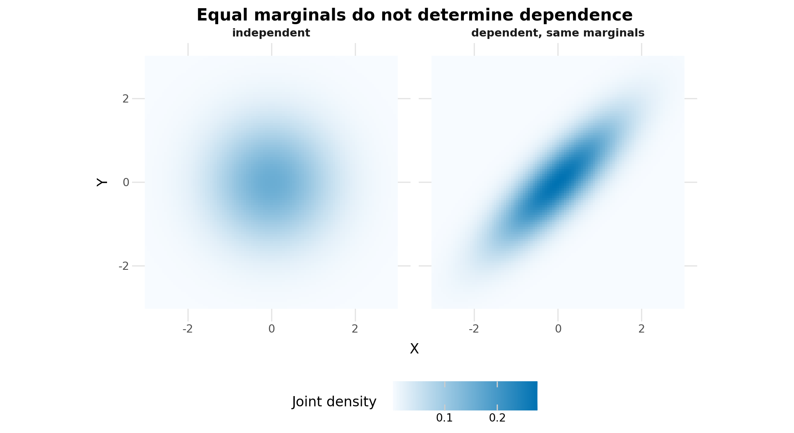

# Product Measures, Fubini, and Probability {#sec-product-probability}

Repeated integration is valid only when a measure exists on the product and the
order exchange has adequate positivity or absolute integrability. Probability uses
the same structure: a pair of random variables has a joint distribution, and
independence means that distribution factors.

**Prerequisites.** Sigma-algebras and Lebesgue integration from [sec-measure](11-measure.md#sec-measure),
Lebesgue construction from [sec-lebesgue-construction](19-lebesgue-measure.md#sec-lebesgue-construction), and $L^p$ estimates from
[sec-lp-convergence](21-lp-convergence.md#sec-lp-convergence).

## Rectangles and product sigma-algebras

Let $(X,\mathcal A)$ and $(Y,\mathcal B)$ be measurable spaces. A measurable
rectangle is $A\times B$ with $A\in\mathcal A$ and $B\in\mathcal B$. The
**product sigma-algebra**

$$
\mathcal A\otimes\mathcal B
=\sigma\{A\times B:A\in\mathcal A,\ B\in\mathcal B\}
$$

is the smallest sigma-algebra containing these rectangles.

It generally contains many sets that are not rectangles. Conversely, it need not
contain every subset of $X\times Y$. Measurability is generated by countable set
operations, not arbitrary unions.

For $E\subseteq X\times Y$, define sections

$$
E_x=\{y:(x,y)\in E\},
\qquad
E^y=\{x:(x,y)\in E\}.
$$

If $E\in\mathcal A\otimes\mathcal B$, then every section $E_x$ belongs to
$\mathcal B$ and every $E^y$ belongs to $\mathcal A$. Prove this first for
rectangles, then observe that the class of sets with measurable sections is a
sigma-algebra.

**Worked example 1.** For
$E=\{(x,y)\in[0,1]^2:x<y\}$,

$$
E_x=(x,1],
\qquad
E^y=[0,y).
$$

Both are Borel. The set itself is open relative to the square because
$(x,y)\mapsto y-x$ is continuous.

## Product measures

If $\mu$ on $(X,\mathcal A)$ and $\nu$ on $(Y,\mathcal B)$ are sigma-finite,
there is a unique product measure $\mu\times\nu$ on
$\mathcal A\otimes\mathcal B$ satisfying

$$
(\mu\times\nu)(A\times B)=\mu(A)\nu(B).
$$

The convention $0\cdot\infty=0$ is used for empty-mass rectangles. Construction
starts with finite disjoint unions of rectangles, forms an outer measure from
coverings, and applies the Carathéodory method. Sigma-finiteness supplies uniqueness
and manageable exhaustion by finite-measure rectangles.

For measurable $E$,

$$
(\mu\times\nu)(E)
=\int_X\nu(E_x)\,d\mu(x)
=\int_Y\mu(E^y)\,d\nu(y),
$$

with value in $[0,\infty]$. This is already Tonelli's theorem applied to $1_E$.

**Worked example 2.** For the triangle in Worked example 1 with Lebesgue measure,

$$
m_2(E)=\int_0^1m((x,1])\,dx
=\int_0^1(1-x)\,dx=\frac12.
$$

Horizontal sections give the same result:
$\int_0^1y\,dy=1/2$.

## Tonelli and Fubini theorems

**Theorem 22.1 (Tonelli's).** If
$f:X\times Y\to[0,\infty]$ is measurable, then the section integrals are
measurable and

$$
\int_{X\times Y}f\,d(\mu\times\nu)
=\int_X\left(\int_Yf(x,y)\,d\nu(y)\right)d\mu(x)
=\int_Y\left(\int_Xf(x,y)\,d\mu(x)\right)d\nu(y),
$$

allowing $+\infty$.

The proof begins with rectangle indicators, extends by linearity to nonnegative
simple functions, and passes to nonnegative measurable functions by monotone
convergence.

**Theorem 22.2 (Fubini's).** If $f$ is integrable on the product, then almost every
section is integrable, both iterated integrals exist absolutely almost everywhere,
and the same equality holds with a finite value.

Apply Tonelli to $|f|$ to control sections, then to $f^+$ and $f^-$. Absolute
integrability prevents an undefined subtraction $\infty-\infty$.

**Worked example 3.** On $(0,\infty)^2$, let
$f(x,y)=e^{-x-2y}$. It is nonnegative, so Tonelli applies without advance
knowledge of finiteness:

$$
\int_0^\infty\int_0^\infty e^{-x-2y}\,dy\,dx
=\left(\int_0^\infty e^{-x}\,dx\right)
\left(\int_0^\infty e^{-2y}\,dy\right)
=\frac12.
$$

The displayed middle operation is multiplication of the two one-dimensional
integrals; positivity justifies the factorization.

Without positivity or absolute integrability, order can matter. A double array
whose rows each sum to $0$ but whose column sums total $1$ gives different
iterated sums. One concrete choice is

$$
a_{m,n}=
\begin{cases}
1,&n=m,\\
-1,&n=m+1,\\
0,&\text{otherwise}.
\end{cases}
$$

Every row sums to $0$, while column $1$ sums to $1$ and every later column to $0$,
so the other iteration sums to $1$. Absolute sum is infinite. This discrete
counting-measure example is a Fubini warning in its simplest form.

## Probability spaces and random variables

A **probability space** $(\Omega,\mathcal F,\mathbb P)$ is a measure space with
$\mathbb P(\Omega)=1$. A real **random variable** is a measurable map
$X:\Omega\to\mathbb R$. Its distribution is the pushforward measure

$$
\mu_X(B)=\mathbb P(X\in B).
$$

Probability statements depend only on this distribution when they mention $X$
alone. The cumulative distribution is $F_X(t)=\mathbb P(X\le t)$.

For a pair $(X,Y)$, measurability as a map into $\mathbb R^2$ gives a joint
distribution. Its marginals are recovered by

$$
\mu_X(A)=\mu_{(X,Y)}(A\times\mathbb R),
\qquad
\mu_Y(B)=\mu_{(X,Y)}(\mathbb R\times B).
$$

Marginals do not determine dependence. Many joint distributions share the same
one-dimensional projections.

<figure id="fig-product-density">


<figcaption>

Figure 22.1: Joint densities with identical normal marginals show independent and dependent product structure.

</figcaption>
</figure>

[Figure 22.1](#fig-product-density) illustrates that marginal shapes do not reveal joint
dependence. In the tilted panel, large values tend to occur together even though
each coordinate alone has the same distribution as in the independent panel.

## Expectation as an integral

For an integrable random variable,

$$
\mathbb E[X]=\int_\Omega X\,d\mathbb P
=\int_{\mathbb R}x\,d\mu_X(x).
$$

More generally, the transfer theorem says

$$
\mathbb E[g(X)]=\int_{\mathbb R}g(x)\,d\mu_X(x)
$$

whenever either side is defined. For a density $p$, this becomes
$\int g(x)p(x)\,dx$; for a discrete distribution it becomes a weighted sum.

Variance is

$$
\operatorname{Var}(X)
=\mathbb E[(X-\mathbb E X)^2]
=\mathbb E[X^2]-(\mathbb E X)^2.
$$

**Worked example 4.** If $X$ is uniform on $[0,1]$, then
$\mathbb E X=1/2$, $\mathbb E X^2=1/3$, and
$\operatorname{Var}(X)=1/12$. These values describe the distribution, not a
guarantee about one observation.

Tonelli often computes expectations of nonnegative sums:

$$
\mathbb E\left[\sum_{n=1}^\infty X_n\right]
=\sum_{n=1}^\infty\mathbb E[X_n]
$$

for $X_n\ge0$, even when the value is infinite. For signed variables, absolute
integrability or a convergence theorem is needed.

## Independence and product structure

Random variables $X$ and $Y$ are **independent** if

$$
\mathbb P(X\in A,Y\in B)
=\mathbb P(X\in A)\mathbb P(Y\in B)
$$

for all Borel $A,B$. Equivalently, their joint distribution is
$\mu_X\times\mu_Y$.

If $X,Y$ are independent, $g,h$ are measurable, and $g(X)$ and $h(Y)$ are individually integrable, Tonelli makes their product integrable and Fubini gives

$$
\mathbb E[g(X)h(Y)]
=\mathbb E[g(X)]\mathbb E[h(Y)].
$$

In particular, integrable independent variables have zero covariance. The converse
is false.

**Worked example 5.** Let $X$ be uniform on $[-1,1]$ and $Y=X^2$. Symmetry gives
$\mathbb E[X]=0$ and $\mathbb E[XY]=\mathbb E[X^3]=0$, so covariance is zero.
Yet $Y$ is completely determined by $X$, so they are not independent.

For independent variables with densities $p_X,p_Y$, the joint density is
$p_X(x)p_Y(y)$. A transformation may then be analysed with the Jacobian theorem
from [sec-multiple-integration](18-multiple-integration.md#sec-multiple-integration).

### Application laboratory: convolution and sums

If independent real random variables $X,Y$ have densities $p$ and $q$, then
$Z=X+Y$ has density

$$
(p*q)(z)=\int_{\mathbb R}p(x)q(z-x)\,dx.
$$

To derive it, integrate a bounded test function:

$$
\mathbb E[\phi(X+Y)]
=\int_{\mathbb R^2}\phi(x+y)p(x)q(y)\,dx\,dy.
$$

For fixed $x$, substitute $z=x+y$, then use Fubini to place $\phi(z)$ outside the
inner integral. Equality for all bounded test functions identifies the density.

**Worked example 6.** If $X,Y$ are independent uniform variables on $[0,1]$, then
$p=q=1_{[0,1]}$. The convolution measures the overlap of intervals
$[0,1]$ and $[z-1,z]$:

$$
p*q(z)=
\begin{cases}
z,&0\le z\le1,\\
2-z,&1<z\le2,\\
0,&\text{otherwise}.
\end{cases}
$$

The sum has a triangular density. Its integral is one, and symmetry gives mean
one. Independence is decisive: if $Y=X$, then $X+Y=2X$ is uniform on $[0,2]$,
not triangular, even though both marginals are uniform.

Convolution also describes adding measurement errors and smoothing functions. The
same formula has probabilistic and analytic meanings because both arise from
integrating over fibres $x+y=z$ in a product space.

<div class="callout callout-warning">
<p class="callout-title">Pitfalls</p>

- Measurable rectangles generate the product sigma-algebra but are not its only
  sets.
- Tonelli permits infinity because the integrand is nonnegative; Fubini permits
  signs because absolute integrability is available.
- Marginal distributions do not determine a joint distribution.
- Zero covariance is weaker than independence.
- Expectation is an integral, not necessarily a possible outcome.

</div>

<!-- inline-formula-code:start -->
## Formula and finite computation

A useful formula in this chapter is

$$
\sum_i\sum_j a_{ij}=\sum_j\sum_i a_{ij}
$$

A finite nonnegative array makes both orders of integration exact. The following standalone Python block expresses that finite rule with its inputs and stopping conditions visible.

```python
array = [[1, 2, 3], [4, 5, 6]]
row_first = sum(sum(row) for row in array)
column_first = sum(sum(row[column] for row in array) for column in range(3))
print(row_first, column_first)
```

**What the computation establishes.** The output certifies only the declared finite case. The theorem, if one is claimed, still requires the argument developed in the chapter.
<!-- inline-formula-code:end -->

## Exercises

<div class="exercise" id="real_analysis-22-product-measures-probability-ex-1">
<p class="exercise-title"><strong>Exercise 1</strong></p>

Find the sections of $E=\{(x,y):x^2+y^2<1\}$.

<details class="solution"><summary>Solution</summary>

$E_x=(-\sqrt{1-x^2},\sqrt{1-x^2})$ for $|x|<1$, and empty otherwise.

</details>

</div>

<div class="exercise" id="real_analysis-22-product-measures-probability-ex-2">
<p class="exercise-title"><strong>Exercise 2</strong></p>

Use Tonelli to compute the area of the unit disk from vertical sections.

<details class="solution"><summary>Solution</summary>

Integrate section length:
$\int_{-1}^12\sqrt{1-x^2}\,dx=\pi$.

</details>

</div>

<div class="exercise" id="real_analysis-22-product-measures-probability-ex-3">
<p class="exercise-title"><strong>Exercise 3</strong></p>

Verify both iterated sums for the array $a_{m,n}$ above.

<details class="solution"><summary>Solution</summary>

Rows telescope to zero; the first column contributes one and later columns
telescope to zero.

</details>

</div>

<div class="exercise" id="real_analysis-22-product-measures-probability-ex-4">
<p class="exercise-title"><strong>Exercise 4</strong></p>

If $f\in L^1(X\times Y)$, prove its section integral is finite for almost every
$x$.

<details class="hint"><summary>Hint 1</summary>

Apply Tonelli to $|f|$. A nonnegative function with finite integral is
finite almost everywhere.

</details>

<details class="solution"><summary>Solution</summary>

Tonelli applied to $|f|$ shows the integral of the nonnegative section-norm
function is finite.

</details>

</div>

<div class="exercise" id="real_analysis-22-product-measures-probability-ex-5">
<p class="exercise-title"><strong>Exercise 5</strong></p>

Compute $\mathbb E[X]$ and $\operatorname{Var}(X)$ when
$\mathbb P(X=0)=1/3$, $\mathbb P(X=3)=2/3$.

<details class="solution"><summary>Solution</summary>

The mean is $2$ and variance is $2$.

</details>

</div>

<div class="exercise" id="real_analysis-22-product-measures-probability-ex-6">
<p class="exercise-title"><strong>Exercise 6</strong></p>

Prove measurable functions of independent random variables are independent.

<details class="solution"><summary>Solution</summary>

Pull Borel sets back through the two functions and apply independence of the
original generated sigma-algebras.

</details>

</div>

<div class="exercise" id="real_analysis-22-product-measures-probability-ex-7">
<p class="exercise-title"><strong>Exercise 7</strong></p>

If $X,Y$ are independent exponential variables with density $e^{-x}$ on
$x>0$, compute $\mathbb P(X+Y\le t)$ for $t\ge0$.

<details class="hint"><summary>Hint 1</summary>

Draw the triangle $x>0$, $y>0$, $x+y\le t$ and integrate the joint
density over it.

</details>

<details class="solution"><summary>Solution</summary>

Integrate over the triangle:
$\int_0^t\int_0^{t-x}e^{-x-y}\,dy\,dx
=1-e^{-t}(1+t)$.

</details>

</div>

<div class="exercise" id="real_analysis-22-product-measures-probability-ex-8">
<p class="exercise-title"><strong>Exercise 8</strong></p>

Give dependent random variables with zero covariance.

<details class="solution"><summary>Solution</summary>

The pair $X$ uniform on $[-1,1]$, $Y=X^2$ from Worked example 5.

</details>

</div>

### Answer support

1. $E_x=(-\sqrt{1-x^2},\sqrt{1-x^2})$ for $|x|<1$, and empty otherwise.
2. Integrate section length:
   $\int_{-1}^12\sqrt{1-x^2}\,dx=\pi$.
3. Rows telescope to zero; the first column contributes one and later columns
   telescope to zero.
4. Tonelli applied to $|f|$ shows the integral of the nonnegative section-norm
   function is finite.
5. The mean is $2$ and variance is $2$.
6. Pull Borel sets back through the two functions and apply independence of the
   original generated sigma-algebras.
7. Integrate over the triangle:
   $\int_0^t\int_0^{t-x}e^{-x-y}\,dy\,dx
   =1-e^{-t}(1+t)$.
8. The pair $X$ uniform on $[-1,1]$, $Y=X^2$ from Worked example 5.
