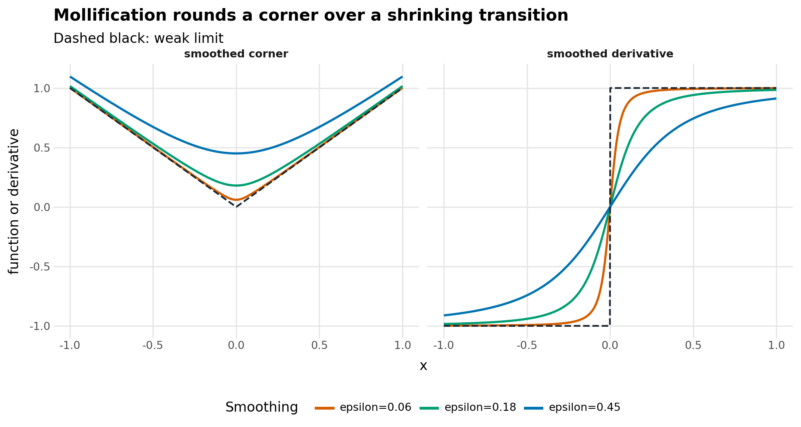

# Weak Derivatives and Sobolev Spaces {#sec-sobolev}

Classical derivatives fail at corners, jumps, and many limits of approximating
sequences. Weak derivatives move differentiation onto smooth test functions,
where integration by parts still makes sense. This enlarges the class of
differentiable functions while preserving enough structure for differential
equations.

**Prerequisites.** $L^p$ completeness and density from [sec-lp-convergence](21-lp-convergence.md#sec-lp-convergence),
multivariable derivatives from [sec-euclidean-differentiation](16-euclidean-differentiation.md#sec-euclidean-differentiation), and integration by
parts from [sec-riemann](08-riemann.md#sec-riemann).

## Test functions and distributions

Let $\Omega\subseteq\mathbb R^n$ be open. A **test function** is a smooth function
$\varphi\in C_c^\infty(\Omega)$: it has derivatives of every order and compact
support contained in $\Omega$. Compact support removes boundary terms when
integrating by parts.

A **distribution** $T$ is a linear functional on $C_c^\infty(\Omega)$ that is
continuous in the test-function topology. Concretely, suppose every $\varphi_k$ is supported in the same compact set $K\subset\Omega$.
If all derivatives of $\varphi_k$ tend uniformly to zero on $K$, then
$T(\varphi_k)\to0$.

Every locally integrable function $f$ defines the **regular distribution**

$$
T_f(\varphi)=\int_\Omega f(x)\varphi(x)\,dx.
$$

Two locally integrable functions define the same distribution exactly when they
agree almost everywhere.

Not every distribution is a function. The Dirac distribution at $a\in\Omega$ is

$$
\delta_a(\varphi)=\varphi(a).
$$

It is continuous on test functions but cannot be represented by a locally
integrable density with respect to Lebesgue measure.

For a multi-index $\alpha=(\alpha_1,\ldots,\alpha_n)$, define the distributional
derivative by

$$
D^\alpha T(\varphi)
=(-1)^{|\alpha|}T(D^\alpha\varphi).
$$

Every distribution has derivatives of every order. The definition is chosen so
that it agrees with repeated integration by parts for smooth functions.

## Weak derivatives

A locally integrable function $g$ is the **weak derivative**
$\partial_j f$ if

$$
\int_\Omega f\,\partial_j\varphi\,dx
=-\int_\Omega g\,\varphi\,dx
$$

for every $\varphi\in C_c^\infty(\Omega)$. Weak derivatives are unique almost
everywhere because a locally integrable function whose integral against every test
function vanishes is zero almost everywhere.

**Worked example 1.** On $(-1,1)$, $f(x)=|x|$ has weak derivative

$$
g(x)=
\begin{cases}
-1,&x<0,\\
1,&x>0.
\end{cases}
$$

Split the integral at zero and integrate by parts on both halves:

$$
\int_{-1}^1|x|\varphi'(x)\,dx
=-\int_{-1}^0(-1)\varphi(x)\,dx
-\int_0^11\varphi(x)\,dx.
$$

The boundary contributions at zero cancel because $|x|$ is continuous there.
The missing point value of $g$ is irrelevant.

For the step function $H_0$, the same calculation gives

$$
D H_0=\delta_0
$$

as a distribution. Since $\delta_0$ is not represented by an $L^p$ function, the
step has no weak first derivative in $L^p$. A jump creates a singular derivative;
a corner creates a bounded one.

**Worked example 2.** The function $f(x)=x_+=\max(x,0)$ has weak derivative
$1_{(0,\infty)}$. Its second distributional derivative is $\delta_0$. Thus the
order of differentiation determines whether the singularity remains within an
ordinary function class.

## First-order Sobolev spaces

For $1\le p\le\infty$, the Sobolev space

$$
W^{1,p}(\Omega)
=\{u\in L^p(\Omega):
\partial_j u\in L^p(\Omega)\text{ weakly for }j=1,\ldots,n\}
$$

has norm

$$
\|u\|_{W^{1,p}}
=\|u\|_p+\sum_{j=1}^n\|\partial_j u\|_p.
$$

Equivalent norms may combine the terms by a $p$th root. The space is complete.
Indeed, if $u_k$ and each $\partial_j u_k$ are Cauchy in $L^p$, let their limits be
$u$ and $g_j$. Passing to limits in

$$
\int u_k\partial_j\varphi=-\int(\partial_j u_k)\varphi
$$

using Hölder proves $g_j=\partial_j u$ weakly.

The subspace $W_0^{1,p}(\Omega)$ is the closure of
$C_c^\infty(\Omega)$ in the Sobolev norm. It encodes zero boundary values without
requiring every element to have pointwise boundary values.

**Worked example 3.** On $(-1,1)$, $|x|\in W^{1,p}$ for every
$1\le p\le\infty$, because both the function and its weak derivative are bounded.
The step function belongs to $L^p$ on the interval but not $W^{1,p}$ for any
$p\ge1$.

In one dimension, every $W^{1,1}(a,b)$ element has an absolutely continuous
representative satisfying

$$
u(x)=u(a)+\int_a^xu'(t)\,dt.
$$

In higher dimensions, Sobolev functions may not be continuous unless $p$ is large
enough relative to dimension. Pointwise language must therefore be used with
embedding theorems or suitable representatives.

## Approximation by smooth functions

Choose a nonnegative smooth function $\rho$ supported in the unit ball with
$\int\rho=1$, and set

$$
\rho_\varepsilon(x)=\varepsilon^{-n}\rho(x/\varepsilon).
$$

For locally integrable $u$, the convolution

$$
u_\varepsilon(x)
=(\rho_\varepsilon*u)(x)
=\int\rho_\varepsilon(y)u(x-y)\,dy
$$

is smooth wherever the averaging ball stays inside $\Omega$.

Weak differentiation commutes with mollification:

$$
\partial_j(u*\rho_\varepsilon)
=(\partial_j u)*\rho_\varepsilon
=u*(\partial_j\rho_\varepsilon).
$$

If $u\in W^{1,p}(\Omega)$ with $p<\infty$, local mollifications converge to $u$
and its weak derivatives in $L^p$ on compactly contained subdomains. A partition
of unity handles the whole domain. Under appropriate boundary regularity, smooth
functions on the closure are dense in $W^{1,p}$.

<figure id="fig-sobolev-mollification">


<figcaption>

Figure 23.1: Mollification rounds a corner while the smoothed derivatives converge to the weak derivative away from an increasingly narrow transition.

</figcaption>
</figure>

[Figure 23.1](#fig-sobolev-mollification) shows two kinds of convergence. The functions approach
the corner uniformly on a compact interval, while derivatives approach the sign
function in every finite $L^p$ norm but not uniformly: at the transition centre,
the derivative error remains large.

**Worked example 4.** Convolving $|x|$ with an even mollifier gives a smooth even
function. Its derivative is odd and changes continuously from near $-1$ to near
$1$ across a layer of width comparable to $\varepsilon$. The layer's measure
shrinks, so finite $L^p$ derivative error tends to zero.

## Poincaré inequalities and compactness

On an interval, if $u$ is absolutely continuous and has mean
$u_{(a,b)}=(b-a)^{-1}\int_a^bu$, then

$$
\|u-u_{(a,b)}\|_{L^p(a,b)}
\le(b-a)\|u'\|_{L^p(a,b)}.
$$

To see the mechanism, write
$u(x)-u(y)=\int_y^xu'(t)\,dt$, average in $y$, and use Hölder and Fubini. If
$u$ has zero boundary trace, the mean can be omitted:
$\|u\|_p\le C\|u'\|_p$.

Poincaré's inequality says that once constants are removed by a mean or boundary
condition, the derivative controls the whole function. It makes
$\|\nabla u\|_p$ an equivalent norm on $W_0^{1,p}$.

**Rellich–Kondrachov compactness, basic form.** If $\Omega$ is bounded with
sufficiently regular boundary and $1\le p<n$, bounded subsets of
$W^{1,p}(\Omega)$ are relatively compact in $L^q(\Omega)$ for
$1\le q<np/(n-p)$. At the endpoint and beyond, the precise statement changes.

Bounded derivatives prevent rapid translation and oscillation, while bounded
domains prevent mass from escaping to infinity. The theorem upgrades weak control
to strongly convergent subsequences in a lower norm, a central existence tool.

## Variational formulation of boundary-value problems

Consider

$$
-u''=f\quad\text{on }(0,1),
\qquad u(0)=u(1)=0.
$$

Multiply by a smooth test function $v$ vanishing at the boundary and integrate by
parts:

$$
\int_0^1u'v'\,dx=\int_0^1fv\,dx.
$$

A **weak solution** is $u\in W_0^{1,2}(0,1)$ satisfying this identity for every
$v$ in the same space. It requires only one weak derivative of $u$, whereas the
classical equation displays two.

The weak solution minimizes the energy

$$
J(u)=\frac12\int_0^1|u'|^2\,dx-\int_0^1fu\,dx.
$$

Poincaré and Cauchy–Schwarz show coercivity: $J(u)\to\infty$ as the Sobolev norm
does. A minimizing sequence is bounded; weak compactness supplies a candidate;
lower semicontinuity preserves the energy bound. Strict convexity gives uniqueness.
This is the direct method of the calculus of variations.

**Worked example 5.** For $f=1$, the classical solution
$u(x)=x(1-x)/2$ belongs to $W_0^{1,2}$ and satisfies

$$
\int_0^1u'v'\,dx=\int_0^1v\,dx
$$

by integration by parts. Uniqueness of the weak solution shows the classical and
variational answers coincide.

### One-dimensional embedding laboratory

On a bounded interval, every $u\in W^{1,p}(a,b)$ has an absolutely continuous
representative. For $p>1$, Hölder gives

$$
|u(x)-u(y)|
\le\int_x^y|u'(t)|\,dt
\le\|u'\|_p|x-y|^{1-1/p}.
$$

Thus bounded sets in $W^{1,p}$ share a Hölder modulus with exponent
$1-1/p$. They are equicontinuous once one value or the mean is controlled.
Arzelà–Ascoli then gives a uniformly convergent subsequence. This is a concrete
one-dimensional model of Sobolev embedding and compactness.

At $p=1$, the estimate becomes
$|u(x)-u(y)|\le\int_x^y|u'|$, which gives absolute continuity for each function
but not a common power-law modulus from an $L^1$ bound alone. Concentration of
derivatives can create increasingly sharp transitions.

The developed comparison in [Section 25.5.1](25-baire-ascoli.md#sec-primitive-compactness) proves a sufficient
endpoint repair using uniformly integrable weak derivatives. Its changed task
also shows why that condition is not necessary for compactness of the
absolutely continuous representatives in the supremum norm.

**Worked example 6.** Let $u_n(x)=\sqrt{x^2+1/n}$ on $[-1,1]$. Then

$$
u_n'(x)=\frac{x}{\sqrt{x^2+1/n}},
\qquad |u_n'|\le1.
$$

The sequence is bounded in $W^{1,p}$ for every finite $p$ and converges uniformly
to $|x|$. Its derivatives converge in $L^p$ to $\operatorname{sgn}(x)$.
The limit retains the weak derivative although classical differentiability fails
at one point. This is precisely the closure property for which Sobolev spaces were
designed.

<div class="callout callout-warning">
<p class="callout-title">Pitfalls</p>

- A distributional derivative always exists, but a Sobolev weak derivative must be
  represented by an $L^p$ function.
- Pointwise values and boundary values are not automatically defined for an
  $L^p$ equivalence class.
- Mollification near a boundary requires extension or a local construction.
- Boundedness in a Sobolev space gives compactness only under dimension, exponent,
  domain, and target-norm conditions.
- A weak solution is not a less correct solution; it solves an integrated equation
  with precisely stated test functions.

</div>

<!-- inline-formula-code:start -->
## Formula and finite computation

A useful formula in this chapter is

$$
\int u\varphi'=-\int v\varphi
$$

A discrete summation-by-parts identity models the sign in a weak derivative. The following standalone Python block expresses that finite rule with its inputs and stopping conditions visible.

```python
values = [0.0, 1.0, 4.0, 9.0, 16.0]
test = [0.0, 2.0, -1.0, 3.0, 0.0]
left = sum(values[i] * (test[i + 1] - test[i]) for i in range(4))
differences = [values[i] - values[i - 1] for i in range(1, 5)]
right = -sum(differences[i - 1] * test[i] for i in range(1, 5))
print(left, right)
```

**What the computation establishes.** The output certifies only the declared finite case. The theorem, if one is claimed, still requires the argument developed in the chapter.
<!-- inline-formula-code:end -->

## Exercises

<div class="exercise" id="real_analysis-23-sobolev-ex-1">
<p class="exercise-title"><strong>Exercise 1</strong></p>

Verify the weak derivative of $|x|$ directly.

<details class="solution"><summary>Solution</summary>

Split at zero; the two interior boundary terms cancel.

</details>

</div>

<div class="exercise" id="real_analysis-23-sobolev-ex-2">
<p class="exercise-title"><strong>Exercise 2</strong></p>

Compute the distributional derivative of $1_{(a,b)}$.

<details class="hint"><summary>Hint 1</summary>

Split the indicator integral and integrate the test-function derivative;
the two endpoints survive with opposite signs.

</details>

<details class="solution"><summary>Solution</summary>

It is $\delta_a-\delta_b$: test against $\varphi'$ and evaluate endpoints.

</details>

</div>

<div class="exercise" id="real_analysis-23-sobolev-ex-3">
<p class="exercise-title"><strong>Exercise 3</strong></p>

Show weak derivatives are unique almost everywhere.

<details class="solution"><summary>Solution</summary>

The difference integrates to zero against every test function; approximate
indicators or use the fundamental lemma.

</details>

</div>

<div class="exercise" id="real_analysis-23-sobolev-ex-4">
<p class="exercise-title"><strong>Exercise 4</strong></p>

Prove $W^{1,p}$ is a vector space and the displayed expression is a norm.

<details class="solution"><summary>Solution</summary>

Linearity of weak derivatives handles closure; norm zero forces $u=0$ almost
everywhere.

</details>

</div>

<div class="exercise" id="real_analysis-23-sobolev-ex-5">
<p class="exercise-title"><strong>Exercise 5</strong></p>

Show $u(x)=x^\alpha$ belongs to $W^{1,p}(0,1)$ exactly under the appropriate
integrability conditions on $u$ and $\alpha x^{\alpha-1}$.

<details class="solution"><summary>Solution</summary>

Require $\alpha p>-1$ and $(\alpha-1)p>-1$ when the coefficients are nonzero.

</details>

</div>

<div class="exercise" id="real_analysis-23-sobolev-ex-6">
<p class="exercise-title"><strong>Exercise 6</strong></p>

Prove the one-dimensional Poincaré inequality for $u(0)=0$.

<details class="hint"><summary>Hint 1</summary>

Write $u(x)=\int_0^xu'(t)\,dt$, apply Hölder, then integrate the resulting
pointwise estimate.

</details>

<details class="solution"><summary>Solution</summary>

$|u(x)|\le\int_0^1|u'|$; refine with Hölder and integrate in $x$.

</details>

</div>

<div class="exercise" id="real_analysis-23-sobolev-ex-7">
<p class="exercise-title"><strong>Exercise 7</strong></p>

Derive the weak formulation of $-\Delta u=f$ on a bounded domain with zero
boundary data.

<details class="solution"><summary>Solution</summary>

Multiply by $v\in W_0^{1,2}$ and integrate by parts to obtain
$\int\nabla u\cdot\nabla v=\int fv$.

</details>

</div>

<div class="exercise" id="real_analysis-23-sobolev-ex-8">
<p class="exercise-title"><strong>Exercise 8</strong></p>

Solve $-u''=1$, $u(0)=u(1)=0$, and compute its energy.

<details class="solution"><summary>Solution</summary>

$u=x(1-x)/2$; insert it into
$J(u)=\frac12\int|u'|^2-\int u$ to obtain $-1/24$.

</details>

</div>

### Answer support

1. Split at zero; the two interior boundary terms cancel.
2. It is $\delta_a-\delta_b$: test against $\varphi'$ and evaluate endpoints.
3. The difference integrates to zero against every test function; approximate
   indicators or use the fundamental lemma.
4. Linearity of weak derivatives handles closure; norm zero forces $u=0$ almost
   everywhere.
5. Require $\alpha p>-1$ and $(\alpha-1)p>-1$ when the coefficients are nonzero.
6. $|u(x)|\le\int_0^1|u'|$; refine with Hölder and integrate in $x$.
7. Multiply by $v\in W_0^{1,2}$ and integrate by parts to obtain
   $\int\nabla u\cdot\nabla v=\int fv$.
8. $u=x(1-x)/2$; insert it into
   $J(u)=\frac12\int|u'|^2-\int u$ to obtain $-1/24$.
