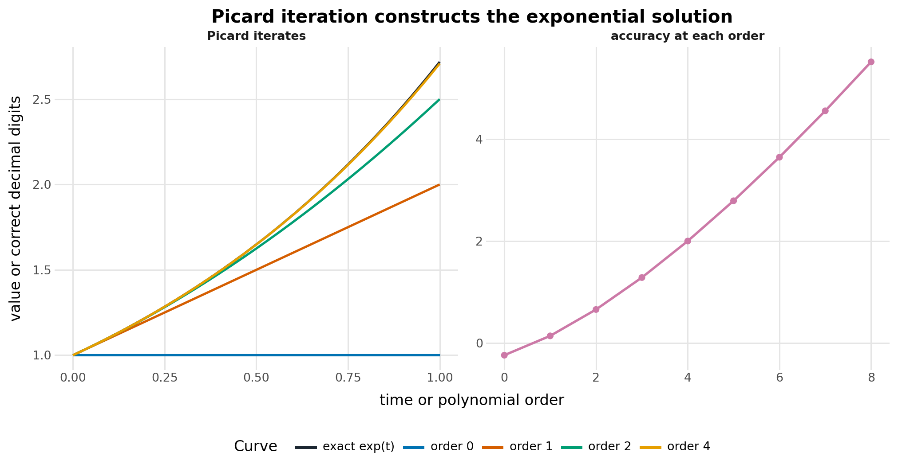

# Differential Equations Through Analysis {#sec-ode-analysis}

An ordinary differential equation prescribes a local rate but asks for a whole
function. Integration turns the equation into a fixed-point problem. Completeness
then constructs the function, a Lipschitz estimate gives uniqueness, and
Grönwall's inequality quantifies stability.

**Prerequisites.** The fundamental theorem from [sec-riemann](08-riemann.md#sec-riemann), uniform norms and the
contraction theorem from [sec-metric-spaces](10-metric-spaces.md#sec-metric-spaces), and multivariable derivatives from
[sec-euclidean-differentiation](16-euclidean-differentiation.md#sec-euclidean-differentiation).

## Integral reformulation of an initial-value problem

Consider

$$
y'(t)=f(t,y(t)),
\qquad
y(t_0)=y_0,
$$

where $y(t)\in\mathbb R^d$. If $y$ is continuously differentiable, the
fundamental theorem gives

$$
y(t)=y_0+\int_{t_0}^tf(s,y(s))\,ds.
$$

Conversely, if $f$ is continuous and a continuous $y$ satisfies this integral
equation, the fundamental theorem makes $y$ continuously differentiable and
recovers the differential equation. The two formulations are equivalent under
these hypotheses.

Define an operator on continuous functions by

$$
(Ty)(t)=y_0+\int_{t_0}^tf(s,y(s))\,ds.
$$

A solution is a fixed point of $T$. This reformulation packages the initial
condition automatically and replaces derivative control by integral estimates.

**Worked example 1.** For $y'=y$, $y(0)=1$, the operator is

$$
(Ty)(t)=1+\int_0^ty(s)\,ds.
$$

Starting from $y_0(t)=1$ gives

$$
y_1=1+t,\quad
y_2=1+t+\frac{t^2}{2},\quad
y_3=1+t+\frac{t^2}{2}+\frac{t^3}{6}.
$$

Picard iteration produces partial sums of $e^t$ before that closed form is
assumed.

The special operator $Ty=1+\int_0^t y(s)\,ds$ can be iterated directly on
polynomial coefficient arrays. Integration shifts each coefficient by one
degree and divides by its new exponent.

```python
def picard_exponential(iterations: int) -> list[float]:
    """Return coefficients of the requested Picard iterate for y'=y, y(0)=1."""
    if iterations < 0:
        raise ValueError("iterations must be nonnegative")
    coefficients = [1.0]
    for _ in range(iterations):
        coefficients = [1.0] + [
            coefficient / degree
            for degree, coefficient in enumerate(coefficients, start=1)
        ]
    return coefficients

coefficients = picard_exponential(5)
value_at_one = sum(coefficients)
print(coefficients)
print(value_at_one)
```

The coefficients are $1,1,1/2!,\ldots,1/5!$, exactly the fifth Picard
iterate, and their sum evaluates it at $t=1$. The contraction estimate below,
not the coefficient pattern alone, proves convergence to the unique solution.

## Picard iteration and local existence

Suppose $f$ is continuous on the rectangle

$$
R=\{(t,y):|t-t_0|\le a,\ \|y-y_0\|\le b\}
$$

and Lipschitz in $y$ there:

$$
\|f(t,y)-f(t,z)\|\le L\|y-z\|.
$$

Compactness gives $M=\sup_R\|f\|<\infty$. Choose

$$
h\le a,\qquad hM\le b,\qquad hL<1.
$$

Let $X$ be the closed ball of functions

$$
X=\{y\in C([t_0-h,t_0+h],\mathbb R^d):
\|y-y_0\|_\infty\le b\}.
$$

It is complete. The bound $hM\le b$ makes $T(X)\subseteq X$, and

$$
\|Ty-Tz\|_\infty
\le hL\|y-z\|_\infty
$$

makes $T$ a contraction.

**Theorem 24.1 (Picard–Lindelöf).** Under these continuity and local Lipschitz hypotheses,
the initial-value problem has a unique solution on a sufficiently short interval.
Picard iterates converge uniformly to it, with geometric error bounds inherited
from the contraction theorem.

Writing $q=hL<1$, the standard a priori contraction estimate is

$$
\|y-y_n\|_\infty
\le \frac{q^n}{1-q}\|y_1-y_0\|_\infty.
$$

The following function turns that symbolic certificate into a numerical stopping
test.  It does not sample the unknown solution: the bound follows from the proved
contraction constant and the first computed step.

```python
from math import isfinite

def picard_error_bound(
    contraction_factor: float,
    first_step_distance: float,
    iteration: int,
) -> float:
    """Bound the distance from a Picard iterate to the fixed point."""
    values = (contraction_factor, first_step_distance)
    if any(not isfinite(value) for value in values):
        raise ValueError("the contraction data must be finite")
    if not 0.0 <= contraction_factor < 1.0:
        raise ValueError("the contraction factor must lie in [0, 1)")
    if first_step_distance < 0.0 or iteration < 0:
        raise ValueError("distance and iteration must be nonnegative")
    return (
        contraction_factor**iteration
        * first_step_distance
        / (1.0 - contraction_factor)
    )

for step in range(1, 6):
    print(step, picard_error_bound(0.25, 0.4, step))
```

The output decreases by a factor of $1/4$ per iteration.  If $hL\ge1$, the
function refuses to report a geometric certificate; that failure does not prove
that the ODE lacks a solution, only that this particular contraction argument
does not certify one on the chosen interval.

The Lipschitz condition is local in $y$ and uniform over the chosen rectangle. A
continuous derivative $D_yf$ supplies it on compact rectangles via a mean-value
estimate.

<figure id="fig-picard">


<figcaption>

Figure 24.1: Picard iterates converge to an ODE solution while a shrinking geometric envelope bounds their error.

</figcaption>
</figure>

[Figure 24.1](#fig-picard) separates approximation from proof. The curves suggest convergence;
the invariant ball, Lipschitz constant, and complete function space certify it.

**Worked example 2.** For

$$
y'=t+y,\qquad y(0)=0,
$$

$f(t,y)=t+y$ is globally Lipschitz in $y$ with $L=1$. Picard iteration begins
$y_0=0$, $y_1=t^2/2$, and
$y_2=t^2/2+t^3/6$. Solving separately gives $y=e^t-t-1$, whose series confirms
the iterates.

Continuity of $f$ without Lipschitz continuity can give existence without
uniqueness. For

$$
y'=2\sqrt{|y|},\qquad y(0)=0,
$$

the zero solution and the delayed solutions

$$
y_c(t)=
\begin{cases}
0,&t\le c,\\
(t-c)^2,&t>c
\end{cases}
$$

all solve the equation for $c\ge0$. The square-root field is not Lipschitz at zero.

## Uniqueness via Grönwall's inequality

**Grönwall inequality.** If a nonnegative continuous function $u$ satisfies

$$
u(t)\le A+B\int_{t_0}^tu(s)\,ds
$$

for $t\ge t_0$, where $A,B\ge0$, then

$$
u(t)\le A e^{B(t-t_0)}.
$$

Let $v(t)=A+B\int_{t_0}^tu(s)\,ds$. Then $u\le v$ and
$v'\le Bv$. Multiplying by $e^{-B(t-t_0)}$ makes the derivative nonpositive,
so $v(t)\le Ae^{B(t-t_0)}$. A limiting argument handles $A=0$ cleanly.

If $y,z$ solve the same equation with the same initial data and $f$ is Lipschitz,

$$
\|y(t)-z(t)\|
\le L\int_{t_0}^t\|y(s)-z(s)\|\,ds.
$$

Grönwall with $A=0$ forces equality. Unlike the short-interval contraction proof,
this uniqueness argument works across any interval on which both solutions stay in
a common Lipschitz region.

**Worked example 3.** If $y'=a(t)y$ and $|a(t)|\le L$, then any two solutions
satisfy

$$
|y(t)-z(t)|\le|y(t_0)-z(t_0)|e^{L|t-t_0|}.
$$

The estimate quantifies possible amplification without requiring an explicit
solution.

## Continuation and maximal solutions

Local solutions can be joined because uniqueness makes overlapping pieces agree.
A solution has a **maximal interval of existence** $(\alpha,\beta)$ if it cannot
be extended past either endpoint as a solution in the domain of $f$.

**Continuation principle.** If $f$ is locally Lipschitz in $y$ on an open domain
$D\subseteq\mathbb R\times\mathbb R^d$ and a solution remains in a compact subset
of $D$ as $t\uparrow\beta<\infty$, then it extends beyond $\beta$.

On that compact set, $f$ is bounded, so $y$ is Lipschitz in time and has a limit
as $t\uparrow\beta$. The limit point remains inside $D$. Apply local existence
there and join the solutions by uniqueness. Therefore finite-time failure requires
the trajectory to leave every compact subset of the domain—by becoming unbounded
or approaching the domain boundary.

**Worked example 4.** The equation

$$
y'=y^2,\qquad y(0)=1
$$

has solution $y(t)=1/(1-t)$ on $(-\infty,1)$. It blows up as $t\uparrow1$, so it
cannot extend as a finite real solution. Smoothness of the vector field does not
guarantee global existence when growth is too fast.

By contrast, if $\|f(t,y)\|\le A+B\|y\|$ globally, Grönwall bounds solutions on
every finite time interval and prevents blow-up. Local solutions then continue
globally.

## Dependence on initial data

Let $y$ and $z$ solve the same $L$-Lipschitz equation with initial data $y_0$ and
$z_0$. Then

$$
\|y(t)-z(t)\|
\le\|y_0-z_0\|
+L\int_{t_0}^t\|y(s)-z(s)\|\,ds,
$$

so

$$
\|y(t)-z(t)\|
\le e^{L|t-t_0|}\|y_0-z_0\|.
$$

The solution map is locally Lipschitz in initial data on a common existence
interval.

If vector fields $f$ and $g$ differ by at most $\eta$ on the relevant region,
solutions with the same initial value satisfy

$$
\|y(t)-z(t)\|
\le\eta|t-t_0|e^{L|t-t_0|}.
$$

This separates model error from dynamical amplification.

**Worked example 5.** For $y'=-ky$ with $k>0$,

$$
|y(t)-z(t)|=e^{-k(t-t_0)}|y_0-z_0|.
$$

The general Grönwall upper bound with $L=k$ grows, so it is valid but not sharp.
Using the sign of the vector field reveals contraction. General estimates trade
sharpness for broad applicability.

## Fixed-point methods beyond ordinary differential equations

The same architecture appears whenever a differential problem can be converted to
an integral equation.

- A Volterra equation
  $u(t)=g(t)+\int_0^tK(t,s,u(s))\,ds$ is a contraction on a short interval when
  $K$ is Lipschitz in $u$.
- A boundary-value problem may become $u=g+G(F(u))$, where $G$ is a Green
  operator. A small Lipschitz factor yields a unique solution.
- Semilinear evolution equations can be written in mild form using a linear
  evolution operator and a time integral.
- Nonlinear elliptic equations often use compactness or monotone-operator methods
  when no contraction is available.

The choice of function space is part of the theorem. Its norm determines the
Lipschitz constant, completeness supplies the fixed point, and boundary or initial
conditions are built into the operator domain.

**Worked example 6.** For

$$
u(t)=g(t)+\lambda\int_0^t\cos(u(s))\,ds
$$

on $[0,T]$, the operator satisfies

$$
\|Tu-Tv\|_\infty\le|\lambda|T\|u-v\|_\infty.
$$

If $|\lambda|T<1$, it has a unique continuous fixed point. Differentiation then
gives $u'=g'+\lambda\cos u$ when $g$ is continuously differentiable.

### Energy and phase-line laboratory

Not every useful ODE estimate comes from a contraction. For the second-order
equation

$$
x''+V'(x)=0,
$$

multiply by $x'$ to obtain

$$
\frac{d}{dt}\left(\frac12|x'|^2+V(x)\right)=0.
$$

The **energy**
$E=\frac12|x'|^2+V(x)$ is conserved. If the sublevel set
$\{x:V(x)\le E\}$ is bounded, then both $x$ and $x'$ remain bounded, and the
continuation principle gives global existence. This converts an algebraic
invariant into a compactness bound.

**Worked example 7.** For the pendulum

$$
x''+\sin x=0,
$$

$V(x)=1-\cos x$ and

$$
E=\frac12|x'|^2+1-\cos x.
$$

When $E<2$, the trajectory cannot reach an odd multiple of $\pi$, where the
potential equals $2$; it oscillates in one well. When $E>2$, rotational motion is
possible. The energy identity classifies qualitative behaviour without solving
the nonlinear equation explicitly.

For a scalar autonomous equation $y'=f(y)$, a phase line records the sign of
$f$. Zeros are equilibria; sign arrows show monotonic motion. If
$f'(y_*)<0$, nearby trajectories are drawn toward $y_*$, while
$f'(y_*)>0$ indicates repulsion. This linear criterion is local and fails to
decide a degenerate equilibrium with $f'(y_*)=0$.

<div class="callout callout-warning">
<p class="callout-title">Pitfalls</p>

- A differential equation and its integral form are equivalent only under stated
  regularity.
- Continuity of the vector field gives no automatic uniqueness.
- Picard–Lindelöf is local; global existence needs continuation bounds.
- Smooth vector fields can still have finite-time blow-up.
- A Grönwall estimate may be non-sharp but remains useful for stability.
- Numerical iteration without an invariant domain or error estimate is evidence,
  not an existence proof.

</div>

<!-- inline-formula-code:start -->
## Formula and finite computation

A useful formula in this chapter is

$$
x_{n+1}=T(x_n),\qquad d(x_n,x^*)\le\frac{q^n}{1-q}d(x_1,x_0)
$$

The iteration returns both an approximation and an a posteriori contraction bound. The following standalone Python block expresses that finite rule with its inputs and stopping conditions visible.

```python
from math import cos

def contraction_fixed_point(
    initial: float, contraction_bound: float, tolerance: float = 1e-12
) -> tuple[float, int, float]:
    """Iterate cos(x) and return value, steps, and an a posteriori error bound."""
    if not 0.0 < contraction_bound < 1.0 or tolerance <= 0.0:
        raise ValueError("require 0 < contraction_bound < 1 and positive tolerance")
    previous = initial
    for step in range(1, 10_001):
        current = cos(previous)
        bound = contraction_bound * abs(current - previous) / (
            1.0 - contraction_bound
        )
        if bound <= tolerance:
            return current, step, bound
        previous = current
    raise RuntimeError("iteration did not meet the requested bound")

value, steps, bound = contraction_fixed_point(0.5, contraction_bound=0.85)
print(value, steps, bound, value - cos(value))
```

**What the computation establishes.** The calculation checks a declared finite instance; the surrounding argument explains what is true beyond those inputs.
<!-- inline-formula-code:end -->

## Exercises

<div class="exercise" id="real_analysis-24-ode-analysis-ex-1">
<p class="exercise-title"><strong>Exercise 1</strong></p>

Write $y'=t^2-y$, $y(0)=2$ as an integral equation.

<details class="solution"><summary>Solution</summary>

$y(t)=2+\int_0^t(s^2-y(s))\,ds$.

</details>

</div>

<div class="exercise" id="real_analysis-24-ode-analysis-ex-2">
<p class="exercise-title"><strong>Exercise 2</strong></p>

Compute the first three Picard iterates starting from the constant $2$.

<details class="solution"><summary>Solution</summary>

$y_0=2$,
$y_1=2+t^3/3-2t$, and
$y_2=2-2t+t^2+t^3/3-t^4/12$.

</details>

</div>

<div class="exercise" id="real_analysis-24-ode-analysis-ex-3">
<p class="exercise-title"><strong>Exercise 3</strong></p>

On a rectangle where $|D_yf|\le L$, prove the required Lipschitz estimate.

<details class="solution"><summary>Solution</summary>

Apply the multivariable mean-value estimate along the segment joining $y,z$.

</details>

</div>

<div class="exercise" id="real_analysis-24-ode-analysis-ex-4">
<p class="exercise-title"><strong>Exercise 4</strong></p>

Verify every delayed solution of $y'=2\sqrt{|y|}$ given above.

<details class="solution"><summary>Solution</summary>

Check each side classically and verify the derivative and value both match at
$t=c$.

</details>

</div>

<div class="exercise" id="real_analysis-24-ode-analysis-ex-5">
<p class="exercise-title"><strong>Exercise 5</strong></p>

Prove the integral form of Grönwall for $A=0$ by adding a positive
$\varepsilon$ and letting it decrease to zero.

<details class="hint"><summary>Hint 1</summary>

Apply the positive-$A$ Grönwall result with $A=\varepsilon$. The estimate
holds for every positive $\varepsilon$.

</details>

<details class="solution"><summary>Solution</summary>

Apply the proved positive-$A$ case to $u(t)\le\varepsilon+
B\int u$, then let $\varepsilon\downarrow0$.

</details>

</div>

<div class="exercise" id="real_analysis-24-ode-analysis-ex-6">
<p class="exercise-title"><strong>Exercise 6</strong></p>

Find the maximal interval for $y'=1+y^2$, $y(0)=0$.

<details class="solution"><summary>Solution</summary>

The solution is $\tan t$, with maximal interval
$(-\pi/2,\pi/2)$.

</details>

</div>

<div class="exercise" id="real_analysis-24-ode-analysis-ex-7">
<p class="exercise-title"><strong>Exercise 7</strong></p>

Show global existence when $|f(t,y)|\le A+B|y|$.

<details class="hint"><summary>Hint 1</summary>

Derive an a priori bound on $|y|$ over each finite interval before using
the continuation principle.

</details>

<details class="solution"><summary>Solution</summary>

The integral equation and Grönwall bound $|y(t)|$ on each finite interval;
continuation then prevents a finite endpoint.

</details>

</div>

<div class="exercise" id="real_analysis-24-ode-analysis-ex-8">
<p class="exercise-title"><strong>Exercise 8</strong></p>

For the Volterra equation in Worked example 6, give an a priori iteration error
bound in terms of $q=|\lambda|T$.

<details class="solution"><summary>Solution</summary>

Banach's estimate gives
$\|u_n-u^*\|_\infty\le q^n\|u_1-u_0\|_\infty/(1-q)$.

</details>

</div>

### Answer support

1. $y(t)=2+\int_0^t(s^2-y(s))\,ds$.
2. $y_0=2$,
   $y_1=2+t^3/3-2t$, and
   $y_2=2-2t+t^2+t^3/3-t^4/12$.
3. Apply the multivariable mean-value estimate along the segment joining $y,z$.
4. Check each side classically and verify the derivative and value both match at
   $t=c$.
5. Apply the proved positive-$A$ case to $u(t)\le\varepsilon+
   B\int u$, then let $\varepsilon\downarrow0$.
6. The solution is $\tan t$, with maximal interval
   $(-\pi/2,\pi/2)$.
7. The integral equation and Grönwall bound $|y(t)|$ on each finite interval;
   continuation then prevents a finite endpoint.
8. Banach's estimate gives
   $\|u_n-u^*\|_\infty\le q^n\|u_1-u_0\|_\infty/(1-q)$.
